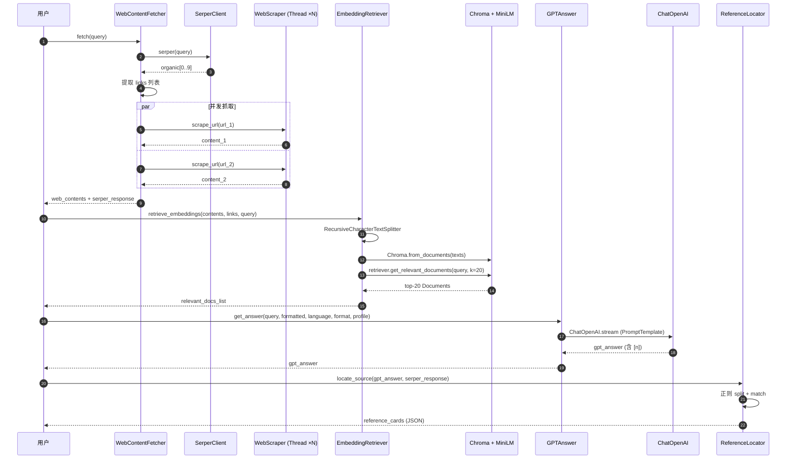

# 01 系统架构文档

> **文档目的**：从架构师视角描述 WebResearch 的整体结构、子系统划分、运行时数据流和部署拓扑。
>
> **目标读者**：架构师、新入职工程师、技术负责人。

---

## 1. 项目概述与定位

WebResearch 是一个**轻量级 RAG（检索增强生成）智能体项目**，包含两套互补的实现：

- **Pipeline 版**（`src/*.py`）：基于 Serper 搜索 + 简易爬虫 + OpenAI 嵌入/生成的极简流水线，适合快速验证 RAG 思路。
- **Notebook 版**（`RAG(Milvus+BGE).ipynb`）：基于 BGE-M3 + Milvus 的工业级混合检索 + 四模块 Agent（Plan/Memory/Tool/Answer），用于销售助手场景。

核心定位：
- **Pipeline 版**：以不到 200 行 Python 代码复现 WebGPT 风格的"搜索→抓取→检索→生成"全流程。
- **Notebook 版**：以"稠密向量 + 稀疏向量 + WeightedRanker 重排"的混合检索（Hybrid Search）演示工业级 RAG 的最佳实践。

## 2. 业务背景与核心场景

### 2.1 业务背景

LLM 存在两类经典局限：
1. **知识截止**：训练数据之外的事件 / 产品 / 公司无法回答；
2. **幻觉（Hallucination）**：在不确定的事实上可能给出貌似合理但错误的内容。

检索增强生成（**RAG, Retrieval-Augmented Generation**）通过"在生成前先从外部知识库中检索证据"缓解上述问题（`https://arxiv.org/abs/2005.11401`）。本项目用"Web 搜索结果"或"本地文档库"作为外部知识源。

### 2.2 核心场景

| 场景 | Pipeline 输入示例 | 期望输出 |
|------|------------------|----------|
| 新闻事件 | "What happened to Silicon Valley Bank" | 带引用 `[1][2]` 的回答 |
| 行业竞品对比 | "Compare Tencent vs NetEase in 2023" | 多源整合 + URL 引用 |
| 销售问答 | "星辰电动 ES9 的续航里程是多少？" | 基于本地 PDF 的精准回答 |
| 市场策略 | "华为汽车的主要优势" | 联网检索 + 引用 |

## 3. 系统总体架构

```
┌──────────────────────────────────────────────────────────────────────────────┐
│                              用户接入层                                       │
│   ┌──────────────┐    ┌──────────────┐    ┌──────────────┐                  │
│   │   CLI        │    │  Python SDK  │    │  Jupyter NB   │                  │
│   │ llm_answer.py│    │  各 .py 类   │    │  RAG.ipynb    │                  │
│   └──────┬───────┘    └──────┬───────┘    └──────┬───────┘                  │
└──────────┼──────────────────┼──────────────────┼───────────────────────────┘
           │                  │                  │
           └──────────────────┼──────────────────┘
                              ▼
┌──────────────────────────────────────────────────────────────────────────────┐
│                          协调层 (Orchestration)                              │
│   ┌─────────────────────────────────────────────────────────────────────┐    │
│   │  WebContentFetcher (fetch_web_content.py:6)                          │    │
│   │  • Serper 调度                                                      │    │
│   │  • 多线程爬虫并发                                                    │    │
│   │  • 内容长度阈值过滤                                                  │    │
│   └─────────────────────────────────────────────────────────────────────┘    │
└──────────────┬─────────────────────────────┬───────────────────────────────┘
               │                             │
               ▼                             ▼
┌─────────────────────────────┐  ┌──────────────────────────────────────────┐
│     检索层 (Retrieval)       │  │     生成层 (Generation)                  │
│   ┌─────────────────────┐   │  │   ┌──────────────────────────────┐      │
│   │ EmbeddingRetriever  │   │  │   │  GPTAnswer                   │      │
│   │ (retrieval.py:19)   │   │  │   │  (llm_answer.py:11)          │      │
│   │ • Chroma 向量库     │   │  │   │  • PromptTemplate 组装        │      │
│   │ • RecursiveChunk     │   │  │   │  • ChatOpenAI 流式输出        │      │
│   │ • top-k=20 召回      │   │  │   └──────────────────────────────┘      │
│   └─────────────────────┘   │  │                                          │
│   ┌─────────────────────┐   │  │   ┌──────────────────────────────┐      │
│   │ Milvus Hybrid Search│   │  │   │  ReferenceLocator             │      │
│   │ (Notebook)           │   │  │   │  (locate_reference.py:4)     │      │
│   │ • BGE-M3 dense+sparse│   │  │   │  • 正则提取 [n] 引用           │      │
│   │ • WeightedRanker     │   │  │   │  • 反向匹配 URL + 元数据      │      │
│   └─────────────────────┘   │  │   └──────────────────────────────┘      │
└─────────────────────────────┘  └──────────────────────────────────────────┘
                                │
                               ▼
┌──────────────────────────────────────────────────────────────────────────────┐
│                              基础设施层                                       │
│   ┌──────────┐   ┌──────────┐   ┌──────────┐   ┌──────────────┐              │
│   │ Serper   │   │ OpenAI   │   │ Chroma   │   │ Milvus       │              │
│   │ Search   │   │ GPT-4o   │   │ + MiniLM │   │ Lite + BGE-M3│              │
│   │ API      │   │ 兼容协议 │   │ L6       │   │ (Notebook)   │              │
│   └──────────┘   └──────────┘   └──────────┘   └──────────────┘              │
│   ┌──────────┐   ┌──────────┐   ┌──────────┐                                │
│   │ BeautifulSoup│ requests │   │ LlamaParse│                                │
│   │ + lxml    │   │ HTTP 库  │   │ (Notebook)│                                │
│   └──────────┘   └──────────┘   └──────────┘                                │
└──────────────────────────────────────────────────────────────────────────────┘
```

### 3.2 关键子系统划分

| 子系统 | 路径 | 职责 |
|--------|------|------|
| 搜索 | `src/serper_service.py` | 封装 Serper API，中英文地域自动判断 |
| 抓取 | `src/web_crawler.py` | HTML 请求、解析、主内容提取 |
| 协调 | `src/fetch_web_content.py` | 搜索+并发抓取的胶水代码 |
| 检索（Pipeline） | `src/retrieval.py` | Chroma + MiniLM-L6 召回 top-20 |
| 检索（Notebook） | `RAG(Milvus+BGE).ipynb` cell18-23 | BGE-M3 + Milvus 稠密+稀疏混合 |
| 生成 | `src/llm_answer.py` | 组装 Prompt，ChatOpenAI 流式生成 |
| 引用定位 | `src/locate_reference.py` | 正则解析 GPT 答案，匹配 URL 元数据 |
| 配置 | `src/config/config.yaml` | API Key、Prompt模板、模型名 |

### 3.3 部署拓扑

```
┌──────────────────────────────────────────┐
│              Host Machine                │
│  ┌────────────────────────────────────┐  │
│  │  Python 进程 / Jupyter Kernel      │  │
│  │   ├── WebContentFetcher             │  │
│  │   │   ├── SerperClient (HTTPS)     │  │
│  │   │   └── N × WebScraper (Thread)  │  │
│  │   ├── EmbeddingRetriever           │  │
│  │   │   └── Chroma (内存)             │  │
│  │   ├── GPTAnswer (ChatOpenAI)        │  │
│  │   └── ReferenceLocator              │  │
│  │                                     │  │
│  │  Notebook:                          │  │
│  │   ├── LlamaParse (PDF → MD)         │  │
│  │   ├── BGEM3EmbeddingFunction       │  │
│  │   ├── pymilvus (本地 Lite 实例)     │  │
│  │   └── Sales Agent (Plan/Memory/...) │  │
│  └────────────────────────────────────┘  │
│           │                  │            │
│           ▼                  ▼            │
│  ┌──────────────┐  ┌────────────────┐    │
│  │  OpenAI API   │  │   Serper API    │    │
│  │   (HTTPS)     │  │   (HTTPS)       │    │
│  └──────────────┘  └────────────────┘    │
│  ┌──────────────┐  ┌────────────────┐    │
│  │  HuggingFace │  │  DashScope      │    │
│  │  bge-m3 模型 │  │  qwen/deepseek  │    │
│  └──────────────┘  └────────────────┘    │
└──────────────────────────────────────────┘
```

**并发模型**：
- Pipeline：`threading.Thread` 为每个 URL 开一个线程（见 `fetch_web_content.py:53`）；
- Notebook：`BGEM3EmbeddingFunction` 单线程向量化；Milvus Hybrid Search 由服务端调度。

## 4. 核心数据流（端到端时序）

### 4.1 主链路数据流

```
用户 ──┐
       │ ① query 字符串
       ▼
WebContentFetcher(query).fetch()
       │ ② Serper API
       ▼
serper_results (organic[0..9])
       │ ③ 提取 links
       ▼
url_list[0..9]
       │ ④ 多线程抓取（每 URL 一个 Thread）
       ▼
web_contents[i] (主内容字符串)
       │ ⑤ + serper_response（元数据）
       ▼
EmbeddingRetriever.retrieve_embeddings()
       │ ⑥ RecursiveCharacterTextSplitter (chunk=1000)
       ▼
texts (Document列表)
       │ ⑦ Chroma.from_documents + MiniLM-L6
       ▼
Chroma 向量库（内存）
       │ ⑧ retriever.get_relevant_documents(query, k=20)
       ▼
relevant_docs_list
       │ ⑨ GPTAnswer._format_reference (TOP_K=10)
       ▼
formatted_reference
       │ ⑩ ChatOpenAI.stream (gpt-4o)
       ▼
gpt_answer (含 [n] 引用)
       │ ⑪ ReferenceLocator.locate_source
       ▼
reference_cards (JSON：titles/snippets/url/source)
```

### 4.2 时序图



## 5. 关键时序子流程

### 5.1 Pipeline 版抓取流程

```
WebContentFetcher.fetch()
 │
   ├─ _serper_launcher()
   │     └─ SerperClient.serper(query) → serper_response
   │     └─ SerperClient.extract_components → {titles, links, snippets}
   │
   ├─ _crawl_threads_launcher(url_list)
   │     └─ 为每个 URL 启动一个 Thread
   │     └─ 每个 Thread:
   │           ├─ WebScraper.scrape_url(url, rule=0)
   │           ├─ 若 len(content) < 800 → 重新抓取 rule=1
   │           └─ 若 len(content) > 300 → 加入 web_contents（thread-safe）
   │
   └─ 重新排序：按 url_list 顺序构造 ordered_contents
```

### 5.2 Notebook 销售 Agent 流程

```
final_answer(user_query)
   │
   ├─ agent_plan(query) ───── qwen-plus ─→ JSON：[{"action_name", "prompts"}]
   │
   ├─ memory_global = []  (全局记忆)
   │
   ├─ for plan_item in plan:
   │     if plan_item.action_name == "本地文档搜索":
   │         for prompt in plan_item.prompts:
   │             docs = retrieval(prompt)            # Milvus Hybrid Search
   │             memory_global.extend(docs)
   │
   │     elif plan_item.action_name == "网络搜索":
   │         for prompt in plan_item.prompts:
   │             docs = web_search(prompt)           # Serper + 多线程抓取
   │             memory_global.extend(docs)
   │
   ├─ final_prompt = """基于参考内容 + 销售话术"""
   │
   └─ completion = client.chat.completions.create(
            model="deepseek-r1", stream=True) # 流式 + 思考过程
```

## 6. 关键技术选型概览

| 维度 | Pipeline 选型 | Notebook 选型 |
|------|---------------|----------------|
| 搜索 | Serper.dev (Google) | Serper.dev (同上) |
| 抓取 | requests + BeautifulSoup | LlamaParse (PDF) |
| 切分 | LangChain RecursiveCharacterTextSplitter (1000/0) | 自定义 chunk_text (300 行级) |
| Embedding | sentence-transformers/all-MiniLM-L6-v2 | BAAI/bge-m3 (稠密+稀疏) |
| 向量库 | Chroma (内存) | Milvus Lite (本地) |
| 检索 | 向量余弦 top-k=20 | WeightedRanker (sparse=0.7, dense=1.0) |
| LLM | OpenAI gpt-4o | 阿里云 DashScope (qwen-plus + deepseek-r1) |
| Agent | 线性流水线 | Plan/Memory/Tool/Answer 四模块 |
| 流式 | StreamingStdOutCallbackHandler | chunk.reasoning_content + content |

## 7. 性能 / 可靠性 / 扩展性架构考量

### 7.1 性能
- **并发抓取**：`threading.Thread` 为每个 URL 开独立线程（`fetch_web_content.py:53`），10 个 URL 总耗时 ≈ 单 URL 最慢耗时。
- **两段式抓取**：第一次 `rule=0`（仅 h/p 标签），若 < 800 字符则升级到 `rule=1`（含 div）以扩大覆盖（`fetch_web_content.py:26-28`）。
- **内容阈值过滤**：< 300 字符的内容直接丢弃（`fetch_web_content.py:30`），避免噪声。

### 7.2 可靠性
- **超时控制**：HTTP 请求 8 秒超时（`web_crawler.py:40`）；失败的 URL 进入 `error_urls` 列表。
- **PDF 跳过**：URL 以 `.pdf` 结尾时直接跳过，避免下载大文件（`web_crawler.py:34-36`）。
- **线程安全**：`threading.Lock` 保护 `web_contents` 和 `error_urls`（`fetch_web_content.py:12-13`）。

### 7.3 扩展性
- **新增嵌入模型**：`retrieval.py:43` 直接替换 `SentenceTransformerEmbeddings(model_name=...)` 即可。
- **新增检索源**：`EmbeddingRetriever` 接受任意文本列表，可扩展为本地 PDF 索引。
- **替换 LLM**：OpenAI 兼容协议下，修改 `config.yaml` 的 `model_name` 即可。
- **Notebook 模块化**：Plan/Memory/Tool/Answer 是独立函数，可单独替换。

## 8. 本章设计原理与依据

### 原理 1：RAG（Retrieval-Augmented Generation）范式

- **核心思想**：将"知识检索"与"答案生成"解耦——先生成检索查询，再让 LLM 基于检索到的证据作答，从而缓解知识截止与幻觉。
- **在本项目中的体现**：Pipeline 版以 `Serper → WebScraper → Chroma → ChatOpenAI` 四步实现完整 RAG；Notebook 版以 `BGE-M3 → Milvus → deepseek-r1` 实现工业级 RAG。
- **为什么有效**：Lewis et al. (NeurIPS 2020) 在原始 RAG 论文中证明，相对于纯参数化模型（BART-large），RAG 在 Open-Domain QA 任务上将 Exact Match 提升 8.5~15.4 个百分点（`https://arxiv.org/abs/2005.11401`）。
- **佐证来源**：
  - [论文] Retrieval-Augmented Generation for Knowledge-Intensive NLP Tasks — Lewis et al., NeurIPS 2020
  - [官方] OpenAI Chat Completions API

### 原理 2：稠密+稀疏混合检索（Hybrid Search）

- **核心思想**：同时使用稠密向量（语义匹配）与稀疏向量（关键词匹配）做召回，再用加权重排（WeightedRanker）合并结果，兼顾语义相似与精确词命中。
- **在本项目中的体现**：Notebook cell 22 `hybrid_search()`（`RAG(Milvus+BGE).ipynb:2671-2691`）使用 `WeightedRanker(sparse_weight=0.7, dense_weight=1.0)`。
- **为什么有效**：Milvus 官方文档指出，Hybrid Search 在大多数场景下召回质量优于纯稠密或纯稀疏检索（`https://milvus.io/docs/hybrid_search.md`）；BGE-M3 同时输出稠密+稀疏，避免维护两套模型。
- **佐证来源**：
  - [官方] Milvus Hybrid Search
  - [论文] BGE M3-Embedding — Chen et al., 2024

### 原理 3：多线程并发抓取

- **核心思想**：对 N 个独立 URL 的网络请求使用线程池，让总耗时 ≈ max(t_i) 而非 Σt_i。
- **在本项目中的体现**：`fetch_web_content.py:51-58` 为每个 URL 启动独立 `threading.Thread`，配合 `thread.join()` 等待。
- **为什么有效**：I/O 密集型任务在 Python 中受 GIL 限制，但网络 I/O 阻塞时 GIL 被释放，线程可真实并发。
- **佐证来源**：
  - [官方] threading — Python Docs
  - [博客] Understanding the Python GIL — David Beazley

### 原理 4：基于引用（Citation）的可追溯生成

- **核心思想**：要求 LLM 在答案中显式标注 `[n]` 引用，事后用正则解析回填原文片段与元数据，让用户能追溯每一个事实。
- **在本项目中的体现**：`config.yaml:8-13` 的 Prompt 要求 LLM 输出 `[1] URL: ... Quoted sentence: ...`；`locate_reference.py` 的三段式正则解析（句子、索引、引用块）。
- **为什么有效**：RAG 的本质是"基于证据回答"，而引用是 LLM 与检索证据建立显式关联的最直接机制；This is exactly what WebGPT / Bing Chat / Perplexity 都采用。
- **佐证来源**：
  - [博客] WebGPT: Browser-assisted question-answering with human feedback — OpenAI, 2021
  - [官方] Prompt Engineering Guide — Citations

### 原理 5：双版本实现（Pipeline + Notebook）

- **核心思想**：同一项目提供"极简 Pipeline 版"与"工业级 Notebook 版"两种实现，前者用于学习/快速验证，后者用于生产/复现论文。
- **在本项目中的体现**：`src/*.py` 提供 6 个 Python 文件的极简流水线；`RAG(Milvus+BGE).ipynb` 提供 BGE-M3 + Milvus + 四模块 Agent 的完整演示。
- **为什么有效**：教学项目分层实现降低理解门槛；Notebook 适合实验与论文复现，脚本适合集成与 CI/CD。
- **佐证来源**：
  - [博客] Software Architecture Patterns — Mark Richards

### 原理 6：基于 `[n]` 标记的引用体系

- **核心思想**：用简单的 `[n]` 括号编号作为"答案与证据"的桥接符号；编号在 Prompt 中明确定义，事后用正则解析。
- **在本项目中的体现**：`config.yaml:8-13` 定义输出格式；`llm_answer.py:36-45` 的 `_rearrange_index()` 处理"同一 URL 多处引用"的索引去重。
- **为什么有效**：相比要求 LLM 输出完整 URL，`[n]` 编号大幅减少 LLM 输出长度，降低幻觉概率；同时便于程序化解析。
- **佐证来源**：
  - [博客] Prompt Engineering for Citation Generation — Lilian Weng
  - [官方] Markdown Reference Syntax — CommonMark

### 原理 7：流式输出（Streaming）改善长答案体验

- **核心思想**：让 LLM 在生成 token 的同时流式推送到终端/前端，减少"等待黑屏时间"。
- **在本项目中的体现**：`llm_answer.py:49` 使用 `ChatOpenAI(streaming=True, callbacks=[StreamingStdOutCallbackHandler()])`；Notebook cell 4310-4345 使用 `stream=True` 并区分 `reasoning_content` 与 `content`。
- **为什么有效**：OpenAI 官方推荐流式输出（`https://platform.openai.com/docs/api-reference/chat/streaming`）；推理模型（如 DeepSeek-R1）的思考过程 + 答案分开流式输出，可让用户看到模型"想的过程"。
- **佐证来源**：
  - [官方] OpenAI Streaming
  - [博客] DeepSeek-R1 推理能力 — DeepSeek API Docs
