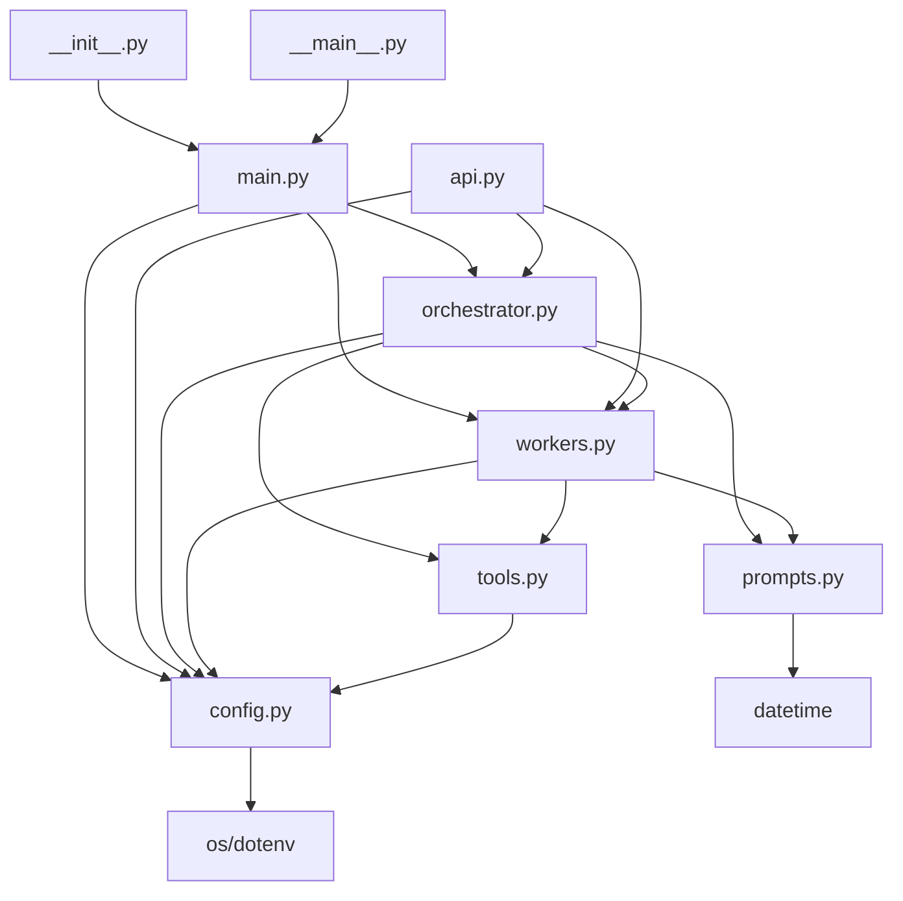

# 05 模块文档

> **文档目的**：从贡献者视角描述每个模块（文件）的职责、对外接口、依赖关系、扩展点。
>
> **目标读者**：项目贡献者、二次开发者。

---

## 1. 模块拓扑图

```
                       ┌─────────────────────────────┐
                       │        __init__.py          │
                       │  导出 DeepResearchAgent      │
                       └────────────┬────────────────┘
                                    │ 暴露给外部
              ┌─────────────────────┼─────────────────────┐
              ▼                     ▼                     ▼
       ┌─────────────────┐  ┌──────────────┐   ┌──────────────────┐
       │   __main__.py   │  │   main.py    │   │     api.py       │
       │  CLI 入口代理    │  │ SDK + CLI    │   │   FastAPI 服务   │
       └────────┬────────┘  └──────┬───────┘   └────────┬─────────┘
                │                  │                    │
                │                  ▼                    │
                │           ┌──────────────────┐         │
                └──────────▶│  orchestrator.py │◀────────┘
                            │  Lead Agent 编排 │
                            └────────┬─────────┘
                                     │
                       ┌─────────────┼─────────────┐
                       ▼             ▼             ▼
                ┌────────────┐ ┌──────────┐ ┌─────────────┐
                │ workers.py │ │ config.py│ │ prompts.py  │
                │ SubAgent   │ │ 全局配置  │ │ 提示词集合  │
                └─────┬──────┘ └──────────┘ └─────────────┘
                      │
                      ▼
              ┌──────────────┐
              │  tools.py    │
              │ LLM/搜索客户端│
              └──────────────┘
```

## 2. 模块清单

| # | 模块 | 文件 | 行数 | 职责 | 对外接口 | 依赖 |
|---|------|------|------|------|----------|------|
| 1 | 包入口 | `__init__.py` | 19 | 暴露 DeepResearchAgent 类 | `DeepResearchAgent` | main.py |
| 2 | 模块入口 | `__main__.py` | 9 | 支持 `python -m` 调用 | `main()` 函数 | main.py |
| 3 | SDK + CLI | `main.py` | 461 | 同步/流式 SDK、CLI 参数解析、ConsoleReporter | `DeepResearchAgent`、CLI | orchestrator.py, workers.py, config.py |
| 4 | HTTP 服务 | `api.py` | 483 | FastAPI 应用、REST + SSE、TaskManager | `/research/*` HTTP 接口 | orchestrator.py, workers.py, config.py |
| 5 | 编排器 | `orchestrator.py` | 964 | Lead Agent：任务拆解、调度、迭代、质量控制 | `Orchestrator` 类 | tools.py, prompts.py, config.py, workers.py |
| 6 | Worker | `workers.py` | 771 | SubAgent：SearchWorker 等 4 种 Worker | `BaseWorker`、`SearchWorker`、`WriterWorker`、`AnalysisWorker`、`VisualizationWorker`、`WorkerFactory`、`search_worker_factory` | tools.py, prompts.py, config.py |
| 7 | 工具层 | `tools.py` | 365 | LLM / Search / 解析辅助 | `LLMClient`、`SearchClient`、`extract_json`、`extract_xml`、`format_search_context`、`get_llm_client`、`get_search_client` | config.py, openai, requests |
| 8 | 提示词 | `prompts.py` | 936 | 7 大类提示词模板 | 12+ 提示词常量 | datetime |
| 9 | 配置 | `config.py` | 117 | 5 个全局配置字典 | `LLM_CONFIG`、`SEARCH_CONFIG`、`AGENT_CONFIG`、`LOG_CONFIG`、`OUTPUT_CONFIG` | os, dotenv |

## 3. 逐模块详解

### 3.1 模块 1: `__init__.py`

**职责**：作为 Python 包入口，导出核心类。

**对外接口**：

```python
from .main import DeepResearchAgent
__version__ = "1.0.0"
__all__ = ["DeepResearchAgent"]
```

**本模块设计原理与依据**：

- **原理：包入口最小化**
  - 核心思想：包入口应只暴露最常用的对象，避免污染命名空间。
  - 本项目中：仅暴露 `DeepResearchAgent` 类，内部类（如 `Orchestrator`、`SearchWorker`）通过 `from deep_research.orchestrator import ...` 显式导入。
  - 为什么有效：清晰的公共 API 边界；避免用户误用内部类。

### 3.2 模块 2: `__main__.py`

**职责**：支持 `python -m deep_research` 调用。

**实现**：

```python
from .main import main

if __name__ == "__main__":
    main()
```

**依赖**：`main.py`

**本模块设计原理与依据**：

- **原理：Python 模块协议**
  - 核心思想：通过 `__main__.py` 让包支持 `python -m` 调用。
  - 为什么有效：让用户可以使用模块路径而非文件路径调用，符合 PEP 338 规范。

### 3.3 模块 3: `main.py`

**职责**：对外 SDK 入口与 CLI 实现。

**关键类/函数**：

- `ConsoleReporter`（`main.py:20`）：控制台进度报告器
- `DeepResearchAgent`（`main.py:206`）：SDK 主类
- `main()`（`main.py:393`）：CLI 入口函数

#### `ConsoleReporter`

```python
class ConsoleReporter:
    """控制台进度报告器"""

    COLORS = {...}              # ANSI 颜色码
    STAGE_ICONS = {...}         # 各阶段 emoji 图标

    def __init__(self, verbose: bool = True):
        self.verbose = verbose
        self.start_time = time.time()

    def _color(self, text, color) -> str: ...
    def _elapsed(self) -> str: ...
    def report(self, stage: str, data: dict): ...
```

**职责**：将 Orchestrator 发出的 30+ 进度事件渲染为带 emoji、颜色、耗时的命令行输出。

**本模块设计原理与依据**：

- **原理：关注点分离**
  - 核心思想：将"渲染"职责从 Orchestrator 中抽出。
  - 为什么有效：Orchestrator 不必关心 UI 是 CLI 还是 Web；同一份回调可用于任意上层。

- **原理：ANSI 颜色降级**
  - 核心思想：使用 ANSI 颜色码，依赖终端支持；不支持时无副作用。
  - 为什么有效：跨平台兼容性最好；不需要 colorama 等第三方库。

#### `DeepResearchAgent`

**对外接口**：

```python
class DeepResearchAgent:
    def __init__(self, verbose=True, save_output=True, output_dir=None): ...
    def research(self, task, max_workers=None, callback=None) -> str: ...
    def research_stream(self, task, max_workers=None) -> Generator: ...
    def _print_header(self, task): ...
    def _print_footer(self, state): ...
    def _save_output(self, state): ...
```

**内部组件**：
- `self.reporter`：ConsoleReporter 实例
- `self.verbose` / `self.save_output` / `self.output_dir`：配置参数

**依赖**：`orchestrator.py`（Orchestrator、ResearchState）、`workers.py`（search_worker_factory）、`config.py`（AGENT_CONFIG、OUTPUT_CONFIG）

**本模块设计原理与依据**：

- **原理：Facade 模式**
  - 核心思想：为复杂的子系统（Orchestrator + Workers + Tools）提供统一的高层接口。
  - 为什么有效：用户只需调用 `research()`，无需了解内部编排细节。

- **原理：生成器（Generator）模式**
  - 核心思想：`research_stream` 用 yield 实现流式输出。
  - 为什么有效：Pythonic 的流式 API；无需回调，调用方用 for 循环自然处理。

- **原理：单一职责**
  - 核心思想：DeepResearchAgent 负责"组装 Orchestrator + 处理输出"，不直接实现研究逻辑。
  - 为什么有效：便于替换 Orchestrator 实现（如未来接 LangGraph）。

#### `main()` CLI

**职责**：解析命令行参数，构造 DeepResearchAgent，执行研究。

**关键设计**：
- 使用 `argparse.RawDescriptionHelpFormatter` 保留 epilog 换行；
- `--quiet` 反转 `verbose`；
- `--no-save` 反转 `save_output`。

### 3.4 模块 4: `api.py`

**职责**：基于 FastAPI 暴露 HTTP API + SSE 流式接口。

**关键类/函数**：

- `ResearchRequest` / `ResearchResponse` / `TaskStatus` / `TaskResult`：Pydantic 模型
- `TaskManager`：任务管理器
- `run_research_task(task_id, request)`：后台执行研究
- `app`：FastAPI 应用实例
- 多个路由函数（`root`、`health_check`、`submit_research` 等）

#### `TaskManager`

```python
class TaskManager:
    def __init__(self):
        self.tasks: Dict[str, Dict[str, Any]] = {}
        self.executor = ThreadPoolExecutor(max_workers=3)
```

**职责**：管理多个研究任务的生命周期。

**关键方法**：
- `create_task(request)`：创建任务，返回 task_id
- `get_task(task_id)`：获取任务
- `update_progress(task_id, stage, data)`：更新进度
- `set_running` / `set_completed` / `set_failed`：状态变更
- `list_tasks()`：列出所有任务

**本模块设计原理与依据**：

- **原理：内存数据库**
  - 核心思想：用 `dict` 暂存所有任务状态，简单且足够（开发阶段）。
  - 为什么有效：避免引入外部数据库依赖；重启后清空（开发阶段可接受）。
  - 局限：内存泄漏风险（任务数据常驻）；不支持分布式；不持久化。

- **原理：UUID 短码作为 Task ID**
  - 核心思想：使用 `uuid.uuid4()[:8]` 生成 8 位短 ID，便于人工识别。
  - 为什么有效：避免完整 UUID（36 位）过长。

- **原理：临时修改全局配置**
  - 核心思想：通过修改 `AGENT_CONFIG` 字典实现请求级参数覆盖。
  - 局限：存在竞态风险（多并发请求相互覆盖），应改为实例级配置对象。

#### 路由列表

| 路由 | 方法 | 功能 | 行号 |
|------|------|------|------|
| `/` | GET | 服务信息 | api.py:259 |
| `/health` | GET | 健康检查 | api.py:277 |
| `/research` | POST | 提交任务 | api.py:283 |
| `/research` | GET | 列出任务 | api.py:315 |
| `/research/{task_id}` | GET | 查询状态 | api.py:324 |
| `/research/{task_id}/result` | GET | 获取结果 | api.py:349 |
| `/research/{task_id}/stream` | GET | SSE 流式 | api.py:389 |
| `/research/{task_id}` | DELETE | 删除任务 | api.py:454 |

### 3.5 模块 5: `orchestrator.py`

**职责**：Lead Agent 核心编排逻辑。

**关键类**：

- 数据类：`SubTask`、`QueryTypeAnalysis`、`TaskPlan`、`IterationRecord`、`ResearchState`
- 核心类：`Orchestrator`

**关键方法**：

| 方法 | 职责 | 触发阶段事件 |
|------|------|--------------|
| `decompose_task` | 任务拆解 | `decomposing`、`decomposed` |
| `dispatch_workers` | 并行调度 | `dispatching`、`worker_started`、`worker_completed`、`worker_failed` |
| `synthesize_results` | 综合报告 | `synthesizing`、`synthesized` |
| `check_quality` | 质量评估 | `quality_checking`、`quality_checked` |
| `check_diminishing_returns` | 收益递减 | - |
| `analyze_gaps` | 差距分析 | `analyzing_gaps`、`gaps_analyzed` |
| `dispatch_supplementary_workers` | 补充调度 | `dispatching_supplementary`、`supplementary_worker_*` |
| `refine_report` | 报告修订 | `refining_report`、`report_refined` |
| `run` | **主流程** | 全部事件 |

**本模块设计原理与依据**：

- **原理：状态机驱动主流程**
  - 核心思想：`ResearchState.status` 字段贯穿整个流程，状态转移即业务进展。
  - 为什么有效：便于追踪、调试、回放。

- **原理：辅助方法职责单一**
  - 核心思想：每个方法只做一件事，便于单元测试。
  - 为什么有效：例如 `dispatch_workers` 只负责调度，不做拆解或汇总。

- **原理：进度事件粒度**
  - 核心思想：每个方法发出 1~3 个事件，覆盖"开始 / 结束 / 失败"全流程。
  - 为什么有效：前端可针对性渲染；日志可分级。

### 3.6 模块 6: `workers.py`

**职责**：SubAgent 实现。

**关键类**：

| 类 | 行号 | 职责 |
|----|------|------|
| `OODACycle` | 43 | OODA 循环记录 |
| `SourceQualityAssessment` | 53 | 来源质量评估 |
| `ResearchBudget` | 61 | 研究预算（含 property） |
| `BaseWorker` | 79 | 抽象基类 |
| `SearchWorker` | 94 | 搜索 Worker（核心） |
| `WriterWorker` | 527 | 写作 Worker |
| `AnalysisWorker` | 581 | 分析 Worker |
| `VisualizationWorker` | 649 | 可视化 Worker |
| `WorkerFactory` | 738 | 工厂类 |

**对外接口**：

```python
def search_worker_factory() -> SearchWorker: ...   # 默认工厂

class WorkerFactory:
    @staticmethod
    def create_search_worker(max_queries=5, max_analysis_cycles=3) -> SearchWorker: ...
    @staticmethod
    def create_writer_worker() -> WriterWorker: ...
    @staticmethod
    def create_analysis_worker() -> AnalysisWorker: ...
    @staticmethod
    def create_visualization_worker() -> VisualizationWorker: ...
```

**本模块设计原理与依据**：

- **原理：工厂模式**
  - 核心思想：通过工厂方法创建 Worker，隐藏实例化细节。
  - 为什么有效：便于扩展（如增加新的 Worker 类型）；便于测试（mock 工厂）。

- **原理：抽象基类**
  - 核心思想：`BaseWorker` 定义统一接口 `execute(task) -> dict`。
  - 为什么有效：所有 Worker 类型可被 Orchestrator 统一调度。

- **原理：组合优于继承**
  - 核心思想：SearchWorker 内部组合 `search_client`、`llm`、`budget` 等组件，而非继承。
  - 为什么有效：灵活的属性组合；避免深层继承链。

- **原理：OODA 循环的代码组织**
  - 核心思想：四个阶段对应四个私有方法 `_observe / _orient / _decide / _act`。
  - 为什么有效：方法名与 OODA 阶段一一对应，便于理解。

### 3.7 模块 7: `tools.py`

**职责**：基础工具层（LLM 客户端 + 搜索客户端 + 解析辅助）。

**关键类/函数**：

| 名称 | 行号 | 类型 | 职责 |
|------|------|------|------|
| `SearchResult` | 19 | dataclass | 单条搜索结果 |
| `SearchResponse` | 33 | dataclass | 搜索响应 |
| `LLMResponse` | 43 | dataclass | LLM 响应 |
| `LLMClient` | 54 | class | LLM 客户端（同步 + 流式） |
| `SearchClient` | 163 | class | 搜索客户端 |
| `extract_xml` | 277 | function | 提取 XML 标签内容 |
| `extract_json` | 292 | function | 提取 JSON（多重策略） |
| `format_search_context` | 323 | function | 格式化搜索结果为上下文 |
| `get_llm_client` | 351 | function | 单例工厂 |
| `get_search_client` | 359 | function | 单例工厂 |

**依赖**：`config.py`、`openai` SDK、`requests`

**本模块设计原理与依据**：

- **原理：单例模式（Singleton）**
  - 核心思想：通过全局 `_llm_client` / `_search_client` 变量实现单例。
  - 为什么有效：LLM 客户端持有 HTTP 连接池，单例可避免重复创建。

- **原理：降级解析（Graceful Degradation）**
  - 核心思想：`extract_json` 三层降级策略（代码块 → 大括号 → 空字典）。
  - 为什么有效：LLM 输出常不规范，降级可避免整个流程崩溃。

- **原理：Dataclass 优于裸 dict**
  - 核心思想：`SearchResult` 等数据结构用 dataclass 定义。
  - 为什么有效：类型安全；IDE 提示；字段含义清晰。

- **原理：流式 + 同步双 API**
  - 核心思想：`LLMClient` 同时提供 `chat()` 和 `chat_stream()`。
  - 为什么有效：同步版用于普通调用；流式版用于实时场景。

### 3.8 模块 8: `prompts.py`

**职责**：集中管理所有提示词模板。

**提示词清单**：

| 常量名 | 行号 | 用途 |
|--------|------|------|
| `CURRENT_DATE` | 12 | 当前日期（f-string 注入） |
| `ORCHESTRATOR_SYSTEM_PROMPT` | 17 | Orchestrator 系统提示 |
| `TASK_DECOMPOSITION_PROMPT` | 38 | 任务拆解提示 |
| `SYNTHESIS_PROMPT` | 167 | 报告综合提示 |
| `QUALITY_CHECK_PROMPT` | 239 | 质量评估提示 |
| `SEARCH_WORKER_SYSTEM_PROMPT` | 336 | Worker 系统提示 |
| `SEARCH_WORKER_TASK_PROMPT` | 354 | Worker 任务提示 |
| `WRITER_WORKER_SYSTEM_PROMPT` | 494 | Writer 系统提示 |
| `WRITER_SECTION_PROMPT` | 511 | 写作任务提示 |
| `QUERY_EXPANSION_PROMPT` | 545 | 查询扩展提示 |
| `FACT_CHECK_PROMPT` | 585 | 事实验证提示 |
| `GAP_ANALYSIS_PROMPT` | 637 | 差距分析提示 |
| `REPORT_REFINEMENT_PROMPT` | 746 | 报告修订提示 |
| `DIMINISHING_RETURNS_CHECK_PROMPT` | 818 | 收益递减检测提示 |
| `PARALLEL_TASK_COORDINATION_PROMPT` | 884 | 并行任务协调提示 |

**本模块设计原理与依据**：

- **原理：提示词外置**
  - 核心思想：所有提示词集中在 `prompts.py`，与业务代码分离。
  - 为什么有效：便于独立优化提示词而无需改业务逻辑；便于版本管理。

- **原理：System Prompt 与 Task Prompt 分离**
  - 核心思想：长期行为准则（System）+ 单次任务指令（Task）分开。
  - 为什么有效：符合 OpenAI/Anthropic 推荐的消息结构。

- **原理：Few-shot 与 Chain-of-Thought**
  - 核心思想：提示词中嵌入 1~2 个示例（Few-shot）和分步思考指令（CoT）。
  - 为什么有效：显著提升 LLM 输出质量与稳定性。

### 3.9 模块 9: `config.py`

**职责**：集中管理所有配置。

**配置字典**：

| 配置 | 行号 | 字段数 | 说明 |
|------|------|--------|------|
| `LLM_CONFIG` | 16 | 7 | LLM API 配置（key、base_url、model 等） |
| `SEARCH_CONFIG` | 27 | 5 | 搜索 API 配置 |
| `AGENT_CONFIG` | 35 | 60+ | Agent 行为配置（worker 数、迭代、质量阈值等） |
| `LOG_CONFIG` | 100 | 7 | 日志配置 |
| `OUTPUT_CONFIG` | 110 | 6 | 输出配置 |

**本模块设计原理与依据**：

- **原理：配置与代码分离**
  - 核心思想：所有可调参数集中在 config，业务代码不硬编码。
  - 为什么有效：调整参数无需改代码；不同环境（开发/生产）可使用不同配置。

- **原理：环境变量注入敏感信息**
  - 核心思想：API Key 通过 `os.getenv()` 注入，不硬编码。
  - 为什么有效：避免敏感信息泄露；不同环境使用不同 Key。

## 4. 模块间依赖图



**依赖层级**：

```
Level 0 (无依赖):  config.py (仅依赖 os + dotenv)
                   prompts.py (仅依赖 datetime)
Level 1 (依赖 0):  tools.py (依赖 config.py + openai + requests)
Level 2 (依赖 1):  workers.py (依赖 tools.py + prompts.py + config.py)
Level 3 (依赖 2):  orchestrator.py (依赖 workers + tools + prompts + config)
Level 4 (依赖 3):  main.py / api.py (依赖 orchestrator + workers + config)
Level 5 (入口):    __init__.py / __main__.py (暴露 main.py)
```

## 5. 扩展点

### 5.1 如何新增一个 Worker 类型

**步骤**：

1. 在 `workers.py` 中新建类继承 `BaseWorker`：

```python
class MyCustomWorker(BaseWorker):
    def execute(self, task) -> dict:
        # 实现你的逻辑
        return {"task_id": task.id, "result": "..."}
```

2. 在 `WorkerFactory` 中添加创建方法：

```python
@staticmethod
def create_my_worker() -> MyCustomWorker:
    return MyCustomWorker()
```

3. 在 `Orchestrator.dispatch_workers` 中按需切换工厂：

```python
orchestrator = Orchestrator(worker_factory=my_worker_factory)
```

### 5.2 如何新增一个工具

**步骤**：

1. 在 `tools.py` 中添加工具类：

```python
class MyToolClient:
    def __init__(self):
        self.api_key = MY_CONFIG["api_key"]
    
    def call(self, params) -> dict:
        # 实现工具调用
        return {...}
```

2. 在 `Worker.execute()` 中调用工具：

```python
def execute(self, task):
    tool = get_my_tool()
    result = tool.call(...)
    ...
```

### 5.3 如何新增一个迭代优化环节

**步骤**：

1. 在 `prompts.py` 中添加新的提示词模板
2. 在 `orchestrator.py` 中添加新的辅助方法
3. 在 `Orchestrator.run` 主循环的对应位置调用

### 5.4 如何替换 LLM

**步骤**：

1. 修改 `config.py` 中的 `LLM_CONFIG["base_url"]` 和 `"model"`
2. 若新 LLM 不支持 OpenAI 协议，替换 `tools.LLMClient` 实现
3. 测试响应格式（特别是 JSON 输出格式）

### 5.5 如何接入数据库持久化

**当前局限**：`TaskManager.tasks` 仅在内存中，重启后丢失。

**改进方向**：

1. 创建 `storage.py` 模块，封装 SQLite/Redis 接口
2. `TaskManager.__init__` 接受 `storage` 参数
3. 将所有 CRUD 操作改为调用 `storage`

## 6. 整体模块划分原理与依据

### 原理 1：单一职责原则（Single Responsibility Principle）

- **核心思想**：每个模块只负责一个明确的职责。
- **本项目体现**：
  - `tools.py` 只负责"提供工具"，不关心"何时使用"
  - `workers.py` 只负责"执行任务"，不关心"任务从何而来"
  - `orchestrator.py` 只负责"编排流程"，不关心"具体执行"
  - `api.py` 只负责"暴露接口"，不关心"研究逻辑"
  - `prompts.py` 只负责"提供提示词"
  - `config.py` 只负责"提供配置"
- **为什么有效**：变更影响范围可控；模块可独立测试。

### 原理 2：依赖倒置原则（Dependency Inversion Principle）

- **核心思想**：高层模块不依赖低层模块，都依赖抽象。
- **本项目体现**：
  - `Orchestrator` 依赖 `worker_factory: Callable`（抽象），而非具体 `SearchWorker` 类
  - `Worker` 依赖 `LLMClient` 单例（接口），而非直接调用 OpenAI SDK
- **为什么有效**：便于替换实现；便于 mock 测试。

### 原理 3：开闭原则（Open-Closed Principle）

- **核心思想**：对扩展开放，对修改关闭。
- **本项目体现**：
  - 新增 Worker 类型无需修改 Orchestrator（只需实现 `BaseWorker`）
  - 新增提示词无需修改业务逻辑（只需在 `prompts.py` 添加常量）
  - 新增配置无需修改代码（只需修改 `config.py`）
- **为什么有效**：新增功能不引入回归 bug。

### 原理 4：层次化架构（Layered Architecture）

- **核心思想**：系统按层次组织，上层依赖下层，下层不依赖上层。
- **本项目体现**（参见上方依赖图）：
  - 配置层（Level 0）→ 工具层（Level 1）→ 执行层（Level 2）→ 编排层（Level 3）→ 接入层（Level 4）
- **为什么有效**：层间职责清晰，避免循环依赖。

### 原理 5：关注点分离（Separation of Concerns）

- **核心思想**：将不同关注点（UI 渲染、业务逻辑、数据访问）分离到不同模块。
- **本项目体现**：
  - `ConsoleReporter` 关注 UI 渲染
  - `Orchestrator` 关注业务逻辑
  - `TaskManager` 关注数据存储（内存版）
  - `LLMClient` / `SearchClient` 关注外部 API 调用
- **为什么有效**：修改一个关注点不影响其他。
