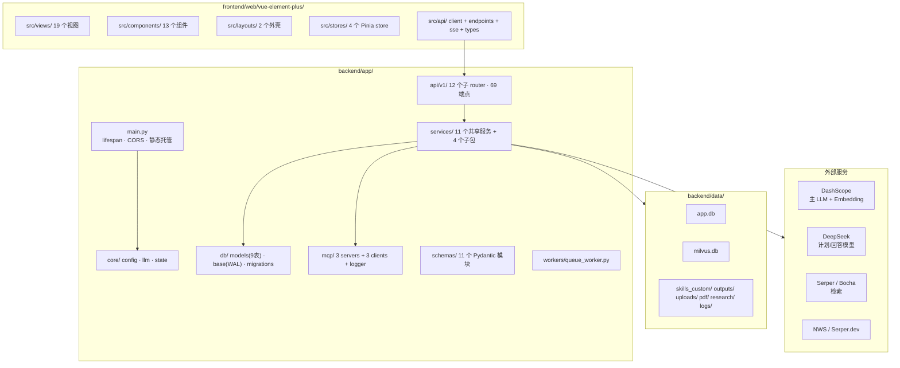
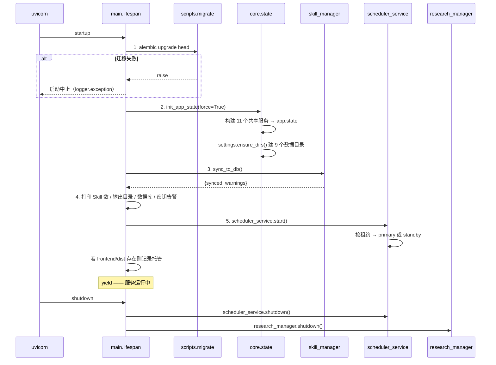
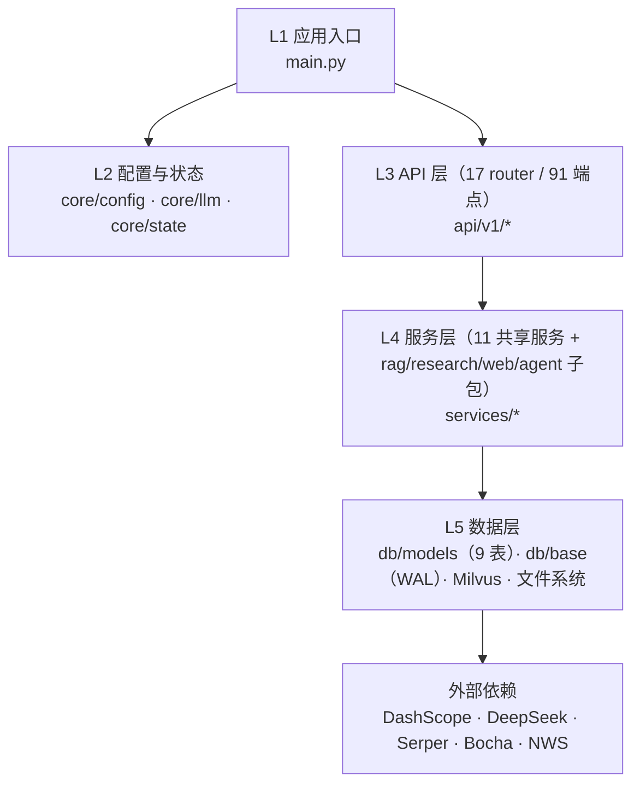
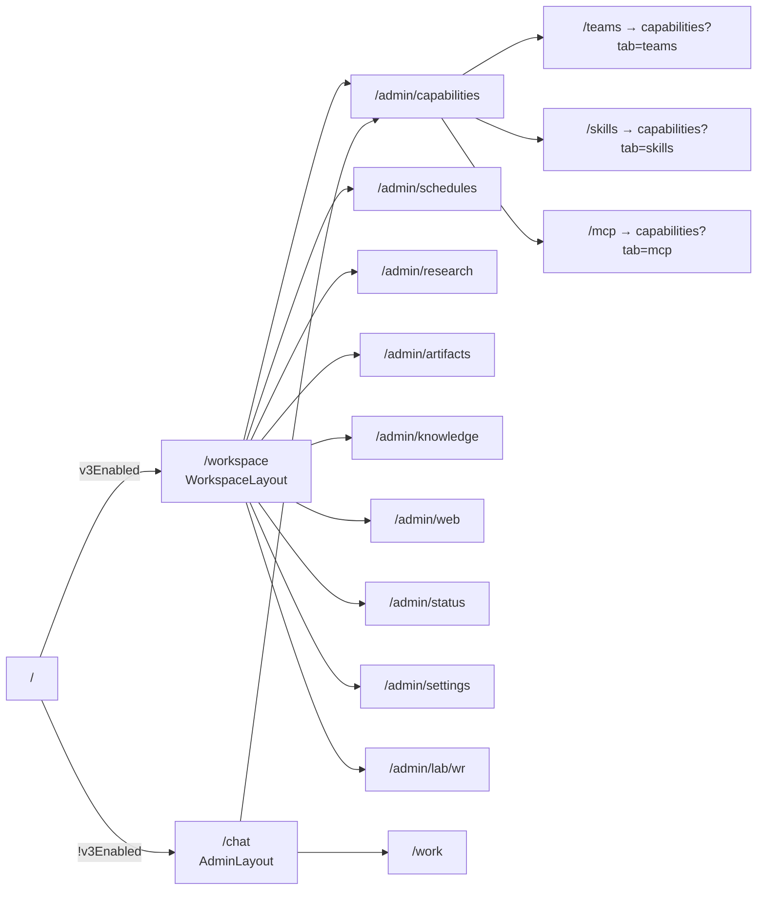

# 架构总览

> - **依据代码**：`backend/app/main.py`、`backend/app/core/state.py`、`backend/app/core/config.py`、`backend/app/api/v1/router.py`、`backend/app/db/`、`frontend/web/vue-element-plus/src/`
> - **资料来源**：2026-10-26 逐文件探查
> - **整理日期**：2026-10-26
> - **对应基线**：commit `c4dac22`
> - **相关篇目**：`02` 五链实现 ｜ `03` 执行引擎 ｜ `04` 数据层 ｜ `05` 接口 ｜ `06` 前端 ｜ `12` 风险台账

---

# 第一部分 现状事实

## 一、平台定位与能力面

**agent-platform** 是一个**统一 Agent 平台**：把五类外部能力（Skill / MCP / RAG / Web Research / Deep Research）收拢到同一套 Agent 执行引擎与同一套会话、调度、运行账本之上，后端 FastAPI，前端 Vue 3 + TypeScript + Element Plus。

平台当前的能力面由 **5 条能力链 + 4 个运行域**构成：

| 类别 | 组成 | 实现位置 |
|---|---|---|
| **能力链 ① Skill** | 6 个内置 Skill 的注册、渐进式披露、增删改启停、zip 导入导出 | `backend/app/services/skill_manager.py` |
| **能力链 ② MCP** | 3 个 stdio MCP Server（12 个工具）的注册、静态反射、按需调用 | `backend/app/services/mcp_manager.py` |
| **能力链 ③ RAG** | PDF 解析 → 切块 → DashScope 向量化 → Milvus Lite 混合检索 → 带引用回答 | `backend/app/services/rag/` |
| **能力链 ④ Web Research** | Serper 检索 → 爬虫 → Chroma 召回 → GPT 回答 → 引用卡片 | `backend/app/services/web/` |
| **能力链 ⑤ Deep Research** | Orchestrator-Workers + OODA 子循环 + 质量评分迭代 + 报告落盘 | `backend/app/services/research/` |
| **运行域 ① 双模式会话** | `chat`（只读工具）/ `work`（全量工具）+ 会话与消息持久化 | `backend/app/services/session_service.py`、`backend/app/services/agent_service.py` |
| **运行域 ② Skill 团队** | 团队 CRUD + 三种编排策略（none / sequential / router） | `backend/app/services/team_service.py` |
| **运行域 ③ 定时任务** | cron / interval 调度 + 租约防重 + 幂等槽位 + 失败退避 | `backend/app/services/scheduler_service.py` |
| **运行域 ④ 运行账本** | `runs` + `run_events` 事件账本 + 断点续传 + 事件回放 | `backend/app/services/run_service.py`、`backend/app/services/run_executor.py` |

**四类存储的分工**（真相源不同，互不重叠）：

| 存储 | 内容 | 位置 |
|---|---|---|
| **SQLite** | 全部业务元数据（会话 / 消息 / 团队 / Skill 索引 / 定时任务 / 运行账本 / 租约） | `backend/data/app.db` |
| **Milvus Lite** | 仅 RAG 文档块（文本 + 1024 维稠密向量 + BM25 稀疏向量） | `backend/data/milvus.db` |
| **文件系统** | Skill 内容真相、产出文件、上传件、PDF 原文、研究报告 | `backend/data/{skills_custom,outputs,uploads,pdf,research}/` |
| **浏览器 localStorage** | 仅前端偏好（v3 灰度开关、选中 Skill、当前会话 id、空间分组、主题） | `localStorage['__ws_v3' / 'ap-vue-ep-*']` |

详见 `04_数据模型与持久化.md`。

## 二、目录地图



### 后端 `app/` 逐目录职责

| 目录 / 文件 | 职责 |
|---|---|
| `backend/app/main.py` | FastAPI 实例、lifespan、CORS、路由挂载、前端静态托管与 SPA 回退 |
| `backend/app/api/deps.py` | 13 个 `Depends` 工厂，从 `app.state` 取共享服务并惰性兜底初始化 |
| `backend/app/api/v1/router.py` | 聚合 12 个子 router，统一挂 `/api/v1` |
| `app/api/v1/*.py` | 12 个子 router：`system` `skills` `agent` `sessions` `runs` `teams` `schedules` `files` `mcp_servers` `rag` `web_research` `research` |
| `backend/app/core/config.py` | `Settings`（pydantic-settings，60+ 字段）+ 路径属性 + 能力检查 + `ensure_dirs()` + `AVAILABLE_MODELS` |
| `backend/app/core/llm.py` | DeepSeek（OpenAI 兼容）客户端工厂与 `chat()` 便捷函数 |
| `backend/app/core/state.py` | `init_app_state()`：构建并缓存 11 个共享服务到 `app.state` |
| `backend/app/db/models.py` | **21 张**业务表的 SQLAlchemy 2.0 声明式模型 |
| `backend/app/db/base.py` | engine / sessionmaker 工厂、`db_session()` 上下文、`retry_on_locked()`、`init_db()`、`check_db()` |
| `backend/app/db/migrations/` | Alembic：`env.py` + `versions/0001_init.py`（唯一版本） |
| `backend/app/schemas/` | 11 个 Pydantic 模型模块（agent / common / mcp / rag / research / run / schedule / session / skill / team / web_research） |
| `backend/app/services/` | 业务服务层（详见下表） |
| `backend/app/services/agent/` | **旧范式** Agent（plan→action→reflection→answer），仅被 `/api/v1/agent/chat` 使用 |
| `backend/app/services/rag/` | RAG 链路：chunking / embedding / ingest / milvus_store / rag_chain |
| `backend/app/services/research/` | Deep Research：orchestrator / workers / prompts / research_config / research_manager / search_client / llm_client / service / utils |
| `backend/app/services/web/` | Web Research：serper_service / web_crawler / fetch_web_content / retrieval / llm_answer / locate_reference / research_service / `config/config.yaml` |
| `backend/app/mcp/servers/` | 3 个 FastMCP Server：`weather_server` / `search_server` / `xiaohongshu_server` |
| `backend/app/mcp/clients/` | 3 个**示例**客户端（主应用不 import）：`llm_client` / `llm_client_ali_v2` / `simple_demo` |
| `backend/app/mcp/utils/mcp_logger.py` | stdio 流量镜像调试代理（写 `mcp_io.log`） |
| `backend/app/workers/queue_worker.py` | 自实现 Redis RESP 消费者；**仓库不提供其运行环境**，主应用不 import |

### `backend/app/services/` 逐文件职责

| 文件 | 职责 |
|---|---|
| `agent_service.py` | **主执行引擎**：function-calling 循环、反思分支、计划生成、system prompt 组装、SSE 事件产出 |
| `tool_registry.py` | 工具合并（内置 / RAG / Web / MCP）、`ToolProfile` 裁剪、`dispatch` 分发、`tool_source` 标记 |
| `skill_manager.py` | Skill 扫描解析、校验、CRUD、软删除、zip 导入导出、DB 同步、system prompt 构建 |
| `team_service.py` | 团队 CRUD、`resolve()` 三策略、router 的 LLM 选路与降级 |
| `mcp_manager.py` | Server 注册表、静态反射、stdio 调用、只读标记 |
| `session_service.py` | 会话与消息持久化、历史裁剪（`build_history`） |
| `run_service.py` | `runs` / `run_events` 账本、幂等创建、事件追加、重启恢复、清理 |
| `run_executor.py` | Agent 执行编排：团队解析 → 会话 → run 记录 → 事件落库 → 审批恢复 |
| `scheduler_service.py` | APScheduler 调度、DB 租约、幂等槽位、退避、配额、每日清理 |
| `code_executor.py` | 本地 subprocess 代码执行（黑名单 + 超时 + 输出截断） |
| `research/research_manager.py` | 研究任务生命周期（pending/running/completed/failed）、进度事件、`tasks.json` 恢复、报告落盘 |

## 三、启动与关闭序列



**关键事实**：

| 项 | 事实 | 证据 |
|---|---|---|
| 迁移失败语义 | `raise` 中止启动，**不静默降级** | `backend/app/main.py:39-43` |
| 共享服务数 | 11 个，构造顺序为 Skill → Executor → MCP → ToolRegistry → Research → Session → Run → Team → Agent → RunExecutor → Scheduler | `backend/app/core/state.py:31-53` |
| 目录创建 | `ensure_dirs()` 建 9 个目录（skills / data / skills_custom / outputs / uploads / browser_data / pdf / logs / research） | `backend/app/core/config.py:168-180` |
| 启动告警 | 无 `DASHSCOPE_API_KEY` → 告警「`/api/v1/agent/run` 将返回错误提示」；无检索 Key → 告警「`/api/v1/research` 检索将失败」 | `backend/app/main.py:56-59` |
| 调度角色 | 未抢到租约时以 **standby** 运行（只提供 API，不触发任务） | `backend/app/main.py:61-62` |
| 关闭顺序 | 先 `scheduler_service.shutdown()` 再 `research_manager.shutdown()` | `backend/app/main.py:67-68` |

## 四、分层与依赖方向



**依赖方向约束**（代码中已固化的三条）：

| 约束 | 体现 |
|---|---|
| API 层不直接碰数据库 | `api/v1/*.py` 只经 `Depends` 拿 service；DB 事务由 service 内部 `with db_session()` 自开 |
| 服务层不依赖 FastAPI 请求上下文 | `app/services/*` 无 `Request` 参数；`run_executor` 明确在生成器内部创建 DB Session |
| 数据层不感知业务 | `db/models.py` 只声明表与约束；业务规则在 `services/` |

## 五、两种运行形态（chat / work）

后端的主开关是 **`mode`**，而不是「4 链开关」。

| 维度 | `mode="chat"` | `mode="work"` |
|---|---|---|
| 语义 | 对话（Ask） | 工作（Craft） |
| 内置工具 | `read_file`、`list_directory` | 全部 5 个（含 `write_file` / `execute_python` / `execute_bash`） |
| RAG 工具 | 仅 `rag_query` | `rag_query` + `rag_ingest` |
| MCP Server | 仅 `read_only=True` 的（weather / search） | 全部（xiaohongshu 会写内容） |
| 最大迭代 | 5 轮 | 20 轮 |
| 默认 Skill | 不加载 | 加载全部启用中的 |
| 计划审批 | 不支持 `plan_first` | 支持 |
| 反思模式 | 不支持（发 `notice` 关闭） | 支持 |
| 工具集一致性 | `assert_profile_consistency` 断言不含写类工具 | — |

**三态到后端的映射**（前端 `workspace` store）：

| 前端形态 | 后端请求 | 说明 |
|---|---|---|
| 对话 Ask | `mode=chat` | 只读 |
| 计划 Plan | `mode=work` + `plan_first=true` | 先生成计划，人工确认后执行 |
| 工作 Craft | `mode=work` | 全量能力 |

证据：`backend/app/schemas/agent.py:21,37-40`、`backend/app/services/agent_service.py:216,256-275`、`backend/app/services/tool_registry.py:31-41,164-191`、`backend/app/services/skill_manager.py:397-401`、`frontend/web/vue-element-plus/src/stores/workspace.ts:24-28`。

## 六、前端双形态



| 形态 | 外壳 | 入口 | 特点 |
|---|---|---|---|
| **v3 工作台** | `WorkspaceLayout.vue` | `/workspace` | 左侧任务流 + 空间分组、三态模式选择、`/` 命令面板、`@` 上下文选择、⌘K 全局搜索、Plan 审批卡 |
| **admin 后台** | `AdminLayout.vue` | `/admin/*`（9 个） | 顶部能力开关栏（MCP / RAG / Web / 反思 / Skill 多选）+ 9 个管理页 |
| **旧版回退** | `AdminLayout.vue` | `/chat`、`/work` | 灰度回退目标，保留可访问 |
| **路径重定向** | — | 11 条 | `/teams` `/skills` `/mcp` `/schedules` `/research` `/files` `/rag` `/web` `/status` `/settings` `/wr` → `/admin/*` |

v3 开关存 `localStorage['__ws_v3']`，缺省为 **true**（`frontend/web/vue-element-plus/src/stores/flags.ts:24-35`、`frontend/web/vue-element-plus/src/router/index.ts:21-29`）。

## 七、能力门禁与降级

| 能力 | 前置条件 | 缺失时的行为 | 位置 |
|---|---|---|---|
| Agent 主链路 | `DASHSCOPE_API_KEY` | SSE 流内发 `error` 事件 + `done`（HTTP 仍 200） | `backend/app/services/agent_service.py:130-142` |
| RAG 检索 / 入库 | `DASHSCOPE_API_KEY` + Milvus 可达 | `/rag/query` 返回 **503**；`/rag/stats` 的 `entities=-1` | `backend/app/api/v1/rag.py:29,58-59` |
| Web Research | `SERPER_API_KEY` + `OPENAI_API_KEY` | 返回 **503** | `backend/app/api/v1/web_research.py:24` |
| Deep Research | `BOCHA_API_KEY` 或 `SERPER_API_KEY` | `POST /research` 返回 **HTTP 200 + `status="failed"`**（非错误码） | `backend/app/api/v1/research.py:113-123` |
| MCP 调用 | 无需 Key（weather）/ `SERPER_API_KEY`（search）/ 用户登录态（xiaohongshu） | 工具异常被转为字符串写入 `result` | `backend/app/services/mcp_manager.py:145-168` |
| 定时任务 | 无需 Key | 调度器正常启动；work 模式任务必须显式 `allow_unattended_tools=true` 才可启用 | `backend/app/services/scheduler_service.py:359-362` |
| 计划审批 | 无 | `plan_first` 计划生成失败时降级为单步计划 | `backend/app/services/agent_service.py:299-301` |

## 八、中间件、安全与可观测现状

| 项 | 现状 |
|---|---|
| 中间件 | `CORSMiddleware`（**S1 起默认收紧**：未显式配置 `CORS_ORIGINS` 时白名单为空，不再回落 `["*"]`）+ 请求 ID 中间件（生成/透传 `X-Request-ID`）+ 桌面会话守卫（仅桌面形态） |
| 鉴权 | **桌面形态**：会话令牌 + Host 白名单（`/__desktop/bootstrap` 下发 Cookie，未授权返回 401 统一错误体）；**Web 形态**：单机无鉴权（`../plan/06` 的 SEC-1b 待办） |
| 限流 | **无** |
| Metrics | **无**（无 `/metrics`，无 prometheus 依赖） |
| Tracing | **无**（无 langfuse / OpenTelemetry 接入） |
| 日志 | `logging.basicConfig(level=INFO)` 输出到 stdout；`settings.logs_dir`（`data/logs`）目录已建但**无文件 handler** |
| 请求 ID | **无** |
| WebSocket | **无**；实时通道全部走 SSE |
| 自建可观测 | `run_events` 全量事件账本、`GET /api/v1/health`（17 字段）、`GET /api/v1/schedules/health`（role / owner / jobs）、Research 进度事件 + `meta_*.json` |

详见 `10_可观测体系现状与方案.md`。

---

# 第二部分 原理剖析

## 九、为什么把「模式」而不是「能力开关」作为主开关

早期设计用 `enable_mcp` / `enable_rag` / `enable_web_research` 四个布尔量表达「这次要开哪些能力」。该模型有三个结构性缺陷：

1. **工具可见性与提示词不同步**。工具数组由 `get_combined_tools()` 全量注入到 LLM 的 `tools` 参数，而系统提示词另行拼接「当前可用能力」。两者分离时会出现「提示词说没有、实际仍可调用」——模型能看到工具 schema 却得不到说明，行为不可预期。
2. **无法表达权限等级**。布尔量只能表达「开/关」，无法表达「只读但可用」。`chat` 模式需要的是「`read_file`/`list_directory` 可用、`write_file`/`execute_bash` 不可用」这种**子集约束**，布尔量表达不了。
3. **安全边界不可断言**。没有统一的「本次运行允许写」判定点，就无法在代码层面验证 chat 模式不会误调写类工具。

当前实现把这三点收敛到一个概念：**`ToolProfile`**。`tool_registry.get_combined_tools(profile=...)` 是唯一的工具可见性裁决点，system prompt 中的能力描述由同一份 profile 派生，并用 `assert_profile_consistency` 做运行时断言（`backend/app/services/tool_registry.py:36-41,164-191`）。四个布尔开关因此从「主开关」降级为「admin 顶栏的辅助偏好」，其作用是**在 profile 允许的范围内进一步收窄工具集**。

## 十、为什么用 SSE 而不是 WebSocket

平台有三条实时通道（Agent 运行、运行事件回放、研究进度），全部用 Server-Sent Events 实现。选型依据：

| 维度 | SSE | WebSocket |
|---|---|---|
| 协议 | 普通 HTTP 响应（`text/event-stream`） | HTTP Upgrade 握手 |
| 方向 | 单向（服务端 → 客户端） | 全双工 |
| 携带请求体 | ✅ 走普通 POST body | ❌ 需先握手再发帧 |
| 鉴权 | ✅ 走普通 HTTP 头 | 握手阶段可带，但浏览器 API 受限 |
| 断线重连 | 需自行实现（本项目用 `after_seq` 游标续订） | 需自行实现 |
| 反向代理友好 | ✅ | 需额外配置 upgrade 头 |
| 基础设施要求 | 普通 HTTP 栈即可 | 部分网关/负载均衡需特殊配置 |

对本项目而言，三个通道都是**「客户端发一个请求，服务端持续推事件直到终态」**的单向模式，没有任何服务端主动推送的场景。SSE 满足需求且工程成本更低。

**代价**：SSE 的重连必须自己做。项目为此设计了两条机制：Agent 运行用 `run_events` 账本 + `after_seq` 游标续订（`GET /api/v1/runs/{run_id}/stream?after_seq=N`），研究进度用 `stage|ts` 去重键续订（`frontend/web/vue-element-plus/src/api/sse.ts:120-177`）。这两条机制的细节见 `08` 与 `06`。

## 十一、为什么数据层选 SQLite 而不是纯文件

平台需要同时满足四个诉求：会话可查、运行可回放、调度可幂等、多副本不重复执行。

纯 JSON 文件方案（`tasks.json` 模式）能解决前两项，第三项需要自己实现槽位去重，第四项则需要分布式锁——本质上是**在应用层重新实现一个数据库**。SQLite + WAL 提供了：

| 诉求 | SQLite 的支持 |
|---|---|
| 会话可查 | 索引 `idx_sessions_mode_updated` + 关系查询 |
| 运行可回放 | `run_events` 表 + `(run_id, seq)` 唯一约束保证顺序 |
| 调度幂等 | `UNIQUE(task_id, scheduled_for)` 把幂等下沉到存储层 |
| 多副本防重 | `system_locks` 表 + 租约过期时间 |

`DATABASE_URL` 可切 PostgreSQL（`backend/app/core/config.py:111-115`、`backend/app/db/base.py` 的 engine 工厂），但**跨库行为差异（尤其是 `render_as_batch` 迁移与 `retry_on_locked` 的 SQLite 专属语义）尚未验证**，因此当前定位是「单机部署的默认存储」。

---

# 第三部分 已知边界与观察

| 编号 | 观察 | 证据 | 指向 |
|---|---|---|---|
| S-01-01 | 启动序列把「迁移失败即中止」写死，迁移与启动强耦合，无法在多副本同时启动时优雅处理（后启动者会因 DB 锁失败而退出） | `backend/app/main.py:39-43` | `12` D-30 |
| S-01-02 | 11 个共享服务全部是**进程内单例**，无跨副本共享机制；多副本部署时 Skill 状态、router 缓存、MCP 工具缓存各自独立 | `backend/app/core/state.py:31-53` | `12` §4 |
| S-01-03 | ~~CORS `allow_origins=["*"]` 与 `allow_credentials=True` 同开~~ **已修**（S1 WP-1.2）：未配置即空白名单 | `backend/app/core/config.py` | 已关闭 |
| S-01-04 | 无鉴权、无限流；`/api/v1/files/upload` 无大小限制 —— **鉴权部分已由 S1 的桌面守卫 + S2 权限引擎覆盖**，Web 形态鉴权与上传限制见 `../plan/06` | `backend/app/api/v1/files.py` | `12` §2 |
| S-01-05 | `/api/v1/health` 的 `mcp_servers_available` 硬编码为 `3`，不反映实际注册数 | `backend/app/api/v1/system.py:47` | `12` D-6 |
| S-01-06 | `backend/app/workers/queue_worker.py` 自实现 Redis RESP 客户端，但仓库不提供其运行环境，主应用也不 import，属孤立组件 | `backend/app/workers/queue_worker.py:3-6` | `12` D-24 |
| S-01-07 | `backend/app/mcp/clients/` 三个客户端是示例实现，主应用不 import；其路径曾因目录迁移而失效（已在历史中修正） | `backend/app/mcp/clients/` | — |
| S-01-08 | 前端 `localStorage` 只存偏好与「当前会话 id」指针，会话内容真相在服务端 SQLite；清浏览器数据不会丢会话 | `frontend/web/vue-element-plus/src/stores/session.ts` | — |
| S-01-09 | `frontend/dist` 与 `web/vue-element-plus/dist` 当前均未生成，后端单端口模式此时不注册静态路由，`GET /` 返回引导 JSON | `backend/app/main.py:102-129` | `09` §1 |
| S-01-10 | ~~v3 工作台与 admin 后台是两套并存的形态~~ **已解决**（S8）：侧栏合并为**统一导航**（跨路由恒定），旧版 `/chat`、`/work` 与灰度开关已下线 | `frontend/web/vue-element-plus/src/router/index.ts` | 已关闭 |

---

# 第四部分 改进指向

> 详见 `12_能力覆盖与风险台账.md` §2 对应条目。

| 优先级 | 事项 | 台账编号 |
|---|---|---|
| **P0** | CORS 白名单化（去掉 `*` 与 `credentials` 同开） | D-6 / `12` §3 |
| **P0** | 增加最小鉴权（哪怕是单一 API Key 中间件）覆盖全部 `/api/v1` | `12` §3 |
| **P0** | 补 Alembic 迁移版本规范（新增表必须产出迁移） | D-30 |
| **P1** | `/health` 的 `mcp_servers_available` 改为实际统计 | D-6 |
| **P1** | 上传接口增加大小与类型限制 | `12` §3 |
| **P1** | 统一会话 `mode` 默认值（schema 默认 `chat` vs 表默认 `work`） | D-31b |
| **P2** | `queue_worker.py` 标注为实验件或移出主干 | D-24 |
| **P2** | 明确多副本部署的前置条件（调度租约、Milvus Standalone、鉴权） | `12` §4 |

---

# 第五部分 核对方式

```bash
# 1. 路由与端点总数（权威来源：OpenAPI 规格）
cd backend && .venv/Scripts/python.exe -c "
from app.main import app
spec = app.openapi()
ops = [(m.upper(), p) for p, o in spec['paths'].items() for m in o if m in ('get','post','put','patch','delete')]
print('端点数:', len(ops))
"

# 2. 共享服务数（应为 17）
grep -c "app.state\.[a-z_]* = " backend/app/core/state.py

# 3. 子 router 数（应为 17）
grep -c "include_router" backend/app/api/v1/router.py

# 4. 中间件（应只有 CORSMiddleware）
grep -n "add_middleware" backend/app/main.py

# 5. 鉴权 / 限流 / 指标 / 追踪（应全部无命中）
grep -rniE "jwt|oauth|BaseHTTPMiddleware|slowapi|prometheus|langfuse|opentelemetry" backend/app/ | grep -v ".pyc"

# 6. 数据目录与表
ls backend/data/
cd backend && .venv/Scripts/python.exe -c "
import sqlite3
print(sorted(r[0] for r in sqlite3.connect('data/app.db').execute(\"select name from sqlite_master where type='table'\")))"
```

---

## 附录 A：本文档引用到的外部资料

见 `00_README.md` §7 公共参考表（R-01 ~ R-20）。

## 附录 B：相关篇目

- 逐链实现细节 → `02_能力链实现.md`
- Agent 循环与事件协议 → `03_Agent执行引擎与事件协议.md`
- 21 张表与一致性 → `04_数据模型与持久化.md`
- 端点全表 → `05_HTTP接口总览.md`
- 前端路由与视图 → `06_前端架构与接口契约.md`
- 缺陷台账与演进路线 → `12_能力覆盖与风险台账.md`
