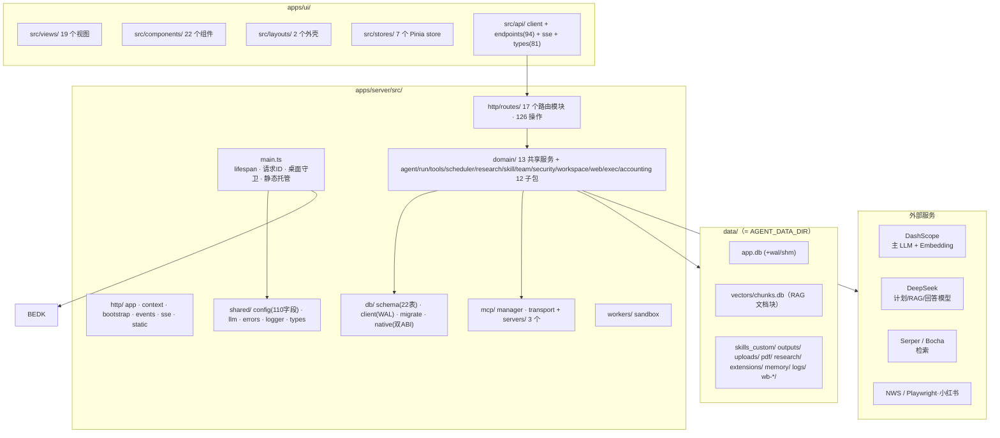
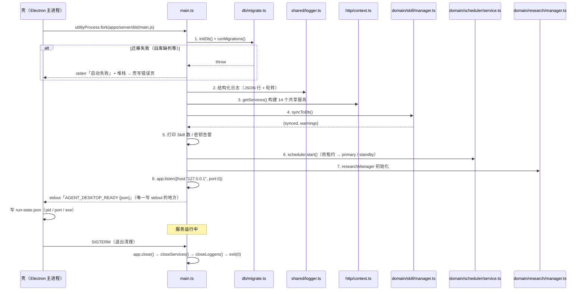
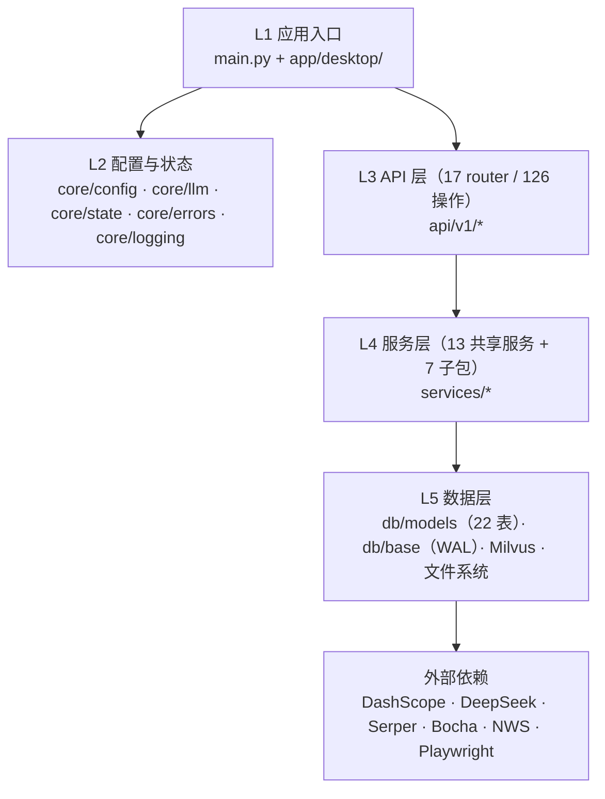
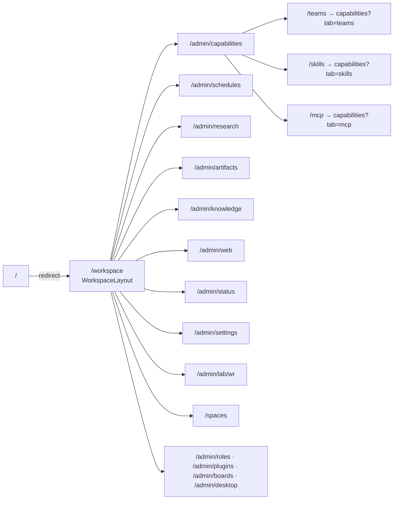

# 架构总览

> - **依据代码**：`apps/server/src/main.ts`、`apps/server/src/http/context.ts`、`apps/server/src/shared/config.ts`、`apps/server/src/http/app.ts`、`apps/server/src/db/`、`apps/server/src/http/`、`apps/ui/src/`
> - **资料来源**：2026-10-29 逐文件复核
> - **整理日期**：2026-10-29
> - **对应基线**：commit `7385dcd` + 工作区未提交改动（S0~S8 阶段 + 批次 01~03 交付后）
> - **相关篇目**：`02` 五链实现 ｜ `03` 执行引擎 ｜ `04` 数据层 ｜ `05` 接口 ｜ `06` 前端 ｜ `12` 风险台账 ｜ `14` 权限安全 ｜ `15` 工作区 ｜ `16` 上下文成本 ｜ `17` 扩展层


> **📌 状态横幅（2026-11-01 · 单运行时改造后）**：本文中「**Web 形态**」「浏览器形态」
> 「`web-e2e`」「CORS」「API Key 鉴权」等表述描述的是**改造前**的形态，**现已退场**
> （design/16 §9.1）。现行形态只有**桌面安装包**（Electron 壳 + 内嵌 TS sidecar）：
> - 渲染进程与 sidecar **同源** → **无跨域、无 CORS、无 API Key**；
> - 鉴权改为「**Host 白名单 + 一次性引导 nonce + 会话 Cookie**」；
> - `tests/web/`（44 例）与 `tests/deploy/`（8 例）随之删除。
>
> **后端路径**同时由 `backend/app/**`（Python）迁到 `apps/server/src/**`（TypeScript）；
> **前端**由 `frontend/web/vue-element-plus/` 迁到 `apps/ui/`。

---

# 第一部分 现状事实

## 一、平台定位与能力面

**agent-platform** 是一个**统一 Agent 平台**：把五类外部能力（Skill / MCP / RAG / Web Research / Deep Research）收拢到同一套 Agent 执行引擎与同一套会话、调度、运行账本之上，后端 Fastify，前端 Vue 3 + TypeScript + Element Plus。

平台当前的能力面由 **5 条能力链 + 4 个运行域 + 4 个横切域**构成：

| 类别 | 组成 | 实现位置 |
|---|---|---|
| **能力链 ① Skill** | 6 个内置 Skill 的注册、渐进式披露、增删改启停、zip 导入导出 | `apps/server/src/domain/skill/manager.ts` |
| **能力链 ② MCP** | 3 个 stdio MCP Server（12 个工具）的注册、静态反射、按需调用 | `apps/server/src/mcp/manager.ts` |
| **能力链 ③ RAG** | PDF 解析 → 切块 → DashScope 向量化 → Milvus Lite 混合检索 → 带引用回答 | `apps/server/src/domain/rag/` |
| **能力链 ④ Web Research** | Serper 检索 → 爬虫 → Chroma 召回 → GPT 回答 → 引用卡片 | `apps/server/src/domain/web/` |
| **能力链 ⑤ Deep Research** | Orchestrator-Workers + OODA 子循环 + 质量评分迭代 + 报告落盘 | `apps/server/src/domain/research/` |
| **运行域 ① 双模式会话** | `chat`（只读工具）/ `work`（全量工具）+ 会话与消息持久化 | `apps/server/src/domain/session/service.ts`、`apps/server/src/domain/agent/` |
| **运行域 ② Skill 团队** | 团队 CRUD + 三种编排策略（none / sequential / router） | `apps/server/src/domain/team/service.ts` |
| **运行域 ③ 定时任务** | cron / interval 调度 + 租约防重 + 幂等槽位 + 失败退避 | `apps/server/src/domain/scheduler/service.ts` |
| **运行域 ④ 运行账本** | `runs` + `run_events` 事件账本 + 断点续传 + 事件回放 | `apps/server/src/domain/run/service.ts`、`apps/server/src/domain/run/executor.ts` |
| **横切域 ① 权限与安全** | 三态权限引擎（5 scope）+ 策略层归一化 + 审批留痕 + JSONL 审计 | `apps/server/src/domain/security/` |
| **横切域 ② 工作区与产物** | 工作空间 CRUD/切换/归档 + 变更 diff/回退 + 产物登记 + 写前快照 | `apps/server/src/domain/workspace/` |
| **横切域 ③ 上下文与成本** | token 预算 + 两级压缩 + 三层记忆 + LLM 计量 + 单价快照 | `apps/server/src/domain/exec/` |
| **横切域 ④ 扩展层** | 角色 CRUD + 插件扫描/安装/回滚 + 黑板任务项/消息 | `apps/server/src/domain/exec/team/`、`apps/server/src/domain/skill/plugins.ts` |

**五类存储的分工**（真相源不同，互不重叠）：

| 存储 | 内容 | 位置 |
|---|---|---|
| **SQLite** | 全部业务元数据（会话 / 消息 / 团队 / Skill 索引 / 定时任务 / 运行账本 / 租约 / 权限 / 工作区 / 产物 / 变更 / 计量 / 记忆索引 / 角色 / 插件 / 黑板 / RAG 台账） | `data/app.db`（**22 表 + `__migrations`**） |
| **本地向量库（SQLite）** | 仅 RAG 文档块（文本 + 1024 维稠密向量 + BM25 稀疏倒排） | `data/vectors/chunks.db` ｜ **Milvus Lite 已退场**（容器与本地二进制均移除） |
| **文件系统** | Skill 内容真相、产出文件、上传件、PDF 原文、研究报告、工作区（`.agent/` 内部目录 + `artifacts/`）、三层记忆、插件包 | `data/{skills_custom,outputs,uploads,pdf,research,extensions,memory,wb-*}/` |
| **JSON / JSONL** | 研究任务台账 `tasks.json`、权限审计 `audit.jsonl`、工作区 `manifest.json` | 见 `04` §7 |
| **浏览器 localStorage** | 仅前端偏好（选中 Skill、当前会话 id、空间分组、主题、面板折叠态） | `localStorage['ap-vue-ep-*']` |

详见 `04_数据模型与持久化.md`。

## 二、目录地图



### 后端 `app/` 逐目录职责

| 目录 / 文件 | 职责 |
|---|---|
| `apps/server/src/main.ts` | Fastify 实例、lifespan（迁移→日志→共享服务→调度器）、CORS、请求 ID 中间件、三个异常处理器、桌面守卫、静态托管与 SPA 回退 |
| `apps/server/src/http/deps.ts` | 13 个 `Depends` 工厂，从 `app.state` 取共享服务并惰性兜底初始化 |
| `apps/server/src/http/app.ts` | 聚合 **17** 个子 router，统一挂 `/api/v1` |
| `app/api/v1/*.py` | 17 个子 router：`system` `skills` `agent` `sessions` `runs` `teams` `schedules` `files` `mcp_servers` `permissions` `workspace` `context` `extensions` `rag` `web_research` `research` `desktop` |
| `apps/server/src/shared/config.ts` | `Settings`（zod-settings，**78 字段**）+ 27 个派生属性 + 10 个 `AGENT_*` 环境变量 + `ensure_dirs()` + `AVAILABLE_MODELS` |
| `apps/server/src/shared/errors.ts` | 13 个 `ErrorCode`、`AppError`、统一错误体、请求 ID 上下文 |
| `apps/server/src/shared/logger.ts` | JSON 行结构化格式器 + 落盘轮转 + DEBUG 抽样 + 敏感键脱敏 |
| `apps/server/src/http/context.ts` | `init_app_state()`：构建并缓存 **13** 个共享服务到 `app.state` |
| `apps/server/src/domain/accounting/pricing.ts` | 模型单价表（供成本核算） |
| `apps/server/src/shared/config.ts` | 上传白名单（扩展名 / MIME / 禁止清单 / 大小上限） |
| `apps/server/src/domain/workspace/service.ts` | 当前工作区目录的进程级全局指针 |
| `apps/server/src/db/schema.ts` | **22 张**业务表的 Drizzle 2.0 声明式模型 |
| `apps/server/src/db/client.ts` | engine / sessionmaker 工厂、**WAL PRAGMA**、`db_session()` 上下文、`retry_on_locked()`、`init_db()`、`check_db()` |
| `apps/server/src/db/` | migrations：`env.py` + `versions/0001~0008`（8 个版本） |
| `apps/server/src/http/routes/` | 12 个 Zod 模型模块（agent / common / mcp / rag / research / run / schedule / session / skill / team / web_research + `__init__`） |
| `apps/server/src/http/` | 桌面端后端侧：`launcher.py`（sidecar 启动）、`bootstrap.py`（会话引导与 Host 白名单）、`events.py`（事件总线） |
| `apps/server/src/domain/` | 业务服务层（详见下表） |
| `apps/server/src/domain/agent/` | **旧范式** Agent（plan→action→reflection→answer），仅被 `/api/v1/agent/chat` 使用 |
| `apps/server/src/domain/` | `chains/skills/`（spec / index / scanner / plugins）+ `chains/mcp/transport.py`（**未接线**，见 `02` §2.4） |
| `apps/server/src/domain/exec/` | 执行扩展子包：`catalog` / `context` / `limits` / `memory` / `accounting` / `roles` / `team/*` |
| `apps/server/src/domain/rag/` | RAG 链路：chunking / embedding / ingest / ledger / milvus_store / rag_chain |
| `apps/server/src/domain/research/` | Deep Research：orchestrator / workers / prompts / research_config / research_manager / search_client / llm_client / service / utils |
| `apps/server/src/domain/web/` | Web Research：serper_service / web_crawler / fetch_web_content / retrieval / llm_answer / locate_reference / research_service / `config/config.yaml` |
| `apps/server/src/domain/scheduler/` | `rrule.py`（RRULE 子集解析，**未接线**）+ `delivery.py`（投递通道，**无 API 入口**） |
| `apps/server/src/domain/security/` | `permissions.py`（权限引擎）/ `policy.py`（归一化）/ `sandbox.py`（能力探测）/ `sensitive.py`（**未接线**）/ `audit.py`（JSONL 审计） |
| `apps/server/src/domain/workspace/` | `service.py` / `manifest.py` / `changes.py` / `artifacts.py` / `snapshots.py` |
| `apps/server/src/mcp/servers/` | 3 个 FastMCP Server：`weather_server`（2 工具）/ `search_server`（3）/ `xiaohongshu_server`（7） |
| `apps/server/src/mcp/clients/` | 3 个**遗留示例**客户端（全仓 0 import）：`llm_client` / `llm_client_ali_v2` / `simple_demo` |
| `apps/server/src/mcp/logger.ts` | stdio 流量镜像调试代理（写 `mcp_io.log`） |
| `apps/server/src/workers/` | **仅剩空 `__init__.py`**（原 `queue_worker.py` 已移除） |

### `apps/server/src/domain/` 逐文件职责

| 文件 | 职责 |
|---|---|
| `agent_service.py` | **主执行引擎**：function-calling 循环、反思分支、计划生成、system prompt 组装、SSE 事件产出、上下文压缩/记忆注入、成本计量旁路 |
| `tool_registry.py` | 工具合并（内置 7 + RAG 2 + Web 1 + MCP N）、`ToolProfile` 裁剪、`dispatch` 分发、`tool_source` 标记、权限判定入口 |
| `skill_manager.py` | Skill 扫描解析、校验、CRUD、软删除、zip 导入导出、DB 同步、system prompt 构建 |
| `team_service.py` | 团队 CRUD、`resolve()` 三策略、router 的 LLM 选路与降级 |
| `mcp_manager.py` | Server 注册表、静态反射、stdio 调用、只读标记 |
| `session_service.py` | 会话与消息持久化、历史裁剪（`build_history`）、消息序号竞态重试 |
| `run_service.py` | `runs` / `run_events` 账本、幂等创建、事件追加、重启恢复、清理、成本聚合 |
| `run_executor.py` | Agent 执行编排：并发闸门 → 团队解析 → 会话 → run 记录 → 事件落库 → 审批恢复；**中断 / steer 控制面** |
| `scheduler_service.py` | APScheduler 调度、DB 租约、幂等槽位、退避、配额、每日清理、补跑扫描 |
| `code_executor.py` | 本地 subprocess 代码执行（黑名单 + rlimit 限额 + 超时 + 输出截断 + 路径逃逸检测 + 写前快照） |
| `permissions.py` | 权限**兼容层**（S2 之前的 API 适配）：`classify` / `set_rule` / `list_rules` / `effective_level` |
| `desktop_service.py` | 桌面运行态快照、组件状态、偏好读写、工作区切换校验 |
| `research/research_manager.py` | 研究任务生命周期（pending/running/completed/failed）、进度事件、`tasks.json` 恢复、报告落盘 |

## 三、启动与关闭序列

> **2026-11-01 按 TS 后端重写**（原 Python `lifespan` 序列保留在下方对照说明）。



**与 Python 版的差异（对照）**：

| 维度 | Python（改造前） | TypeScript（现行） |
|---|---|---|
| 生命周期载体 | FastAPI `lifespan`（async 上下文管理器） | `main()` 显式序列 + `process.on("SIGTERM")` |
| 迁移 | `alembic upgrade head`（12 版） | `runMigrations()`（**1 个基线版本**；旧库走「标记基线 + 增量补列」） |
| 服务装配 | `app.state` 惰性属性 | `getServices()` **单例容器**（`http/context.ts`） |
| 端口 | `uvicorn` 传入或 `settings.port` | `app.listen({host:"127.0.0.1", port:0})` —— **OS 分配**，无 TOCTOU |
| 握手 | `launcher.py` 打印 | `main.ts` 打印（**协议不变**：同一行 `AGENT_DESKTOP_READY {json}`） |
| 静态托管 | `mount("/assets", StaticFiles)` | `http/static.ts`（`@fastify/static` + SPA 回退 + **路径穿越防护**） |
| CORS | 有（Web 形态） | **无**（桌面端同源） |

## 四、分层与依赖方向



**依赖方向约束**（代码中已固化的四条）：

| 约束 | 体现 |
|---|---|
| API 层不直接碰数据库 | `api/v1/*.py` 只经 `Depends` 拿 service；DB 事务由 service 内部 `with db_session()` 自开 |
| 服务层不依赖 Fastify 请求上下文 | `app/services/*` 无 `Request` 参数；`run_executor` 明确在生成器内部创建 DB Session |
| 数据层不感知业务 | `db/models.py` 只声明表与约束；业务规则在 `services/` |
| **权限判定只在工具分发入口** | `ToolRegistry.dispatch()` 是**唯一**的权限判定落点；HTTP 层仅 `POST /changes/{id}/revert` 直接调用引擎 | `apps/server/src/domain/tools/registry.ts:293-366`；`apps/server/src/http/routes/workspace.ts:102-112` |

## 五、两种运行形态（chat / work）

后端的主开关是 **`mode`**，而不是「4 链开关」。

| 维度 | `mode="chat"` | `mode="work"` |
|---|---|---|
| 语义 | 对话（Ask） | 工作（Craft） |
| 内置工具 | `read_file`、`list_directory` | 全部 7 个（含 `write_file` / `execute_python` / `execute_bash` / `tool_search` / `tool_load`） |
| RAG 工具 | 仅 `rag_query` | `rag_query` + `rag_ingest` |
| Web 工具 | 无 | `web_research` |
| MCP Server | 仅 `read_only=True` 的（weather / search） | 全部（xiaohongshu 会写内容） |
| 最大迭代 | **5** 轮（`chat_max_iterations`） | **20** 轮（`max_iterations`） |
| 默认 Skill | 不加载 | 加载全部启用中的 |
| 计划审批 | 不支持 `plan_first` | 支持 |
| 反思模式 | 不支持（发 `notice` 后静默降级为 false） | 支持，走 `_stream_reflection()` |
| 工具集一致性 | `assert_profile_consistency` 断言不含写类工具 | — |

**三态到后端的映射**（前端 `workspace` store）：

| 前端形态 | 后端请求 | 说明 |
|---|---|---|
| 对话 Ask | `mode=chat` | 只读 |
| 计划 Plan | `mode=work` + `plan_first=true` | 先生成计划，人工确认后执行 |
| 工作 Craft | `mode=work` | 全量能力 |

证据：`apps/server/src/http/routes/agent.ts:21,37-40`、`apps/server/src/domain/agent/:236,295-300,306`、`apps/server/src/domain/tools/registry.ts:31-33,191-218`、`apps/server/src/domain/skill/manager.ts:397-401`、`apps/ui/src/stores/workspace.ts:24-28`。

> **注意**：`plan_first` 走的是「**挂起 + 恢复**」而非阻塞等待——`agent_service.py:295-300` 直接 `return` 后由 `POST /api/v1/agent/runs/{id}/approve` 恢复。详见 `03` §4。

## 六、前端双形态



| 形态 | 外壳 | 入口 | 特点 |
|---|---|---|---|
| **v3 工作台** | `WorkspaceLayout.vue` | `/workspace`（`/assistant` 为别名） | 左侧任务流 + 空间分组、三态模式选择、`/` 命令面板、`@` 上下文选择、⌘K 全局搜索、Plan 审批卡、右侧结果区 |
| **admin 后台** | `AdminLayout.vue` | `/admin/*`（13 个子路由） | 顶部能力开关栏（MCP / RAG / Web / 反思 / Skill 多选）+ 13 个管理页 |
| **路径重定向** | — | **13** 条 | `/` → `/workspace`；`/admin` → `/admin/capabilities`；`/teams` `/skills` `/mcp` → `/admin/capabilities?tab=*`；`/schedules` `/research` `/files` `/rag` `/web` `/status` `/settings` `/wr` → `/admin/*` |

> **旧版回退已下线**：`/chat`、`/work` 与 `localStorage['__ws_v3']` 灰度开关已在 S8 移除，侧栏合并为**统一导航**（`SideNav variant="workspace|admin"`）。

## 七、能力门禁与降级

| 能力 | 前置条件 | 缺失时的行为 | 位置 |
|---|---|---|---|
| Agent 主链路 | `DASHSCOPE_API_KEY` | SSE 流内发 `error` 事件 + `done`（HTTP 仍 200） | `apps/server/src/domain/agent/:419-424` |
| RAG 检索 / 入库 | `DASHSCOPE_API_KEY` + Milvus 可达 | `/rag/query` 返回 **503**；`/rag/stats` 的 `entities=-1` | `apps/server/src/http/routes/rag.ts:29,55` |
| Web Research | `SERPER_API_KEY` + `OPENAI_API_KEY` | 返回 **503** | `apps/server/src/http/routes/web-research.ts:24` |
| Deep Research | `BOCHA_API_KEY` 或 `SERPER_API_KEY` | `POST /research` 返回 **HTTP 200 + `status="failed"`**（非错误码） | `apps/server/src/http/routes/research.ts:112-123` |
| MCP 调用 | 无需 Key（weather）/ `SERPER_API_KEY`（search）/ 用户登录态（xiaohongshu） | 工具异常被转为字符串写入 `result` | `apps/server/src/mcp/manager.ts:188-197` |
| 定时任务 | 无需 Key | 调度器正常启动；work 模式任务必须显式 `allow_unattended_tools=true` 才可启用 | `apps/server/src/domain/scheduler/service.ts:396-399` |
| 计划审批 | 无 | `plan_first` 计划生成失败时降级为单步计划 | `apps/server/src/domain/agent/:337` |
| 权限审批 | 桌面形态恒有通道；Web 形态需最近 10s 有人拉待审列表 | 无审批通道 → **立即 deny**（不静默放行） | `apps/server/src/domain/security/permissions.ts:332-338,360-370` |

## 八、中间件、安全与可观测现状

| 项 | 现状 |
|---|---|
| 中间件 | `CORSMiddleware`（**S1 起默认收紧**：未显式配置 `CORS_ORIGINS` 时白名单为空，不再回落 `["*"]`）+ **请求 ID 中间件**（生成/透传 `X-Request-ID`，写日志上下文，回写响应头）+ **桌面会话守卫**（仅桌面形态注册） |
| 异常处理 | 3 个 handler：`AppError` / `HTTPException` / 未捕获 `Exception`；统一错误体 `{code, message, detail, request_id}` |
| 鉴权 | **桌面形态**：Host 白名单（loopback + 端口一致，防 DNS rebinding）+ 会话 Cookie / `X-Agent-Desktop-Token`（`hmac.compare_digest` 常量时间比较）；**Web 形态**：**完全无鉴权** |
| 限流 | **无**（但有并发预算信号量，见 `11`） |
| Metrics | **有**：`GET /api/v1/metrics`（自建轻量版，非 Prometheus 格式） |
| Tracing | **无**（无 langfuse / OpenTelemetry 接入） |
| 日志 | JSON 行结构化格式器 + 落盘轮转（10MB × 5）+ DEBUG 按 20% 抽样 + 敏感键脱敏 |
| 请求 ID | **有**：`X-Request-ID` 生成/透传，CORS `expose_headers` 已放开 |
| WebSocket | **无**；实时通道全部走 SSE（4 条） |
| 自建可观测 | `run_events` 全量事件账本、`GET /api/v1/health`（17 字段）、`GET /api/v1/metrics`、`GET /api/v1/schedules/health`、权限审计 `audit.jsonl`、Research 进度事件 + `meta_*.json` |

详见 `10_可观测体系现状与方案.md`、`14_权限引擎与安全边界.md`。

---

# 第二部分 原理剖析

## 九、为什么把「模式」而不是「能力开关」作为主开关

早期设计用 `enable_mcp` / `enable_rag` / `enable_web_research` 四个布尔量表达「这次要开哪些能力」。该模型有三个结构性缺陷：

1. **工具可见性与提示词不同步**。工具数组由 `get_combined_tools()` 全量注入到 LLM 的 `tools` 参数，而系统提示词另行拼接「当前可用能力」。两者分离时会出现「提示词说没有、实际仍可调用」——模型能看到工具 schema 却得不到说明，行为不可预期。
2. **无法表达权限等级**。布尔量只能表达「开/关」，无法表达「只读但可用」。`chat` 模式需要的是「`read_file`/`list_directory` 可用、`write_file`/`execute_bash` 不可用」这种**子集约束**，布尔量表达不了。
3. **安全边界不可断言**。没有统一的「本次运行允许写」判定点，就无法在代码层面验证 chat 模式不会误调写类工具。

当前实现把这三点收敛到一个概念：**`ToolProfile`**。`tool_registry.get_combined_tools(profile=...)` 是唯一的工具可见性裁决点，system prompt 中的能力描述由同一份 profile 派生，并用 `assert_profile_consistency` 做运行时断言（`apps/server/src/domain/tools/registry.ts:36-44,178-220`）。四个布尔开关因此从「主开关」降级为「admin 顶栏的辅助偏好」，其作用是**在 profile 允许的范围内进一步收窄工具集**。

## 十、为什么用 SSE 而不是 WebSocket

平台有四条实时通道（Agent 运行、运行事件回放、研究进度、桌面事件），全部用 Server-Sent Events 实现。选型依据：

| 维度 | SSE | WebSocket |
|---|---|---|
| 协议 | 普通 HTTP 响应（`text/event-stream`） | HTTP Upgrade 握手 |
| 方向 | 单向（服务端 → 客户端） | 全双工 |
| 携带请求体 | ✅ 走普通 POST body | ❌ 需先握手再发帧 |
| 鉴权 | ✅ 走普通 HTTP 头 | 握手阶段可带，但浏览器 API 受限 |
| 断线重连 | 需自行实现（本项目用 `after_seq` / `after_id` 游标续订） | 需自行实现 |
| 反向代理友好 | ✅ | 需额外配置 upgrade 头 |
| 基础设施要求 | 普通 HTTP 栈即可 | 部分网关/负载均衡需特殊配置 |

对本项目而言，四条通道都是**「客户端发一个请求，服务端持续推事件直到终态」**的单向模式，没有任何服务端主动推送的场景。SSE 满足需求且工程成本更低。

**代价**：SSE 的重连必须自己做。项目为此设计了两条机制：Agent 运行用 `run_events` 账本 + `after_seq` 游标续订（`GET /api/v1/runs/{run_id}/stream?after_seq=N`），桌面事件用环形缓冲 + `after_id` 游标续订（`GET /api/v1/desktop/events?after_id=N`），研究进度用 `stage|ts` 去重键续订（`apps/ui/src/api/sse.ts:122-179`）。详见 `08`、`13` 与 `06`。

## 十一、为什么数据层选 SQLite 而不是纯文件

平台需要同时满足四个诉求：会话可查、运行可回放、调度可幂等、多副本不重复执行。

纯 JSON 文件方案（`tasks.json` 模式）能解决前两项，第三项需要自己实现槽位去重，第四项则需要分布式锁——本质上是**在应用层重新实现一个数据库**。SQLite + WAL 提供了：

| 诉求 | SQLite 的支持 |
|---|---|
| 会话可查 | 索引 `idx_sessions_mode_updated` + 关系查询 |
| 运行可回放 | `run_events` 表 + `(run_id, seq)` 唯一约束保证顺序 |
| 调度幂等 | `UNIQUE(task_id, scheduled_for)` 把幂等下沉到存储层 |
| 多副本防重 | `system_locks` 表 + 租约过期时间 |
| 变更追溯 | `changes` 表 + 快照引用（`snapshot_ref`）支持逐文件回退 |

`DATABASE_URL` 可切 PostgreSQL（`apps/server/src/shared/config.ts:87`、`apps/server/src/db/client.ts` 的 engine 工厂），但**跨库行为差异（尤其是 `render_as_batch` 迁移与 `retry_on_locked` 的 SQLite 专属语义）尚未验证**，因此当前定位是「单机部署的默认存储」。

## 十二、为什么横切能力单独成层而不是塞进服务层

S2（安全）、S3（工作区）、S5（上下文成本）、S6（扩展层）四个阶段的共性是：**它们不产生新的用户可见入口，而是横切在「Agent 执行 → 工具调用 → 产物落地」这条主干上**。

| 横切域 | 挂在主干的哪个点 | 判定依据 |
|---|---|---|
| 权限 | 工具**分发前**（`ToolRegistry.dispatch` 入口） | 工具名 + 入参 → 归一化请求 → 三态规则匹配 |
| 工作区 | 工具**写盘时**（`LocalCodeExecutor.write_file` 钩子） | 写前快照 → 执行 → 记一条 `changes` |
| 上下文成本 | 每轮**组装消息前** + 每次 **LLM 响应后** | 预算占用 → 压缩/裁剪；usage → `llm_calls` |
| 扩展层 | **旁路**（当前不接主干） | 角色 / 插件 / 黑板各自有 API，但 Agent 链路不消费 |

把它们独立成层的收益是：**主干（`03` 讲得最细的执行引擎）保持可读**，横切能力可以各自独立演进、独立测试、独立成篇。本目录 `14`~`17` 即按此切分。

---

# 第三部分 已知边界与观察

| 编号 | 观察 | 证据 | 指向 |
|---|---|---|---|
| S-01-01 | 启动序列把「迁移失败即中止」写死，迁移与启动强耦合，多副本同时启动时后启动者会因 DB 锁失败而退出 | `apps/server/src/main.ts:47-53` | `12` §2.1 |
| S-01-02 | 14 个共享服务全部是**进程内单例**，无跨副本共享机制；多副本部署时 Skill 状态、router 缓存、MCP 工具缓存各自独立 | `apps/server/src/http/context.ts:33-59` | `12` §4 |
| S-01-03 | ~~CORS `allow_origins=["*"]` 与 `allow_credentials=True` 同开~~ **已修**（S1 WP-1.2）：未配置即空白名单 | `apps/server/src/shared/config.ts:245-257` | 已关闭 |
| S-01-04 | Web 形态**完全无鉴权**（桌面形态已由 S1 守卫覆盖）；无限流 | `apps/server/src/main.ts:152-165`（仅桌面态生效） | `12` §3 |
| S-01-05 | 上传接口**已有** 415 类型白名单 + 413 大小上限（50MB/100MB）——原「无大小限制」的结论已过期 | `apps/server/src/http/routes/files.ts:54-102`；`apps/server/src/shared/config.ts` | 已关闭 |
| S-01-06 | `apps/server/src/workers/` 现仅剩空 `__init__.py`（原 `queue_worker.py` 已移除） | `apps/server/src/workers/` | 已关闭 |
| S-01-07 | `apps/server/src/mcp/clients/` 三个客户端是遗留示例，主应用 0 import | `apps/server/src/mcp/clients/` | `12` §2.3 |
| S-01-08 | `services/exec/team/orchestrator.py` 的 `TeamOrchestrator` **未接入运行时**（仅测试引用）；运行时的「team」是 `team_service` 的 Skill 团队，语义完全不同 | `apps/server/src/domain/team/orchestrator.ts:70` | `17` §5 |
| S-01-09 | `services/chains/skills/index.py` 与 `spec.py` **未接入运行时**（仅测试引用），且 `spec.py` 的 `ALLOWED_FIELDS` 不含 `license`，与 `skill_manager` 的规范冲突 | `apps/server/src/domain/skill/spec.ts:16-18` | `02` §1.5 |
| S-01-10 | `services/chains/mcp/transport.py` **整文件未接线**，真实 MCP 调用走 `mcp_manager` 的「每次新建 stdio 会话」路径；`pool_size()` 指标恒为 0 | `apps/server/src/mcp/transport.ts`；`apps/server/src/mcp/manager.ts:162-197` | `02` §2.4 |
| S-01-11 | `services/security/sensitive.py` 在 app 代码中**零调用**，敏感信息扫描/加密未接入上下文链路 | `apps/server/src/domain/security/sensitive.ts` | `14` §4.4 |
| S-01-12 | `services/scheduler/rrule.py` 与 `delivery.py` 均**未接线**；`delivery_json` 列无任何写入 API，投递通道无法通过 HTTP 配置 | `apps/server/src/domain/scheduler/delivery.ts`；`apps/server/src/http/routes/schedules.ts` | `08` §1.7 |
| S-01-13 | `apps/server/src/workers/` 与 `apps/server/src/http/` 的目录职责在旧文档中被混写；`desktop/` 是**桌面端后端侧**的三个模块，与 `services/desktop_service.py` 分属两处 | `apps/server/src/http/` | `13` §2 |
| S-01-14 | `apps/dist` 是否存在决定后端是否注册静态路由；不存在时 `GET /` 返回引导 JSON | `apps/server/src/main.ts:190-217` | `09` §1 |

---

# 第四部分 改进指向

> 详见 `12_能力覆盖与风险台账.md` §2 对应条目。

| 优先级 | 事项 | 台账编号 |
|---|---|---|
| **P0** | Web 形态增加最小鉴权（哪怕是单一 API Key 中间件）覆盖全部 `/api/v1` | `12` §3 |
| **P0** | 补 migrations 迁移版本规范（`0001` 是 `create_all`，导致新装库 0002~0008 全为 no-op） | `12` §2.1 |
| **P1** | `exec/team/orchestrator.py`、`chains/skills/index.py`、`chains/skills/spec.py`、`chains/mcp/transport.py` 四处**未接线模块**明确标注或删除 | `12` §2.2 |
| **P1** | `sensitive.py` 接入上下文链路，或明确标注为「预留」 | `12` §2.1 |
| **P1** | 统一两套 frontmatter 规范（`license` 字段是否允许） | `12` §2.3 |
| **P2** | `queue_worker.py` 移除后的空目录清理 | 已关闭 |
| **P2** | 明确多副本部署的前置条件（调度租约、Milvus Standalone、鉴权） | `12` §4 |

---

# 第五部分 核对方式

```bash
# 1. 路由与端点总数（权威来源：OpenAPI 规格）
cd backend && .venv/bin/python -c "
from app.main import app
spec = app.openapi()
ops = [(m.upper(), p) for p, o in spec['paths'].items() for m in o if m in ('get','post','put','patch','delete')]
from collections import Counter
print('唯一路径:', len(spec['paths']), '操作:', len(ops), dict(Counter(m for m,_ in ops)))"

# 2. 共享服务数（应为 13）
grep -c "app.state\.[a-z_]* = " apps/server/src/http/context.ts

# 3. 子 router 数（应为 17）
grep -c "include_router" apps/server/src/http/app.ts

# 4. 中间件与异常处理器
grep -nE "add_middleware|@app.middleware|exception_handler" apps/server/src/main.ts

# 5. 鉴权 / 限流 / 追踪（应无命中；/metrics 是自建的，不依赖 prometheus 库）
grep -rniE "jwt|oauth|slowapi|prometheus|langfuse|opentelemetry" apps/server/src/ | grep -v ".pyc"

# 6. 数据目录与表
ls data/
cd backend && .venv/bin/python -c "
import sqlite3
print(sorted(r[0] for r in sqlite3.connect('data/app.db').execute(\"select name from sqlite_master where type='table'\")))"
```

---

## 附录 A：本文档引用到的外部资料

见 `00_README.md` §7 公共参考表（R-01 ~ R-24）。

## 附录 B：相关篇目

- 逐链实现细节 → `02_能力链实现.md`
- Agent 循环与事件协议 → `03_Agent执行引擎与事件协议.md`
- 22 张表与一致性 → `04_数据模型与持久化.md`
- 端点全表 → `05_HTTP接口总览.md`
- 前端路由与视图 → `06_前端架构与接口契约.md`
- 权限与安全边界 → `14_权限引擎与安全边界.md`
- 工作区、产物与回退 → `15_工作区产物与变更回退.md`
- 上下文预算与成本核算 → `16_上下文经济性与成本核算.md`
- 角色 / 插件 / 黑板 → `17_扩展层角色插件与黑板.md`
- 缺陷台账与演进路线 → `12_能力覆盖与风险台账.md`
