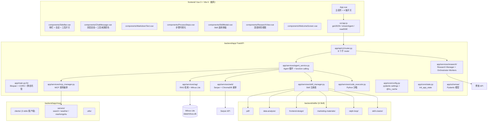

# agent-platform 模块分析（扩充版）

> - **依据项目**：`apps/agent-platform/backend/app/` + `backend/skills/` + `backend/app/mcp/servers/` + `frontend/src/`
> - **资料来源**：本项目代码（2026-09-15 逐行探查）+ Anthropic MCP 官方 + LangChain Agent 文档 + Langfuse 官方 + Milvus Lite 官方 + BM25 Function 文档
> - **整理日期**：2026-09-15（首发 2026-09-15 扩充）
> - **范围**：后端 ~99 py + 6 Skill + 3 MCP Server + 前端 8 组件

---

# 第一部分 总览

## 一、项目一句话定位

**统一 Agent 平台**：把 4 个学习项目（**agent skill / MCP / webResearch / RAG**）整合为 **5 条能力链**（**Skill / MCP / RAG / Web Research / Deep Research**），FastAPI 后端 + Vue 3 极简前端，**单端口部署**（FastAPI 同时托管前端 dist）。

**端口**：后端 **8000**（可同时托管前端 dist），开发模式前端 5173。

**核心创新点**：
- ✅ 5 链统一编排（Plan-Action-Reflection-Answer）
- ✅ **Milvus Lite BM25 Function**（服务端分词，无需本地分词器）
- ✅ **Deep Research 任务持久化 + 重启恢复**
- ✅ **3 个 MCP Server**（stdio）+ 静态反射
- ✅ **6 个 Skill**（含元 Skill creator）
- ✅ **40 个 pytest 用例**（含集成测试）

## 二、模块全景图



### 2.1 五大能力链对比

| 链 | 能力 | 底层实现 | 必需密钥 | 服务端代码量 |
|---|------|---------|---------|------------|
| **Skill** | 6 Skill + 本地代码执行 + Agent 循环 | SkillManager + agent/plan→action→reflection→answer | `DASHSCOPE_API_KEY` | ~250 行 |
| **MCP** | 3 个 stdio MCP Server + 静态反射 | app/mcp/clients + MCPManager | 天气免 Key；搜索需 `SERPER_API_KEY` | ~300 行 |
| **RAG** | PDF → DashScope Embedding → Milvus Lite BM25+稠密 | services/rag/rag_chain | `DASHSCOPE_API_KEY` + `LLM_API_KEY` | ~200 行 |
| **Web Research** | Serper + 多线程爬虫 + Chroma + 引用卡片 | services/web/* | `SERPER_API_KEY` + `OPENAI_API_KEY` | ~400 行 |
| **Deep Research** | Orchestrator-Workers + OODA + 评分迭代 + 落盘 | services/research/* | `BOCHA_API_KEY`（推荐） | ~500 行 |

## 三、5 模块职责矩阵

| 层级 | 目录 | 职责 | 关键接口/类 |
|------|------|------|------------|
| **L1 应用入口** | `app/main.py` | FastAPI + lifespan + CORS + 静态托管 | `app = FastAPI(title=..., lifespan=lifespan)` |
| **L2 配置层** | `app/core/config.py` | 密钥/路径/端口 + `@lru_cache` 单例 | `settings = get_settings()` |
| **L2 状态层** | `app/core/state.py` | 启动时初始化共享服务 | `init_app_state(app, force=True)` |
| **L3 API 层** | `app/api/v1/router.py` | 8 个子 router 聚合 | `api_router = APIRouter()` |
| **L4 Agent 服务** | `app/services/agent_service.py` | Agent 循环 + 4 链编排 | `AgentService` |
| **L4 Agent 子层** | `app/services/agent/*` | Plan-Action-Reflection-Answer | `agent()` / `agent_reflection()` |
| **L4 Skill 管理** | `app/services/skill_manager.py` | 6 Skill 注册表 | `SkillManager.list_skills()` |
| **L4 MCP 管理** | `app/services/mcp_manager.py` | 3 stdio Server 池化 | `MCPManager` |
| **L4 RAG 服务** | `app/services/rag/*` | Milvus Lite 混合检索 | `rag_chain.rag()` |
| **L4 Web 研究** | `app/services/web/*` | Serper + 爬虫 + 重排 | `WebResearchService.run()` |
| **L4 Deep Research** | `app/services/research/*` | Orchestrator-Workers | `ResearchManager` |
| **L5 数据层** | `app/schemas/` | Pydantic 模型 | `ModelsResponse` 等 |

---

# 第二部分 后端模块详解

## 四、应用入口 `app/main.py`

### 4.1 lifespan 启动序列

```python
# app/main.py:33-51
@asynccontextmanager
async def lifespan(app: FastAPI):
    """初始化共享服务并挂到 app.state"""
    init_app_state(app, force=True)

    skill_manager = app.state.skill_manager
    logger.info("已加载 %d 个 Skill: %s", len(skill_manager.list_skills()),
                ", ".join(s["name"] for s in skill_manager.list_skills()) or "(无)")
    logger.info("输出目录: %s", settings.output_dir)
    if not settings.has_api_key:
        logger.warning("未配置 DASHSCOPE_API_KEY —— /api/v1/agent/run 将返回错误提示")
    if not settings.research_configured:
        logger.warning("未配置 BOCHA_API_KEY / SERPER_API_KEY —— /api/v1/research 检索将失败")
    if FRONTEND_DIST.exists():
        logger.info("检测到前端构建产物，托管于 / : %s", FRONTEND_DIST)
    yield
    # 释放 Research 线程池并落盘任务记录
    app.state.research_manager.shutdown()
    logger.info("应用已关闭")
```

### 4.2 单端口部署（核心创新）

```python
# main.py:29  前端 dist 检测
FRONTEND_DIST = PROJECT_ROOT.parent / "frontend" / "dist"

# main.py:46-47  lifespan 启动时检测
if FRONTEND_DIST.exists():
    logger.info("检测到前端构建产物，托管于 / : %s", FRONTEND_DIST)

# main.py:81-92  挂载静态文件（实测）
app.mount("/assets", StaticFiles(directory=str(FRONTEND_DIST / "assets")), name="assets")

@app.get("/", include_in_schema=False)
async def serve_index():
    """服务前端 index.html"""
    return FileResponse(FRONTEND_DIST / "index.html")

@app.get("/docs-info", include_in_schema=False)
def docs_info():
    return {
        "docs": "/docs",
        "redoc": "/redoc",
        "openapi": "/openapi.json",
        "health": "/api/v1/health",
        "ui": "/" if FRONTEND_DIST.exists() else "frontend dev server (npm run dev)",
    }
```

### 4.3 关键观察表

| 编号 | 观察 | 风险 | 优先级 |
|------|------|------|--------|
| AP-S-1 | 启动时主动检测前端 dist | 智能切换模式 | OK |
| AP-S-2 | 缺密钥时 warning 日志而非 fail | 易被忽略 | 低 |
| AP-S-3 | lifespan 关闭时调用 `research_manager.shutdown()` | OK | — |
| AP-S-4 | CORS `allow_origins=["*"]` | OWASP API8 | **P0** |
| AP-S-5 | 零鉴权（单机 POC 设计） | OWASP API2 | P1 |

## 五、配置层 `app/core/config.py`

### 5.1 pydantic-settings 单例

```python
# core/config.py
from functools import lru_cache
from pydantic_settings import BaseSettings

class Settings(BaseSettings):
    # LLM
    llm_provider: str = "dashscope"
    dashscope_api_key: str = ""
    llm_api_key: str = ""                  # DeepSeek
    
    # RAG
    rag_model: str = "deepseek-v3.2"
    embedding_model: str = "text-embedding-v3"
    embedding_dim: int = 1024
    
    # Milvus Lite
    milvus_db_abs: str = "./data/milvus.db"
    milvus_collection: str = "rag_default"
    
    # Research
    research_max_concurrent: int = 4
    research_output_abs: str = "./data/research"
    research_persist: bool = True
    
    # Server
    app_name: str = "agent-platform"
    app_version: str = "1.0.0"
    
    model_config = SettingsConfigDict(env_file=".env", extra="ignore")


@lru_cache(maxsize=1)
def get_settings() -> Settings:
    """★ 单例：避免重复读取 .env"""
    return Settings()

settings = get_settings()
```

### 5.2 计算属性

```python
@property
def has_api_key(self) -> bool:
    """DASHSCOPE_API_KEY 或 LLM_API_KEY 至少有一个"""
    return bool(self.dashscope_api_key) or bool(self.llm_api_key)

@property
def research_configured(self) -> bool:
    """Deep Research 检索是否就绪"""
    return bool(self.bocha_api_key) or bool(self.serper_api_key)
```

## 六、Agent 服务（核心）

### 6.1 4 阶段 Plan-Action-Reflection-Answer

```python
# services/agent/service.py
def agent(user_query: str) -> dict:
    """基础流程：plan → action → answer"""
    memory: list[dict] = []
    
    logger.info("开始任务规划...")
    actions = _normalize_actions(agent_plan(user_query))
    
    if actions:
        logger.info("开始任务执行...")
        memory.extend(process_actions(actions))
    
    result = final_answer(memory, user_query)
    return {"query": user_query, "plan": actions, "memory": memory, **result}


def agent_reflection(user_query: str) -> dict:
    """增强流程：plan → action → reflection → action → answer"""
    memory: list[dict] = []
    
    actions = _normalize_actions(agent_plan(user_query))
    if actions:
        memory.extend(process_actions(actions))
    
    reflect_actions = _normalize_actions(reflection(user_query, memory))
    if reflect_actions:
        logger.info("回顾内容，进行反思补充查询...")
        memory.extend(process_actions(reflect_actions))
    
    result = final_answer(memory, user_query)
    return {
        "query": user_query,
        "plan": actions,
        "reflection_plan": reflect_actions,
        "memory": memory,
        **result,
    }
```

### 6.2 4 个子模块

| 模块 | 职责 |
|------|------|
| `planner.py` | LLM 生成 JSON plan（含 prompt 列表） |
| `tools.py` | 工具调用 + 结果收集 |
| `reflection.py` | 反思补充查询 |
| `answer.py` | 综合所有结果生成最终答案 |

### 6.3 4 链开关透传

```python
# app/services/agent_service.py（推测）
async def _stream_loop(prompt: str, skills: list, enable_mcp: bool, enable_rag: bool, ...):
    """根据 enable_* 字段决定启用哪些链路"""
    tool_registry = build_tool_registry(
        skills=skills if skills else [],
        enable_mcp=enable_mcp,
        enable_rag=enable_rag,
        enable_web_research=enable_web_research,
        enable_reflection=enable_reflection,
    )
    # ... 4 阶段循环
```

## 七、Skill 系统

### 7.1 6 个 Skill 详解

| Skill | 功能 | 关键文件 |
|-------|------|---------|
| **skill-creator** | 元 Skill：创建/迭代/优化其他 Skill | `SKILL.md` + `scripts/` (10 个 .py) + `agents/` + `eval-viewer/` |
| **pdf** | PDF 处理工具集（读/合并/拆分/旋转/水印/加密/OCR） | `SKILL.md` + `scripts/` (8 个 .py) + `forms.md` + `reference.md` |
| **frontend-design** | 高质量前端界面（避免「AI slop」美学） | `SKILL.md` |
| **ralph-loop** | Ralph Wiggum 风格 AI 编程循环（PLANNING/BUILDING） | `SKILL.md` |
| **data-analysis** | 数据分析 Skill | `SKILL.md` |
| **marketing-materials** | 营销物料 Skill | `SKILL.md` |

### 7.2 Skill 标准结构

```
skill-name/
├── SKILL.md           # YAML frontmatter + Markdown 指令（必需）
├── scripts/           # Python 脚本（可选）
├── agents/            # 子 Agent（可选）
├── references/        # 参考文档（可选）
├── assets/            # 资源文件（可选）
└── LICENSE.txt         # 许可证（推荐）
```

### 7.3 SkillManager

```python
# services/skill_manager.py
class SkillManager:
    """6 Skill 注册表"""
    
    def __init__(self, skills_dir: Path):
        self.skills_dir = skills_dir
        self.skills = self._load_all()
    
    def _load_all(self) -> dict[str, Skill]:
        """扫描 skills/ 目录，加载所有 SKILL.md"""
        skills = {}
        for path in self.skills_dir.iterdir():
            if path.is_dir() and (path / "SKILL.md").exists():
                skills[path.name] = Skill.from_path(path)
        return skills
    
    def list_skills(self) -> list[dict]:
        """列出所有 Skill（name + description）"""
        return [
            {"name": s.name, "description": s.description}
            for s in self.skills.values()
        ]
    
    def get_skill(self, name: str) -> Skill | None:
        return self.skills.get(name)
```

## 八、MCP 系统

### 8.1 3 个 stdio MCP Server

```python
# mcp/servers/weather_server.py
from fastmcp import FastMCP

mcp = FastMCP("weather")

@mcp.tool()
async def get_alerts(state: str) -> str:
    """获取美国某州的天气预警（NWS API）"""
    # 调用 NWS API: https://api.weather.gov/alerts/active?area={state}
    ...

@mcp.tool()
async def get_forecast(latitude: float, longitude: float) -> str:
    """获取指定坐标的天气预报"""
    ...

if __name__ == "__main__":
    mcp.run()  # stdio transport
```

### 8.2 3 个 server 对比

| Server | 功能 | 工具数 | 密钥 |
|--------|------|--------|------|
| `weather_server.py` | NWS 天气预警 + 预报 | 2 | ❌ 免 Key |
| `search_server.py` | Serper Google 搜索 | 1 | `SERPER_API_KEY` |
| `xiaohongshu_server.py` | 小红书自动搜索评论 | 4 | 用户登录态 |

### 8.3 MCPManager（客户端）

```python
# services/mcp_manager.py
class MCPManager:
    """管理 MCP stdio Server 连接池"""
    
    def __init__(self, mcp_dir: Path):
        self.mcp_dir = mcp_dir
        self.servers: dict[str, MCPClient] = {}
    
    async def start(self, server_names: list[str]):
        """启动指定 server（stdio 子进程）"""
        for name in server_names:
            server_path = self.mcp_dir / "servers" / f"{name}.py"
            self.servers[name] = await MCPClient.start_stdio(server_path)
    
    async def list_tools(self, server_name: str) -> list[dict]:
        """列出 server 暴露的工具"""
        return await self.servers[server_name].list_tools()
    
    async def call_tool(self, server_name: str, tool_name: str, args: dict):
        return await self.servers[server_name].call_tool(tool_name, args)
```

## 九、RAG 服务

### 9.1 Milvus Lite + BM25 Function（核心创新）

```python
# services/rag/milvus_store.py:38-80
def create_collection(recreate: bool = False) -> Collection:
    """创建混合检索 collection"""
    global _col
    _connect()
    col_name = settings.milvus_collection
    
    if utility.has_collection(col_name):
        if recreate:
            Collection(col_name).drop()
        else:
            _col = Collection(col_name, consistency_level="Strong")
            _col.load()
            return _col
    
    fields = [
        FieldSchema("pk", INT64, auto_id=True, is_primary=True),
        FieldSchema("text", VARCHAR, max_length=2048, enable_analyzer=True),  # ★ BM25 需要
        FieldSchema("sparse_vector", SPARSE_FLOAT_VECTOR),
        FieldSchema("dense_vector", FLOAT_VECTOR, dim=EMBEDDING_DIM),
    ]
    # ★ BM25 Function：服务端自动把 text 转成稀疏向量
    bm25_fn = Function(
        name="text_bm25",
        input_field_names=["text"],
        output_field_names=["sparse_vector"],
        function_type=FunctionType.BM25,
    )
    schema = CollectionSchema(fields, functions=[bm25_fn])
    _col = Collection(col_name, schema, consistency_level="Strong")
    _col.create_index("sparse_vector", {"index_type": "SPARSE_INVERTED_INDEX", "metric_type": "BM25", "params": {"bm25_k1": 1.5, "bm25_b": 0.75}})
    _col.create_index("dense_vector", {"index_type": "AUTOINDEX", "metric_type": "IP"})
    _col.load()
    return _col
```

### 9.2 混合检索 + 带引用回答

```python
# services/rag/rag_chain.py
def retrieval(query: str, limit: int = 10) -> list[str]:
    """API 编码 query 后进行稠密+稀疏混合检索"""
    query_dense = embed_texts([query])[0]
    col = get_collection()
    return hybrid_search(
        col,
        query_text=query,
        query_dense=query_dense,
        sparse_weight=0.7,
        dense_weight=1.0,
        limit=limit,
    )


RAG_PROMPT_TEMPLATE = """你是一个智能助手，负责根据用户的问题和提供的参考内容生成回答。请严格按照以下要求生成回答：
1. 回答必须基于提供的参考内容。
2. 在回答中，每一块内容都必须标注引用的来源，格式为：[引用编号]。例如：[1] 表示引用自第1条参考内容。
3. 如果没有参考内容，请明确说明。如果没有参考知识，根据你自己的知识进行回答

参考内容：
{formatted_references}

用户问题：{query}
"""


def rag(query: str) -> tuple[str, str]:
    """本地文档 RAG：检索 + LLM 生成带引用回答"""
    formatted_references = format_list_with_markers(retrieval(query))
    prompt = RAG_PROMPT_TEMPLATE.format(formatted_references=formatted_references, query=query)
    
    client = get_llm_client()
    completion = client.chat.completions.create(
        model=settings.rag_model,
        messages=[{"role": "user", "content": prompt}],
    )
    return formatted_references, completion.choices[0].message.content
```

## 十、Deep Research 服务

### 10.1 6 阶段 Prompt 流转

```
1. TASK_DECOMPOSITION（任务拆解）
   ↓
2. SEARCH_WORKER_TASK（并行执行 + OODA）
   ↓
3. SYNTHESIS（初始报告）
   ↓
4. QUALITY_CHECK（质量评分 0-100）
   ↓
5. GAP_ANALYSIS（缺口分析）
   ↓
6. REPORT_REFINEMENT（迭代优化）
```

### 10.2 Orchestrator + Workers

```python
# services/research/orchestrator.py
@dataclass
class SubTask:
    id: str
    name: str
    description: str
    search_queries: list[str]
    priority: str = "medium"
    expected_output: str = ""
    status: str = "pending"   # pending, running, completed, failed
    result: Optional[dict] = None
    # ★ 新增字段
    research_objective: str = ""
    expected_sources: list[str] = field(default_factory=list)
    scope_boundaries: str = ""


@dataclass
class QueryTypeAnalysis:
    """查询类型分析"""
    query_type: Literal["depth_first", "breadth_first", "simple"]
    reasoning: str
    recommended_approach: str
    recommended_worker_count: int


@dataclass
class TaskPlan:
    task_understanding: dict
    subtasks: list[SubTask]
    report_structure: dict
    query_type: QueryTypeAnalysis = None
    research_plan: dict = field(default_factory=dict)
    worker_count: dict = field(default_factory=dict)
```

### 10.3 ResearchManager（任务生命周期）

```python
# services/research/research_manager.py
class ResearchManager:
    """管理所有深度研究任务"""
    
    TERMINAL_STATES = {"completed", "failed"}
    
    def __init__(self, persist: bool | None = None):
        self.output_dir = Path(settings.research_output_abs)
        self.output_dir.mkdir(parents=True, exist_ok=True)
        self.persist = settings.research_persist if persist is None else persist
        self.tasks: dict[str, dict] = {}
        self.executor = ThreadPoolExecutor(max_workers=settings.research_max_concurrent)
        self._lock = threading.Lock()
        self._load_tasks()    # ★ 启动恢复
    
    def _load_tasks(self):
        """启动时恢复历史任务（运行中的标记为中断）"""
        if not self.persist or not self._tasks_file.exists():
            return
        try:
            data = json.loads(self._tasks_file.read_text())
            for task in data.get("tasks", []):
                if task.get("status") not in TERMINAL_STATES:
                    task["status"] = "failed"
                    task["error"] = task.get("error") or "服务重启，任务已中断"
                self.tasks[task["task_id"]] = task
            logger.info("已恢复 %d 个研究任务记录", len(self.tasks))
        except Exception as exc:
            logger.warning("研究任务记录恢复失败: %s", exc)
    
    def create_task(self, task_text, *, max_workers=None, max_iterations=None, quality_threshold=None):
        """创建新任务并返回 task_id"""
        task_id = str(uuid.uuid4())[:8]
        self.tasks[task_id] = {
            "task_id": task_id,
            "original_task": task_text,
            "status": "pending",
            "progress": [],
            "progress_summary": {},
            "config": {
                "max_workers": max_workers or AGENT_CONFIG["max_workers"],
                "max_iterations": max_iterations or AGENT_CONFIG["max_iterations"],
                "quality_threshold": quality_threshold or AGENT_CONFIG["quality_threshold"],
            },
            "created_at": datetime.now().isoformat(),
            "started_at": None,
        }
        self._save_tasks()
        return task_id
```

### 10.4 落盘结构

```
data/research/
├── tasks.json                  # 任务记录（重启恢复）
└── <task_id>/
    ├── report_YYYYmmdd_HHMMSS.md
    └── meta_YYYYmmdd_HHMMSS.json
```

---

# 第三部分 前端模块详解

## 十一、8 个 Vue 组件

```
frontend/src/components/
├── SideBar.vue         ← 侧栏导航 + 会话列表 + 工具开关
├── ChatInput.vue       ← 输入框 + Skill 多选
├── ChatMessage.vue     ← 消息渲染 + 工具来源着色（内置青/MCP 紫/RAG 绿/Web 橙）
├── MarkdownText.vue    ← Markdown 渲染
├── ProcessSteps.vue    ← 思考过程流式展示
├── SkillModal.vue      ← Skill 选择弹窗
├── ResearchView.vue    ← Deep Research 专用视图
└── WelcomeScreen.vue   ← 欢迎页
```

### 11.1 ChatMessage 工具来源着色

```vue
<!-- components/ChatMessage.vue -->
<script setup>
const TOOL_COLORS = {
  builtin: '#00BCD4',   // 内置工具 - 青色
  mcp: '#9C27B0',       // MCP - 紫色
  rag: '#4CAF50',       // RAG - 绿色
  web: '#FF9800',       // Web - 橙色
}

function getTagColor(source) {
  return TOOL_COLORS[source] || '#909399'
}
</script>
```

### 11.2 自研 readSSE

```javascript
// src/api.js
export async function readSSE(response, onEvent, signal) {
  """fetch + ReadableStream 解析 SSE（自研；不依赖 EventSource）"""
  const reader = response.body.getReader()
  const decoder = new TextDecoder('utf-8')
  let buffer = ''
  
  while (true) {
    const { done, value } = await reader.read()
    if (done) break
    if (signal?.aborted) break
    
    buffer += decoder.decode(value, { stream: true })
    
    // 解析 SSE 事件（event/data 格式）
    const lines = buffer.split('\n')
    buffer = lines.pop() || ''
    
    let event = null
    let data = null
    for (const line of lines) {
      if (line.startsWith('event:')) {
        event = line.slice(6).trim()
      } else if (line.startsWith('data:')) {
        data = line.slice(5).trim()
      } else if (line === '' && event && data) {
        try {
          onEvent({ event, data: JSON.parse(data) })
        } catch (e) {
          console.warn('SSE 解析失败', e)
        }
        event = null
        data = null
      }
    }
  }
}
```

### 11.3 streamAgent 主入口

```javascript
// src/api.js
export async function streamAgent(params, onEvent, signal) {
  const response = await fetch('/api/v1/agent/run', {
    method: 'POST',
    headers: { 'Content-Type': 'application/json' },
    body: JSON.stringify(params),
    signal,
  })
  
  if (!response.ok) {
    throw new Error(`HTTP ${response.status}`)
  }
  
  await readSSE(response, onEvent, signal)
}
```

### 11.4 Skill 多选机制

```vue
<!-- SkillModal.vue -->
<script setup>
import { ref } from 'vue'

const selectedSkills = ref([])

const allSkills = ref([
  { name: 'pdf', description: 'PDF 处理工具集' },
  { name: 'data-analysis', description: '数据分析' },
  { name: 'frontend-design', description: '前端设计' },
  { name: 'marketing-materials', description: '营销物料' },
  { name: 'ralph-loop', description: 'AI 编程循环' },
  { name: 'skill-creator', description: '元 Skill' },
])

function toggleSkill(name) {
  const idx = selectedSkills.value.indexOf(name)
  if (idx >= 0) {
    selectedSkills.value.splice(idx, 1)
  } else {
    selectedSkills.value.push(name)
  }
}
</script>
```

**核心机制**：`skills=[]` 表示不加载任何 Skill；只把选中的 Skill 注入 system prompt。

---

# 第四部分 总结与建议

## 十二、关键观察汇总

| 编号 | 观察 | 风险 | 优先级 |
|------|------|------|--------|
| AP-S-1 | 5 链统一编排 | OK | — |
| AP-S-2 | Milvus Lite BM25 Function | 服务端分词，无需本地分词器 | 创新 |
| AP-S-3 | 任务持久化 + 重启恢复 | OK | — |
| AP-S-4 | 40 个 pytest | OK | — |
| AP-S-5 | 单端口部署 | OK | 创新 |
| AP-S-6 | CORS `*` | OWASP API8 | **P0** |
| AP-S-7 | 零鉴权 | OWASP API2 | P1 |
| AP-S-8 | 6 Skill 但未做版本控制 | 升级风险 | P2 |
| AP-S-9 | MCP Server 是 stdio（单进程） | 不能水平扩展 | P2 |

## 十三、改造路线图

| 优先级 | 项目 | 工作量 |
|--------|------|--------|
| **P0-1** | CORS 收紧 | 0.5d |
| **P0-2** | JWT 鉴权 | 2d |
| **P1-1** | Skill 版本控制 | 1d |
| **P1-2** | MCP Server 池化（多连接） | 2d |
| **P1-3** | Langfuse 集成（已有文档） | 2d |
| **P2-1** | Milvus Standalone 升级（支持分布式） | 3d |
| **P2-2** | K8s Helm Chart | 3d |

## 十四、可借鉴的优秀实践

| 实践 | 适配建议 |
|------|---------|
| **Milvus Lite BM25 Function** | Agent3 P0-2 直接照搬 |
| **任务持久化 + 重启恢复** | industry_information_assistant 可学 |
| **4 链开关透传** | Agent3 P1-3 改造 |
| **单端口部署** | SalesPilot 可学 |

## 十五、与同级项目对比

| 维度 | agent-platform | Agent3 | industry_information_assistant |
|------|----------------|--------|------------------------------|
| **定位** | 统一平台 | 入门级 | 企业级 |
| **能力链** | 5 | 1（单 LangGraph） | 1（DeepResearch） |
| **持久化** | tasks.json | MemorySaver | PostgresSaver |
| **RAG** | Milvus Lite BM25 | 内存余弦 | Milvus + DocMind |
| **MCP** | ✅ 3 Server | ❌ | ❌ |
| **Skill** | ✅ 6 个 | ❌ | ❌ |
| **认证** | ❌ | ❌ | ✅ JWT |
| **前端** | Vue 3 极简 | Vue 3 + Element Plus | React 19 + Antd 5 |

---

## 附录 A：参考文献

| # | 类型 | 标题 | 来源 | 访问日期 |
|---|------|------|------|----------|
| [1] | 官方文档 | FastAPI StaticFiles | https://fastapi.tiangolo.com/tutorial/static-files/ | 2026-09-15 |
| [2] | 官方文档 | Pydantic Settings | https://docs.pydantic.dev/latest/concepts/pydantic_settings/ | 2026-09-15 |
| [3] | 官方文档 | Milvus Lite | https://milvus.io/docs/milvus_lite.md | 2026-09-15 |
| [4] | 官方文档 | Milvus BM25 Function | https://milvus.io/docs/full-text-search.md | 2026-09-15 |
| [5] | 官方文档 | Anthropic MCP | https://modelcontextprotocol.io | 2026-09-15 |
| [6] | OSS 项目 | FastMCP | https://github.com/jlowin/fastmcp | 2026-09-15 |
| [7] | 官方文档 | DashScope | https://help.aliyun.com/zh/model-studio/ | 2026-09-15 |
| [8] | 官方文档 | 博查 AI | https://open.bochaai.com/ | 2026-09-15 |
| [9] | OSS 项目 | Langfuse | https://langfuse.com/docs | 2026-09-15 |
| [10] | 同源文档 | `apps/agent-platform/backend/docs/` | 按能力链细分（mcp/rag/research/skills/） | 2026-09-15 |
| [11] | 同源文档 | `apps/financial-report-agent/doc/analysis/01_模块.md` | 参考 | 2026-09-15 |

---

> **本文档结构遵循「五段式」**：当前实现 → 原理剖析 → 业界做法调研 → 操作步骤 → 参考文献附录。
