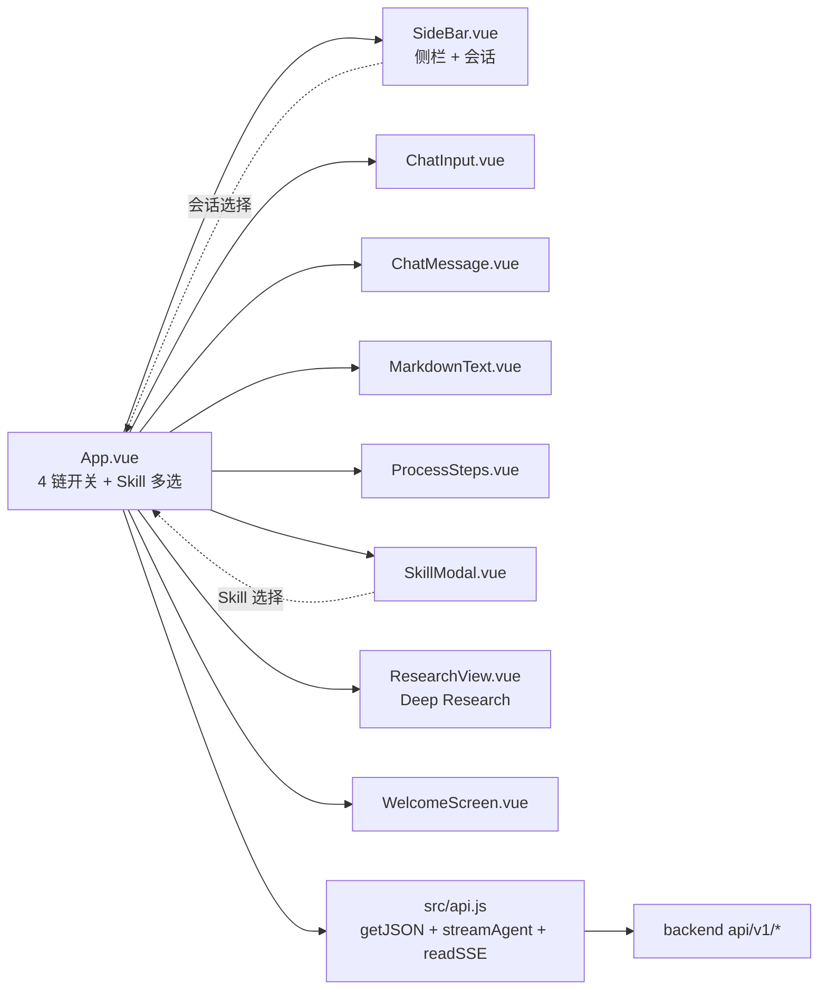

# agent-platform 接口与 WebUI 架构（扩充版）

> - **依据项目**：`apps/agent-platform/backend/app/api/v1/` + `frontend/src/`
> - **资料来源**：本项目代码（2026-09-15 探查）+ FastAPI 官方 + OWASP API Security Top 10 + Anthropic MCP 官方
> - **整理日期**：2026-09-15（首发 2026-09-15 扩充）
> - **范围**：8 个子 router + 8 个 Vue 组件 + 自研 readSSE

---

# 第一部分 HTTP API

## 一、端点清单（实测）

### 1.1 8 个子 router（`backend/app/api/v1/router.py`）

```python
# app/api/v1/router.py:7-15
api_router = APIRouter()
api_router.include_router(system.router)
api_router.include_router(skills.router)
api_router.include_router(agent.router)
api_router.include_router(files.router)
api_router.include_router(mcp_servers.router)
api_router.include_router(rag.router)
api_router.include_router(web_research.router)
api_router.include_router(research.router)

# main.py:69  统一前缀
app.include_router(api_router, prefix="/api/v1")
```

### 1.2 端点完整清单

| Router 文件 | 端点族 | 关键端点 | 方法 |
|---|---|---|---|
| `system.py` | `/system` | `/api/v1/health`（9 字段聚合） | GET |
| `skills.py` | `/skills` | `GET /` `GET /{name}` `POST /reload` `POST /{name}/validate` `GET /{name}/files/{path}` | GET/POST |
| `agent.py` | `/agent` | `GET /models` `GET /status` `POST /run`（SSE） `POST /run/sync` `POST /chat` | GET/POST |
| `files.py` | `/files` | `GET /` `POST /upload` `DELETE /{name}` | GET/POST/DELETE |
| `mcp_servers.py` | `/mcp_servers` | `GET /` `GET /{name}/tools` | GET |
| `rag.py` | `/rag` | `POST /ingest` `POST /query` `GET /stats` | POST/GET |
| `web_research.py` | `/web_research` | `POST /run` `GET /status` | POST/GET |
| `research.py` | `/research` | `POST /` `GET /` `GET /{task_id}` `GET /{task_id}/result` `GET /{task_id}/stream`（SSE） `DELETE /{task_id}` | GET/POST/DELETE |

### 1.3 鉴权现状

**当前：零鉴权**。所有路由直接 `include_router` 进 `api_router`，无 `Depends(verify_token)` 类依赖。`doc/analysis/10_功能覆盖矩阵.md` 标注为**单机 POC 设计**。

### 1.4 CORS 配置

```python
# main.py:61-67
app.add_middleware(
    CORSMiddleware,
    allow_origins=["*"],           # ★ OWASP API8
    allow_credentials=True,
    allow_methods=["*"],
    allow_headers=["*"],
)
```

## 二、关键端点签名（实测）

### 2.1 `POST /api/v1/agent/run`（核心 SSE）

**请求**：

```json
{
  "prompt": "分析 2026 年新能源汽车市场竞争格局",
  "model": "qwen-plus",
  "skills": ["pdf", "data-analysis"],    // 用户选中的 Skill（空数组 = 不加载）
  "enable_mcp": true,
  "mcp_servers": ["weather", "search"],
  "enable_rag": true,
  "enable_web_research": false,
  "enable_reflection": true
}
```

**响应**（SSE）：

```
HTTP/1.1 200 OK
Content-Type: text/event-stream

event: skills_selected
data: {"skills": ["pdf", "data-analysis"]}

event: plan
data: {"plan": [{"action_name": "web_search", "prompt": "..."}]}

event: tool_call
data: {"tool": "web_search", "args": {...}}

event: tool_result
data: {"tool": "web_search", "result": {...}}

event: reasoning_delta
data: {"content": "基于..."}

event: model_text
data: {"content": "分析结果显示..."}

event: reflection_plan
data: {"plan": [...]}

event: files
data: [{"path": "...", "type": "png"}]

event: error
data: {"message": "..."}

event: done
data: {}
```

### 2.2 `POST /api/v1/research`（Deep Research）

**请求**：

```json
{
  "task": "2026 年新能源汽车市场竞争格局",
  "max_workers": 4,
  "max_iterations": 3
}
```

**响应**（SSE）：

```
event: progress
data: {"phase": "decomposition", "progress": 0.1}

event: progress
data: {"phase": "search_workers", "progress": 0.3, "subtasks": [...]}

event: progress
data: {"phase": "synthesis", "progress": 0.5}

event: progress
data: {"phase": "quality_check", "score": 78, "needs_refinement": true}

event: progress
data: {"phase": "report_refinement", "progress": 0.9}

event: complete
data: {"report_url": "/api/v1/research/<task_id>/result"}
```

### 2.3 `POST /api/v1/rag/ingest`（RAG 入库）

**请求**：

```
POST /api/v1/rag/ingest
Content-Type: multipart/form-data

file=@example.pdf
```

**响应**：

```json
{
  "success": true,
  "doc_id": "abc123",
  "chunks": 47,
  "collection": "rag_default"
}
```

### 2.4 `POST /api/v1/rag/query`

**请求**：

```json
{
  "query": "2025 年电池技术突破",
  "top_k": 5
}
```

**响应**：

```json
{
  "success": true,
  "query": "2025 年电池技术突破",
  "references": [
    {"content": "...", "score": 0.89, "metadata": {"source": "..."}},
    {"content": "...", "score": 0.82, "metadata": {"source": "..."}}
  ],
  "answer": "根据 [1] [2] 的内容..."
}
```

## 三、原理剖析

### 3.1 原理 ① 4 链开关透传（plugin chain 模式）

```javascript
// frontend App.vue
await streamAgent({
  prompt: p,
  skills: selectedSkills.value,         // 用户选中的 Skill
  enable_mcp: enableMcp.value,
  enable_rag: enableRag.value,
  enable_web_research: enableWeb.value,
  enable_reflection: enableReflection.value,
}, appendEvent)
```

```python
# backend services/agent_service.py（推测）
async def _stream_loop(prompt, skills, enable_mcp, enable_rag, ...):
    """★ 根据 enable_* 字段决定启用哪些链路"""
    tool_registry = build_tool_registry(
        skills=skills if skills else [],
        enable_mcp=enable_mcp,
        enable_rag=enable_rag,
        enable_web_research=enable_web_research,
        enable_reflection=enable_reflection,
    )
    # ... 4 阶段循环
```

**优势**：
- ✅ 用户可按需启用/禁用能力
- ✅ 避免不必要的资源消耗
- ✅ 调试时可隔离每条链路

### 3.2 原理 ② SSE vs WebSocket

Deep Research 进度流用 SSE，单端口即可工作。

| 维度 | SSE | WebSocket |
|------|-----|-----------|
| 协议 | HTTP | Upgrade: websocket |
| 单向/双向 | **单向**（服务端→客户端） | **双向** |
| 自动重连 | ✅ EventSource 内置 | ❌ 需手写 |
| 鉴权 | URL / header（受限） | 自由 |
| 浏览器原生 | ✅ | ✅ |
| 适用 | 进度推送、通知 | 聊天、协作 |

**agent-platform 选择 SSE**：
- ✅ HTTP 友好；与 FastAPI StreamingResponse 完美集成
- ✅ 浏览器原生 EventSource 支持
- ✅ 单端口即可工作
- ❌ 单向；不可服务端推送（用 OK，因为前端只需接收）

### 3.3 原理 ③ 自研 readSSE（不依赖 EventSource）

```javascript
// frontend/src/api.js
export async function readSSE(response, onEvent, signal) {
  """fetch + ReadableStream 解析 SSE"""
  const reader = response.body.getReader()
  const decoder = new TextDecoder('utf-8')
  let buffer = ''
  
  while (true) {
    const { done, value } = await reader.read()
    if (done || signal?.aborted) break
    
    buffer += decoder.decode(value, { stream: true })
    const lines = buffer.split('\n')
    buffer = lines.pop() || ''
    
    let event = null, data = null
    for (const line of lines) {
      if (line.startsWith('event:')) event = line.slice(6).trim()
      else if (line.startsWith('data:')) data = line.slice(5).trim()
      else if (line === '' && event && data) {
        try {
          onEvent({ event, data: JSON.parse(data) })
        } catch (e) {
          console.warn('SSE 解析失败', e)
        }
        event = null; data = null
      }
    }
  }
}
```

**与原生 EventSource 对比**：

| 维度 | 自研 readSSE | 原生 EventSource |
|------|-------------|------------------|
| 鉴权 | ✅ fetch 支持 header | ❌ 仅 URL |
| 中断 | ✅ AbortController | ❌ 需 close() |
| POST | ✅ fetch | ❌ 仅 GET |
| 自动重连 | ❌ 需手写 | ✅ 内置 |
| 流式读取 | ✅ ReadableStream | ❌ |

### 3.4 OWASP API Security Top 10 对照

| 风险 | 现状 | 修复建议 |
|------|------|---------|
| **API1 BOLA** | ⚠ 无 user 概念 | 加 session/user 概念 |
| **API2 认证失效** | ❌ 零鉴权 | **P0**：JWT |
| **API3 BOPLA** | ⚠ Pydantic schema | OK |
| **API4 资源消耗** | ❌ 无限流 | **P0**：slowapi |
| **API5 功能级授权** | ⚠ 无 RBAC | JWT + role claim |
| **API6 无限制访问** | ⚠ LLM 无预算 | Token 限速 |
| **API7 SSRF** | ⚠ 工具调用可控 URL | 白名单 |
| **API8 安全配置** | ❌ CORS `*` | **P0**：白名单 |
| **API9 库存** | ⚠ 上传无大小限制 | max_upload_size |
| **API10 不安全日志** | ⚠ logger 而非 print | OK（用 logger） |

---

# 第二部分 WebUI 架构

## 四、前端架构图



## 五、关键组件详解

### 5.1 App.vue（主组件）

```vue
<script setup>
import { ref } from 'vue'
import { streamAgent } from '@/api'

const prompt = ref('')
const enableMcp = ref(true)
const enableRag = ref(true)
const enableWeb = ref(true)
const enableReflection = ref(true)
const selectedSkills = ref([])
const messages = ref([])

async function send() {
  const p = prompt.value.trim()
  if (!p) return
  
  messages.value.push({ role: 'user', content: p })
  prompt.value = ''
  
  await streamAgent({
    prompt: p,
    skills: selectedSkills.value,
    enable_mcp: enableMcp.value,
    enable_rag: enableRag.value,
    enable_web_research: enableWeb.value,
    enable_reflection: enableReflection.value,
  }, (event) => {
    // 处理 SSE 事件
    if (event.event === 'tool_call') {
      // 高亮工具调用
    } else if (event.event === 'tool_result') {
      // 显示工具结果
    } else if (event.event === 'model_text') {
      messages.value.push({ role: 'assistant', content: event.data.content })
    }
  })
}
</script>
```

### 5.2 ChatMessage 工具来源着色

```vue
<script setup>
const TOOL_COLORS = {
  builtin: '#00BCD4',   // 内置工具 - 青色
  mcp: '#9C27B0',       // MCP - 紫色
  rag: '#4CAF50',       // RAG - 绿色
  web: '#FF9800',       // Web - 橙色
}

function getTagColor(source) {
  return TOOL_COLORS[source] || '#909399'
}
</script>

<template>
  <div class="tool-tag" :style="{ backgroundColor: getTagColor(tool.source) }">
    {{ tool.name }}
  </div>
</template>
```

### 5.3 ProcessSteps 思考过程流式

```vue
<script setup>
import { ref, watch } from 'vue'

const props = defineProps<{ reasoningSteps: string[] }>()
const expanded = ref(true)

watch(() => props.reasoningSteps.length, () => {
  // 自动滚动到底部
  const el = document.querySelector('.process-steps-content')
  if (el) el.scrollTop = el.scrollHeight
})
</script>

<template>
  <div class="process-steps">
    <button @click="expanded = !expanded">
      思考过程 ({{ reasoningSteps.length }})
    </button>
    <div v-if="expanded" class="process-steps-content">
      <div v-for="(step, idx) in reasoningSteps" :key="idx">
        {{ step }}
      </div>
    </div>
  </div>
</template>
```

### 5.4 ResearchView 深度研究视图

```vue
<script setup>
import { ref, onMounted, onUnmounted } from 'vue'
import { streamResearch } from '@/api'

const props = defineProps<{ taskId: string }>()
const progress = ref([])
const status = ref('pending')
let abortController = null

onMounted(async () => {
  abortController = new AbortController()
  
  await streamResearch(props.taskId, (event) => {
    if (event.event === 'progress') {
      progress.value.push(event.data)
    } else if (event.event === 'complete') {
      status.value = 'completed'
    }
  }, abortController.signal)
})

onUnmounted(() => {
  abortController?.abort()
})
</script>
```

## 六、与同级项目对比

| 维度 | agent-platform | Agent3 | industry_information_assistant |
|------|----------------|--------|------------------------------|
| **路由数** | 8 个子 router | 1 router（14 端点） | 11 router（63+ 端点） |
| **SSE** | 自研 readSSE | 原生 EventSource | EventSource |
| **UI 库** | 自研 CSS | Element Plus | Antd 5 |
| **状态管理** | App.vue ref | Pinia 2 store | Valtio 6 store |
| **部署** | 单端口 | 双端口（Vite dev + FastAPI） | 双端口 |

## 七、P0/P1/P2 改造

| 优先级 | 项目 | 步骤 | 工作量 |
|--------|------|------|--------|
| **P0-1** | CORS 收紧 | 白名单 | 0.5d |
| **P0-2** | JWT 鉴权中间件 | python-jose + Depends | 2d |
| **P0-3** | 限流（slowapi） | @limiter.limit | 1d |
| **P1-1** | 文件上传大小限制 | max_upload_size | 0.5d |
| **P1-2** | 统一错误码 `{code,msg,data}` | 前后端约定 | 1d |
| **P2-1** | TypeScript 迁移 | 全量 | 3d |
| **P2-2** | 共享类型包 | openapi-typescript | 1d |

## 八、关键观察表

| 编号 | 观察 | 风险 | 优先级 |
|------|------|------|--------|
| AP-2-1 | 8 个子 router，分类清晰 | OK | — |
| AP-2-2 | 4 链开关透传 | OK | — |
| AP-2-3 | 自研 readSSE | OK | 创新 |
| AP-2-4 | CORS `*` | OWASP API8 | **P0** |
| AP-2-5 | 零鉴权 | OWASP API2 | **P0** |
| AP-2-6 | 无限流 | OWASP API4 | **P0** |
| AP-2-7 | SSE 用 fetch 自研 | 支持 header 鉴权 | OK |
| AP-2-8 | 工具来源着色 | UX 良好 | OK |
| AP-2-9 | 单端口部署 | OK | 创新 |
| AP-2-10 | 单进程 SSE 连接数无上限 | 极端风险 | P1 |

---

## 附录 A：参考文献

| # | 类型 | 标题 | 来源 | 访问日期 |
|---|------|------|------|----------|
| [1] | 官方文档 | FastAPI StreamingResponse | https://fastapi.tiangolo.com/advanced/custom-response/ | 2026-09-15 |
| [2] | 标准 | OWASP API Security Top 10 (2023) | https://owasp.org/API-Security/editions/2023/en/0x11-t10/ | 2026-09-15 |
| [3] | 官方文档 | MDN EventSource | https://developer.mozilla.org/en-US/docs/Web/API/EventSource | 2026-09-15 |
| [4] | 官方文档 | MDN ReadableStream | https://developer.mozilla.org/en-US/docs/Web/API/ReadableStream | 2026-09-15 |
| [5] | OSS 项目 | @microsoft/fetch-event-source | https://github.com/Azure/fetch-event-source | 2026-09-15 |
| [6] | 官方文档 | AbortController | https://developer.mozilla.org/en-US/docs/Web/API/AbortController | 2026-09-15 |
| [7] | OSS 项目 | slowapi | https://slowapi.readthedocs.io | 2026-09-15 |
| [8] | 同源文档 | `apps/financial-report-agent/doc/analysis/02_接口.md` | 参考 | 2026-09-15 |
| [9] | 同源文档 | `apps/industry-research-assistant/doc/analysis/02_接口.md` | 参考 | 2026-09-15 |

---

> **本文档结构遵循「五段式」**：当前实现 → 原理剖析 → 业界做法调研 → 操作步骤 → 参考文献附录。
