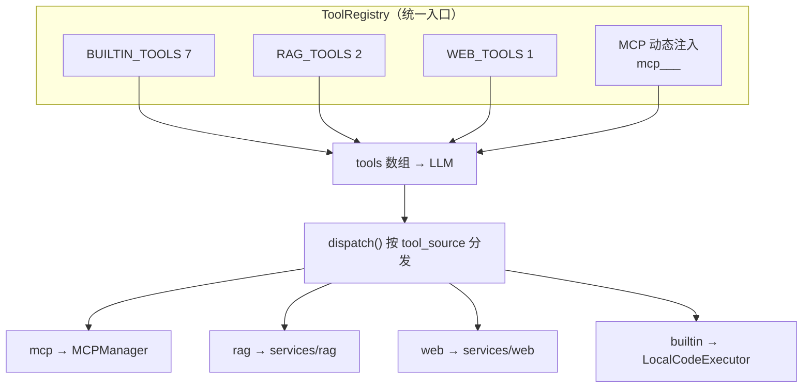
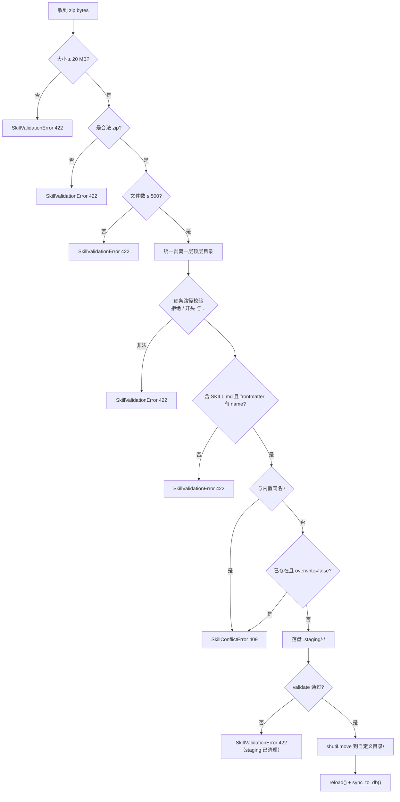

# 能力链实现

> - **依据代码**：`backend/app/services/skill_manager.py`、`team_service.py`、`mcp_manager.py`、`chains/skills/`、`chains/mcp/`、`backend/app/mcp/servers/`、`backend/app/services/rag/`、`backend/app/services/web/`、`backend/app/services/research/`、`backend/app/services/tool_registry.py`
> - **资料来源**：2026-10-29 逐文件复核
> - **整理日期**：2026-10-29
> - **对应基线**：commit `7385dcd` + 工作区未提交改动
> - **相关篇目**：`01` 架构总览 ｜ `03` 执行引擎 ｜ `07` Deep Research 详情 ｜ `12` 风险台账 ｜ `17` 扩展层（插件）

---

# 第一部分 现状事实

五链共用的底座是 **ToolRegistry**：它把「内置工具 + RAG 工具 + Web 工具 + MCP 动态工具」合并成一个 OpenAI 兼容的 `tools` 数组，并按 `ToolProfile`（chat / work）裁剪。链路之间的差别在于**工具从哪来、结果怎么回**。



**10 个静态工具全表**（`backend/app/services/tool_registry.py`）：

| # | 工具名 | 来源常量 | Profile | 说明 |
|---|---|---|---|---|
| 1 | `tool_search` | `BUILTIN_TOOLS:46` | chat + work | 在工具目录中按关键词检索（延迟装载） |
| 2 | `tool_load` | `BUILTIN_TOOLS:60` | chat + work | 加载某个工具的完整 Schema（延迟装载） |
| 3 | `read_file` | `BUILTIN_TOOLS:73` | chat + work | 读文件（只读） |
| 4 | `write_file` | `BUILTIN_TOOLS:83` | 仅 work | 写文件（触发写前快照 + 变更记账） |
| 5 | `execute_python` | `BUILTIN_TOOLS:94` | 仅 work | 执行 Python（受 rlimit 限额约束） |
| 6 | `execute_bash` | `BUILTIN_TOOLS:104` | 仅 work | 执行 Bash（命令黑名单 + 分段权限判定） |
| 7 | `list_directory` | `BUILTIN_TOOLS:114` | chat + work | 列目录（只读） |
| 8 | `rag_query` | `RAG_TOOLS:129` | chat + work | RAG 混合检索问答 |
| 9 | `rag_ingest` | `RAG_TOOLS:140` | 仅 work | RAG 入库（写类） |
| 10 | `web_research` | `WEB_TOOLS:152` | 仅 work | Web 检索 + 引用卡片 |

> 另有 MCP 动态工具 **12 个**（`mcp_<server>__<tool>`），数量随注册表变化。

---

## 一、Skill 链

### 1.1 存储模型：内容在文件系统，元数据在 DB

| 层 | 位置 | 内容 |
| --- | --- | --- |
| **内容真相** | `backend/skills/<name>/SKILL.md`（内置，只读）<br>`backend/data/skills_custom/<name>/SKILL.md`（自定义，可写） | YAML frontmatter + Markdown 指令 + 附属资源（scripts / references / assets） |
| **元数据索引** | `skills` 表 | `name` / `description` / `source`(builtin\|custom) / `path` / `frontmatter_json` / `enabled` / `stale` / `updated_at` |

**双目录扫描与覆盖规则**（`backend/app/services/skill_manager.py:69-104`）：

1. 先扫 `custom_dir`（`data/skills_custom`），标记 `source="custom"`；
2. 再扫 `skills_dir`（`backend/skills`），标记 `source="builtin"`；
3. **同名时内置被跳过**（`skill_manager.py:90-91`）——自定义覆盖内置；
4. 目录必须含 `SKILL.md`、frontmatter 必须含 `name`，否则跳过；
5. 内存字典字段：`name` / `description` / `path` / `skill_md_path` / `skill_md_rel` / `content` / `resources` / `source` / `mtime` / `enabled`。

### 1.2 SKILL.md 解析与校验规则

**解析**（`skill_manager.py:106-118`）：内容必须以 `---` 开头，`content.split("---", 2)` 取第 2 段作为 YAML，`yaml.safe_load` 失败或结果非 dict 则返回 `None`（该 Skill 被跳过）。

**校验**（`backend/app/services/skill_manager.py:493-548`，等价于 `backend/skills/skill-creator/scripts/quick_validate.py`）：

| 规则 | 判据 |
| --- | --- |
| frontmatter 白名单 | 仅允许 `name` `description` `license` `allowed-tools` `metadata` `compatibility`（`skill_manager.py:26`），出现其它 key 即失败 |
| 必填 | `name` + `description` |
| `name` 格式 | `^[a-z0-9-]+$`（kebab-case） |
| `name` 边界 | 不得以 `-` 开头/结尾、不得含 `--`、长度 ≤ 64 |
| `description` | 不得含 `<` / `>`，长度 ≤ 1024 |

> ⚠️ **两套规范冲突**：`chains/skills/spec.py:16-18` 的 `ALLOWED_FIELDS` **不含 `license`**，而 `skill_manager.py:26` **含**。
> 由于 `chains/skills/index.py` 未接入运行时（见 §1.5），该冲突目前**不影响生产路径**，但一旦轻量索引被接线，`frontend-design` / `pdf` / `skill-creator` 三个带 `license` 的内置 Skill 会被 `spec.validate()` 静默跳过。

### 1.3 渐进式披露（第一级）

`build_system_prompt()`（`skill_manager.py:403-488`）只注入 Skill 的**名称 + 描述 + 指令文件路径**，不注入 `SKILL.md` 正文；模型若要执行某个 Skill，需自行调用 `read_file` 读取该路径。这把上下文成本从「N 个 Skill 的完整正文」降为「N 行描述」。

注入形态：

```
### <name>
- 描述: <description>
- 指令文件: <绝对路径>
```

`sequential` 策略下额外加 `[步骤 i/N]` 前缀（`skill_manager.py:477`）。

### 1.4 Skill 选择语义

| 入参 | 解析结果 | 位置 |
| --- | --- | --- |
| `skills=None` | 全部**启用中**的 Skill | `skill_manager.py:384-395` |
| `skills=[]` | **不加载任何** Skill | 同上 |
| `skills=["pdf","不存在"]` | 仅 `pdf`（不存在的名字被忽略） | 同上 |
| `skills=None` + `mode="chat"` | **不加载任何** Skill（模式感知覆盖） | `skill_manager.py:397-401` |
| `skills=None` + `mode="work"` | 全部启用中的 Skill | 同上 |

### 1.5 管理闭环

| 操作 | 行为 | 关键约束 | 位置 |
| --- | --- | --- | --- |
| **创建** | 在自定义目录建 `<name>/SKILL.md`（自动拼 frontmatter） | 同名 → `SkillConflictError`（409）；校验失败 → 删目录并抛 `SkillValidationError`（422） | `skill_manager.py:216-231` |
| **编辑** | 重写 `SKILL.md` | **内置 Skill → `SkillForbiddenError`（403）**；校验失败 → 回写原内容再抛 422 | `skill_manager.py:233-251` |
| **启停用** | 写 `skills.enabled` → `reload()` → `sync_to_db()` | 状态持久在 DB，重启后生效 | `skill_manager.py:258-277` |
| **删除** | **软删除**：移动到 `data/skills_custom/.trash/<name>-<ts>` | 内置 → 403；返回 `{deleted, trash_path}` | `skill_manager.py:279-293` |
| **导出 zip** | `rglob("*")` 打包，排除 `__pycache__` / `node_modules` / `evals` / `.DS_Store` / `*.pyc` | — | `skill_manager.py:295-310` |
| **导入 zip** | 见下 | 见下 | `skill_manager.py:312-379` |
| **校验** | `POST /skills/{name}/validate` | 返回 `{valid, message, name}` | `skill_manager.py:493-548` |
| **资源读取** | `GET /skills/{name}/files/{resource_path}` | `get_resource_path()` 解析后校验 `target.startswith(base)`，**防路径穿越与符号链接逃逸** | `skill_manager.py:185-194` |

**zip 导入安全流程**（`skill_manager.py:312-379`）：



### 1.6 DB 同步（双源一致性）

`sync_to_db()`（`skill_manager.py:137-170`）在**启动时**与**每次写操作后**调用，方向是 **DB → 内存**：

- 磁盘有、DB 无 → 新建记录，显式 `enabled=1`（ORM 列默认在 flush 前为 `None`，故显式赋值）；
- 磁盘有、DB 有 → 刷新 `description` / `source` / `path` / `stale=0`，并把 DB 的 `enabled` **回填到内存字典**；
- 磁盘已删、DB 仍有 → 标 `stale=1` + `enabled=0`，产生 warning；
- DB 未就绪（如迁移前）→ 捕获异常，仅告警不阻塞启动。

> `skills.frontmatter_json` 列已定义，但**全仓无写入方**（只有 `models.py:116` 提到它）。

### 1.7 Skill 团队与三种编排策略

团队实体：`teams` 表（`name` / `description` / `prompt_prefix` / `strategy` / `enabled`）+ `team_skills` 关联表（`team_id` / `skill_name` / `position`）。实现在 `backend/app/services/team_service.py`。

| 策略 | `resolve()` 行为 | 注入形态 | 位置 |
| --- | --- | --- | --- |
| **none** | 全部成员展开 | 成员列表 | `team_service.py:185-201` |
| **sequential** | 全部成员展开，带 `step_index = i+1` | system prompt 加「请按以下标注顺序执行 Skill，前一步的产出作为后一步的输入」+ 每个 Skill 前缀 `[步骤 i/N]` | `team_service.py:199`；`skill_manager.py:462-464,477` |
| **router** | 用 LLM（JSON 模式）从候选中选 1~2 个 | 只注入被选中的 Skill | `team_service.py:203-206,223-254` |

**router 的防幻觉与降级**（`team_service.py:223-254`）：

1. 用 `app.core.llm.chat(ROUTER_PROMPT, model=settings.plan_model, json_mode=True)` 让模型返回选中的 Skill 名；
2. 把模型返回的名字**与候选集求交**（过滤幻觉出的不存在名字）；
3. 结果为空或调用失败 → **降级为全量**并置 `degraded=True`；
4. 缓存：key = `sha256(query + 候选名)`，TTL 300 s，上限 256 条（`team_service.py:27-28,248-250`）。

### 1.8 6 个内置 Skill（逐一实测）

| Skill | frontmatter | 描述摘要 | 附属内容 |
| --- | --- | --- | --- |
| `data-analysis` | name, description | 数据分析助手，pandas 清洗/统计/可视化 | `assets/premium_chart.html` |
| `frontend-design` | name, description, **license** | 生产级前端界面设计（避免 AI 味审美） | `LICENSE.txt` / `doc/README.md` |
| `marketing-materials` | name, description | 批量生成品牌营销素材（小红书/朋友圈/抖音，qwen 文生图） | `assets/`（`brand_vi.md`、2 张 jpg）/ `references/`×3 / `scripts/generate_image.py` |
| `pdf` | name, description, **license** | 一切 PDF 读写/合并/拆分/表单/OCR | `forms.md` / `reference.md` / `LICENSE.txt` / `scripts/`×8 |
| `ralph-loop` | name, description | 生成 Ralph Wiggum 式 AI 循环 bash 脚本 | `doc/README.md` |
| `skill-creator` | name, description | 创建/改进 Skill、跑 eval、benchmark | `agents/`×3 / `eval-viewer/` / `references/` / `scripts/`×8 |

### 1.9 `chains/skills/` 四文件的接线状态

| 文件 | 职责 | 运行时引用 |
| --- | --- | --- |
| `spec.py` | SKILL.md 规范校验（`validate:98`）/ 生成（`build_skill_md:141`） | ❌ 仅 `chains/skills/__init__.py:2` 与 `index.py:15` 自引用 + 测试 |
| `index.py` | 轻量索引（`build_index:47`）/ 匹配（`match:78`）/ 命中后读正文（`load_body:105`） | ❌ **仅 `backend/tests/test_s6_extensions.py:17`** |
| `scanner.py` | 7 条静态扫描规则 + 4 级分级 | ✅ `api/v1/extensions.py:90`（插件扫描） |
| `plugins.py` | 插件清单校验 / 原子安装 / 回滚 | ✅ `api/v1/extensions.py:74,117,129,142` |

> 插件链的完整说明见 `17_扩展层角色插件与黑板.md` §2。

---

## 二、MCP 链

### 2.1 Server 注册表

`backend/app/services/mcp_manager.py:26-47` 声明 3 个 Server：

| Server | 模块 | 工具 | 只读 | 外部依赖 | 密钥 |
| --- | --- | --- | --- | --- | --- |
| `weather` | `app.mcp.servers.weather_server` | `get_alerts(state)`、`get_forecast(latitude, longitude)` | ✅ | 美国 NWS `api.weather.gov` | 免 Key |
| `search` | `app.mcp.servers.search_server` | `web_search(query, num_results)`、`news_search(query, num_results)`、`weather_search(city)` | ✅ | Serper.dev | `SERPER_API_KEY`（缺失时工具返回 `"SERPER_API_KEY not configured"`） |
| `xiaohongshu` | `app.mcp.servers.xiaohongshu_server` | `login()`、`search_notes(keywords, limit)`、`get_note_content(url)`、`get_note_comments(url)`、`analyze_note(url)`、`post_smart_comment(url, comment_type)`、`post_comment(url, comment)` | ❌ | Playwright 浏览器自动化 + 用户扫码登录态 | 无 API Key；状态存 `data/browser_data` |

共 **12 个工具**（2 + 3 + 7）。脚本定位单源：`mcp_manager.py:58-65`（注册表 `script` 字段 + `settings.mcp_servers_dir`）。

### 2.2 工具发现：静态反射

`_list_tools_async()`（`mcp_manager.py:95-117`）用 `importlib.import_module()` 直接导入 Server 模块，取其 `mcp` 对象，再兼容两种 API：

```python
if hasattr(mcp, "get_tools"):      # fastmcp 2.x
    tools = list((await mcp.get_tools()).values())
else:                                # mcp 1.x SDK 内置 FastMCP
    tools = await mcp.list_tools()
```

**不需要启动子进程**即可列出工具。返回项只含 `name` 与 `description`（description 取第一行）。

`list_tools_with_schema()`（`mcp_manager.py:137`）额外返回 `inputSchema`（缺省 `{"type":"object","properties":{}}`），供 Agent 动态注入工具定义。

### 2.3 工具缓存

`self._tools_cache: dict[str, list[dict]]`（`mcp_manager.py:53`）缓存 `list_tools()` 结果（默认 `use_cache=True`）。清空入口是 `POST /api/v1/mcp_servers/reload`，直接调用 `manager._tools_cache.clear()`（`backend/app/api/v1/mcp_servers.py:27`）。

**注意**：`list_tools_with_schema()` **不走缓存**（每次都重新反射），因此 Agent 每轮构造工具定义时都会重新 import + 反射。

### 2.4 工具调用：每次新建 stdio 会话

`_call_tool_async()`（`mcp_manager.py:162-197`）：

```python
script = settings.mcp_servers_dir / f"{name}_server.py"
server_params = StdioServerParameters(command=sys.executable, args=[str(script)], env=None)
async with stdio_client(server_params) as (read, write):
    async with ClientSession(read, write) as session:
        await session.initialize()
        result = await asyncio.wait_for(session.call_tool(tool, arguments), timeout=settings.mcp_call_timeout)
```

设计理由写在文件头注释（`mcp_manager.py:6-8`）：避免跨事件循环持有 `ClientSession` 的坑。**代价是每次工具调用都要付出一次 Python 解释器启动 + FastMCP 初始化的开销。**

`call_tool()`（同步包装）用 `asyncio.run()` 新建事件循环，并把异常**数据化**返回给 LLM：

| 异常 | 返回字符串 |
| --- | --- |
| 超时 | `MCP 工具调用超时（{mcp_call_timeout}s）: {name}/{tool}` |
| 其他 | `MCP 工具调用失败: {类型}: {消息}` |

### 2.5 start / stop 的真实语义

`start()` / `stop()`（`mcp_manager.py:94-100`）操作的是 `self._enabled` 集合，即**「启用/停用注册」**，**不涉及子进程生命周期**——文件头注释明确写「实际子进程在调用时按需拉起」（`mcp_manager.py:8`）。

`list_servers()` 的 `status` 字段已去掉原先的 `or True` 恒真条件（S1 WP-1.9），状态灯现在真实反映启用状态。

### 2.6 只读语义

`is_read_only(name)`（`mcp_manager.py:31-47`）读注册表的 `read_only` 字段。`ToolRegistry` 在构造 chat profile 时据此**只注入只读 Server 的工具**（`tool_registry.py:205-218`），从而把「小红书可发评论」这类写操作挡在对话模式之外。

### 2.7 ⚠️ `chains/mcp/transport.py`：整文件未接线

**这是本次复核最重要的发现之一**——旧文档「S7 起 MCP 连接池化」的描述**与实际不符**。

| 事实 | 证据 |
| --- | --- |
| 全仓对 `transport.py` 的引用只有 3 处：`api/v1/system.py:25,64`（只取 `pool_size()` 上报指标）、`tests/test_s7_automation.py:16,187-205`、`chains/mcp/__init__.py:2-10` | — |
| **运行时从不创建连接** → `/api/v1/metrics` 的 MCP 连接池指标**恒为 0** | `backend/app/api/v1/system.py:25,64` |
| `MCPManager` 走的是完全独立的 `asyncio.run` + `stdio_client` 路径 | `backend/app/services/mcp_manager.py:162-197` |
| 文件自身骨架问题：stdio 手写 line-delimited JSON-RPC（`id` 恒为 1）、HTTP 腿用自造 REST 约定（`{url}/tools`、`{url}/call`）、`_http_tools` 未归一化为 `list[dict]`、`MCPConnection.close()` 用 `endpoint.name` 弹 `_stdio_procs` 与池 key 语义不一致 | `backend/app/services/chains/mcp/transport.py:109-194` |
| **工作区未提交改动**：新增 `_LOOPBACK_HOSTS` + `_opener_for()`，让回环地址（`localhost`/`127.0.0.1`/`::1`）绕过系统代理（`ProxyHandler({})`），修「本端 MCP 服务器被代理接管后连接建立成功但不转发 → 读超时」的现象 | `backend/app/services/chains/mcp/transport.py:204-227` |

> 该未提交改动**全仓唯一出现处就在该文件内**，`doc/` 全目录无任何描述，**无测试覆盖**。文档中必须显式标注其「未接线 + 未提交」状态。

### 2.8 调试工具

`backend/app/mcp/utils/mcp_logger.py` 是一个 argparse 包装器：包裹任意命令，把 stdin/stdout 逐行镜像写入 `mcp_io.log`，用于观察 MCP JSON-RPC 报文。

### 2.9 三个客户端示例（主应用不使用）

| 文件 | 说明 |
| --- | --- |
| `backend/app/mcp/clients/llm_client.py` | `LLMWithMCP`：stdio 版 LLM + MCP 客户端，运行时拉取工具定义做 function calling |
| `backend/app/mcp/clients/llm_client_ali_v2.py` | `MCPClient` + `LLMToolAgent`：支持远程 streamable_http（高德地图），最多 10 轮工具调用 |
| `backend/app/mcp/clients/simple_demo.py` | `SimpleToolDemo`：不依赖 MCP 的简化 function calling 教学 |

三者均**不被主应用 import**（全仓 0 命中），属参考实现。

---

## 三、RAG 链

### 3.1 入库流程

```mermaid
flowchart LR
    P["data/pdf/*.pdf"] -->|pymupdf4llm.to_markdown| M["Markdown 全文"]
    M -->|chunk_text(300)| C["chunks 列表"]
    C -->|DashScope text-embedding-v3<br/>batch=10| V["1024 维稠密向量"]
    C --> W["写入 Milvus text + doc_id"]
    V --> W
    W -->|BM25 Function 服务端分词| S["sparse_vector"]
```

| 环节 | 实现 | 关键参数 |
| --- | --- | --- |
| PDF 解析 | `pymupdf4llm.to_markdown()`；**按文件**解析（批次 03 起不再全量拼接），每个文件算幂等键 `sha256(绝对路径\|内容哈希)[:40]` | `backend/app/services/rag/ingest.py:27,40`；`rag/ledger.py:36-39` |
| 切块 | 行级切分，`max_chunk_size=300`；**含 `\|` 的行视为表格，整块保留到空行**；空行且 `current_size > 150` 提前断块；无 overlap | `backend/app/services/rag/chunking.py:4-62` |
| 向量化 | DashScope `text-embedding-v3`，1024 维 | `_BATCH_SIZE = 10`（超过会 400），`backend/app/services/rag/embedding.py:10-38` |
| 建库 | `create_collection(recreate)`，旧 collection 缺 `doc_id` 字段 → 自动 drop 重建并告警 | `backend/app/services/rag/milvus_store.py:49-57` |
| 写入 | `insert_chunks(batch_size=50)` + `flush()` | `milvus_store.py:102-111` |
| 幂等 | `rag_documents` 表按 `doc_id` 记账：命中 → 跳过（不 embed 不写 chunk）；内容变更 → `delete_by_doc_id` 清旧 chunk 再重灌 | `backend/app/services/rag/ledger.py:94-121`；`ingest.py:68-103` |

> `embedding.py:36` 的 docstring 写「自动按 25 条分批」，与实际常量 `_BATCH_SIZE = 10` 不一致。

### 3.2 Collection Schema

| 字段 | 类型 | 说明 | 行号 |
| --- | --- | --- | --- |
| `pk` | INT64, auto_id, primary | 自增主键 | `milvus_store.py:63` |
| `text` | VARCHAR(2048), `enable_analyzer=True` | 原文块；`enable_analyzer` 是 BM25 Function 的前提 | `milvus_store.py:64-69` |
| `doc_id` | VARCHAR(64) | **幂等键**（批次 03 新增） | `milvus_store.py:71` |
| `sparse_vector` | SPARSE_FLOAT_VECTOR | **服务端**由 BM25 Function 生成 | `milvus_store.py:72` |
| `dense_vector` | FLOAT_VECTOR(1024) | 客户端 API 编码写入 | `milvus_store.py:73` |

**BM25 Function**（`milvus_store.py:76-81`）：

```python
Function(name="text_bm25",
         input=["text"],
         output=["sparse_vector"],
         type=FunctionType.BM25)
```

**索引**（`milvus_store.py:84-92`）：

| 字段 | index_type | metric_type | params |
| --- | --- | --- | --- |
| `sparse_vector` | `SPARSE_INVERTED_INDEX` | `BM25` | `bm25_k1=1.5`、`bm25_b=0.75` |
| `dense_vector` | `AUTOINDEX` | `IP` | — |

### 3.3 混合检索

`hybrid_search()`（`milvus_store.py:168-187`）：

| 腿 | 请求 | metric |
| --- | --- | --- |
| 稀疏 | **直接传原始 query 文本**（服务端 BM25 Function 编码） | `BM25` |
| 稠密 | 客户端已编码的 1024 维向量 | `IP` |

融合用 `WeightedRanker(sparse_weight=0.7, dense_weight=1.0)`——**线性加权归一化分数，不是 RRF**；权重**硬编码**在 `rag_chain.py:32-33`，**不是配置项**。默认 `limit=10`（`rag_chain.py:24`，API 允许 1–50）。

### 3.4 引用编号与回答

`format_list_with_markers()`（`rag_chain.py:19-21`）生成 `"[1] 文本\n[2] 文本\n"`。

`RAG_PROMPT_TEMPLATE`（`rag_chain.py:7-16`）要求模型：
1. 回答必须基于参考内容；
2. 每块内容标注 `[引用编号]`；
3. 无参考内容时明确说明，可用自己的知识回答。

回答由 `settings.rag_model`（默认 `deepseek-chat`）生成（`rag_chain.py:48-53`），客户端是 `backend/app/core/llm.py` 的 DeepSeek OpenAI 兼容客户端。

### 3.5 选型说明：为什么是 API Embedding + 服务端 BM25

| 维度 | 本地 BGE-M3（未采用） | 本项目方案 |
| --- | --- | --- |
| 部署体积 | 需 torch + 4.3 GB 模型权重 | **零本地模型**，仅 HTTP 调用 |
| 稀疏向量 | 需本地稀疏编码器（bge-m3 稀疏头） | **Milvus 2.5 BM25 Function 服务端分词** |
| 索引兼容性 | 学习型稀疏向量需 `SPARSE_WAND` 等专用索引 | 标准 `SPARSE_INVERTED_INDEX` + `BM25` metric |
| 离线可用 | ✅ | ❌ 依赖 DashScope API 与网络 |
| 中文分词质量 | 取决于 bge-m3 词表 | 依赖 Milvus 内置分析器（默认分词器） |

**能力边界**：BM25 Function 是**词袋**匹配，不理解语义；语义部分完全依赖稠密腿。因此混合检索的召回质量等于「词面匹配 + 语义匹配」的并集，无法覆盖纯语义泛化（如同义改写且无共同词）。同时服务端分词器不可自定义为 jieba/IK 等中文分词器，**对中文长查询的词面召回存在天然上限**。

---

## 四、Web Research 链

### 4.1 编排流程

`web_research()`（`backend/app/services/web/research_service.py:9-33`）：


### 4.2 各环节细节

| 环节 | 实现 | 关键行为 |
| --- | --- | --- |
| 检索 | `serper_service.py` | POST `https://google.serper.dev/search`；**含中文的查询自动加 `gl=cn, hl=zh-cn`**；只取 `organic` 结果（通常 10 条）；返回 `{query, language, count, titles, links, snippets}` |
| 抓取 | `web_crawler.py` + `fetch_web_content.py` | requests + BeautifulSoup(lxml)，timeout 8 s，跳过 `.pdf`；**规则 0/1 两级**：内容长度 `0 < len < 800` 时改用规则 1 重抓；`len > 300` 才保留；每个 URL 一个 `threading.Thread`，共享列表用 `threading.Lock` 保护；失败 URL 收集到 `error_urls` |
| 召回 | `retrieval.py` | langchain `RecursiveCharacterTextSplitter(chunk_size=1000, overlap=0)` → `Chroma.from_documents` **内存库** → `as_retriever(k=min(20, len(texts)))`；embedding 走 DashScope `OpenAIEmbeddings`（复用 RAG 的 `text-embedding-v3`） |
| 回答 | `llm_answer.py` | `ChatOpenAI(model=settings.openai_model, temperature=0.0)`；提示词模板来自 `backend/app/services/web/config/config.yaml`（占位符 `{context_str} {profile} {language} {query} {format}`）；`format_reference()` 输出 `Webpage[n], url: ...` 并对索引重排去重；喂给 LLM 的引用数被 `GPTAnswer.TOP_K = 10` 截断 |
| 引用定位 | `locate_reference.py` | 按 `\nReferences:` 切分答案 → 正则抽 `[n]` 句子 → 匹配 URL + `Quoted sentence:` → 生成卡片 `{titles, snippets, index, sent, url, source}`；答案无 References 段则返回 `-1`，上层转 `[]`（`research_service.py:32`） |

### 4.3 前置校验与失败语义

```python
if not settings.serper_api_key:  raise RuntimeError("未配置 SERPER_API_KEY，网络检索不可用")
if not settings.openai_api_key: raise RuntimeError("未配置 OPENAI_API_KEY，Web Research 回答生成不可用")
if not serper_response:         raise RuntimeError("Serper 搜索无结果")
```

三者在 API 层统一映射为 **HTTP 503**（`backend/app/api/v1/web_research.py:24`）。

### 4.4 与 Deep Research 的 provider 边界

| 链路 | 检索 provider | 代码位置 |
| --- | --- | --- |
| Web Research（链 ④） | **仅 Serper**（无 Bocha、无降级） | `backend/app/services/web/serper_service.py:11` |
| Deep Research（链 ⑤） | Bocha → Serper → none 三态自动选择 | `backend/app/services/research/search_client.py:35-42` |

`backend/app/services/web/` 目录下**没有** Bocha 实现；但 Deep Research 的 Serper 降级路径**复用了** Web Research 的 `SerperClient`（`search_client.py:125`）。

### 4.5 ⚠️ 两个必须知道的缺陷

| 缺陷 | 行为 | 证据 |
| --- | --- | --- |
| **LLM base_url 串线** | `llm_answer.py:53` 调用 `get_langchain_chat_model(model=..., api_key=..., temperature=0.0)` 时**未传 provider / base_url** → `core/llm.py:74` 走 `resolve_provider(None)` → 默认 `"deepseek"` → 端点变成 `settings.llm_base_url`（`https://api.deepseek.com/v1`）。**结果是用 OpenAI 的 key + `gpt-4o` 模型名去打 DeepSeek 端点**，除非用户改 `LLM_BASE_URL`，否则回答生成必然失败 | `backend/app/services/web/llm_answer.py:53`；`backend/app/core/llm.py:24,74` |
| **搜索固定第 2 页** | `serper_service.py:19` 固定 `{"q": query, "page": 2}` → **丢弃 Serper 第 1 页结果**，从第 2 页起抓 | `backend/app/services/web/serper_service.py:19` |

附带：`fetch_web_content.py:40` 的异常分支引用可能未绑定的 `url` → `NameError` 掩盖真实异常；引用卡片的 `time` 字段被注释掉（`locate_reference.py:78`）→ **卡片无时间戳**。

---

## 五、Deep Research 链（骨架）

本节只给编排骨架与关键参数，**详细流程、时序图与评分迭代见 `07_DeepResearch链路.md`**。

| 项 | 事实 | 位置 |
| --- | --- | --- |
| 入口 | `research_service.run_research(task, max_workers, on_progress, config_overrides)` | `backend/app/services/research/service.py:24` |
| 可覆盖配置 | 仅 `max_iterations` / `quality_threshold`（`OVERRIDABLE_KEYS`）；`max_workers` 走构造参数不走 overrides；**覆盖按实例传递**（`Orchestrator(overrides=...)`），全局 `AGENT_CONFIG` 不被改写 → 无并发串扰 | `backend/app/services/research/service.py:21,46-53` |
| 编排器 | `Orchestrator`，持有 `worker_factory` / `max_workers` / `on_progress` | `backend/app/services/research/orchestrator.py:117` |
| 阶段 | `planning` → `researching` → `synthesizing` → `iterating` → `completed` / `failed` | `orchestrator.py:675-878` |
| 并发 | `actual_workers = min(len(subtasks), self.max_workers, recommended_worker_count)`；内部 `ThreadPoolExecutor` | `orchestrator.py:268-275` |
| 检索 provider | `SearchClient.provider` → `bocha` / `serper` / `none` | `backend/app/services/research/search_client.py:35-42` |
| 落盘 | `data/research/<task_id>/report_<ts>.md` + `meta_<ts>.json`；同时写穿 `runs` 表（`trigger="research"`） | `backend/app/services/research/research_manager.py:295-336` |

---

## 六、五链横向对比

| 维度 | Skill | MCP | RAG | Web Research | Deep Research |
| --- | --- | --- | --- | --- | --- |
| **触发方式** | 注入 system prompt，模型按需 `read_file` | 工具调用 | 工具调用 / REST | 工具调用 / REST | 独立 REST 任务 |
| **工具名** | —（非工具，是指令） | `mcp_<server>__<tool>` | `rag_query` / `rag_ingest` | `web_research` | —（不经过 ToolRegistry） |
| **存储** | 文件系统 + `skills` 表 | 无（每次新建进程） | Milvus Lite | Chroma 内存（不持久） | `data/research/` + `tasks.json` + `runs` 表 |
| **LLM** | 随主链路（DashScope） | 随主链路 | `settings.rag_model`（DeepSeek） | `settings.openai_model`（**base_url 有 bug**） | `research_config`（DashScope qwen 系列） |
| **必需 Key** | 无 | weather 免；search 需 `SERPER_API_KEY` | `DASHSCOPE_API_KEY` | `SERPER_API_KEY` + `OPENAI_API_KEY` | `BOCHA_API_KEY` 或 `SERPER_API_KEY` |
| **只读** | — | weather/search 是；xiaohongshu 否 | `rag_query` 只读；`rag_ingest` 写 | 只读 | 写（落盘） |
| **幂等** | 无（写文件系统） | 无 | **有**（幂等键 + `rag_documents` 台账） | 无 | 任务级幂等在 `runs` 表（见 `08`） |
| **可降级** | Skill 缺失 → 跳过 | 工具异常 → 字符串返回给 LLM | Milvus 不可用 → `entities=-1` | 缺 Key → 503 | 无 Key → 200 + `status="failed"` |
| **持久化真相源** | 文件系统 | — | Milvus | 无 | 文件系统 + DB 双写 |
| **未接线模块** | `chains/skills/{index,spec}.py` | `chains/mcp/transport.py` | — | — | `WriterWorker` / `AnalysisWorker` / `VisualizationWorker` / `FACT_CHECK_PROMPT` |

---

# 第二部分 原理剖析

## 七、Skill 的「文件系统为真、DB 为索」双源模型

Anthropic Skill 生态的分发单位是**目录**（含 `SKILL.md` 与附属资源），不是数据库记录。因此平台选择了文件系统作为内容真相源，DB 只承担两件文件系统不擅长的事：

| 需求 | 文件系统 | DB |
| --- | --- | --- |
| 存正文与资源 | ✅ 自然 | ❌ 不适合 |
| 记录「是否启用」 | ❌ 需要旁路文件 | ✅ 一行记录 |
| 记录「已被删除但有团队引用」 | ❌ 无法表达 | ✅ `stale` 标记 + 告警 |
| 跨副本一致性 | ❌ | ✅ 需外部协调 |

`sync_to_db()` 因此是**单向的 DB → 内存**同步（DB 的 `enabled` 覆盖内存默认值），而不是双向合并。这个方向的选择避免了「谁赢」的歧义：**启停用状态永远以 DB 为准，内容永远以磁盘为准**。

## 八、静态反射 vs 进程常驻

MCP 工具发现有两条路：

| 方案 | 做法 | 优点 | 代价 |
| --- | --- | --- | --- |
| **静态反射**（本项目生产路径） | `importlib` 导入 Server 模块，直接读 `mcp.get_tools()` | 无子进程开销；工具列表可秒级返回 | 依赖 Server 模块**可被安全导入**（导入即执行模块级代码） |
| **进程常驻**（`transport.py` 试图实现，**未接线**） | 启动 MCP Server 子进程，通过协议握手 `list_tools` | 与协议语义一致；支持远程 Server | 每个 Server 常驻一个进程；需处理进程生命周期与僵尸回收 |

项目选了静态反射，因为 Server 都是本仓库内的 Python 脚本、导入无副作用，且工具列表需要在 admin 面板中「秒开」。代价是 `list_tools_with_schema()` 无法缓存（每次都 import + 反射）。

## 九、BM25 Function 把「稀疏检索」的成本从客户端移到了服务端

传统混合检索方案（BGE-M3 / BGE-Sparse）要求客户端同时产出稠密向量与稀疏向量，意味着本地要装两个模型、承担两套编码开销。

Milvus 2.5 的 BM25 Function 改变了这个分工：客户端只写 `text` 字段，**服务端在写入与查询时用内置分析器分词并生成稀疏向量**。于是：

- 客户端只需一个稠密向量（甚至可以换成任意 Embedding API）；
- 稀疏腿的索引类型是标准 `SPARSE_INVERTED_INDEX`，不需要专用稀疏模型索引；
- 稀疏检索的查询侧也简化了——直接传原始文本（`milvus_store.py:176`）。

代价是**分词器不可控**（服务端内置，中文长查询的词面召回有上限），以及**无法学习领域词表**。

## 十、引用编号与可验证性

RAG 链路的 `[n]` 引用并非「装饰」，而是**可验证契约**：`format_list_with_markers()` 生成编号文本 → 提示词要求模型在回答中标注 `[n]` → 前端可据此把答案片段与检索结果对齐。若模型不标注编号，引用即失效。因此该链路的可解释性完全依赖提示词约束，而非结构化输出（没有用 function calling 或 JSON 约束解码）。

Web Research 的引用卡片走的是同一思路，但更脆弱——它要求模型输出**严格格式**的 `References:` 段（`\nReferences:` 切分 + 三组正则），格式稍有偏差就整段失效，返回空数组。

---

# 第三部分 已知边界与观察

| 编号 | 观察 | 证据 | 指向 |
| --- | --- | --- | --- |
| S-02-01 | ~~MCP `list_servers()` 的 `status` 恒为 `"ready"`~~ **已修**（S1 WP-1.9） | `backend/app/services/mcp_manager.py:75-92` | 已关闭 |
| S-02-02 | MCP 每次工具调用都新建 Python 子进程 + FastMCP 会话，无连接池化 | `backend/app/services/mcp_manager.py:162-197` | `11` §2 / `12` §2.2 |
| S-02-03 | **`chains/mcp/transport.py` 整文件未接线**，`pool_size()` 指标恒 0；文档「S7 起连接复用」的说法与实际不符 | `backend/app/services/chains/mcp/transport.py`；`backend/app/api/v1/system.py:25,64` | `12` §2.2 |
| S-02-04 | `transport.py:204-227` 有**未提交改动**（回环绕过系统代理），无测试、无文档、全仓唯一引用 | `backend/app/services/chains/mcp/transport.py:204-227` | `12` §2.2 |
| S-02-05 | `list_tools_with_schema()` 不走缓存，Agent 每轮构造工具定义都会重新 import + 反射 | `backend/app/services/mcp_manager.py:137` | `11` §2 |
| S-02-06 | 静态反射依赖 Server 模块可被安全导入；`xiaohongshu_server.py` 导入时会执行 Playwright 相关模块级代码 | `backend/app/mcp/servers/xiaohongshu_server.py` | `11` §2 |
| S-02-07 | ~~RAG 增量入库不去重~~ **已修**（批次 03） | `backend/app/services/rag/ledger.py` | 已关闭 |
| S-02-08 | ~~`POST /rag/ingest` 的 `recreate` 默认 `True`~~ **已改**（批次 03：默认 `False`） | `backend/app/api/v1/rag.py:45` | 已关闭 |
| S-02-09 | `embedding.py:36` docstring 写「按 25 条分批」，实际常量是 10 | `backend/app/services/rag/embedding.py:12,36` | `12` §2.3 |
| S-02-10 | **Web Research 的 LLM base_url 串线**：OpenAI key + `gpt-4o` 打 DeepSeek 端点，回答生成必然失败 | `backend/app/services/web/llm_answer.py:53`；`backend/app/core/llm.py:24,74` | `12` §2.1 |
| S-02-11 | **Serper 固定 `page=2`**，丢弃搜索第 1 页结果 | `backend/app/services/web/serper_service.py:19` | `12` §2.1 |
| S-02-12 | Web Research 的 Chroma 每次重建、无持久化，无法复用索引 | `backend/app/services/web/retrieval.py:36-39` | `11` §2 |
| S-02-13 | Web 爬虫用原生 `threading.Thread`、无并发上限，URL 数由外部 API 决定 | `backend/app/services/web/fetch_web_content.py:49-58` | `11` §2 |
| S-02-14 | RAG 的 `[n]` 引用完全依赖提示词约束，模型不标注即失效，无结构化兜底 | `backend/app/services/rag/rag_chain.py:7-16` | `12` §2.3 |
| S-02-15 | Skill 团队 router 的 LLM 选路有 300 s 缓存，Skill 列表变更后旧路由结果仍可能命中 | `backend/app/services/team_service.py:27-28,248-250` | `12` §2.3 |
| S-02-16 | `WriterWorker` / `AnalysisWorker` / `VisualizationWorker` / `WorkerFactory` 类定义完整但**零调用方** | `backend/app/services/research/workers.py:523,577,645,734` | `12` §2.2 |
| S-02-17 | `FACT_CHECK_PROMPT` 全仓无引用 → 「事实核查」能力缺失（`speculative_vs_factual` 依赖 LLM 自填） | `backend/app/services/research/prompts.py:585` | `12` §2.2 |
| S-02-18 | `research_config.py` 有 **10 个死键**（`max_search_depth`/`worker_count_guidelines`/`min_sources_per_topic`/`report_language`/`include_sources`/`include_summary`/`diminishing_returns_threshold`/`early_termination_min_score`/`worker_max_ooda_cycles`/`research_budget`） | `backend/app/services/research/research_config.py:54-91` | `12` §2.3 |
| S-02-19 | `chains/skills/spec.py` 与 `skill_manager.py` 两套 frontmatter 白名单不一致（`license`） | `backend/app/services/chains/skills/spec.py:16-18`；`skill_manager.py:26` | `12` §2.3 |
| S-02-20 | `skills.frontmatter_json` 列已定义但**无任何写入方** | `backend/app/db/models.py:116` | `12` §2.3 |
| S-02-21 | `mcp_max_servers`、`gaode_api_key` 两个配置项全仓无有效引用 | `backend/app/core/config.py:61,63` | `12` §2.3 |

---

# 第四部分 改进指向

> 详见 `12_能力覆盖与风险台账.md` §2 对应条目。

| 优先级 | 事项 | 台账编号 |
| --- | --- | --- |
| **P0** | 修 Web Research 的 `base_url` 串线（`llm_answer.py` 显式传 provider/base_url） | `12` §2.1 |
| **P0** | 修 Serper `page=2` → 改回 `page=1` | `12` §2.1 |
| **P1** | `chains/mcp/transport.py` 要么接线（并补连接池指标口径），要么删除 | `12` §2.2 |
| **P1** | `chains/skills/{index,spec}.py` 要么接线（并统一 frontmatter 规范），要么删除 | `12` §2.2 |
| **P1** | 接入 `WriterWorker` / `AnalysisWorker` / `VisualizationWorker` 与 `FACT_CHECK_PROMPT`，或移除 | `12` §2.2 |
| **P1** | MCP 连接池化（复用 stdio 会话） | `11` §3 |
| **P2** | `list_tools_with_schema()` 加缓存 | `11` §3 |
| **P2** | `embedding.py` docstring 与常量对齐；清理 `research_config.py` 死键 | `12` §2.3 |
| **P2** | Web Research 的 Chroma 索引持久化（Chroma PersistentClient） | `11` §3 |
| **P2** | RAG / Web 引用改为结构化输出（function calling 约束 `[n]`） | `12` §2.3 |
| **P2** | 团队 router 缓存在 Skill 变更时失效 | `12` §2.3 |

---

# 第五部分 核对方式

```bash
cd backend

# Skill：内置数量与 frontmatter
ls skills/*/SKILL.md | wc -l                                  # 应为 6
head -5 skills/pdf/SKILL.md

# Skill：双目录与覆盖规则
grep -n "for base, source in" app/services/skill_manager.py
grep -n "or True" app/services/mcp_manager.py                # 应无输出

# Skill：校验规则常量
grep -n "ALLOWED_PROPERTIES\|IMPORT_MAX" app/services/skill_manager.py

# MCP：注册表与工具数
grep -n "SERVER_REGISTRY" -A 20 app/services/mcp_manager.py | head -25
grep -rn "@mcp.tool" app/mcp/servers/ | wc -l                  # 应为 12

# MCP：transport.py 未接线（应只有 3 处引用）
grep -rn "chains.mcp.transport\|chains/mcp/transport" app/ tests/ | wc -l

# RAG：collection 与 BM25
grep -n "milvus_collection\|milvus_db_path" app/core/config.py
grep -n "FunctionType.BM25\|bm25_k1\|WeightedRanker" app/services/rag/milvus_store.py

# RAG：embedding 常量
grep -n "EMBEDDING_MODEL\|EMBEDDING_DIM\|_BATCH_SIZE" app/services/rag/embedding.py

# Web：provider 归属与已知 bug
ls app/services/web/                                          # 不应出现 bocha
grep -n "page" app/services/web/serper_service.py             # 应看到 page: 2
grep -n "get_langchain_chat_model" app/services/web/llm_answer.py

# 静态工具总数（应为 10）
grep -c "\"name\":" app/services/tool_registry.py
```
