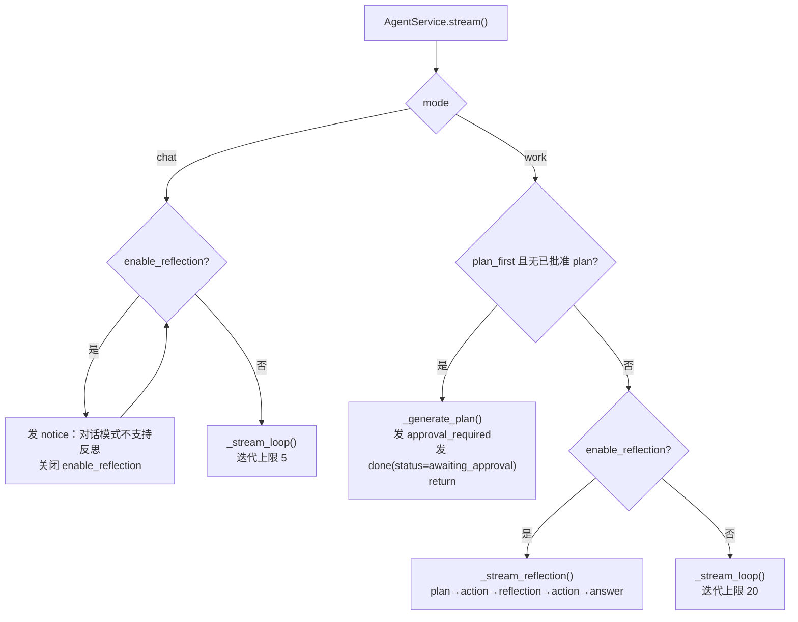
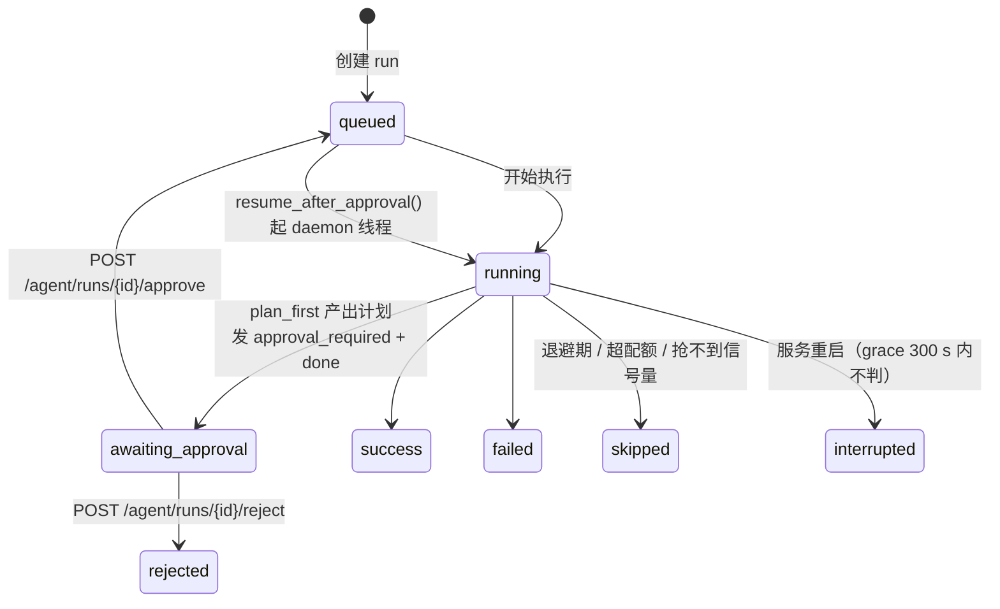

# Agent 执行引擎与事件协议

> - **依据代码**：`apps/server/src/domain/agent/`、`tool_registry.py`、`apps/server/src/http/routes/agent.ts`、`apps/server/src/domain/run/executor.ts`、`apps/server/src/domain/run/service.ts`、`apps/server/src/http/routes/agent.ts`、`apps/server/src/domain/agent/`、`apps/server/src/domain/exec/`
> - **资料来源**：2026-10-29 逐文件复核
> - **整理日期**：2026-10-29
> - **对应基线**：commit `7385dcd` + 工作区未提交改动
> - **相关篇目**：`01` 架构总览 ｜ `02` 能力链 ｜ `04` 数据层 ｜ `05` 接口 ｜ `06` 前端消费 ｜ `08` 运行账本 ｜ `16` 上下文成本

---

# 第一部分 现状事实

## 一、执行模型总览

Agent 执行有**四条互斥路径**，由 `mode` / `plan_first` / `enable_reflection` 三个入参决定：



| 路径 | 触发条件 | 实现 | LLM 调用方式 |
|---|---|---|---|
| **① 主循环** | 默认 | `_stream_loop()`（`agent_service.py:396-604`） | OpenAI 兼容 function calling，**非流式** |
| **② 计划审批** | `mode=work` + `plan_first=true` + 无已批准 plan | `_generate_plan()`（`agent_service.py:313-337`） | `app.core.llm.chat(..., json_mode=True)` |
| **③ 反思循环** | `enable_reflection=true`（**仅 work**） | `_stream_reflection()`（`agent_service.py:609-694`） | 规划/反思用 JSON mode；最终回答用 **stream=True** |
| **④ 旧范式** | `POST /api/v1/agent/chat` | `apps/server/src/domain/agent/service.ts` | DeepSeek JSON-mode + `reasoning_content` 流式 |

> **路径 ④ 与前三条是并列关系，不是「旧版本」**：`apps/server/src/domain/agent/` 5 个文件（`planner` / `reflection` / `answer` / `tools` / `service`）构成一条**独立的 plan→action→reflection→answer 实现**，其提示词硬编码「星辰电动 ES9 汽车销售助手」，仅被 `POST /api/v1/agent/chat` 使用（`apps/server/src/http/routes/agent.ts:132`）。

## 二、主循环逐步

### 2.1 上下文装配

```mermaid
sequenceDiagram
    participant S as AgentService.stream
    participant SK as SkillManager
    participant TR as ToolRegistry
    participant EX as exec/context
    participant L as DashScope /chat/completions

    S->>SK: resolve_for_mode(skills, mode)
    S->>TR: get_combined_tools(..., profile)
    S->>SK: build_system_prompt(skills, mode, team)
    S->>TR: build_tools_prompt_section(...)
    Note over S: system_prompt = Skill 段 + 工具段 (+ 已批准计划段)
    S->>S: yield skills_selected / system_prompt / user_input
    loop iteration in 1..limit
        S->>S: 三道闸门：deadline / cancel / steer
        S->>S: yield round_start / round_input
        S->>EX: usage() → 超阈值则 compress / trim
        S->>L: chat.completions.create(model, messages, tools, max_tokens)
        L-->>S: assistant message (content + tool_calls)
        alt 有 content
            S->>S: yield model_text
        end
        alt 无 tool_calls
            S->>S: finished = true; break
        end
        loop 每个 tool_call
            S->>S: yield tool_call
            S->>TR: dispatch(tool_name, tool_input, executor)
            TR-->>S: (result_json, tool_source, extra)
            S->>S: yield tool_result (+references / +reference_cards)
            S->>S: messages.append(role=tool, tool_call_id, content=result[:8000])
        end
    end
    S->>S: yield files / yield done
```

### 2.2 各步骤的关键实现

| 步骤 | 实现 | 证据 |
|---|---|---|
| 客户端 | `OpenAI(api_key=settings.dashscope_api_key, base_url=settings.dashscope_base_url)`，懒加载单例；缺 Key 抛 `MissingApiKeyError` | `agent_service.py:144-154` |
| Schema 转换 | `_to_openai_tools()` 把 Anthropic 风格的 `input_schema` / `inputSchema` 转成 OpenAI `{"type":"function","function":{name,description,parameters}}` | `agent_service.py:159-173` |
| 工具目录 | `exec/catalog.build_catalog()` + `catalog_text()` 生成工具目录文本注入 system prompt；`ToolLoader` 负责延迟装载 | `agent_service.py:263-272`；`exec/catalog.py:80-169` |
| 历史回放 | **只回放 `role in ("user","assistant")` 且 `content` 非空**的条目——**绝不回放 `tool` 消息与带 `tool_calls` 的 assistant 消息** | `agent_service.py:412-415` |
| 记忆注入 | `_inject_memories()` 刷新索引 → 预筛 → 以 `role="system"` 插到 messages[1] | `agent_service.py:342-361` |
| LLM 调用 | `client.chat.completions.create(model, max_tokens=settings.max_tokens, messages, tools=openai_tools)`，**非流式** | `agent_service.py:502-509` |
| 计量旁路 | `_record_usage()` 把 `response.usage` 写入 `llm_calls` 表（含单价快照） | `agent_service.py:363-391`；`exec/accounting.py:39-71` |
| assistant 回填 | `{"role":"assistant","content":content or "","tool_calls":[{"id","type":"function","function":{"name","arguments"}}]}` | `agent_service.py:531-543` |
| 工具入参解析 | `json.loads(tc.function.arguments or "{}")`，JSON 解析失败则用 `{}` | `agent_service.py:546-552` |
| 工具结果回填 | `{"role":"tool","tool_call_id":tc.id,"content":result_str[:8000]}` | `agent_service.py:591-595` |
| 产出文件收集 | 运行前 `_snapshot_files()` 取 `output_dir` 文件名集合，结束后 `_collect_new_files()` 取差集 | `agent_service.py:181-193,599-601` |
| 路径脱敏 | `display_path()` 把项目根绝对路径替换为 `./`（**仅用于事件展示**，回填给 LLM 的仍是原串） | `agent_service.py:89-91` |

### 2.3 迭代上限判定链

| 环节 | 位置 | 值 |
|---|---|---|
| 配置定义 | `core/config.py:45` / `:93` | `max_iterations=20` / `chat_max_iterations=5` |
| **选择** | `agent_service.py:306` | `max_iterations = settings.chat_max_iterations if mode == "chat" else settings.max_iterations` |
| 兜底 | `agent_service.py:408` | `limit = max_iterations or settings.max_iterations` |
| **执行** | `agent_service.py:429` | `for iteration in range(limit)` |
| 超限信号 | `agent_service.py:596-597` | `for...else` 分支 → `error: 达到最大迭代次数 {limit}` |

> ⚠️ **上限不覆盖的两条路径**：`enable_reflection=True` 走 `_stream_reflection()`（`agent_service.py:609-694`），**完全无迭代上限**；`plan_first` 分支在 `:295-300` 直接 `return`，也不受上限约束。

### 2.4 终止条件与「停止原因」

**代码中不存在 `stop_reason` 枚举**。终止以「事件 + run 状态」表达：

| 终止场景 | 触发位置 | 事件 | run 状态终值 |
|---|---|---|---|
| 正常收敛（无 tool_calls） | `agent_service.py:527-529` | `model_text`(可无) → `files` → `done` | `success` |
| 达到迭代上限 | `agent_service.py:596-597` | `error: 达到最大迭代次数 N` → `files` → `done` | `failed` |
| 超过 deadline | `agent_service.py:430-432` | `error: timeout: 超过执行时限` → `files` → `done` | `failed` |
| LLM 调用异常（网络/鉴权/限流） | `agent_service.py:510-512` | `error: {类型}: {消息}` → `files` → `done` | `failed` |
| 缺 API Key | `agent_service.py:419-424` | `error` → `done` | `failed` |
| 用户取消（轮次起点） | `agent_service.py:433-437` | `interrupted{phase:"round"}` → `done` | `interrupted`→**被覆盖为 `failed`**（见 §5.3） |
| 用户取消（工具前） | `agent_service.py:562-566` | `interrupted{phase:"before_tool"}` → `done` | 同上 |
| 用户取消（工具后） | `agent_service.py:579-584` | `tool_result` → `interrupted{phase:"after_tool"}` → `done` | 同上 |
| 客户端断开 | `run_executor.py:342-345` | `GeneratorExit` → `interrupt_run()` | `interrupted` |
| plan-first 挂起 | `agent_service.py:295-300` | `approval_required` → `done{status:"awaiting_approval"}` | `awaiting_approval` |
| 并发预算满 | `run_executor.py:143-151` | `busy` → `done` | `skipped`（无 run 记录） |
| 服务重启/巡检超时 | `run_service.py:331-355` | — | `interrupted` |

**run 状态枚举**（唯一的状态常量集）：

- 终态 `TERMINAL_STATUSES = {"success","failed","skipped","interrupted","rejected"}` — `apps/server/src/domain/run/service.ts:23`
- 中间态：`queued` / `running` / `awaiting_approval` — `run_service.py:151,159,171,181`

**子进程限额命中枚举**（与 Agent 循环无关，属 exec 边界）：`ExecResult.limit_hit ∈ {"", "output", "timeout", "cpu", "memory"}` — `apps/server/src/domain/exec/limits.ts:79`

---

## 三、工具注册表与 Profile

### 3.1 工具集合构成

| 来源 | 数量 | 名称 | 定义位置 |
|---|---|---|---|
| 内置 | **7** | `tool_search` `tool_load` `read_file` `write_file` `execute_python` `execute_bash` `list_directory` | `tool_registry.py:46-127` |
| RAG | 2 | `rag_query` `rag_ingest` | `tool_registry.py:129-150` |
| Web | 1 | `web_research` | `tool_registry.py:152-167` |
| MCP | 动态（12） | `mcp_<server>__<tool>` | `tool_registry.py:205-218` |

### 3.2 Profile 裁剪规则

`get_combined_tools()`（`tool_registry.py:178-220`）：

| profile | 内置 | RAG | Web | MCP |
|---|---|---|---|---|
| `CHAT` | 仅 `read_file` `list_directory` | 仅 `rag_query` | 不给 | 仅 `read_only=True` 的 Server |
| `WORK` | 全给 | 全给 | 全给 | 全给 |

`assert_profile_consistency()`（`tool_registry.py:36-44`）在 CHAT 下断言工具名集合与 `WRITE_TOOL_NAMES = {write_file, execute_python, execute_bash, rag_ingest}` 无交集。

MCP 工具注入时：
- 名称改写为 `mcp_<server>__<tool>`；
- 描述改写为 `[MCP:<server>] <原描述第一行>`；
- schema 取 `inputSchema`，缺省 `{"type":"object","properties":{}}`；
- **单个 Server 反射失败只记 warning，不阻塞其它 Server**。

### 3.3 分发

`dispatch()`（`tool_registry.py:225-288`）返回三元组 `(result_json_str, tool_source, extra)`：

| tool_source | 触发条件 | result 形态 | extra |
|---|---|---|---|
| `mcp` | 名称以 `mcp_` 开头 | `{"result": "<MCP 原始返回>"}` | `{"mcp_server": server}` |
| `rag` | `rag_query` | `{"answer": ..., "references": ...}` | `{"references": refs}` |
| `rag` | `rag_ingest` | 入库统计 | `{}` |
| `web` | `web_research` | 完整结果 | `{"reference_cards": [...]}` |
| `builtin` | 其余 | 内置工具返回值 | `{}` |

**异常数据化**：RAG / Web 工具的异常被包成 `{"error": "..."}` 返回给 LLM，**不抛异常中断循环**。

MCP 工具的异常在 `MCPManager.call_tool()` 层已被转成字符串（`mcp_manager.py:188-197`），`dispatch` 不再重复包装。

### 3.4 延迟装载（`tool_search` / `tool_load`）的**已知缺陷**

| 项 | 事实 |
|---|---|
| 目录文本 | `build_catalog()` + `catalog_text()` 确实注入 system prompt（`agent_service.py:267-270`） |
| `tool_search` | 确实可用（`tool_registry.py:431-443`） |
| `tool_load` | **只把 Schema 文本塞进工具结果，不回写 loader**（`tool_registry.py:446-470`） |
| 后果 | 下一轮 `tools` 数组不变——`agent_service.py:266` 只算一次工具定义，`ToolLoader.load()` **从未被调用** |

---

## 四、模式与计划审批

### 4.1 模式语义

| 维度 | `chat` | `work` |
|---|---|---|
| 迭代上限 | `settings.chat_max_iterations` = 5 | `settings.max_iterations` = 20 |
| Skill 默认 | `skills=None` → 不加载 | `skills=None` → 全部启用中 |
| 工具集 | 只读 | 全量 |
| `plan_first` | 不支持（会话级 chat 直接报错，`run_executor.py:176-179`） | 支持 |
| `enable_reflection` | 不支持（发 `notice` 关闭） | 支持 |
| system prompt | 「对话模式（Ask）」段 + 提示不要写文件/执行代码 | 「工作模式（Craft）」段 + 工具说明 + `execute_python` 使用规则 + 中文支持说明 |

`work` 模式的 system prompt 明确写入了 **「每次 `execute_python` 调用都是独立进程，变量不会共享」** 的规则（`skill_manager.py:441-447`），这是对 subprocess 语义的显式补偿。

### 4.2 计划生成

`_generate_plan()`（`agent_service.py:313-337`）：

1. 用 `app.core.llm.chat(PLAN_STEPS_TEMPLATE.format(query=...), model=settings.plan_model, json_mode=True)` 请求 JSON；
2. 正则 `r"(\[[\s\S]*\])"` 从返回文本中抠出 JSON 数组（容忍前后解释文字）；
3. 每步规整为 `{id, title[:40], detail[:120]}`，过滤无 `title` 的项；
4. **任何异常 → 降级为单步计划** `[{"id":1,"title":"执行任务","detail": query[:120]}]`。

`PLAN_STEPS_TEMPLATE`（`agent_service.py:74-86`）要求拆解为 **2-6 个步骤**，`title ≤ 20 字`、`detail ≤ 60 字`。

### 4.3 审批状态机



| 动作 | 实现 | 位置 |
|---|---|---|
| 产出计划并挂起 | `agent_service.py:295-300` 发 `approval_required` + `done(status="awaiting_approval")` 后 `return` | `apps/server/src/domain/agent/` |
| 状态置 `awaiting_approval` | `run_service.save_plan()` | `apps/server/src/domain/run/service.ts:154-159` |
| 批准 | `run_service.approve_plan()` → `status="queued"`；随后 `executor.resume_after_approval()` 起 **daemon 线程**续跑 | `apps/server/src/domain/run/service.ts:161-174`；`apps/server/src/domain/run/executor.ts:441-523` |
| 拒绝 | `run_service.reject_run()` → `status="rejected"` | `apps/server/src/domain/run/service.ts:176-186` |
| API | `POST /api/v1/agent/runs/{run_id}/approve`（可带 `edited_plan`）/ `reject`（带 `reason`）；非待审批状态返回 **409** | `apps/server/src/http/routes/agent.ts:104-129` |

**恢复执行时**，`plan` 被拼进 system prompt 的「## 已批准的执行计划」段（`agent_service.py:274-279`）。

---

## 五、SSE 事件协议

### 5.1 事件全表（Agent，**26 个事件名**：24 个来自 `agent_service` + `meta`/`busy` 来自 `RunExecutor`）

> 顺序栏标注「典型出现次序」；`meta` / `busy` 由 `RunExecutor` 产生，`approval_required` 在 plan-first 路径产生。
> **事件名没有集中常量/枚举**——全部是散落的字典字面量 `"type"` 键；前端唯一权威清单是 `src/api/types.ts:483-505`。

| # | type | 关键字段 | 产生位置 | 典型次序 |
|---|---|---|---|---|
| 1 | `meta` | `run_id` `session_id` `mode` `team` `resolved_skills` | `run_executor.py:244-251` | 1（最前） |
| 2 | `busy` | `content` `limit` | `run_executor.py:145-149` | 入口（并发满） |
| 3 | `notice` | `content` | `agent_service.py:291`；`run_executor.py:216,253` | 早 |
| 4 | `skills_selected` | `skills[]` `all_skills[]` `total` | `agent_service.py:281-286` | 2 |
| 5 | `system_prompt` | `content`（**默认空串**）+ `summary{length,skills[],tool_count}` + `full`（`full=false` 时只有摘要；`debug_prompt=true` 时 `content` 才带全文，已脱敏绝对路径） | `agent_service.py:449-468` | 3 |
| 6 | `user_input` | `content` | `agent_service.py:288` | 4 |
| 7 | `approval_required` | `run_id` `plan[]`（`agent_service` 版不带 `run_id`，`run_executor` 版带） | `agent_service.py:298`；`run_executor.py:326-334` | 5（plan-first 时） |
| 8 | `done` | `status`（仅 plan-first 带 `awaiting_approval`） | `agent_service.py:299`；`run_executor.py:150,164,173,178,217,225,351` | 6（plan-first 时）/ 最末 |
| 9 | `steer_injected` | `instructions[]` `modes[]` | `agent_service.py:458-462` | 轮次起点（有 steer 时） |
| 10 | `plan_replaced` | `content` | `agent_service.py:467` | 轮次起点（`replace_plan` 模式） |
| 11 | `round_start` | `round`（从 1 开始） | `agent_service.py:469` | 循环内 |
| 12 | `round_input` | `messages[]`（摘要：index / role / preview） | `agent_service.py:470`；摘要器 `:757-773` | 循环内 |
| 13 | `context_compressed` | `mode` `before_tokens` `after_tokens` `saved_tokens` `sections[]` `summary` | `agent_service.py:486`；载荷 `exec/context.py:225-234` | 上下文超 85% |
| 14 | `context_trimmed` | `dropped` `tokens` `ratio` | `agent_service.py:495-500` | 上下文超 70% |
| 15 | `model_text` | `content` `round` | `agent_service.py:520-525`；反思分支 `:688` | 循环内 |
| 16 | `tool_call` | `tool_name` `tool_input` `round` `tool_source` `mcp_server` | `agent_service.py:553-560`；反思 `:702-708` | 循环内 |
| 17 | `tool_result` | `tool_name` `result`（**按 ContextBudget 剩余预算截断**，上限 8000/2000）`round` `tool_source` `mcp_server` `references?` `reference_cards?` `truncated` `truncated_ratio` `budget_ratio` | `agent_service.py:872-882`；反思 `:1097-1104` | 循环内 |
| 18 | `files` | `files[]`（`name` `size` `is_image`） | `agent_service.py:600`；反思 `:693` | 末 |
| 19 | `error` | `content` | `agent_service.py:422,431,511,597,634,690`；`run_executor.py:163,172,177,224,350` | 任意时刻 |
| 20 | `interrupted` | `content` `phase`（round / before_tool / after_tool） | `agent_service.py:435,564,582` | 取消时 |
| 21 | `reflection_start` | `mode="plan_action_reflection_answer"` | `agent_service.py:623` | 反思分支 |
| 22 | `plan` | `actions[]` | `agent_service.py:637` | 反思分支 |
| 23 | `reflection_plan` | `actions[]` | `agent_service.py:661` | 反思分支 |
| 24 | `reasoning_delta` | `content` | `agent_service.py:686` | 反思分支 |
| 25 | `memory_item` | `tool` `input` `result`（截 3000） | `agent_service.py:724` | 反思分支（**内部事件，不 yield 给前端**） |
| 26 | `loop_detected` | `tool_name` `repeat` `content` | `agent_service.py`（循环检测命中时） | 循环内（连续相同调用 ≥3 次） |

**前端 TypeScript 联合类型 `AgentEvent` 覆盖 24 个成员**（`apps/ui/src/api/types.ts:495-`）——**缺 `context_trimmed`、`loop_detected`、`memory_item`**（后三者在后端产生但前端联合类型未收录）。
`plan` 与 `reflection_plan` 共用同一个 `PlanEv`（其 `type` 字段是联合 `'plan' | 'reflection_plan'`）。

### 5.2 事件负载格式

SSE 帧格式为 `data: {json}\n\n`（`apps/server/src/http/routes/agent.ts:64`），响应头：

```
Content-Type: text/event-stream
Cache-Control: no-cache
X-Accel-Buffering: no
Connection: keep-alive
```

**DB tail 流**额外注入 `seq` 字段：`payload = {"type": item.type, "seq": item.seq, **item.payload}` — `apps/server/src/http/routes/runs.ts:80`。

### 5.3 中断与 steer 机制（S4）

**控制面**（`apps/server/src/domain/run/executor.ts`）：

| 组件 | 位置 | 说明 |
|---|---|---|
| `_steer_queue: dict[str, list[str]]` | `run_executor.py:46` | 按 `run_id` 的 steer 队列 |
| `_cancel_flags: dict[str, threading.Event]` | `run_executor.py:47` | 按 `run_id` 的取消标志 |
| `_control_lock` | `run_executor.py:48` | 保护上述两者 |
| `request_cancel(run_id)` | `run_executor.py:53-64` | 置位 Event + `run_service.interrupt_run(run_id)` 立即改 DB 状态 |
| `request_steer(run_id, instruction, mode)` | `run_executor.py:66-82` | 入队 `{text, mode, seq}`；`mode` 白名单 `append`/`replace_plan`，非法降级为 `append`；空文本拒绝 |
| `_steer_hook(run_id)` | `run_executor.py:89-99` | **取出即清空**（一次性消费），按 `seq` 排序 |
| `_cancel_hook(run_id)` | `run_executor.py:101-105` | 读取消标志 |

**HTTP 端点**：

| 端点 | 位置 | 行为 |
|---|---|---|
| `POST /api/v1/runs/{run_id}/cancel` | `api/v1/runs.py:95-109` | 主动置位取消标志；返回 `{"status":"interrupted"}` |
| `POST /api/v1/runs/{run_id}/steer` | `api/v1/runs.py:112-139` | body `{instruction\|text, mode}`；空指令 400；非法 mode 422；返回 `status:"queued"` |

**执行侧生效点**：

| 机制 | 位置 | 行为 |
|---|---|---|
| `interrupted` | `agent_service.py:433-437` | **轮次起点**检查 `cancel_hook()`，`phase="round"` |
| | `agent_service.py:562-566` | **工具调用前**检查，`phase="before_tool"`，此时不发起本次调用 |
| | `agent_service.py:579-584` | **工具调用后**检查，`phase="after_tool"`，**本次结果保留** |
| `steer_injected` | `agent_service.py:438-462` | 兼容纯字符串 / `{text, mode, seq}` 两种形态；`mode` 默认 `append`；空文本丢弃；**按 `seq` 排序保序** |
| `plan_replaced` | `agent_service.py:466-467` | `mode=="replace_plan"` → 丢弃带 `tool_calls` 的 assistant 消息并额外发该事件；随后**统一**以 `role="user"` 追加到 messages |

**已知缺陷**：

| 缺陷 | 位置 | 说明 |
|---|---|---|
| **取消后终态被覆盖为 `failed`** | `run_executor.py:319-323` 设 `final_status="interrupted"` → **`run_executor.py:360-361` `if error: final_status="failed"`** → `run_executor.py:375-381` `run_service.finish(run_id, final_status)` | `interrupted` 事件同时设了 `error`，导致 `final_status` 被重写为 `failed`。**DB 终态是 `failed` 而非 `interrupted`**，与 `TERMINAL_STATUSES` 的设计意图冲突 |
| `execute_sync` 的 `final_status` 是死变量 | `run_executor.py:419` | 赋值后从未被读取 |
| **审批恢复执行无 steer/cancel** | `run_executor.py:470-483` | `resume_after_approval` 调 `agent_service.stream()` 时**未传** `steer_hook`/`cancel_hook` → 恢复执行期间无法介入或取消 |
| 取消对正在运行的命令无效 | `run_executor.py:56-59`（docstring） | 阻塞式 `subprocess.run` 最长 180s 不被立即终止 |
| steer 注入到消息末尾而非当轮开头 | `agent_service.py:468` | 以 `role="user"` 追加，模型在下一轮看到 |

### 5.4 落库顺序

`RunExecutor` 把同一批事件写入 `run_events` 表，**批量 20 条 / 2 秒**（`apps/server/src/domain/run/executor.ts:27-28,286-291,340-341`），带 `seq` 递增。前端因此可以用 `after_seq` 游标续订。

### 5.5 反思分支的事件差异

反思分支**没有** `round_start` / `round_input` / `tool_call` 的 `round` 字段语义（工具事件来自 `_execute_actions()`，无轮次编号），并且额外产出 `reflection_start` / `plan` / `reflection_plan` / `reasoning_delta`。

### 5.6 成本统计没有专属 SSE 事件

成本通过两条旁路暴露：

- 落库：`record_call()` 写 `llm_calls` 表（`exec/accounting.py:39-71`），由 `_record_usage()` 调用（`agent_service.py:380-389`）
- 聚合到 run 行：`run_service.finish()` 内调 `aggregate_run()`（`run_service.py:204-212`）→ 写入 `runs.prompt_tokens / completion_tokens / llm_calls / estimated_cost`
- 查询端点：`GET /runs/{run_id}/cost`、`GET /cost/estimate`（`api/v1/context.py:22,31`）

详见 `16_上下文经济性与成本核算.md`。

---

## 六、`exec/` 执行扩展子包

`apps/server/src/domain/exec/` 共 8 个模块，**4 个真正生效、2 个部分生效、2 个纯备胎**：

| 模块 | 职责 | 关键类 / 函数 | 是否真正生效 |
|---|---|---|---|
| `catalog.py` | 工具目录（name + 一句话描述 + 命名空间）与延迟装载 | `CatalogEntry:53` / `build_catalog:80` / `catalog_text:95` / `search_catalog:100` / `ToolLoader:132` / `split_core_and_catalog:172` | **部分生效**。目录文本确实注入 system prompt；`tool_search` 确实被调用。但 **`ToolLoader.load()` 从未被调用** → `tool_load` 不回写 loader（见 §3.4） |
| `context.py` | 上下文预算 / 裁剪 / 九段压缩 | `MODEL_CONTEXT_WINDOWS:18` / `ContextBudget:53` / `trim_messages:102` / `compress:272` / `build_nine_section_summary:237` | **生效**。但 `COMPACT_THRESHOLD`/`SUMMARY_THRESHOLD` 常量（`:30-31`）与 `should_compact`/`should_summarize`（`:87-92`）**无人调用**——真实阈值走 `settings` |
| `limits.py` | **子进程执行边界**（非「Agent 限额」）——rlimit / 输出上限 / 超时 / 路径逃逸 / 网络出口 | `ExecLimits:40` / `limits_from_settings:60` / `ExecResult:72` / `run_with_limits:253` / `detect_escape:176` / `detect_network_usage:199` | **完全生效**。被 `code_executor.py:142,148`（启动前检查）与 `:217,263`（受限执行）调用 |
| `memory.py` | 三层记忆（user / workspace / project）+ 索引 + 预筛 | `memory_root:53` / `refresh_index:104` / `list_memories:145` / `write_memory:161` / `select_memories:204` / `mark_used:238` | **完全生效**。`agent_service.py:347-353` 调 `refresh_index`/`select_memories`/`mark_used`；CRUD 走 `api/v1/context.py:75-116` |
| `accounting.py` | LLM 计量 + 成本核算 | `CallUsage:26` / `record_call:39` / `aggregate_run:74` / `run_cost_detail:97` / `cost_percentiles:130` / `Timer:149` | **完全生效**。表 `llm_calls` |
| `roles.py` | S5 内置轻量角色常量（0 工具） | `Role:17` / `BUILTIN_ROLES:47`（`compact`/`contextSummary`/`memorySelector`）/ `get_role:72` | **不生效（占位）**。三个 Prompt **从未被送给 LLM**；真实作用是 `exec/team/roles.py:218-236 sync_builtin_roles()` 的数据源 |
| `team/orchestrator.py` | 多 Agent 编排（parallel / sequential / review） | `TeamOrchestrator:70`（`run:87`、`_run_parallel:127`、`_run_sequential:132`、`_run_review:141`） | **不生效（未接线）**。仅被 `apps/server/tests/test_s6_extensions.py:257-296` 引用。运行时的「team」是 `team_service` 的 **Skill 团队**（none/sequential/router），只影响 system prompt 与 skill 选择——**两个「team」是完全不同的概念** |
| `team/blackboard.py` | 黑板：任务项 / 依赖图 / 就绪判定 / 环检测 / 指派 | `BoardItem:30` / `readiness:79` / `would_create_cycle:103` / `assign_by_capability:129` / `BlackboardService:166` | **仅 API 层生效**。`api/v1/extensions.py:150-179` 提供读写端点；**Agent 执行链路完全不使用黑板** |
| `team/roles.py` | 角色 CRUD（`roles` 表为准，代码常量为回退） | `Role:37` / `RoleService:112` / `model_for_tier:103` / `sync_builtin_roles:218` | **仅 API 层生效**。角色**不参与**工具权限裁定（工具裁剪只看 `ToolProfile`） |
| `team/messaging.py` | Agent 间消息 / 通知 + 上下文收费站 | `AgentMessage:31` / `MessageService:91` / `tollgate:171` / `build_main_context_block:187` | **仅 API 层生效**。`tollgate` 与 `build_main_context_block` 未接入运行时 |

---

# 第二部分 原理剖析

## 七、为什么主链路是 function calling 而不是 plan→action→reflection→answer

三种主流的 Agent 编排范式：

| 范式 | 控制流 | 优点 | 代价 |
|---|---|---|---|
| **Plan-then-Act**（先出完整计划，再逐步执行） | LLM 一次性产出计划 → 执行器按计划走 | 计划可视、可审批、可预估成本 | 计划与现实脱节时整条链报废；灵活性差 |
| **Reflection**（执行 → 反思 → 补充执行） | 执行一轮后让 LLM 判断信息是否充分 | 能自我纠偏、补齐信息 | 额外 LLM 调用；反思质量不稳定 |
| **ReAct / function calling**（模型自己决定调什么工具） | 每轮把「当前消息 + 工具列表」交给模型，模型返回 tool_calls 或最终文本 | 模型自主决策；工具调用与自然语言回答可在同一轮混排；OpenAI 兼容协议原生支持 | 需要模型具备可靠的 tool_call 能力；调试链路更长 |

本项目的**主链路选择 ReAct 范式**，理由是：

1. **工具集是动态的**。MCP 工具在运行时才知道有哪些、参数 schema 是什么，Skill 也可能随时被禁用。ReAct 范式天然支持「每轮重新给出工具定义」，而 Plan-then-Act 需要在规划时就冻结工具清单。
2. **模式差异需要即时生效**。`chat` 与 `work` 的工具集差异必须在**每一次**模型调用时体现，Plan-then-Act 的计划在第一步就定死了工具。
3. **协议成本**。DashScope 的 OpenAI 兼容端点对 function calling 支持完整，而「结构化规划 + 自由执行」需要模型同时稳定输出 JSON 与工具调用。

**反思能力没有被丢弃，而是降级为一个可选分支**：`enable_reflection=true` 时走 `_stream_reflection()`，保留 Plan-then-Act + Reflection 的组合，用于需要「先规划、查证、再补充查证、最后成文」的任务。

## 八、为什么历史回放必须过滤 tool 消息

OpenAI 兼容的 function calling 协议要求消息序列严格配对：

```
assistant(tool_calls=[{id:"call_1", ...}])
tool(tool_call_id="call_1", content="...")
```

如果把上一轮的 `tool` 消息回放进新一轮的 `messages`，但**没有对应的 assistant(tool_calls) 消息**，协议校验会直接报错；如果回放了 assistant(tool_calls) 但缺少 tool 结果，同样报错。

而如果把整段 tool 交互都回放，token 成本会随对话轮数**二次方增长**（每轮的工具输出都是大段文本）。

`agent_service.py:412-415` 的策略是：**只回放 user 与 assistant 的纯文本内容**，丢弃全部 tool 交互。代价是模型在新一轮里「忘记」自己上一轮查过什么；缓解手段是工具结果中的关键信息通常也会被模型写进 assistant 的文本回复里。

`session_service.build_history()` 用同样的规则，并额外做了字符预算裁剪（`session_history_max_chars=8000`）与「首条必须是 user」的处理。

## 九、为什么工具结果要截断到 8000 字符

回填给模型的 tool 消息长度直接决定下一轮的输入 token 数与成本。平台采用两级截断：

| 位置 | 截断 | 面向 |
|---|---|---|
| 回填给 LLM | `result_str[:8000]`（`agent_service.py:594`） | 控制上下文成本 |
| 发给前端 | `result_str[:2000]`（`agent_service.py:574`） | 控制 SSE 帧大小与前端渲染性能 |

这意味着**前端看到的工具结果可能与模型看到的不同**（前端看到 2000 字符，模型看到 8000）。这是有意的取舍：模型需要完整结果做判断，前端只需要可读的摘要。

## 十、为什么计划审批用「挂起 + 恢复」而不是「阻塞等待」

`plan_first` 需要人工确认，但 HTTP 请求不能无限等待。平台的做法是：

1. 第一次请求产出计划并**立即结束 SSE 流**（`done` 带 `status="awaiting_approval"`）；
2. run 记录落库，状态 `awaiting_approval`，计划存 `runs.plan_json`；
3. 前端拿到计划后渲染 `PlanCard`，用户点「确认执行」→ `POST /agent/runs/{run_id}/approve`；
4. 服务端 `approve_plan()` 把状态改回 `queued`，再由 `resume_after_approval()` 起一个 **daemon 线程**继续执行，前端通过 `GET /runs/{run_id}/stream?after_seq=N` 续订事件。

这个设计的关键收益是：**HTTP 连接不会被占用**（不会因等待人工确认而超时），且**执行过程可断点续订**（`run_events` 账本 + `after_seq`）。代价是恢复执行走的是 daemon 线程而非请求上下文，因此 `resume_after_approval()` 内部必须**自己创建 DB Session**。

## 十一、为什么用 SSE 而不是 WebSocket

见 `01_架构总览.md` §10 的完整对比。本篇只补充与事件协议直接相关的三点：

1. **事件是有序的、可持久化的**。`run_events` 表给每个事件分配递增 `seq`，`GET /runs/{run_id}/stream?after_seq=N` 天然支持「从第 N 条继续」。WebSocket 的消息没有这种内建游标，需要自己维护。
2. **断线重连是必需能力而非优化**。研究进度流最长可达 1800 秒（`SSE_MAX_DURATION=1800`），任何网络抖动都会断流。SSE + `after_seq` / `stage|ts` 去重键提供了可恢复的续订路径。
3. **反向代理需要显式配置**。Nginx 必须 `proxy_buffering off`，否则事件会被缓冲成一坨再吐出，前端完全失去流式体验（`deploy/nginx/conf.d/agent.conf:40-54`）。

## 十二、为什么 `exec/` 要做成独立子包而不是散落在服务层

主循环的职责是「编排 LLM 与工具的对话」，而上下文预算、记忆预筛、成本计量、进程限额这四类逻辑各有独立生命周期：

| 关注点 | 独立后得到的能力 |
|---|---|
| 上下文预算 | 可独立测试「给定 token 数 → 触发哪一级压缩」 |
| 记忆 | 可独立测试「给定 query → 选出哪几条记忆」 |
| 成本 | 可独立测试「给定 usage → 算出多少钱」 |
| 进程限额 | 可独立测试「给定资源上限 → 子进程是否被 kill」 |

同时 `exec/` 与 `services/security/`、`services/workspace/` 一样，构成一组**横切能力层**——它们不新增用户可见入口，而是挂在「Agent 执行 → 工具调用 → 产物落地」这条主干上。详见 `01` §12。

---

# 第三部分 已知边界与观察

| 编号 | 观察 | 证据 | 指向 |
|---|---|---|---|
| S-03-01 | **LLM 调用是非流式的**：`chat.completions.create()` 不带 `stream=True`，模型完整响应后才产出 `model_text`。所谓「流式」只是事件逐个下发，首 token 延迟 = 完整响应时间 | `apps/server/src/domain/agent/:502-509` | `11` §2 |
| S-03-02 | `approval_required` 在 `agent_service` 路径**不带 `run_id`**，而前端 `ApprovalRequiredEv.run_id` 是必填字段 | `apps/server/src/domain/agent/:298`；`apps/ui/src/api/types.ts` | `12` §2 |
| S-03-03 | `done` 事件带 `status` 字段（`awaiting_approval`），前端 `DoneEv` 未声明也不消费 | `apps/server/src/domain/agent/:299` | `12` §2 |
| S-03-04 | `tool_result` 的 `references`（RAG）与 `reference_cards`（Web）是两个不同字段，前端分别消费，语义不统一 | `apps/server/src/domain/agent/:571-589` | `06` §6 |
| S-03-05 | `system_prompt` 事件把**完整 system prompt** 发给前端（含工具清单与 Skill 清单），信息量随工具数增长 | `apps/server/src/domain/agent/:287` | `12` §2 |
| S-03-06 | 达到迭代上限走 `for...else`，与「无 tool_calls 正常结束」的 `break` 路径区分依赖语言细节 | `apps/server/src/domain/agent/:429,596-597` | `12` §2 |
| S-03-07 | `enable_reflection` 在 chat 模式下不是报错而是「发 notice 后静默降级」，用户可能不知道反思没生效 | `apps/server/src/domain/agent/:290-292` | `12` §2 |
| S-03-08 | 计划生成失败一律降级为单步计划「执行任务」，用户看到的计划可能与预期完全不符 | `apps/server/src/domain/agent/:337` | `12` §2 |
| S-03-09 | `resume_after_approval()` 用 daemon 线程恢复执行，**进程退出即丢失**该执行 | `apps/server/src/domain/run/executor.ts:441-523` | `08` §5 |
| S-03-10 | 工具异常一律数据化返回给 LLM，Agent 会把错误字符串当作「工具结果」继续推理，可能产生幻觉式补救 | `apps/server/src/domain/tools/registry.ts:225-288` | `12` §2 |
| S-03-11 | **取消后 run 终态被覆盖为 `failed`**（`interrupted` 事件同时设了 `error`） | `apps/server/src/domain/run/executor.ts:360-361` | `12` §2.1 |
| S-03-12 | **审批恢复执行不接受 steer/cancel**——`resume_after_approval` 未传 `steer_hook`/`cancel_hook` | `apps/server/src/domain/run/executor.ts:470-483` | `12` §2.1 |
| S-03-13 | **`tool_load` 不回写 loader** → 延迟装载实际上只有「目录 + 一次性 schema」，第二轮起工具集不再变化 | `apps/server/src/domain/tools/registry.ts:446-470`；`agent_service.py:266` | `12` §2.2 |
| S-03-14 | **九段摘要只有 2 段有真实内容**：`agent_service.py:477-480` 只传了 `intent` 与 `current`，其余 7 段由模板填成「（未记录）」/「（无）」，**无任何 LLM 参与摘要生成** | `apps/server/src/domain/agent/:477-480`；`exec/context.py:250-259` | `12` §2.2 |
| S-03-15 | `exec/context.py` 的 `COMPACT_THRESHOLD`/`SUMMARY_THRESHOLD` 与 `should_compact`/`should_summarize` 是**未被引用的重复定义** | `apps/server/src/domain/exec/context.ts:30-31,87-92` | `12` §2.3 |
| S-03-16 | `exec/truncate_tool_result()` 只被测试用，实际截断是硬编码 `[:8000]` | `apps/server/src/domain/exec/context.ts:159` | `12` §2.3 |
| S-03-17 | `exec/roles.py` 的三个内置角色 Prompt 从未被送给 LLM | `apps/server/src/domain/team/roles.ts:36-45` | `12` §2.2 |
| S-03-18 | `exec/team/orchestrator.py` 的 `TeamOrchestrator` 未接入运行时，仅测试引用 | `apps/server/src/domain/team/orchestrator.ts:70` | `12` §2.2 |
| S-03-19 | 前端 `AgentEvent` 联合类型缺 `busy` 与 `memory_item` 两个事件 | `apps/ui/src/api/types.ts:483-505` | `06` §6 |
| S-03-20 | `chat_log_*.json` 调试日志路径仍在，但由 `settings.save_chat_log`（默认 `False`）关闭 | `apps/server/src/domain/agent/:779`；`core/config.py:94` | `12` §2.3 |
| S-03-21 | 反思分支与 plan-first 分支**都不受迭代上限约束** | `apps/server/src/domain/agent/:295-300,609-694` | `12` §2.1 |

---

# 第四部分 改进指向

| 优先级 | 事项 | 台账编号 |
|---|---|---|
| **P0** | 修取消后终态被覆盖为 `failed`（`run_executor.py:360-361`） | `12` §2.1 |
| **P0** | `approval_required` 补 `run_id`，与前端类型对齐 | `12` §2 |
| **P0** | 审批恢复执行接入 `steer_hook` / `cancel_hook` | `12` §2.1 |
| **P1** | `tool_load` 回写 loader，使延迟装载真正生效 | `12` §2.2 |
| **P1** | 九段摘要接入 LLM 生成（或明确降级为「结构化截断」） | `12` §2.2 |
| **P1** | LLM 调用改流式（`stream=True` + 增量 `model_text`），降低首 token 延迟 | `11` §3 |
| **P1** | 前端消费 `done.status`，区分「完成」与「待审批」；补 `busy` 事件类型 | `06` §6 |
| **P2** | 反思分支补迭代上限 | `12` §2.1 |
| **P2** | 计划生成失败时在事件中显式告知降级（当前只落日志） | `12` §2 |
| **P2** | 统一 `references` 与 `reference_cards` 的语义与结构 | `06` §6 |
| **P2** | `system_prompt` 事件改为按需下发（仅调试模式全量下发） | `12` §2 |
| **P2** | `for...else` 改为显式 `finished` 标志判断 | `12` §2 |
| **P2** | 清理 `exec/context.py` 的重复常量与未引用函数 | `12` §2.3 |

---

# 第五部分 核对方式

```bash
cd backend

# 事件类型全量（应为 25 个）
grep -rhoE '"type":\s*"[a-z_]+"' app/ | sed 's/.*"\([a-z_]*\)"/\1/' | sort -u

# 主循环关键行
grep -n "chat.completions.create\|max_tokens\|role\": \"tool\"\|for iteration in range" app/services/agent_service.py

# 历史回放过滤
grep -n 'role") in ("user", "assistant")' app/services/agent_service.py

# Profile 裁剪
grep -n "CHAT_BUILTIN_NAMES\|WRITE_TOOL_NAMES\|assert_profile_consistency" app/services/tool_registry.py

# 审批端点
grep -n "approve\|reject\|409" app/api/v1/agent.py

# 中断 / steer 控制面
grep -n "_steer_queue\|_cancel_flags\|request_cancel\|request_steer\|_steer_hook\|_cancel_hook" app/services/run_executor.py

# exec/ 子包接线状态（orchestrator / roles 应只被测试引用）
grep -rn "TeamOrchestrator\|exec.roles\|get_role" app/ | grep -v "exec/team\|exec/roles.py"

# 前端事件类型（应为 22 个联合成员）
sed -n '483,506p' ../apps/ui/src/api/types.ts
```
