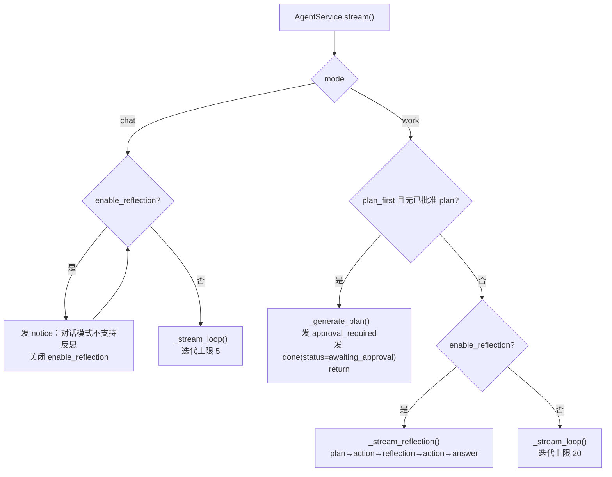
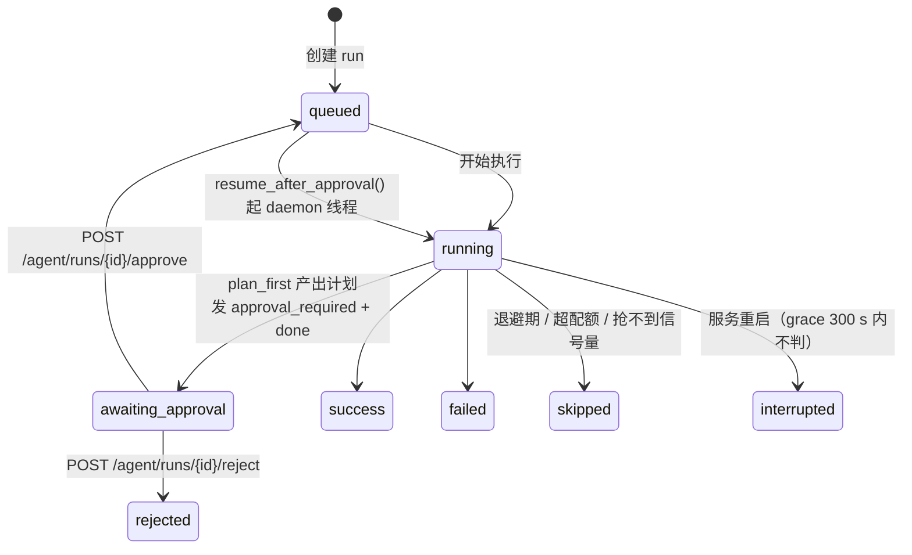

# Agent 执行引擎与事件协议

> - **依据代码**：`backend/app/services/agent_service.py`、`tool_registry.py`、`backend/app/api/v1/agent.py`、`backend/app/services/run_executor.py`、`backend/app/services/run_service.py`、`backend/app/schemas/agent.py`、`backend/app/services/agent/`
> - **资料来源**：2026-10-26 逐文件探查
> - **整理日期**：2026-10-26
> - **对应基线**：commit `c4dac22`
> - **相关篇目**：`01` 架构总览 ｜ `02` 能力链 ｜ `04` 数据层 ｜ `05` 接口 ｜ `06` 前端消费 ｜ `08` 运行账本

---

# 第一部分 现状事实

## 一、执行模型总览

Agent 执行有**四条互斥路径**，由 `mode` / `plan_first` / `enable_reflection` 三个入参决定：



| 路径 | 触发条件 | 实现 | LLM 调用方式 |
|---|---|---|---|
| **① 主循环** | 默认 | `_stream_loop()`（`agent_service.py:306-425`） | OpenAI 兼容 function calling，**非流式** |
| **② 计划审批** | `mode=work` + `plan_first=true` + 无已批准 plan | `_generate_plan()`（`agent_service.py:277-301`） | `app.core.llm.chat(..., json_mode=True)` |
| **③ 反思循环** | `enable_reflection=true`（**仅 work**） | `_stream_reflection()`（`agent_service.py:433-518`） | 规划/反思用 JSON mode；最终回答用 **stream=True** |
| **④ 旧范式** | `POST /api/v1/agent/chat` | `backend/app/services/agent/service.py` | DeepSeek JSON-mode + `reasoning_content` 流式 |

> **路径 ④ 与前三条是并列关系，不是「旧版本」**：`backend/app/services/agent/` 5 个文件（`planner` / `reflection` / `answer` / `tools` / `service`）构成一条**独立的 plan→action→reflection→answer 实现**，其提示词硬编码「星辰电动 ES9 汽车销售助手」，仅被 `POST /api/v1/agent/chat` 使用（`backend/app/api/v1/agent.py:135`）。

## 二、主循环逐步

### 2.1 上下文装配

```mermaid
sequenceDiagram
    participant S as AgentService.stream
    participant SK as SkillManager
    participant TR as ToolRegistry
    participant L as DashScope /chat/completions
    participant EX as LocalCodeExecutor

    S->>SK: resolve_for_mode(skills, mode)
    S->>TR: get_combined_tools(..., profile)
    S->>SK: build_system_prompt(skills, mode, team)
    S->>TR: build_tools_prompt_section(...)
    Note over S: system_prompt = Skill 段 + 工具段 (+ 已批准计划段)
    S->>S: yield skills_selected / system_prompt / user_input
    loop iteration in 1..limit
        S->>S: yield round_start / round_input
        S->>L: chat.completions.create(model, messages, tools, max_tokens)
        L-->>S: assistant message (content + tool_calls)
        alt 有 content
            S->>S: yield model_text
        end
        alt 无 tool_calls
            S->>S: finished = true; break
        end
        loop 每个 tool_call
            S->>S: yield tool_call
            S->>TR: dispatch(tool_name, tool_input, executor)
            TR-->>S: (result_json, tool_source, extra)
            S->>S: yield tool_result (+references / +reference_cards)
            S->>S: messages.append(role=tool, tool_call_id, content=result[:8000])
        end
    end
    S->>S: yield files / yield done
```

### 2.2 各步骤的关键实现

| 步骤 | 实现 | 证据 |
|---|---|---|
| 客户端 | `OpenAI(api_key=settings.dashscope_api_key, base_url=settings.dashscope_base_url)`，懒加载单例；缺 Key 抛 `MissingApiKeyError` | `agent_service.py:130-142` |
| Schema 转换 | `_to_openai_tools()` 把 Anthropic 风格的 `input_schema` / `inputSchema` 转成 OpenAI `{"type":"function","function":{name,description,parameters}}` | `agent_service.py:147-161` |
| 历史回放 | **只回放 `role in ("user","assistant")` 且 `content` 非空**的条目——**绝不回放 `tool` 消息与带 `tool_calls` 的 assistant 消息** | `agent_service.py:318-321` |
| LLM 调用 | `client.chat.completions.create(model, max_tokens=settings.max_tokens, messages, tools=openai_tools)`，**非流式** | `agent_service.py:343-348` |
| assistant 回填 | `{"role":"assistant","content":content or "","tool_calls":[{"id","type":"function","function":{"name","arguments"}}]}` | `agent_service.py:368-379` |
| 工具入参解析 | `json.loads(tc.function.arguments or "{}")`，JSON 解析失败则用 `{}` | `agent_service.py:384-387` |
| 工具结果回填 | `{"role":"tool","tool_call_id":tc.id,"content":result_str[:8000]}` | `agent_service.py:415-419` |
| 产出文件收集 | 运行前 `_snapshot_files()` 取 `output_dir` 文件名集合，结束后 `_collect_new_files()` 取差集 | `agent_service.py:166-181,323,423` |
| 路径脱敏 | `display_path()` 把项目根绝对路径替换为 `./`（**仅用于事件展示**，回填给 LLM 的仍是原串） | `agent_service.py:89-91` |

### 2.3 终止条件

| 条件 | 行为 | 事件 |
|---|---|---|
| 无 `tool_calls` | `finished = True`，正常退出循环 | 随后 `files` + `done` |
| 达到迭代上限 | `for...else` 分支触发 | `error: 达到最大迭代次数 {limit}` |
| 超过 deadline | 每轮迭代前检查 `time.monotonic() > deadline` | `error: timeout: 超过执行时限` |
| LLM 调用异常 | 捕获网络/鉴权/限流异常 | `error: {类型}: {消息}` |
| 缺 API Key | `_get_client()` 抛 `MissingApiKeyError` | `error` + `done`，直接返回 |

**注意**：达到上限时走的是 `for...else`（`agent_service.py:420-421`）——Python 的 `for...else` 在循环**未被 `break`** 时执行 `else`，因此「正常跑完 limit 轮且每轮都有 tool_calls」会走到 `else` 分支发 error，而「因无 tool_calls 而 break」不会。逻辑正确但可读性差。

## 三、工具注册表与 Profile

> **S5 新增**：`tool_search`（按关键词检索工具目录）与 `tool_load`（装载完整 Schema）两个工具；
> 首轮上下文只注入**目录**（name + 一句话描述 + 命名空间）与**核心工具** Schema，其余按需装载
> （详见 `../analysis/02` 与 `../plan/`）。

### 3.1 工具集合构成

| 来源 | 数量 | 名称 | 定义位置 |
|---|---|---|---|
| 内置 | 5 | `read_file` `write_file` `execute_python` `execute_bash` `list_directory` | `tool_registry.py:46-97` |
| RAG | 2 | `rag_query` `rag_ingest` | `tool_registry.py:102-123` |
| Web | 1 | `web_research` | `tool_registry.py:125-139` |
| MCP | 动态 | `mcp_<server>__<tool>` | `tool_registry.py:184-189` |

### 3.2 Profile 裁剪规则

`get_combined_tools()`（`tool_registry.py:151-193`）：

| profile | 内置 | RAG | Web | MCP |
|---|---|---|---|---|
| `CHAT` | 仅 `read_file` `list_directory` | 仅 `rag_query` | 全给 | 仅 `read_only=True` 的 Server |
| `WORK` | 全给 | 全给 | 全给 | 全给 |

`assert_profile_consistency()`（`tool_registry.py:36-41`）在 CHAT 下断言工具名集合与 `WRITE_TOOL_NAMES = {write_file, execute_python, execute_bash, rag_ingest}` 无交集。

MCP 工具注入时：
- 名称改写为 `mcp_<server>__<tool>`；
- 描述改写为 `[MCP:<server>] <原描述第一行>`；
- schema 取 `inputSchema`，缺省 `{"type":"object","properties":{}}`；
- **单个 Server 反射失败只记 warning，不阻塞其它 Server**（`tool_registry.py:190-191`）。

### 3.3 分发

`dispatch()`（`tool_registry.py:198-253`）返回三元组 `(result_json_str, tool_source, extra)`：

| tool_source | 触发条件 | result 形态 | extra |
|---|---|---|---|
| `mcp` | 名称以 `mcp_` 开头 | `{"result": "<MCP 原始返回>"}` | `{"mcp_server": server}` |
| `rag` | `rag_query` | `{"answer": ..., "references": ...}` | `{"references": refs}` |
| `rag` | `rag_ingest` | 入库统计 | `{}` |
| `web` | `web_research` | 完整结果 | `{"reference_cards": [...]}` |
| `builtin` | 其余 | 内置工具返回值 | `{}` |

**异常数据化**：RAG / Web 工具的异常被包成 `{"error": "..."}` 返回给 LLM，**不抛异常中断循环**（`tool_registry.py:222-223,231-232,249-250`）。

MCP 工具的异常在 `MCPManager.call_tool()` 层已被转成字符串（`mcp_manager.py:175-179`），`dispatch` 不再重复包装。

## 四、模式与计划审批

### 4.1 模式语义

| 维度 | `chat` | `work` |
|---|---|---|
| 迭代上限 | `settings.chat_max_iterations` = 5 | `settings.max_iterations` = 20 |
| Skill 默认 | `skills=None` → 不加载 | `skills=None` → 全部启用中 |
| 工具集 | 只读 | 全量 |
| `plan_first` | 不支持（schema 校验拒绝） | 支持 |
| `enable_reflection` | 不支持（发 `notice` 关闭） | 支持 |
| system prompt | 「对话模式（Ask）」段 + 提示不要写文件/执行代码 | 「工作模式（Craft）」段 + 工具说明 + `execute_python` 使用规则 + 中文支持说明 |

`work` 模式的 system prompt 明确写入了 **「每次 `execute_python` 调用都是独立进程，变量不会共享」** 的规则（`skill_manager.py:441-447`），这是对 subprocess 语义的显式补偿。

### 4.2 计划生成

`_generate_plan()`（`agent_service.py:277-301`）：

1. 用 `app.core.llm.chat(PLAN_STEPS_TEMPLATE.format(query=...), model=settings.plan_model, json_mode=True)` 请求 JSON；
2. 正则 `r"(\[[\s\S]*\])"` 从返回文本中抠出 JSON 数组（容忍前后解释文字）；
3. 每步规整为 `{id, title[:40], detail[:120]}`，过滤无 `title` 的项；
4. **任何异常 → 降级为单步计划** `[{"id":1,"title":"执行任务","detail": query[:120]}]`。

`PLAN_STEPS_TEMPLATE`（`agent_service.py:74-86`）要求拆解为 **2-6 个步骤**，`title ≤ 20 字`、`detail ≤ 60 字`。

### 4.3 审批状态机



| 动作 | 实现 | 位置 |
|---|---|---|
| 产出计划并挂起 | `agent_service.py:261-265` 发 `approval_required` + `done(status="awaiting_approval")` 后 `return` | `backend/app/services/agent_service.py` |
| 状态置 `awaiting_approval` | `run_service.save_plan()` | `backend/app/services/run_service.py:112-117` |
| 批准 | `run_service.approve_plan()` → `status="queued"`；随后 `executor.resume_after_approval()` 起 **daemon 线程**续跑 | `backend/app/services/run_service.py:119-132`；`backend/app/services/run_executor.py:324-406` |
| 拒绝 | `run_service.reject_run()` → `status="rejected"` | `backend/app/services/run_service.py:134-144` |
| API | `POST /api/v1/agent/runs/{run_id}/approve`（可带 `edited_plan`）/ `reject`（带 `reason`）；非待审批状态返回 **409** | `backend/app/api/v1/agent.py:104-129` |

**恢复执行时**，`plan` 被拼进 system prompt 的「## 已批准的执行计划」段（`agent_service.py:240-245`）。

## 五、SSE 事件协议

### 5.1 事件全表（Agent，**25 个事件名** = 原 18 + S2~S7 新增 7）

> 顺序栏标注「典型出现次序」；`meta` 由 `RunExecutor` 产生，`approval_required` 在 plan-first 路径产生。

| # | type | 关键字段 | 产生位置 | 典型次序 |
|---|---|---|---|---|
| 1 | `meta` | `run_id` `session_id` `mode` `team` `resolved_skills` | `run_executor.py:158-165` | 1（最前） |
| 2 | `notice` | `content` | `agent_service.py:257`（chat+反思）、`run_executor.py:132,167` | 早 |
| 3 | `skills_selected` | `skills[]` `all_skills[]` `total` | `agent_service.py:247-252` | 2 |
| 4 | `system_prompt` | `content`（已脱敏绝对路径） | `agent_service.py:253` | 3 |
| 5 | `user_input` | `content` | `agent_service.py:254` | 4 |
| 6 | `approval_required` | `plan[]`；**`agent_service` 版不带 `run_id`，`run_executor` 版带** | `agent_service.py:263`；`run_executor.py:222` | 5（plan-first 时） |
| 7 | `done` | `status`（仅 plan-first 分支带 `awaiting_approval`） | `agent_service.py:264` | 6（plan-first 时） |
| 8 | `round_start` | `round`（从 1 开始） | `agent_service.py:339` | 循环内 |
| 9 | `round_input` | `messages[]`（摘要：index / role / preview） | `agent_service.py:340` | 循环内 |
| 10 | `model_text` | `content` `round` | `agent_service.py:357-361`；反思分支 `:512` | 循环内 |
| 11 | `tool_call` | `tool_name` `tool_input` `round` `tool_source` `mcp_server` | `agent_service.py:389-396` | 循环内 |
| 12 | `tool_result` | `tool_name` `result`（截断 2000）`round` `tool_source` `mcp_server` `references?` `reference_cards?` | `agent_service.py:401-413` | 循环内 |
| 13 | `error` | `content` | `agent_service.py:328,337,350,421,458,514` | 任意时刻 |
| 14 | `files` | `files[]`（`name` `size` `is_image`） | `agent_service.py:424`；反思分支 `:517` | 末 |
| 15 | `done` | — | `agent_service.py:425`；反思分支 `:518` | 最末 |
| 16 | `reflection_start` | `mode="plan_action_reflection_answer"` | `agent_service.py:447` | 反思分支 |
| 17 | `plan` / `reflection_plan` | `actions[]` | `agent_service.py:461,485` | 反思分支 |
| 18 | `reasoning_delta` | `content` | `agent_service.py:510` | 反思分支 |
| 19 | `interrupted` | `content` `phase`（round / before_tool / after_tool） | `agent_service.py`（S4 取消在工具边界生效） | 取消时 |
| 20 | `steer_injected` | `instructions[]` `modes[]` | `agent_service.py`（S4 转向在下一个工具边界注入） | 工具边界 |
| 21 | `plan_replaced` | `content` | `agent_service.py`（S4 `replace_plan` 模式） | 工具边界 |
| 22 | `context_compressed` | `mode` `before_tokens` `after_tokens` `saved_tokens` `sections[]` `summary` | `agent_service.py`（S5 九段压缩） | 上下文超阈值 |
| 23 | `context_trimmed` | `dropped` `tokens` `ratio` | `agent_service.py`（S5 轻量裁剪） | 上下文超 70% |
| 24 | `busy` | `content` `limit` | `run_executor.py`（S4 并发预算超限） | 请求入口 |
| 25 | `memory_item` | `tool` `input` `result`（截断 3000） | `agent_service.py`（S5 记忆工具调用） | 记忆检索时 |

**线上事件名 18 个，前端 TypeScript 联合类型 17 个**——`plan` 与 `reflection_plan` 共用同一个 `PlanEv`（`frontend/web/vue-element-plus/src/api/types.ts:412-415`，其 `type` 字段是联合 `'plan' | 'reflection_plan'`）。

### 5.2 事件负载格式

SSE 帧格式为 `data: {json}\n\n`（`backend/app/api/v1/agent.py:64`），响应头：

```
Content-Type: text/event-stream
Cache-Control: no-cache
X-Accel-Buffering: no
Connection: keep-alive
```

### 5.3 落库顺序

`RunExecutor` 把同一批事件写入 `run_events` 表，**批量 20 条 / 2 秒**（`backend/app/services/run_executor.py:26-27,232-233`），带 `seq` 递增。前端因此可以用 `after_seq` 游标续订。

### 5.4 反思分支的事件差异

反思分支**没有** `round_start` / `round_input` / `tool_call` 的 `round` 字段语义（工具事件来自 `_execute_actions()`，无轮次编号），并且额外产出 `reflection_start` / `plan` / `reflection_plan` / `reasoning_delta`。

---

# 第二部分 原理剖析

## 六、为什么主链路是 function calling 而不是 plan→action→reflection→answer

三种主流的 Agent 编排范式：

| 范式 | 控制流 | 优点 | 代价 |
|---|---|---|---|
| **Plan-then-Act**（先出完整计划，再逐步执行） | LLM 一次性产出计划 → 执行器按计划走 | 计划可视、可审批、可预估成本 | 计划与现实脱节时整条链报废；灵活性差 |
| **Reflection**（执行 → 反思 → 补充执行） | 执行一轮后让 LLM 判断信息是否充分 | 能自我纠偏、补齐信息 | 额外 LLM 调用；反思质量不稳定 |
| **ReAct / function calling**（模型自己决定调什么工具） | 每轮把「当前消息 + 工具列表」交给模型，模型返回 tool_calls 或最终文本 | 模型自主决策；工具调用与自然语言回答可在同一轮混排；OpenAI 兼容协议原生支持 | 需要模型具备可靠的 tool_call 能力；调试链路更长 |

本项目的**主链路选择 ReAct 范式**，理由是：

1. **工具集是动态的**。MCP 工具在运行时才知道有哪些、参数 schema 是什么，Skill 也可能随时被禁用。ReAct 范式天然支持「每轮重新给出工具定义」，而 Plan-then-Act 需要在规划时就冻结工具清单。
2. **模式差异需要即时生效**。`chat` 与 `work` 的工具集差异必须在**每一次**模型调用时体现，Plan-then-Act 的计划在第一步就定死了工具。
3. **协议成本**。DashScope 的 OpenAI 兼容端点对 function calling 支持完整，而「结构化规划 + 自由执行」需要模型同时稳定输出 JSON 与工具调用——项目实测该 key 的 `/messages`（Anthropic 协议）返回 404，只能走 `/chat/completions`。

**反思能力没有被丢弃，而是降级为一个可选分支**：`enable_reflection=true` 时走 `_stream_reflection()`，保留 Plan-then-Act + Reflection 的组合，用于需要「先规划、查证、再补充查证、最后成文」的任务（如研究型问答）。它与主链路是两条**并列**的实现，而非主链路的「增强版」。

## 七、为什么历史回放必须过滤 tool 消息

OpenAI 兼容的 function calling 协议要求消息序列严格配对：

```
assistant(tool_calls=[{id:"call_1", ...}])
tool(tool_call_id="call_1", content="...")
```

如果把上一轮的 `tool` 消息回放进新一轮的 `messages`，但**没有对应的 assistant(tool_calls) 消息**，协议校验会直接报错；如果回放了 assistant(tool_calls) 但缺少 tool 结果，同样报错。

而如果把整段 tool 交互都回放，token 成本会随对话轮数**二次方增长**（每轮的工具输出都是大段文本）。

`agent_service.py:318-321` 的策略是：**只回放 user 与 assistant 的纯文本内容**，丢弃全部 tool 交互。代价是模型在新一轮里「忘记」自己上一轮查过什么；缓解手段是工具结果中的关键信息通常也会被模型写进 assistant 的文本回复里。

`session_service.build_history()` 用同样的规则，并额外做了字符预算裁剪（`session_history_max_chars=8000`）与「首条必须是 user」的处理（`backend/app/services/session_service.py:226-261`）。

## 八、为什么工具结果要截断到 8000 字符

回填给模型的 tool 消息长度直接决定下一轮的输入 token 数与成本。平台采用两级截断：

| 位置 | 截断 | 面向 |
|---|---|---|
| 回填给 LLM | `result_str[:8000]`（`agent_service.py:418`） | 控制上下文成本 |
| 发给前端 | `result_str[:2000]`（`agent_service.py:404`） | 控制 SSE 帧大小与前端渲染性能 |

这意味着**前端看到的工具结果可能与模型看到的不同**（前端看到 2000 字符，模型看到 8000）。这是有意的取舍：模型需要完整结果做判断，前端只需要可读的摘要。

## 九、计划审批为什么用「挂起 + 恢复」而不是「阻塞等待」

`plan_first` 需要人工确认，但 HTTP 请求不能无限等待。平台的做法是：

1. 第一次请求产出计划并**立即结束 SSE 流**（`done` 带 `status="awaiting_approval"`）；
2. run 记录落库，状态 `awaiting_approval`，计划存 `runs.plan_json`；
3. 前端拿到计划后渲染 `PlanCard`，用户点「确认执行」→ `POST /agent/runs/{run_id}/approve`；
4. 服务端 `approve_plan()` 把状态改回 `queued`，再由 `resume_after_approval()` 起一个 **daemon 线程**继续执行，前端通过 `GET /runs/{run_id}/stream?after_seq=N` 续订事件。

这个设计的关键收益是：**HTTP 连接不会被占用**（不会因等待人工确认而超时），且**执行过程可断点续订**（`run_events` 账本 + `after_seq`）。代价是恢复执行走的是 daemon 线程而非请求上下文，因此 `resume_after_approval()` 内部必须**自己创建 DB Session**（`run_executor.py:324-406`）。

## 十、为什么用 SSE 而不是 WebSocket

见 `01_架构总览.md` §10 的完整对比。本篇只补充与事件协议直接相关的三点：

1. **事件是有序的、可持久化的**。`run_events` 表给每个事件分配递增 `seq`，`GET /runs/{run_id}/stream?after_seq=N` 天然支持「从第 N 条继续」。WebSocket 的消息没有这种内建游标，需要自己维护。
2. **断线重连是必需能力而非优化**。研究进度流最长可达 1800 秒（`SSE_MAX_DURATION=1800`），任何网络抖动都会断流。SSE + `after_seq` / `stage|ts` 去重键提供了可恢复的续订路径。
3. **反向代理需要显式配置**。Nginx 必须 `proxy_buffering off`，否则事件会被缓冲成一坨再吐出，前端完全失去流式体验（`deploy/nginx/conf.d/agent.conf:40-54`）。

---

# 第三部分 已知边界与观察

| 编号 | 观察 | 证据 | 指向 |
|---|---|---|---|
| S-03-01 | **LLM 调用是非流式的**：`chat.completions.create()` 不带 `stream=True`，模型完整响应后才产出 `model_text`。所谓「流式」只是事件逐个下发，首 token 延迟 = 完整响应时间 | `backend/app/services/agent_service.py:343-348` | `12` §2 / `11` §2 |
| S-03-02 | `approval_required` 在 `agent_service` 路径**不带 `run_id`**，而前端 `ApprovalRequiredEv.run_id` 是必填字段 | `backend/app/services/agent_service.py:263`；`frontend/web/vue-element-plus/src/api/types.ts:431-435` | `12` D-39 |
| S-03-03 | `done` 事件带 `status` 字段（`awaiting_approval`），前端 `DoneEv` 未声明也不消费 | `backend/app/services/agent_service.py:264`；`frontend/web/vue-element-plus/src/api/types.ts:403-405` | `12` D-40 |
| S-03-04 | `tool_result` 的 `references`（RAG）与 `reference_cards`（Web）是两个不同字段，前端分别消费，语义不统一 | `backend/app/services/agent_service.py:409-412` | `06` §5 |
| S-03-05 | `system_prompt` 事件把**完整 system prompt** 发给前端（含工具清单与 Skill 清单），信息量随工具数增长 | `backend/app/services/agent_service.py:253` | `12` §2 |
| S-03-06 | 达到迭代上限走 `for...else`，与「无 tool_calls 正常结束」的 `break` 路径区分依赖语言细节 | `backend/app/services/agent_service.py:335,363-365,420-421` | `12` §2 |
| S-03-07 | `enable_reflection` 在 chat 模式下不是报错而是「发 notice 后静默降级」，用户可能不知道反思没生效 | `backend/app/services/agent_service.py:256-258` | `12` §2 |
| S-03-08 | 计划生成失败一律降级为单步计划「执行任务」，用户看到的计划可能与预期完全不符 | `backend/app/services/agent_service.py:299-301` | `12` §2 |
| S-03-09 | `resume_after_approval()` 用 daemon 线程恢复执行，**进程退出即丢失**该执行 | `backend/app/services/run_executor.py:324-406` | `08` §5 |
| S-03-10 | 工具异常一律数据化返回给 LLM，Agent 会把错误字符串当作「工具结果」继续推理，可能产生幻觉式补救 | `backend/app/services/tool_registry.py:222-250` | `12` §2 |
| S-03-11 | `write_file` / `execute_python` 等写类工具的路径参数由模型给出，**未做目录白名单限制**（cwd 固定为 `output_dir`，但绝对路径可越界） | `backend/app/services/code_executor.py` | `12` D-36 / §3 |
| S-03-12 | `_stream_loop` 的 `messages` 列表无长度上限，只受 `max_iterations=20` 约束；工具结果每次最多 8000 字符，最坏情况上下文可达数十万 token | `backend/app/services/agent_service.py:335-419` | `11` §2 |
| S-03-13 | `chat_log_*.json` 调试日志路径仍在，但由 `settings.save_chat_log`（默认 `False`）关闭 | `backend/app/services/agent_service.py:427-428`；`backend/app/core/config.py:85` | `12` D-21 |

---

# 第四部分 改进指向

| 优先级 | 事项 | 台账编号 |
|---|---|---|
| **P0** | `approval_required` 补 `run_id`，与前端类型对齐 | D-39 |
| **P0** | 写类工具的路径参数增加工作目录约束（禁止越出 `output_dir`） | D-36 / `12` §3 |
| **P0** | `allow_dangerous_tools` 在 `ToolRegistry` 生效 | D-29 |
| **P1** | LLM 调用改流式（`stream=True` + 增量 `model_text`），降低首 token 延迟 | `11` §3 |
| **P1** | 工具结果回填增加 token 预算控制（当前仅按字符数硬截断） | `11` §3 |
| **P1** | 前端消费 `done.status`，区分「完成」与「待审批」 | D-40 |
| **P1** | 计划生成失败时在事件中显式告知降级（当前只落日志） | `12` §2 |
| **P2** | 统一 `references` 与 `reference_cards` 的语义与结构 | `06` §5 |
| **P2** | `system_prompt` 事件改为按需下发（仅调试模式全量下发） | `12` §2 |
| **P2** | `for...else` 改为显式 `finished` 标志判断 | `12` §2 |
| **P2** | `resume_after_approval` 的恢复执行改为可持久化任务（避免进程退出丢失） | `08` §5 |

---

# 第五部分 核对方式

```bash
cd backend

# 事件类型全量（应为 24 个，排除 schema 关键字）
grep -rhoE '"type":\s*"[a-z_]+"' app/ | sed 's/.*"\([a-z_]*\)"/\1/' | sort -u

# 主循环关键行
grep -n "chat.completions.create\|max_tokens\|role\": \"tool\"\|for iteration in range" backend/app/services/agent_service.py

# 历史回放过滤
grep -n "role\") in (\"user\", \"assistant\")" backend/app/services/agent_service.py

# Profile 裁剪
grep -n "CHAT_BUILTIN_NAMES\|WRITE_TOOL_NAMES\|assert_profile_consistency" backend/app/services/tool_registry.py

# 审批端点
grep -n "approve\|reject\|409" backend/app/api/v1/agent.py

# 前端事件类型（应为 27 个 TS 类型 / 24 个事件名）
sed -n '442,460p' ../frontend/web/vue-element-plus/src/api/types.ts
grep -n "type: 'plan' | 'reflection_plan'" ../frontend/web/vue-element-plus/src/api/types.ts
```
