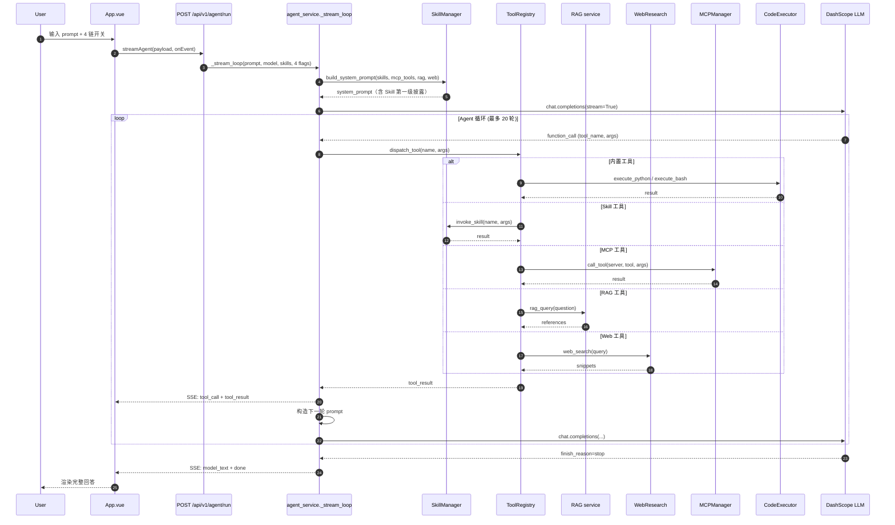
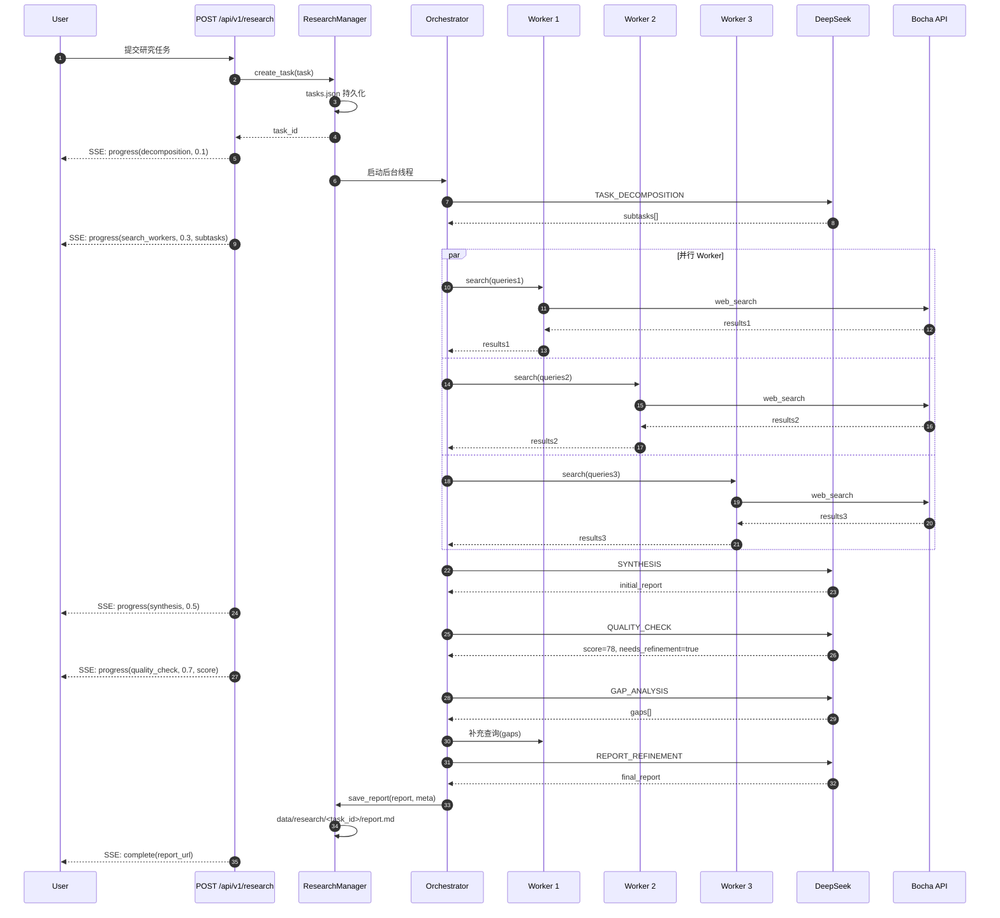
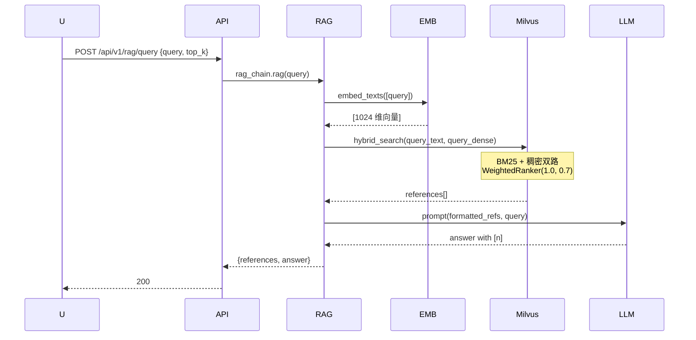

# agent-platform 链路分析（扩充版）

> - **依据项目**：`apps/agent-platform/backend/app/` + `frontend/src/`
> - **资料来源**：本项目代码（2026-09-15 探查）+ FastAPI StreamingResponse + Anthropic MCP 规范 + LangGraph 对比
> - **整理日期**：2026-09-15（首发 2026-09-15 扩充）
> - **范围**：7 条核心链路 + Agent 循环时序 + Deep Research 多智能体流程

---

# 第一部分 链路总览

## 一、7 条核心链路

| # | 链路 | 端点 | 存储 | LLM | 关键特征 |
|---|------|------|------|-----|----------|
| 链路一 | **Agent 主链路** | `POST /api/v1/agent/run` (SSE) | 文件 + Milvus Lite | DashScope (主) + DeepSeek (备) | 4 链开关透传；最多 20 轮 |
| 链路二 | 同步 Agent | `POST /api/v1/agent/run/sync` | 同上 | 同上 | 阻塞式；返回完整结果 |
| 链路三 | **文档入库 (RAG)** | `POST /api/v1/rag/ingest` | Milvus Lite | DashScope Embedding | 文件 → 切块 → embed |
| 链路四 | **文档检索 (RAG)** | `POST /api/v1/rag/query` | Milvus Lite | DeepSeek | hybrid search + 生成带 `[n]` 引用 |
| 链路五 | **Web Research** | `POST /api/v1/web_research/run` | 临时 Chroma | OpenAI (gpt-4o) | Serper + 多线程爬虫 |
| 链路六 | **Deep Research** | `POST /api/v1/research` (SSE) | `data/research/tasks.json` | Bocha + DeepSeek | Orchestrator-Workers + 质量评分 |
| 链路七 | 启动加载 | `lifespan` → `init_app_state` | — | — | Skill 扫描 + MCP 进程启动 |

### 1.1 链路拓扑图

```mermaid
flowchart TB
    Browser[Browser]
    Browser -->|4 链开关| App[App.vue]
    App -->|streamAgent| Agent[/api/v1/agent/run/]
    App -->|streamResearch| Research[/api/v1/research/]
    App -->|upload| Ingest[/api/v1/rag/ingest]
    App -->|search| Query[/api/v1/rag/query]
    App -->|web| WebRes[/api/v1/web_research/run]
    
    Agent --> SM[SkillManager]
    Agent --> MM[MCPManager]
    Agent --> Rag[RAG Chain]
    Agent --> WR[WebResearch]
    Agent --> LLM[DashScope / DeepSeek]
    
    Research --> Orch[Orchestrator]
    Orch --> Workers[OODA Workers]
    Orch --> LLM
    Orch --> Bocha[Bocha API]
```

## 二、关键观察表

| 编号 | 观察 | 风险/影响 |
|------|------|----------|
| AP-3-1 | `max_iterations=20` 硬编码 | 防死循环；但长任务可能不够 |
| AP-3-2 | 4 链开关在 payload 透传 | 前端 UI 与服务端解耦 |
| AP-3-3 | Skill 系统提示词「渐进式披露」 | metadata 在 system prompt；正文按需加载 |
| AP-3-4 | 工具结果直接拼下一轮 | 无显式 memory 截断；可能超 token |
| AP-3-5 | SSE 事件 10+ 类型 | 前端需容错（App.vue:166） |
| AP-3-6 | `enable_reflection` 单独开关 | Plan→Act→Reflect 模式 |
| AP-3-7 | tasks.json 多线程并发写 | 需读写锁（research_manager.py） |
| AP-3-8 | 启动时启动 MCP Server（subprocess） | 影响启动时间 |

---

# 第二部分 关键链路详解

## 二、链路一：Agent 主链路（核心）

### 2.1 时序图



### 2.2 工具分发策略

```python
# tool_registry.py
def build_tool_registry(skills, enable_mcp, enable_rag, enable_web_research):
    """根据 4 链开关构建工具注册表"""
    tools = []
    
    # 1. 内置工具（始终）
    tools.extend([
        {"type": "function", "function": builtin_tool_schema("execute_python")},
        {"type": "function", "function": builtin_tool_schema("execute_bash")},
    ])
    
    # 2. Skill 工具（用户选择）
    for skill_name in skills:
        skill = skill_manager.get_skill(skill_name)
        if skill:
            tools.extend(skill.to_tool_schemas())
    
    # 3. MCP 工具
    if enable_mcp:
        tools.extend(mcp_manager.get_all_tool_schemas())
    
    # 4. RAG 工具
    if enable_rag:
        tools.append({"type": "function", "function": rag_tool_schema()})
    
    # 5. Web 工具
    if enable_web_research:
        tools.append({"type": "function", "function": web_research_tool_schema()})
    
    return tools
```

### 2.3 SSE 事件协议（10+ 类型）

```python
# agent_service.py
yield {"event": "skills_selected", "data": {"skills": selected}}
yield {"event": "plan", "data": {"plan": [...]}}
yield {"event": "tool_call", "data": {"tool": name, "args": args}}
yield {"event": "tool_result", "data": {"tool": name, "result": result}}
yield {"event": "reasoning_delta", "data": {"content": "..."}}
yield {"event": "reflection_plan", "data": {"plan": [...]}}
yield {"event": "model_text", "data": {"content": "..."}}
yield {"event": "files", "data": [{"path": ..., "type": "png"}]}
yield {"event": "error", "data": {"message": "..."}}
yield {"event": "done", "data": {}}
```

## 三、链路六：Deep Research 多智能体

### 3.1 时序图



### 3.2 6 阶段 Prompt 流转

| 阶段 | Prompt | 输出 |
|------|--------|------|
| 1. TASK_DECOMPOSITION | 拆解任务为子任务 | `subtasks[]` |
| 2. SEARCH_WORKER_TASK | 并行执行搜索 | Worker results |
| 3. SYNTHESIS | 汇总为初步报告 | `initial_report` |
| 4. QUALITY_CHECK | 评分（0-100） | `score, needs_refinement` |
| 5. GAP_ANALYSIS | 分析缺口 | `gaps[]` |
| 6. REPORT_REFINEMENT | 迭代优化 | `final_report` |

## 四、链路四：RAG 检索

### 4.1 时序图



## 五、前端 SSE 消费（自研 readSSE）

```javascript
// src/api.js
export async function streamAgent(params, onEvent, signal) {
  const response = await fetch('/api/v1/agent/run', {
    method: 'POST',
    headers: { 'Content-Type': 'application/json' },
    body: JSON.stringify(params),
    signal,
  })
  
  if (!response.ok) throw new Error(`HTTP ${response.status}`)
  
  await readSSE(response, onEvent, signal)
}
```

## 六、S-* 观察汇总

| 优先级 | 链路 | 项目 |
|--------|------|------|
| **P0** | 链路一 | SSE 鉴权（已有自研 readSSE，支持 header） |
| **P0** | 所有 | CORS 收紧 |
| **P1** | 链路一 | memory 截断（防 token 超限） |
| **P1** | 链路六 | Deep Research 任务并发上限 |
| **P2** | 所有 | Langfuse 集成（已有文档） |

## 七、业界做法对比

| 方案 | 来源 | 范式 | 优缺点 |
|------|------|------|-------|
| **本项目 ReAct + Reflection** | Agent 实现 | 灵活；可控 | — |
| **LangGraph** | LangChain | 状态机 | 表达力强 |
| **AutoGen** | Microsoft | 多 Agent | 成熟 |
| **CrewAI** | CrewAI Inc | 角色+任务 | 上手快 |
| **OpenAI Agents SDK** | OpenAI | 官方 | 原生支持 |
| **Anthropic Tool Use** | Anthropic | 范式 | Skills 模式 |

---

## 附录 A：参考文献

| # | 类型 | 标题 | 来源 | 访问日期 |
|---|------|------|------|----------|
| [1] | 官方文档 | FastAPI StreamingResponse | https://fastapi.tiangolo.com/advanced/custom-response/ | 2026-09-15 |
| [2] | 官方文档 | LangGraph | https://langchain-ai.github.io/langgraph/ | 2026-09-15 |
| [3] | 官方文档 | Anthropic Tool Use | https://docs.anthropic.com/en/docs/build-with-claude/agent-overview | 2026-09-15 |
| [4] | 官方文档 | OpenAI Agents SDK | https://platform.openai.com/docs/agents | 2026-09-15 |
| [5] | 官方文档 | Milvus Hybrid Search | https://milvus.io/docs/hybrid-search.md | 2026-09-15 |
| [6] | 同源文档 | `apps/financial-report-agent/doc/analysis/03_链路分析.md` | 参考 | 2026-09-15 |
| [7] | 同源文档 | `apps/agent-platform/doc/knowledge/03_Orchestrator-Workers多智能体架构.md` | Deep Research | 2026-09-15 |

---

> **本文档结构遵循「五段式」**：当前实现 → 原理剖析 → 业界做法调研 → 操作步骤 → 参考文献附录。
