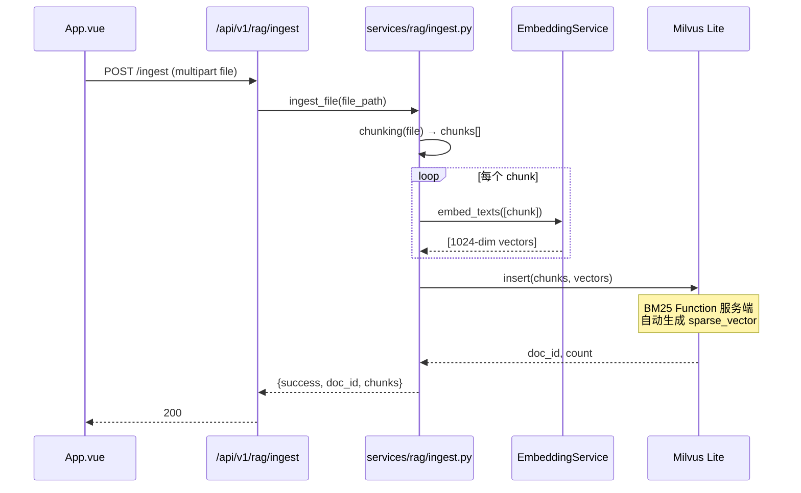
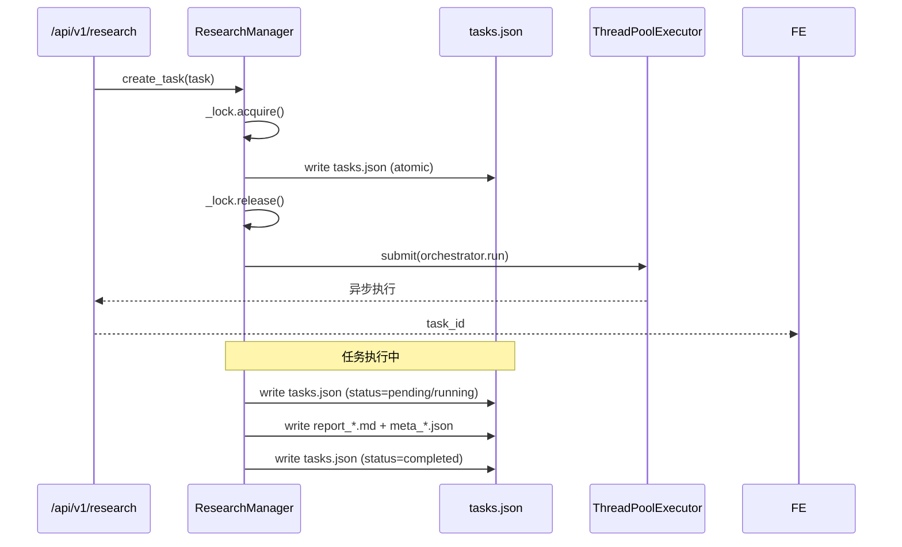
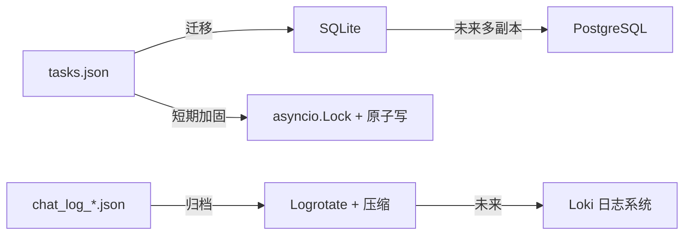

# agent-platform 三端一致性设计（扩充版）

> - **依据项目**：`apps/agent-platform/backend/app/services/` + `data/` + `frontend/src/App.vue`
> - **资料来源**：本项目代码（2026-09-15 探查）+ Milvus 官方 + SQLite WAL + asyncio Lock + Debezium CDC
> - **整理日期**：2026-09-15（首发 2026-09-15 扩充）
> - **范围**：Milvus Lite（向量）+ tasks.json（任务）+ chat_log（会话）+ Skills 文件 + localStorage

---

# 第一部分 当前状态

## 一、五端存储分布

| 存储 | 角色 | 内容 | 写入位置 |
|------|------|------|---------|
| **Milvus Lite**（本地文件） | 派生端（RAG 向量） | chunk + dense + sparse | `services/rag/ingest.py` |
| **`data/research/tasks.json`** | 派生端（任务状态） | task status, report | `services/research/research_manager.py` |
| **`data/outputs/chat_log_*.json`** | 派生端（会话日志） | 完整对话 + 工具调用 | `agent_service._save_log` |
| **本地文件系统** | 派生端（Skill 资源） | SKILL.md + scripts + assets | `backend/skills/{name}/` |
| **前端 localStorage** | 客户端（无后端真相源） | sessions + skills + mode | `App.vue:11-13` |

**结论**：**未使用 PostgreSQL / Redis**——架构天然规避了多端一致性问题，但**所有持久化都是文件**，缺乏事务保证。

### 1.1 存储分布图

```
┌─────────────────────────────────────────────────────────────┐
│                     FastAPI 进程                              │
│                                                              │
│  ┌──────────────┐  ┌──────────────┐  ┌──────────────┐       │
│  │ MilvusClient │  │ ResearchMgr  │  │ SkillManager │       │
│  │  (内存+文件) │  │  (内存 dict) │  │  (内存 dict) │       │
│  └──────────────┘  └──────────────┘  └──────────────┘       │
│                                                              │
└─────────────────────────────────────────────────────────────┘
        │                  │                       │
        ▼                  ▼                       ▼
   ┌─────────┐      ┌──────────────┐         ┌──────────┐
   │milvus.db│      │ tasks.json   │         │ skills/  │
   │ (文件)  │      │ chat_log_*.json│      │ (目录)   │
   └─────────┘      └──────────────┘         └──────────┘
   文件持久化        文件持久化               文件持久化
```

## 二、关键观察表

| 编号 | 观察 | 风险 |
|------|------|------|
| AP-4-1 | Milvus Lite 单文件 `data/milvus.db` | IO 失败时文件可能损坏 |
| AP-4-2 | `tasks.json` 普通 JSON 文件，多线程并发写 | 需读写锁（research_manager 已用 `threading.Lock`） |
| AP-4-3 | chat_log 按时间戳分文件 | 易爆盘；无归档 |
| AP-4-4 | localStorage 无版本迁移 | 字段变更可能丢数据 |
| AP-4-5 | RAG ingest 失败无回滚 | Milvus 增了但前端不知 |
| AP-4-6 | 启动时启动 MCP subprocess | 影响启动时间（~2s） |

## 三、写入链路

### 3.1 RAG 文档入库（链路三）



**风险点**：
- ⚠️ Embedding API 失败 → 部分 chunks 已 insert（**部分写入**）
- ⚠️ Milvus insert 失败 → 无回滚
- ⚠️ 文件删除后 Milvus 索引残留（孤儿）

### 3.2 Research 任务持久化（链路六）



**优势**：
- ✅ threading.Lock 保护并发写
- ✅ 原子写（write 整个文件）
- ✅ 重启可恢复（`_load_tasks`）

### 3.3 Chat 日志

```python
# agent_service._save_log()
def _save_log(self, session_id, messages):
    """按时间戳分文件保存对话日志"""
    log_path = self.output_dir / f"chat_log_{datetime.now().strftime('%Y%m%d')}_{session_id}.json"
    
    if log_path.exists():
        existing = json.loads(log_path.read_text())
        existing.extend(messages)
        log_path.write_text(json.dumps(existing, ensure_ascii=False, indent=2))
    else:
        log_path.write_text(json.dumps(messages, ensure_ascii=False, indent=2))
```

---

# 第二部分 业界做法调研

## 四、典型模式对比

| 模式 | 适用 | 优缺点 |
|------|------|-------|
| **本地 Lite 数据库**（本项目方案） | 单机 POC | 简单；单点失败 |
| **PG + 同步 ES/Redis** | 大型生产 | 强一致；运维复杂 |
| **Outbox + CDC** | 多副本强一致 | Debezium；高吞吐 |
| **SQLite 替代 JSON** | 升级方案 | 事务保证；文件级 |
| **Event Sourcing** | 审计场景 | 不可变事件流 |

### 4.1 Milvus Lite vs Milvus Standalone

| 维度 | Milvus Lite（本项目） | Milvus Standalone |
|------|---------------------|-------------------|
| 部署 | Python 库 | Docker |
| 容量 | 千万级 | 千万级 |
| 性能 | 中（单进程） | 高 |
| 多副本 | ❌ | ✅ |
| 启动 | 0s | 30s |
| 持久化 | 文件 | etcd + MinIO + 文件 |

## 五、RAG 持久化方案对比

| 方案 | 部署 | 性能 | 持久化 | 适用 |
|------|------|------|--------|------|
| Milvus Lite（本项目） | Python 嵌入式 | 千万级 | ✅ 文件 | POC/桌面 |
| Milvus Standalone | Docker | 千万级 | ✅ 服务 | 中小生产 |
| Milvus Cluster | K8s | 亿级 | ✅ 分布式 | 大型生产 |
| pgvector | PG 扩展 | 百万级 | ✅ | 已用 PG |
| Qdrant | Rust 单文件 | 千万级 | ✅ | 性能优先 |
| ChromaDB | Python | 百万级 | ✅ | 轻量 |

## 六、本项目推荐升级路径



---

# 第三部分 推荐改造

## 七、P1-1：研究任务持久化升级 SQLite

```python
# services/research/research_manager.py 改造
import aiosqlite

class ResearchManager:
    async def _save_tasks(self):
        async with aiosqlite.connect(self._db_path) as db:
            await db.execute("""
                CREATE TABLE IF NOT EXISTS tasks (
                    task_id TEXT PRIMARY KEY,
                    original_task TEXT NOT NULL,
                    status TEXT NOT NULL,
                    progress_json TEXT,
                    config_json TEXT,
                    created_at TEXT,
                    started_at TEXT,
                    completed_at TEXT,
                    error TEXT,
                    report_path TEXT
                )
            """)
            await db.executemany(
                "INSERT OR REPLACE INTO tasks VALUES (?, ?, ?, ?, ?, ?, ?, ?, ?, ?)",
                [(t["task_id"], t["original_task"], t["status"], ...) for t in self.tasks.values()]
            )
            await db.commit()
```

## 八、P1-2：ChatLog 归档

```python
# scripts/logrotate.py
import os
import gzip
from datetime import datetime, timedelta

def archive_logs(output_dir, retention_days=30):
    """归档 30 天前的日志"""
    cutoff = datetime.now() - timedelta(days=retention_days)
    for log_file in output_dir.glob("chat_log_*.json"):
        mtime = datetime.fromtimestamp(log_file.stat().st_mtime)
        if mtime < cutoff:
            # 压缩归档
            with log_file.open('rb') as f_in:
                with gzip.open(f"{log_file}.gz", 'wb') as f_out:
                    f_out.writelines(f_in)
            log_file.unlink()
```

## 九、P1-3：Janitor 巡检

```python
# scripts/janitor.py
async def janitor():
    """定期清理孤儿 + 修复一致性"""
    # 1. 扫 Milvus vs 本地文件
    milvus_docs = milvus_client.list_docs()
    fs_files = list(uploads_dir.glob("*.pdf"))
    orphans = set(milvus_docs) - set(fs_files)
    for orphan in orphans:
        milvus_client.delete(orphan)
    
    # 2. 扫 tasks.json 终态
    ...
    
    # 3. 扫 chat_log 归档
    ...
```

## 十、关键观察表（汇总）

| 优先级 | 项目 | 工作量 | 收益 |
|--------|------|--------|------|
| **P1-1** | tasks.json → SQLite | 4h | 事务保证 |
| **P1-2** | chat_log 归档 | 2h | 磁盘控制 |
| **P1-3** | Janitor 巡检 | 1d | 长期稳定 |
| **P2-1** | Milvus → Standalone | 1d | 多副本 |
| **P2-2** | Loki 日志系统 | 1d | 可观测 |
| **P2-3** | localStorage 版本迁移 | 4h | 数据兼容 |

## 十一、改造效果对比

| 维度 | 改造前 | 改造后 |
|------|-------|-------|
| 任务并发写 | ⚠️ Lock + 整文件覆盖 | ✅ SQLite 行级锁 |
| 日志归档 | ❌ 无 | ✅ 自动压缩归档 |
| 孤儿文件 | ❌ 累积 | ✅ Janitor 清理 |
| RAG ingest 失败 | ❌ 部分写入 | ✅ SQLite 事务回滚 |
| 磁盘满 | ❌ 无监控 | ✅ Logrotate + 告警 |

---

## 附录 A：参考文献

| # | 类型 | 标题 | 来源 | 访问日期 |
|---|------|------|------|----------|
| [1] | 官方文档 | Milvus Lite | https://milvus.io/docs/milvus_lite.md | 2026-09-15 |
| [2] | 官方文档 | SQLite WAL | https://www.sqlite.org/wal.html | 2026-09-15 |
| [3] | OSS 项目 | aiosqlite | https://github.com/omnilib/aiosqlite | 2026-09-15 |
| [4] | OSS 项目 | Debezium CDC | https://debezium.io/ | 2026-09-15 |
| [5] | OSS 项目 | Logrotate | https://github.com/logrotate/logrotate | 2026-09-15 |
| [6] | 官方文档 | Python asyncio Lock | https://docs.python.org/3/library/asyncio-sync.html | 2026-09-15 |
| [7] | 官方文档 | MDN localStorage | https://developer.mozilla.org/en-US/docs/Web/API/Window/localStorage | 2026-09-15 |
| [8] | 同源文档 | `apps/industry-research-assistant/doc/analysis/04_五端一致性.md` | 五端对比 | 2026-09-15 |
| [9] | 同源文档 | `apps/financial-report-agent/doc/analysis/04_三端一致性.md` | 四端对比 | 2026-09-15 |

---

> **本文档结构遵循「五段式」**：当前实现 → 原理剖析 → 业界做法调研 → 操作步骤 → 参考文献附录。
