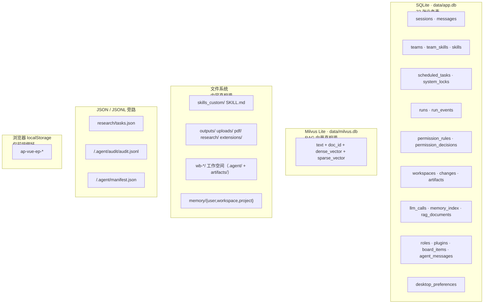
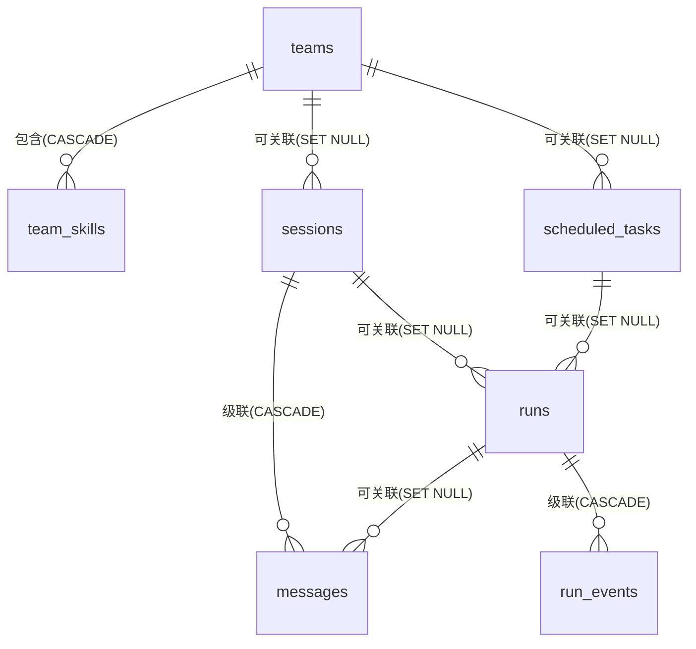

# 数据模型与持久化

> - **依据代码**：`apps/server/src/db/schema.ts`、`apps/server/src/db/client.ts`、`apps/server/src/db/`、`apps/server/src/domain/session/service.ts`、`run_service.py`、`scheduler_service.py`、`skill_manager.py`、`team_service.py`、`apps/server/src/domain/research/manager.ts`
> - **资料来源**：2026-10-29 逐文件复核 + `sqlite3 data/app.db` 实际库结构交叉验证
> - **整理日期**：2026-10-29
> - **对应基线**：commit `7385dcd` + 工作区未提交改动
> - **相关篇目**：`01` 架构总览 ｜ `02` 能力链 ｜ `03` 执行引擎 ｜ `08` 调度与运行账本 ｜ `12` 风险台账 ｜ `14` 权限 ｜ `15` 工作区 ｜ `16` 上下文成本 ｜ `17` 扩展层


> **📌 状态横幅（2026-11-01 · 单运行时改造后）**：本文正文的**能力语义**仍然有效，
> 但其中三处**实现载体**已变化，读时请按此对照：
>
> | 文中写法 | 现状 |
> | --- | --- |
> | **Milvus Lite**（`milvus_store.py` / `milvus-lite`） | → **进程内 SQLite 向量层**（`apps/server/src/domain/rag/store.ts`）：`data/vectors/chunks.db`；BM25 由进程内倒排实现。**两腿结构与融合策略不变** |
> | **Web 形态**（浏览器直连 / CORS / API Key 鉴权） | → **已退场**（design/16 §9.1）。桌面端渲染进程与 sidecar **同源** → 无跨域、无 API Key；鉴权改为「**Host 白名单 + 一次性 nonce + 会话 Cookie**」 |
> | **Docker Compose / 容器化** | → **已退场**。发布物只有**桌面安装包**（dmg / nsis / AppImage）；发布手册见 `deploy/README.md` |
>
> **后端路径**同时由 `backend/app/**`（Python）迁到 `apps/server/src/**`（TypeScript）。

---

# 第一部分 现状事实

## 一、存储分工

平台的数据按**真相源**分成五类，各司其职、互不重叠：



| 存储 | 存什么 | 真相源含义 | 位置 |
| --- | --- | --- | --- |
| **SQLite** | 全部业务元数据（22 张表，见 §2） | **业务元数据的唯一真相源** | `data/app.db`（`settings.database_url_abs`，`core/config.py:164-168`） |
| **Milvus Lite** | RAG 文档块：`text`（≤2048 字符）+ `doc_id` + 1024 维稠密向量 + BM25 稀疏向量 | **RAG 向量的唯一真相源** | `data/milvus.db`（`settings.milvus_db_abs`） |
| **文件系统** | Skill 内容、产出文件、上传件、PDF 原文、研究报告、插件包、工作空间、三层记忆 | **内容与产物的真相源** | `data/{skills_custom,outputs,uploads,pdf,research,extensions,memory,wb-*}/` |
| **JSON / JSONL** | 研究任务台账、权限审计、工作区清单 | **旁路/投影**（可从 DB 或文件系统重建） | 见 §7 |
| **localStorage** | 选中 Skill、当前会话 id、模式、空间分组、主题、面板折叠态 | **仅前端偏好**，不含业务数据 | `localStorage['ap-vue-ep-*']` |

**「真相源」的判定标准**：删掉这一端数据，另一端能否恢复？

- 删 SQLite → 会话、团队、任务、账本**不可恢复**（它们是真相源）；
- 删 `skills` 表 → 重启后 `sync_to_db()` 会从文件系统重建元数据（文件系统是 Skill 内容的真相源，DB 只是索引）；
- 删 `milvus.db` → 需重跑 `scripts.ingest_data` 重建（PDF 原文在文件系统是更上游的真相源）；
- 删 `rag_documents` 表 → 入库台账丢失，会重新入库（但会重复占用向量空间）；
- 删 `tasks.json` → Deep Research 任务可从 `runs` 表恢复（`_restore_from_db`，`research_manager.py:146-182`）；
- 清 localStorage → 只丢偏好，不丢会话（会话真相在 SQLite）。

## 二、22 张业务表

> 时间字段全部存 **UTC ISO8601 字符串**（`models.py:1-4` 文件头注释，SQLite 无时区类型，前端本地化展示）。生成器 `utc_now()` = `datetime.now(timezone.utc).isoformat()`（`models.py:18-19`）。`id` 统一用 `uuid4().hex`（32 位十六进制，`models.py:14-15`）。
> **计数依据**：`models.py` 中 `__tablename__` 出现 **22 次**；全仓仅 `models.py` 一个文件定义 ORM 表。加 `migrations_version` 共 **23 张物理表**。



| # | 表 | 主键 | 关键字段 | 约束与索引 | 定义位置 |
| --- | --- | --- | --- | --- | --- |
| 1 | `sessions` | `id`(Text) | `mode`(chat\|work)、`plan_first`(Int)、`title`、`team_id`→teams(SET NULL)、`config_json`、`owner`、`archived`(Int 0/1)、`created_at`/`updated_at` | `Index(idx_sessions_mode_updated, mode, updated_at)`；`messages` 关系 `cascade="all, delete-orphan"` 按 `seq` 排序 | `models.py:26-48` |
| 2 | `messages` | `id`(Text) | `session_id`(NOT NULL, CASCADE)、`run_id`(SET NULL)、`seq`(Int NOT NULL)、`role`(user\|assistant\|system\|tool)、`content`、`steps_json`、`files_json`、`meta_json` | **`UniqueConstraint(uq_messages_session_seq, session_id, seq)`** | `models.py:51-71` |
| 3 | `teams` | `id`(Text) | `name`(**unique**)、`description`、`prompt_prefix`、`strategy`(none\|sequential\|router)、`enabled`(Int) | `members` 关系级联、按 `position` 排序 | `models.py:74-90` |
| 4 | `team_skills` | (`team_id`, `skill_name`) 复合 PK | `position`(Int) | `team_id` CASCADE；`Index(idx_team_skills_skill, skill_name)` | `models.py:93-104` |
| 5 | `skills` | `name`(Text) | `description`、`source`(builtin\|custom)、`path`、`frontmatter_json`、`enabled`(Int)、`stale`(Int，磁盘已删)、`updated_at` | 仅元数据；内容真相在文件系统 | `models.py:107-119` |
| 6 | `scheduled_tasks` | `id`(Text) | `name`、`prompt`、`mode`、`plan_first`(Int)、`team_id`(SET NULL)、`skills_json`、`enable_json`、`schedule_kind`(cron\|interval)、`cron_expr`、`interval_seconds`、`timezone`(默认 Asia/Shanghai)、`enabled`、`allow_unattended_tools`、`allow_dangerous_tools`、`daily_run_limit`(默认 100)、`next_run_at`、`last_run_at`、`last_status`(默认 never)、`last_error`、`run_count`、`consecutive_failures`、`backoff_until`、`delivery_json` | `Index(idx_tasks_enabled_next, enabled, next_run_at)` | `models.py:122-154` |
| 7 | `runs` | `id`(Text) | `task_id`(SET NULL)、`session_id`(SET NULL)、`trigger`(manual\|schedule\|api)、`scheduled_for`(**幂等槽位**)、`status`（8 态）、`plan_json`、`meta_json`、`started_at`/`finished_at`、`duration_ms`、`result_summary`、`error`、`files_json`、`prompt_tokens`/`completion_tokens`/`llm_calls`/`tool_calls`/`estimated_cost` | **`UniqueConstraint(uq_runs_task_slot, task_id, scheduled_for)`** + `Index(idx_runs_task_started)` + `Index(idx_runs_status)` | `models.py:157-197` |
| 8 | `run_events` | `id`(Int, autoincrement) | `run_id`(NOT NULL, CASCADE)、`seq`(Int NOT NULL)、`type`、`payload_json`、`created_at` | **`UniqueConstraint(uq_run_events_run_seq, run_id, seq)`** + `Index(idx_run_events_run_seq)` | `models.py:200-217` |
| 9 | `system_locks` | `name`(Text) | `owner`、`expires_at`、`renewed_at` | 调度租约（多副本防重）；**唯一使用者 = scheduler** | `models.py:220-228` |
| 10 | `desktop_preferences` | `id`(Int, **default=1**，单行表) | `workspace_dir`、`default_mode`、`danger_tools`、`notify_on_run`、`notify_channel`(system\|toast\|off)、`remote_mode`、`remote_base`、`updated_at` | `id` 恒为 1 | `models.py:231-244` |
| 11 | `permission_rules` | `id`(Int) | `scope`(tool\|file\|command\|network\|action)、`pattern`、`decision`(deny\|ask\|allow)、`risk`(normal\|elevated\|critical)、`workspace_id`、`priority`、`origin`(builtin\|user\|enterprise)、`expires_at`、`hit_count` | **`UniqueConstraint(uq_permission_rules_triplet, scope, pattern, workspace_id)`** + `Index(idx_permission_rules_lookup, scope, priority)` | `models.py:247-275` |
| 12 | `permission_decisions` | `id`(Int) | `run_id`、`session_id`、`tool_name`、`request_json`、`action`、`matched_rule_id`、`reason`、`decided_by`、`status`、`latency_ms` | `Index(idx_permission_decisions_run)` + `Index(idx_permission_decisions_status)` | `models.py:278-300` |
| 13 | `workspaces` | `id`(Text) | `name`、`root_path`、`status`(active\|archived)、`manifest_json` | `Index(idx_workspaces_status)` | `models.py:302-315` |
| 14 | `changes` | `id`(Int) | `run_id`、`workspace_id`、`path`、`op`(create\|modify\|delete\|revert)、`before_hash`、`after_hash`、`snapshot_ref`、`tool`、`size_before`/`size_after` | `Index(idx_changes_run)` + `Index(idx_changes_workspace)` | `models.py:338-359` |
| 15 | `artifacts` | `id`(Int) | `run_id`、`workspace_id`、`path`、`title`、`mime`、`kind`、`size`、`previewable` | `Index(idx_artifacts_run)` + `Index(idx_artifacts_workspace)` | `models.py:362-381` |
| 16 | `llm_calls` | `id`(Int) | `run_id`、`session_id`、`model`、`provider`、`role`、`prompt_tokens`、`completion_tokens`、`cached_tokens`、`latency_ms`、`price_snapshot`、`cost` | **单价快照**保证历史金额不随改价而变；`Index(idx_llm_calls_run)` + `Index(idx_llm_calls_session)` | `models.py:383-405` |
| 17 | `memory_index` | `id`(Int) | `path`、`scope`(user\|workspace\|project)、`summary`、`tags`、`size`、`last_used_at` | `Index(idx_memory_index_scope)` | `models.py:408-423` |
| 18 | `roles` | `id`(Int) | `name`(**唯一**)、`title`、`identity`、`expertise`、`boundaries`、`workflow`、`output_style`、`tools_json`、`skills_json`、`model_tier`、`builtin`、`enabled` | **`UniqueConstraint(uq_roles_name, name)`** + `Index(idx_roles_enabled)` | `models.py:425-450` |
| 19 | `plugins` | `id`(Int) | `name`、`version`、`source`、`status`、`scan_result`、`manifest_json`、`installed_at` | **`UniqueConstraint(uq_plugins_name_version, name, version)`** + `Index(idx_plugins_name)` | `models.py:453-472` |
| 20 | `board_items` | `id`(Int) | `board_id`、`title`、`detail`、`status`(pending\|ready\|running\|done\|blocked\|failed)、`assignee`、`deps_json`、`result_json` | `Index(idx_board_items_board)` + `Index(idx_board_items_status)` | `models.py:475-495` |
| 21 | `agent_messages` | `id`(Int) | `board_id`、`from_role`、`to_role`(**空=通知**)、`kind`、`content`、`refs_json` | `Index(idx_agent_messages_board)` + `Index(idx_agent_messages_to_role)` | `models.py:498-515` |
| 22 | `rag_documents` | `doc_id`(Text) | `source_path`、`content_hash`、`chunk_count`、`collection` | **批次 03**：RAG 入库台账；幂等键 = `sha256(绝对路径\|内容哈希)[:40]`；`Index(idx_rag_documents_source)` | `models.py:318-335` |

**统计**：外键 **8** 条（CASCADE 3：`messages.session_id` / `team_skills.team_id` / `run_events.run_id`；SET NULL 5）、显式 `UniqueConstraint` **6** 条（`models.py:71,194,215,273,450,470`）+ 隐式唯一 **1** 条（`teams.name`）、`Index` **24** 条。

**外键删除策略的选择**：

| 关系 | 策略 | 理由 |
| --- | --- | --- |
| `messages.session_id` | `CASCADE` | 会话删除则消息一并删（消息无独立价值） |
| `run_events.run_id` | `CASCADE` | 运行删除则事件一并删（事件无独立价值） |
| `team_skills.team_id` | `CASCADE` | 团队删除则成员关系一并删 |
| `sessions.team_id` | `SET NULL` | 删团队**保留**会话 |
| `runs.session_id` / `runs.task_id` | `SET NULL` | 删会话/任务**保留**运行账本（审计价值） |
| `scheduled_tasks.team_id` | `SET NULL` | 删团队**保留**任务定义 |

> 注意 `messages.run_id` 与 `runs` 的关系是 `SET NULL`，意味着**删 run 不删消息**，消息的 `run_id` 会被置空。

## 三、JSON 字段用法（27 列，全部以 Text 存序列化字符串）

| 表 | 字段 | 存什么 | 写入方 |
| --- | --- | --- | --- |
| `sessions` | `config_json` | `{"skills":[...],"config":{...}}` | `session_service.py:89` |
| `messages` | `steps_json` | 工具步骤数组 | `session_service.py:210` |
| `messages` | `files_json` | 附件文件数组 | `session_service.py:211` |
| `messages` | `meta_json` | 消息元数据（含 `tool_only` 标记，用于历史回放过滤） | `session_service.py:212`；读 `session_service.py:263-265` |
| `skills` | `frontmatter_json` | SKILL.md frontmatter —— ⚠️ **定义了但全仓无任何写入方** | `models.py:116` |
| `scheduled_tasks` | `skills_json` | 启用的 Skill 名单 | `scheduler_service.py:324,373` |
| `scheduled_tasks` | `enable_json` | 能力开关 `{mcp,mcp_servers,rag,web,reflection}` | `scheduler_service.py:325-329,380-388` |
| `scheduled_tasks` | `delivery_json` | 通知渠道配置 `{channels:[{type,target,template,enabled}]}` | 读 `scheduler_service.py:556-561`（**无写入 API**） |
| `runs` | `plan_json` | 待审批计划 | `run_service.py:158,167`；读 `run_service.py:55` |
| `runs` | `meta_json` | 执行元数据（`workspace_id`/`workspace_root`/`prompt`/`mode`/`model`/`skills`/`plan_edited`…） | `run_service.py:99,139,170` |
| `runs` | `files_json` | 产出文件列表 | `run_service.py:223` |
| `run_events` | `payload_json` | 事件负载（**截断 60000 字符**） | `run_service.py:248` |
| `permission_decisions` | `request_json` | 归一化后的工具请求 `{tool,action,path,command,network}` | `security/permissions.py:499-503` |
| `workspaces` | `manifest_json` | 工作空间清单快照（与磁盘 `.agent/manifest.json` 平行） | `workspace/service.py:95` |
| `llm_calls` | `price_snapshot` | **单价快照**（调用时取值，历史金额不随改价变） | `exec/accounting.py:64`；读 `exec/accounting.py:114` |
| `memory_index` | `tags`（**无 `_json` 后缀**） | 记忆标签数组 | `exec/memory.py:130,134` |
| `roles` | `expertise` / `boundaries` / `workflow`（**无 `_json` 后缀**） | 三组字符串数组 | `exec/team/roles.py:171-176` |
| `roles` | `tools_json` / `skills_json` | 声明的工具上界 / 挂载技能 | `exec/team/roles.py:229` |
| `plugins` | `scan_result`（**无 `_json` 后缀**） | 安全扫描结果 | `chains/skills/plugins.py:203` |
| `plugins` | `manifest_json` | plugin.json 元信息（白名单字段） | `chains/skills/plugins.py:204` |
| `board_items` | `deps_json` | 依赖的任务项 id 数组 | `exec/team/blackboard.py` |
| `board_items` | `result_json` | 任务项结果对象 | `exec/team/blackboard.py` |
| `agent_messages` | `refs_json` | 结构化引用列表 | `exec/team/messaging.py:116` |

**约定**：全部以 `Text` 存 `json.dumps(..., ensure_ascii=False)`；读取端统一 `json.loads(x or "{}")` 容错（例：`session_service.py:32-34`；`scheduler_service.py:556-558` 用 try/except 兜 `JSONDecodeError`）。

## 四、SQLite 运行时

### 4.1 引擎与 PRAGMA

**唯一设置点**：`@event.listens_for(engine, "connect")` 钩子，每条新连接执行 4 条 PRAGMA（`apps/server/src/db/client.ts:41-50`）。

| 项 | 值 | 位置 |
| --- | --- | --- |
| 连接参数 | `check_same_thread=False`、`timeout=30` | `apps/server/src/db/client.ts:38` |
| `journal_mode` | `WAL`（写不阻塞读） | `base.py:46` |
| `synchronous` | `NORMAL`（WAL 下的推荐折中） | `base.py:47` |
| `foreign_keys` | `ON`（启用外键级联/置空） | `base.py:48` |
| `busy_timeout` | `5000` ms（等锁 5 秒） | `base.py:49` |
| 内存库 | `:memory:` 时强制 `StaticPool`（多线程共享单连接） | `apps/server/src/db/client.ts:59-64` |
| `pool_pre_ping` | `True` | `apps/server/src/db/client.ts:36` |

### 4.2 事务边界

**无 Fastify `Depends(get_db)` 依赖**。每个 service 方法内部用 `with db_session() as db:` 自开事务（`apps/server/src/db/client.ts:99-110`）：

```python
session = get_session_factory()()
try:
    yield session
    session.commit()
except Exception:
    session.rollback()
    raise
finally:
    session.close()
```

Session 工厂配置：`autoflush=False, expire_on_commit=False`（`base.py:71,87`）。

服务层的文件头注释明确写「无状态服务：每个方法内部自开事务」（`session_service.py:57`）。SSE 生成器内也明确「不能依赖请求上下文的 DB Session」，因此在 `RunExecutor` 里 DB Session 是在生成器内部创建的。

### 4.3 写冲突处理

三层防线：

| 层 | 机制 | 参数 | 位置 |
| --- | --- | --- | --- |
| 第一层 | `busy_timeout=5000` | 写锁被占用时最多等 5 秒 | `base.py:49` |
| 第二层 | `retry_on_locked()`：捕获 `OperationalError` 且消息含 `locked` 时重试 | 指数退避 **50 / 100 / 200 ms**，最多 3 次 | `apps/server/src/db/client.ts:113-125`；调用点 `run_service.py:227,252`、`session_service.py:231` |
| 第三层 | `append_message` 的 `IntegrityError`（`uq_messages_session_seq` 冲突）重试 | **最多 20 次**，间隔 `0.005*(attempt+1) + 随机抖动` | `apps/server/src/domain/session/service.ts:201-236` |

### 4.4 乐观锁：**没有版本列**

全仓**无** `version_id` / `__mapper_args__` version_id。等效手段是四种「守卫式 CAS」：

| 手段 | 实现 | 位置 |
| --- | --- | --- |
| 状态守卫 | `approve_plan` 校验 `status=='awaiting_approval'`；`reject_run`；`interrupt_run` | `run_service.py:164,179,370` |
| 唯一约束 CAS | `create_run` 的 `IntegrityError` → `None` | `run_service.py:107` |
| 租约 owner 校验 | 续约时校验 `owner` 未变 | `scheduler_service.py:155` |
| 权限规则缓存失效 | `invalidate_cache()` 在规则变更后调用 | `security/permissions.py:273-275`；调用点 `permissions.py:128,144` |

> 文档口径需明确：**「乐观锁 = 状态机守卫 + 唯一约束，非版本号」**。

## 五、migrations 迁移

| 版本 | down_revision | 做了什么 | 位置 |
| --- | --- | --- | --- |
| `0001_init` | `None` | **不走 `op.create_table`**，直接 `Base.metadata.create_all(bind)` → 一次性建出**当前全部 22 张表**；`downgrade` 为 `drop_all` | `versions/0001_init.py:18-29` |
| `0002_desktop` | `0001` | 建 `desktop_preferences`；建**旧形态** `permission_rules`(scope/target/decision)；给 `runs` 补 5 个用量列；空表时写入 **8 条初始规则**（`workspace_id=NULL`，**普通 INSERT**）+ 1 行默认桌面配置。**全程 inspector 判存在 → 完全幂等** | `versions/0002_desktop.py:51-129` |
| `0003_mode_unify` | `0002` | `sessions` 加 `plan_first` 列（幂等：判列是否存在）；历史 `mode='plan'` → `mode='work' + plan_first=1` | `versions/0003_mode_unify.py:24-38` |
| `0004_security` | `0003` | **重建** `permission_rules`（建新表→搬数据→删旧→改名；`target`→`pattern`，扩 `risk/workspace_id/priority/origin/expires_at`，新唯一约束三键）；新建 `permission_decisions`；写 **20 条内置规则**（`INSERT OR IGNORE`）。⚠️ 其中 8 条与 `0002` 重复 → 新装库上这 8 条**出现两次**（见下方订正） | `versions/0004_security.py:43-157` |
| `0005_workspace` | `0004` | 新建 `workspaces` / `changes` / `artifacts` | `versions/0005_workspace.py:25-75` |
| `0006_context` | `0005` | 新建 `llm_calls`（含 `price_snapshot`）/ `memory_index` | `versions/0006_context.py:26-63` |
| `0007_extensions` | `0006` | 新建 `roles` / `plugins` / `board_items` / `agent_messages` | `versions/0007_extensions.py:26-100` |
| `0008_rag_ingest` | `0007` | 新建 `rag_documents`（幂等台账） | `versions/0008_rag_ingest.py:24-38` |
| `0009_rrule` | `0008` | `scheduled_tasks` 加 `rrule_expr` 列（幂等：判列是否存在） | `versions/0009_rrule.py:21-25` |
| `0010_constraints` | `0009` | ① **先清洗**历史非法 `trigger` → `manual`；② **同一 batch 内**加 `ck_runs_trigger` CHECK + `runs.version_id` 列。⚠️ 必须同 batch：拆两个会报 `duplicate column name: version_id` | `versions/0010_constraints.py:22-51` |
| `0011_soft_delete` | `0010` | `sessions` 加 `deleted_at` 列（幂等：判列是否存在） | `versions/0011_soft_delete.py:23-27` |
| `0012_browser_artifact` | `0011` | `artifacts` 加 `url` 列（浏览器类产物的来源页面地址）。幂等：`inspect` 到该列直接返回 | `versions/0012_browser_artifact.py:20-29` |

| 项 | 事实 | 位置 |
| --- | --- | --- |
| 环境配置 | `render_as_batch=True`（SQLite 兼容 ALTER）、`compare_type=True` | `apps/server/src/db/env.ts:39-40,54-55` |
| URL 来源 | `DATABASE_URL` 环境变量优先，否则 `settings.database_url_abs` | `env.py:29-30` |
| logger 处理 | `fileConfig(..., disable_existing_loggers=False)`（否则 migrations 会清掉应用 logger） | `env.py:24` |
| 执行入口 | `command.upgrade(cfg, "head")` | `scripts/migrate.py:24` |
| 自动迁移 | lifespan 启动时执行，**失败则 raise 中止启动** | `apps/server/src/main.ts:47-53` |

> ⚠️ **重要语义**：由于 `0001` 是 `create_all`，**新装库在 0001 就已拥有全部 22 张表**，0002~0008 的**schema 变更部分**走「判存在 → 跳过」分支；但它们的**数据写入部分仍会无条件执行**（如 `0002` 的内置规则、`0004` 的内置规则在 `if` 块之外）。只有**老库**（0001 已用旧 models.py 执行过）才真正触发 0002~0008 的建表/重建逻辑。
>
> **实测订正（2026-10-30 全新库跑迁移链）**：新装库上 `permission_rules` **确有** 28 条 `origin="builtin"` 规则——
> 但**其中 8 条出现两次**（16 行是 8 对重复）。根因是 `0002` 与 `0004` **都**写入同一批内置规则，且都写 `workspace_id=NULL`：
> SQLite 唯一约束 `(scope,pattern,workspace_id)` 对 NULL **不去重**，`0002` 又用**普通 `INSERT`**（非 `INSERT OR IGNORE`）。
> 功能上因「同 scope 取最严」而无害，但规则列表重复、`hit_count` 分裂。~~（本节首版曾误判为「新装库无内置规则」）~~

**遗留**：各 `downgrade()` 已实现但**实跑演练**尚未在 CI 中执行。

## 六、一致性与幂等

平台有三道幂等闸门，全部由数据库唯一约束兜底：

| 约束 | 所在表 | 防的是什么 | 代码位置 |
| --- | --- | --- | --- |
| `uq_messages_session_seq` | `messages` | 同一会话的消息 `seq` 重复 | `models.py:71` |
| `uq_runs_task_slot` | `runs` | 同一定时任务在同一调度槽位被重复创建 run | `models.py:194` |
| `uq_run_events_run_seq` | `run_events` | 同一 run 的事件 `seq` 重复 | `models.py:215` |
| `uq_permission_rules_triplet` | `permission_rules` | 同一条权限规则重复写入 | `models.py:273` |
| `uq_roles_name` | `roles` | 角色名重复 | `models.py:450` |
| `uq_plugins_name_version` | `plugins` | 同一插件版本重复安装 | `models.py:470` |

### 6.1 序号分配：先算后插，冲突重算

`seq` 采用 **`max(seq)+1` 在事务内生成** 的方式：

```python
max_seq = db.scalar(select(func.max(MessageRow.seq)).where(MessageRow.session_id == session_id)) or 0
row = MessageRow(..., seq=max_seq + 1, ...)
```

这个方式存在**并发竞态**：两个并发事务可能算到同一个 `max(seq)`。兜底靠唯一约束，冲突时**重试重算**（`append_message` 20 次，`session_service.py:201-236`）。

`run_events` 同样用 `max(seq)+1`，但只重试 3 次（走 `retry_on_locked`，`run_service.py:236-252`）。

### 6.2 运行账本的幂等创建

`RunService.create_run()`（`run_service.py:71-109`）：

```python
try:
    with db_session() as db:
        db.add(row); db.flush(); db.refresh(row)
        return run_to_out(row)
except IntegrityError:
    logger.info("运行幂等冲突，跳过: task=%s slot=%s", task_id, scheduled_for)
    return None
```

返回 `None` 即表示「该槽位已有 run」，调度器据此跳过重复触发。这是 `uq_runs_task_slot` 的语义化落地。

### 6.3 upsert 的实现风格

全部为「**先查后插/改**」，**不使用** `ON CONFLICT`：

| 场景 | 位置 |
| --- | --- |
| 权限规则 | `services/permissions.py:112-129` |
| 工作空间授权落库 | `services/security/permissions.py:436-452` |
| RAG 台账 | `services/rag/ledger.py:103-121` |
| 内置角色同步 | `services/exec/team/roles.py:222-234` |
| 插件安装/回滚 | `services/chains/skills/plugins.py:192-208,256-262` |
| Skill 元数据同步 | `services/skill_manager.py:148-167` |
| 记忆索引增量刷新 | `services/exec/memory.py:110-141` |

### 6.4 调度租约（多副本防重）

| 机制 | 实现 | 位置 |
| --- | --- | --- |
| 存储 | `system_locks` 表，租约名常量 `LEASE_NAME = "scheduler"` | `models.py:220-228`；`scheduler_service.py` |
| owner 标识 | `f"{hostname}:{pid}:{uuid4hex[:8]}"` | `scheduler_service.py:123` |
| 获取 | 不存在则插入；**同 owner 或已过期**才可接管 | `scheduler_service.py:133-149` |
| 续约 | 后台 daemon 线程 `scheduler-lease`，每 20s 续一次；**连续失败 3 次 → 停止调度**（防分裂脑） | `scheduler_service.py:151-180` |
| 释放 | `shutdown()` 删除锁行 | `scheduler_service.py:161-165,227-231` |
| 角色 | `primary` / `standby`；未获租约 → `standby`，仅提供 API | `scheduler_service.py:125,191-194` |
| TTL | `schedule_lease_ttl` = 60s | `core/config.py:101` |

### 6.5 重启恢复

| 组件 | 恢复逻辑 | 位置 |
| --- | --- | --- |
| 运行账本 | `recover_interrupted(grace_seconds=300)`：`queued`/`running` 且参考时间早于 300 s 阈值 → 标 `interrupted`，错误追加「服务重启，标记为中断」 | `apps/server/src/domain/run/service.ts:331-355` |
| 超期巡检 | 调度器 `__stale_sweep__` 每 5 分钟巡检，宽限 `max(grace=900, timeout+60)` → 标 `interrupted` | `scheduler_service.py:287-308` |
| Deep Research 任务 | `_load_tasks()`：非终态任务标 `failed`，错误置「服务重启，任务已中断」 | `research_manager.py:48-61` |
| 调度器 | 启动时重建 job（以 `scheduled_tasks` 表为唯一真相，不用 jobstore 双写） | `scheduler_service.py:199-212` |

> 「参考时间」是 `started_at or created_at`——刚创建还没开始的 run 用 `created_at` 判断，避免把「排队中」误标为中断。

### 6.6 清理

`cleanup(retention_days=90, keep_per_task=500)`（`run_service.py:374-390`）：删除 `created_at` 早于 90 天且状态在终态集合里的 run（级联删事件）。**每日 03:30** 由调度器的 `__cleanup__` job 调用。

**注意**：`keep_per_task=500` 参数**被声明但未使用**——当前实现只按时间删，不按「每任务保留最近 500 条」删。

### 6.7 事件负载截断

`append_events` 写 `payload_json` 时截断到 **60000 字符**（`run_service.py:248`），防超大事件撑爆 TEXT 列。

## 七、`data/` 落盘清单

根目录 = `settings.data_dir` = `PROJECT_ROOT/data`（`config.py:84`），桌面态由 `AGENT_DATA_DIR` 覆盖（`config.py:201-210`）；目录统一创建于 `config.py:312-325`。

| 路径 | 内容 | 写入方 | 读取方 |
| --- | --- | --- | --- |
| `data/app.db` (+`app.db-wal`, `app.db-shm`) | **SQLite 主库**（22 业务表 + `migrations_version`） | Drizzle engine（`base.py:35-52`） | 全部 service |
| `data/milvus.db` (+`.milvus.db.lock`) | Milvus Lite 向量库（RAG chunk） | RAG 入库链路 | RAG 检索链路 |
| `data/outputs/` | Agent 产物 + **历史 `chat_log_*.json` 调试日志** | `code_executor.py:62`；旧 JSON 日志 `agent_service.py:779`（受 `settings.save_chat_log` 开关，默认 False） | 前端产物列表 / 调度通知收集 |
| `data/uploads/` | 上传文件 | 上传链路 | 上传读取接口 |
| `data/pdf/` | PDF 原文（**RAG 的上游真相源**） | 上传/采集 | RAG 入库扫描：`rag/ledger.py:56`、`rag/ingest.py:27` |
| `data/research/` | `tasks.json` + `<task_id>/report_{ts}.md` + `meta_{ts}.json` | `research_manager.py:33-34,72-74,298-333` | 启动恢复 `_load_tasks()` |
| `data/skills_custom/` | 用户自定义 Skill（含 `.trash/`、`.staging/`） | `skill_manager.py:199-203,216-231,279-293,312-379`；插件技能安装 `api/v1/extensions.py:109` | `skill_manager.reload()` |
| `data/browser_data/` | 浏览器用户数据（小红书登录态） | `app/mcp/servers/xiaohongshu_server.py:15-20,65` | 同上 |
| `data/logs/app.log` | 应用日志（JSON 行 + 轮转 10MB×5） | `core/logging.py:165-171` | 运维/排障 |
| `data/extensions/plugins/<name>/<version>/` | 已安装插件包 | `api/v1/extensions.py:72-74` → `chains/skills/plugins.py:170-213` | 插件列表/扫描 |
| `data/wb-YYYYMMDD-xxxxxx/` | **工作空间根**（每 run/任务一个）；布局：`.agent/{manifest.json,snapshots/,audit/,runtime/,locks/,memory/}` + `artifacts/` + `memory/` | `workspace/service.py:79-87`；布局 `workspace/manifest.py:39-45` | `workspace/service.py:102-160`；`exec/memory.py:58-60` |
| `data/memory/user/` | 用户级长期记忆（`*.md` + frontmatter tags） | `exec/memory.py:161-173` | `exec/memory.py:53-61,104-142` |

> 注意：`data/` 下**不含** `workspace/`（`default_workspace_dir` = `user_data_dir/workspace`，`config.py:237-242`）——但当前工作空间创建走的是 `data_dir/wb-*` 路径（`workspace/service.py:84-85`）。

---

# 第二部分 原理剖析

## 八、为什么选 SQLite + WAL 而不是纯文件

早期实现（`tasks.json` + `chat_log_*.json`）是纯文件存储。它的失效点：

| 需求 | 纯文件 | SQLite + WAL |
| --- | --- | --- |
| 会话可查 | 需遍历 + 全文检索 | `idx_sessions_mode_updated` 索引 |
| 消息有序 | 需自己维护数组下标 | `(session_id, seq)` 唯一约束 |
| 调度幂等 | 需应用层槽位去重 + 文件锁 | `UNIQUE(task_id, scheduled_for)` 下沉到存储层 |
| 多副本防重 | 需分布式文件锁 | `system_locks` 租约 |
| 事件可回放 | 需自己设计日志格式 | `run_events` 表 + `after_seq` 游标 |

WAL（Write-Ahead Logging）是 SQLite 的关键选项：写入先进 WAL 文件，读取者从「数据库 + WAL」合成视图，因此**写不阻塞读**。对「定时任务频繁写账本 + 前端频繁读会话」的场景，WAL 把读写冲突从「互斥」降为「写时短暂独占」。

`busy_timeout=5000` 是第二道保险：写锁被占用时，新写入者**最多等 5 秒**而不是立即报错。`retry_on_locked` 的 50/100/200 ms 指数退避是在这个 5 秒窗口内的**第三道**保险。

## 九、为什么幂等要下沉到唯一约束，而不是「先查后插」

「先 `SELECT` 判断存在，再 `INSERT`」在并发下不可靠：两个请求可能同时查「不存在」然后都插入。唯一约束把判重权交给存储层，由 SQLite 在事务提交时保证原子性。

`uq_runs_task_slot` 的设计尤甚：它把**调度的幂等**（同一槽位不重复触发）与**人工的灵活性**（手动触发不幂等）用一条约束同时表达——定时触发的 run 有 `scheduled_for` 值会碰撞，手动触发的 `scheduled_for=NULL` 不会碰撞（SQLite 的 `NULL != NULL` 语义）。

## 十、为什么不用 Fastify 的 `Depends(get_db)`

本项目所有 service 都是「每个方法内部自开事务」。这种写法与 Fastify 惯用的 `Depends(get_db)` 请求级 Session 有本质差异：

| 维度 | `Depends(get_db)` | 方法内自开事务 |
| --- | --- | --- |
| Session 生命周期 | 随请求 | 随方法 |
| 适用场景 | 一个请求一次数据库交互 | 一个请求多次、或在 SSE 生成器中跨多次 |
| 对 SSE/生成器的兼容 | ❌ 生成器 yield 期间 Session 已关闭 | ✅ 每批写入时现开现关 |
| 事务粒度 | 粗（整个请求） | 细（每个方法） |

平台需要支持 SSE 长流（生成器内多次写入 `run_events`），请求级 Session 无法满足，因此选择了方法级事务。代价是**无法做跨方法的复合事务**（如「创建会话 + 写入首条消息」必须原子）。

## 十一、时间为什么存 UTC 字符串

SQLite 没有原生的「带时区时间戳」类型。存 UTC ISO8601 字符串的取舍：

- ✅ 排序正确（ISO8601 的字典序 = 时间序）；
- ✅ 可读（`2026-10-29T08:00:00+00:00`）；
- ✅ 前端可本地化展示；
- ❌ 时区计算需在应用层做。

**时区处理的四个特殊点**：

| 场景 | 处理 | 位置 |
| --- | --- | --- |
| `scheduled_tasks.timezone` | **不是时间戳**，是任务的 IANA 时区名（默认 `Asia/Shanghai`） | `models.py:138` |
| 全局时区配置 | `settings.tz = "Asia/Shanghai"`（调度器/APScheduler 时区） | `core/config.py:98` |
| `next_run_at` 写回 | APScheduler 的本地时间**显式转 UTC** | `scheduler_service.py:264` |
| 「今天」配额 | **按任务时区本地自然日**切边界，再折算回 UTC 区间过滤 | `run_service.py:306-329` |

---

# 第三部分 已知边界与观察

| 编号 | 观察 | 证据 | 指向 |
| --- | --- | --- | --- |
| S-04-01 | ~~9 张业务表~~ **实为 22 张业务表 + `migrations_version` = 23 张物理表**（旧口径已过期） | `apps/server/src/db/schema.ts`（22 处 `__tablename__`） | 已修正 |
| S-04-02 | 会话 `mode` 默认值双源：`SessionCreate.mode` 默认 `"chat"`，而 `sessions` 表 `mode` 列默认 `"work"`；直接 ORM 插入与 API 创建的默认模式不同 | `apps/server/src/http/routes/sessions.ts`；`apps/server/src/db/schema.ts:32` | `12` §2 |
| S-04-03 | `SessionRow.messages` 关系 `cascade="all, delete-orphan"`：删会话**物理删除**消息，无软删除 | `apps/server/src/db/schema.ts:43-45` | `12` §2 |
| S-04-04 | `runs` 表同时被「手动对话」「定时任务」「Deep Research」三类写入，`trigger` 字段区分但无枚举约束 | `apps/server/src/db/schema.ts:168` | `12` §2 |
| S-04-05 | `append_events` 用 `max(seq)+1` 分配但仅重试 3 次，高频并发写时仍可能耗尽 | `apps/server/src/domain/run/service.ts:236-252` | `12` §2 |
| S-04-06 | `recover_interrupted` 的 300 s 宽限期意味着：运行 5 分钟内服务重启，该 run 不会被标中断，会**永久停在 running** | `apps/server/src/domain/run/service.ts:331-355` | `12` §2 |
| S-04-07 | `skills` 表的 `stale` 标记依赖启动时的 `sync_to_db()` 才会刷新；运行中磁盘删 Skill 不会立即反映 | `apps/server/src/domain/skill/manager.ts:162-167` | `12` §2 |
| S-04-08 | `system_locks` 表只有 `name`/`owner`/`expires_at`/`renewed_at` 四个字段，**无创建时间与用途说明**，扩展多类锁时语义会混淆 | `apps/server/src/db/schema.ts:220-228` | `12` §2 |
| S-04-09 | **`0001_init` 是 `create_all`** → 新装库在 0001 就已拥有全部 22 张表，0002~0008 的 schema 部分为 no-op（但数据写入部分仍执行）。**订正**：内置权限规则**确实**被写入（28 条 builtin），真问题是 `0002`+`0004` 重复插入导致 **8 条规则出现两次**（NULL workspace_id 使唯一约束不去重 + `0002` 用普通 INSERT） | `versions/0001_init.py:18-29`；`versions/0002_desktop.py:101-116`；`versions/0004_security.py:117-157` | `12` §2.3（D-48，已降 P2） |
| S-04-10 | **无乐观锁版本列**——并发更新同一行时是「后写覆盖」，没有版本冲突检测 | 全仓无 `version_id` | `12` §2.1 |
| S-04-11 | `skills.frontmatter_json` 列已定义但**全仓无写入方** | `apps/server/src/db/schema.ts:116` | `12` §2.3 |
| S-04-12 | `memory_index.tags` / `roles.expertise` / `roles.boundaries` / `roles.workflow` / `plugins.scan_result` **缺 `_json` 后缀**，与其它 22 个 JSON 列命名不一致 | `apps/server/src/db/schema.ts:417,438-440,463` | `12` §2.3 |
| S-04-13 | `runs.scheduled_for` 允许 NULL：手动触发的 run 槽位为 NULL，SQLite 中 `NULL != NULL` 故不触发唯一约束——这是**有意为之**（手动 run 不做幂等） | `apps/server/tests/test_db.py` | — |
| S-04-14 | `cleanup` 的 `keep_per_task` 参数被声明但未使用 | `apps/server/src/domain/run/service.ts:374-390` | `12` §2 |
| S-04-15 | `scheduled_tasks.delivery_json` 列有读无写——**没有任何 API 能配置投递通道** | `scheduler_service.py:556-561`；`api/v1/schedules.py` | `08` §1.7 |
| S-04-16 | `chat_log_*.json` 双写风险：一旦开启 `save_chat_log`，会话会同时写入 SQLite 与 JSON 文件两个真相源 | `apps/server/src/shared/config.ts:94`；`apps/server/src/domain/agent/:779` | `12` §2 |
| S-04-17 | SQLite 单写者：WAL 下写仍互斥，高并发写会触发 `SQLITE_BUSY`，只能靠 `retry_on_locked` 兜底 | `apps/server/src/db/client.ts:113-125` | `11` §2 |
| S-04-18 | **文件与 DB 双源**：Skill 内容在文件系统、元数据在 DB，靠 `sync_to_db()` 单向同步维持一致 | `apps/server/src/domain/skill/manager.ts:137-170` | — |

---

# 第四部分 改进指向

| 优先级 | 事项 | 台账编号 |
| --- | --- | --- |
| ~~**P0**~~ | ~~补 migrations 迁移版本规范~~ **已完成**（`0002`~`0008` 显式 DDL） | 已关闭 |
| **P2** | **内置权限规则去重 + 写入收敛**：把 `0002`/`0004` 的内置规则写入收敛到启动时 upsert，清理新装库上的 8 条重复规则；（低优先）`0001_init` 改为只建基线表以消除 `downgrade()` 语义不可靠 | `12` §2.3（D-48） |
| **P0** | 修正会话 `mode` 默认值双源（schema `chat` vs 表 `work`） | `12` §2 |
| **P1** | 为易并发更新的表补 `version_id` 乐观锁列（或显式文档化「无乐观锁」） | `12` §2.1 |
| **P1** | `cleanup` 实现 `keep_per_task`（每任务保留最近 N 条）语义 | `12` §2 |
| **P1** | 为 `scheduled_tasks.delivery_json` 增加写入 API | `08` §1.7 |
| **P1** | 明确 `save_chat_log` 的定位：文档化「开启后形成双写」或移除 | `12` §2 |
| **P2** | `system_locks` 补 `created_at` 与 `purpose` 字段 | `12` §2 |
| **P2** | `append_events` 的重试次数与 `append_message` 对齐（20 次） | `12` §2 |
| **P2** | `skills.stale` 增加运行期刷新（`POST /skills/reload` 后触发） | `12` §2 |
| **P2** | 统一 JSON 列命名（`tags` / `expertise` / `scan_result` 加 `_json` 后缀） | `12` §2.3 |

---

# 第五部分 核对方式

```bash
cd backend

# 1. 实际库结构与 models.py 一致性
.venv/bin/python -c "
import sqlite3
con = sqlite3.connect('data/app.db')
for name, in con.execute(\"select name from sqlite_master where type='table' and name not like 'sqlite_%' order by name\"):
    cols = [c[1] for c in con.execute(f'PRAGMA table_info({name})')]
    print(name, len(cols), cols)"

# 2. 表数量（应为 22）
grep -c "__tablename__" app/db/models.py

# 3. 唯一约束（应见 6 条）
grep -n "UniqueConstraint" app/db/models.py

# 4. WAL 与 PRAGMA
grep -n "journal_mode\|busy_timeout\|synchronous\|foreign_keys" app/db/base.py

# 5. 幂等创建（IntegrityError → None）
grep -n "IntegrityError" app/services/run_service.py

# 6. migrations 版本数（应为 8）
ls app/db/migrations/versions/*.py | wc -l

# 7. 0001 是否是 create_all
grep -n "create_all" app/db/migrations/versions/0001_init.py

# 8. cleanup 的 keep_per_task 是否被使用
grep -n "keep_per_task" app/services/run_service.py   # 只出现在签名，不出现在函数体

# 9. save_chat_log 默认值（应为 False）
grep -n "save_chat_log" app/core/config.py
```


---

## 附：2026-10-31 复核（P1~P6 六批次交付后）

### 表与迁移的增量

| 项 | 2026-10-29 口径 | 当前 | 增量来源 |
|---|---|---|---|
| 业务表 | 22 | **22** | 无新增表（新增能力走既有表的列） |
| migrations 迁移 | 8 | **12**（head `0012`） | `0009_rrule`（RRULE 列）、`0010_constraints`（`runs.trigger` CHECK + `runs.version_id`）、`0011_soft_delete`（`sessions.deleted_at`）、`0012_browser_artifact`（`artifacts.url`） |

### 新增列（4 处）

| 表 | 列 | 用途 | 幂等性 |
|---|---|---|---|
| `runs` | `version_id` | 乐观锁版本列（`__mapper_args__` 用 `declared_attr` 声明 `version_id_col`） | 迁移 `0010` **同 batch** 内加约束 + 列（拆两个 batch 会报 `duplicate column name`） |
| `runs` | `trigger` CHECK 约束 | 枚举收敛到 `manual/schedule/api/research` | 迁移 `0010` **先清洗**历史非法值 → `manual`（不清洗则重建表时 CHECK 失败） |
| `sessions` | `deleted_at` | 软删除标记（与 `archived=1` 一起置位；`purge` 才物理删除） | 迁移 `0011` 判列存在 |
| `artifacts` | `url` | 浏览器类产物的**来源页面地址**（前端「浏览器」视图的数据源） | 迁移 `0012` 用 `inspect` 判列存在（新装库由 `0001` 的 `create_all` 已含该列） |

### 一致性注意点（代码级审计发现）

1. **`0001_init` 用的是 `Base.metadata.create_all`** → 新装库**已是最新结构** → 后续迁移必须自己判存在，否则 `duplicate column` / `no such table`。
2. **`workspaces.manifest_json` 是死列** —— 只有 `create` 写死 `"{}"`；**真实 manifest 在磁盘**（`<workspace>/.agent/manifest.json`）。
3. **manifest 的读写路径曾不一致**（写入按「容器目录」，读取按「当前工作区目录」）→ 2026-10-31 已统一为按 `workspaces.root_path` 反推容器目录（`read_manifest_for` / `write_manifest_for`）。
4. **`runs.trigger` 与 `runs.scheduled_for` 的唯一约束**（`uq_runs_task_slot`）是调度幂等的落点 → `create_run` 冲突时返回 `None`，调度器据此跳过。
