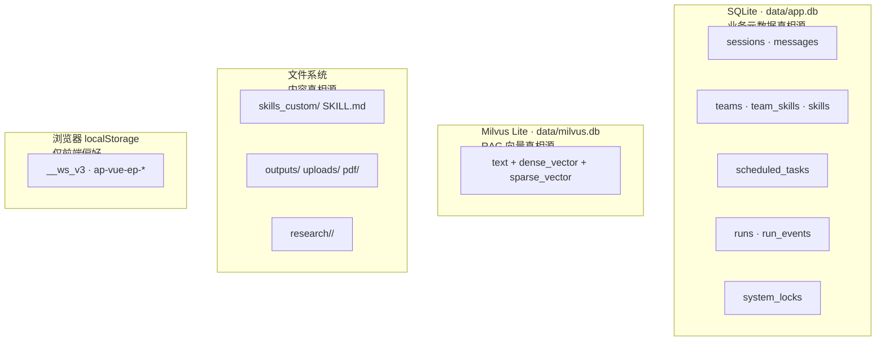
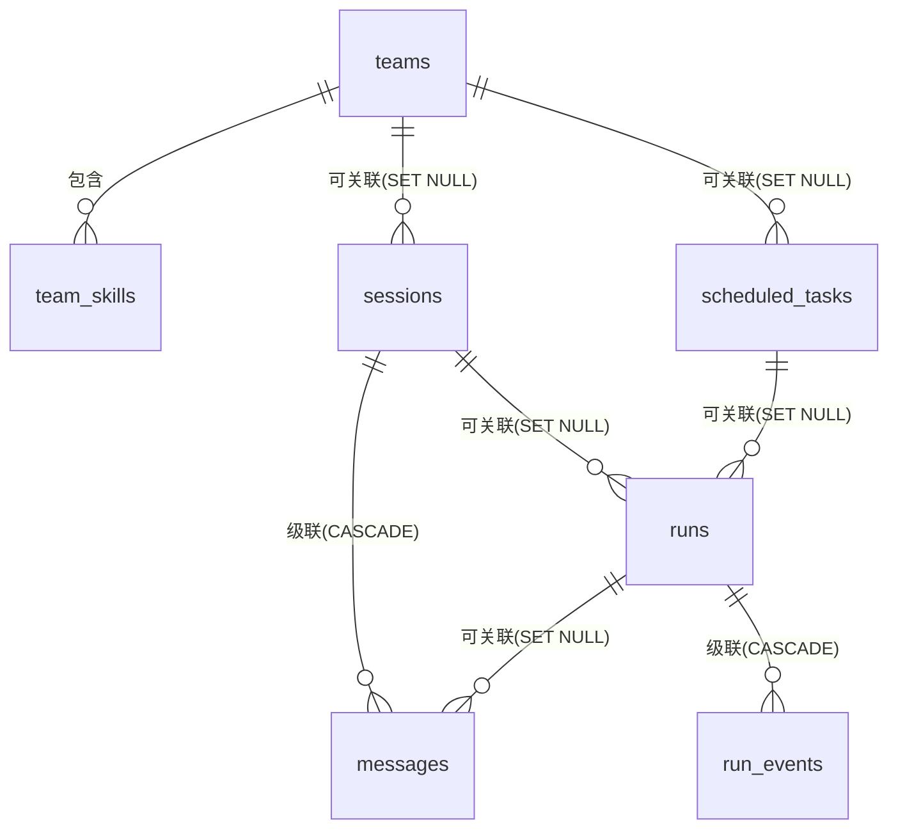

# 数据模型与持久化

> - **依据代码**：`backend/app/db/models.py`、`backend/app/db/base.py`、`backend/app/db/migrations/`、`backend/app/services/session_service.py`、`backend/app/services/run_service.py`、`backend/app/services/scheduler_service.py`、`backend/app/services/research/research_manager.py`
> - **资料来源**：2026-10-26 逐文件探查 + `sqlite3 data/app.db` 实际库结构交叉验证
> - **整理日期**：2026-10-26
> - **对应基线**：commit `c4dac22`
> - **相关篇目**：`01` 架构总览 ｜ `02` 能力链 ｜ `03` 执行引擎 ｜ `08` 调度与运行账本 ｜ `12` 风险台账

---

# 第一部分 现状事实

## 一、存储分工

平台的数据按**真相源**分成四类，各司其职、互不重叠：



| 存储 | 存什么 | 真相源含义 | 位置 |
| --- | --- | --- | --- |
| **SQLite** | 会话、消息、团队、团队成员、Skill 元数据与启停用、定时任务定义、运行账本、运行事件、调度租约 | **业务元数据的唯一真相源** | `backend/data/app.db`（`settings.database_url_abs`，`core/config.py:111-115`） |
| **Milvus Lite** | RAG 文档块：`text`（≤2048 字符）+ 1024 维稠密向量 + BM25 稀疏向量 | **RAG 向量的唯一真相源** | `backend/data/milvus.db`（`settings.milvus_db_abs`） |
| **文件系统** | Skill 内容（`SKILL.md` + scripts/assets）、产出文件、上传件、PDF 原文、研究报告、Deep Research `tasks.json` | **内容与产物的真相源** | `backend/data/{skills_custom,outputs,uploads,pdf,research}/` |
| **localStorage** | v3 灰度开关、选中 Skill、当前会话 id、模式、空间分组、主题 | **仅前端偏好**，不含业务数据 | `localStorage['__ws_v3' / 'ap-vue-ep-mode' / 'ap-vue-ep-session' / 'ap-vue-ep-skills' / 'ap-vue-ep-theme' / '__ws_spaces']` |

**「真相源」的判定标准**：删掉这一端数据，另一端能否恢复？
- 删 SQLite → 会话、团队、任务、账本**不可恢复**（它们是真相源）；
- 删 `skills` 表 → 重启后 `sync_to_db()` 会从文件系统重建元数据（文件系统是 Skill 内容的真相源，DB 只是索引）；
- 删 `milvus.db` → 需重跑 `scripts.ingest_data` 重建（PDF 原文在文件系统是更上游的真相源）；
- 清 localStorage → 只丢偏好，不丢会话（会话真相在 SQLite）。

## 二、22 张业务表

> 时间字段全部存 **UTC ISO8601 字符串**（`models.py:3` 文件头注释，SQLite 无时区类型，前端本地化展示）。`id` 统一用 `uuid4().hex`（32 位十六进制）。



| 表 | 主键 | 关键字段 | 约束与索引 |
| --- | --- | --- | --- |
| `sessions` | `id`(Text) | `mode`(chat\|work)、`title`、`team_id`→teams(SET NULL)、`config_json`、`owner`、`archived`(Int 0/1)、`created_at`/`updated_at` | `Index(idx_sessions_mode_updated, mode, updated_at)`；`messages` 关系 `cascade="all, delete-orphan"` 按 `seq` 排序 |
| `messages` | `id`(Text) | `session_id`(NOT NULL, CASCADE)、`run_id`(SET NULL)、`seq`(Int NOT NULL)、`role`(user\|assistant\|system\|tool)、`content`、`steps_json`、`files_json`、`meta_json` | **`UniqueConstraint(uq_messages_session_seq, session_id, seq)`** |
| `teams` | `id`(Text) | `name`(unique)、`description`、`prompt_prefix`、`strategy`(none\|sequential\|router)、`enabled`(Int) | `members` 关系级联、按 `position` 排序 |
| `team_skills` | (`team_id`, `skill_name`) 复合 PK | `position`(Int) | `team_id` CASCADE；`Index(idx_team_skills_skill, skill_name)` |
| `skills` | `name`(Text) | `description`、`source`(builtin\|custom)、`path`、`frontmatter_json`、`enabled`(Int)、`stale`(Int，磁盘已删)、`updated_at` | 仅元数据；内容真相在文件系统 |
| `scheduled_tasks` | `id`(Text) | `name`、`prompt`、`mode`、`plan_first`(Int)、`team_id`(SET NULL)、`skills_json`、`enable_json`、`schedule_kind`(cron\|interval)、`cron_expr`、`interval_seconds`、`timezone`(默认 Asia/Shanghai)、`enabled`、`allow_unattended_tools`、`allow_dangerous_tools`、`daily_run_limit`(默认 100)、`next_run_at`、`last_run_at`、`last_status`(默认 never)、`last_error`、`run_count`、`consecutive_failures`、`backoff_until`、`delivery_json` | `Index(idx_tasks_enabled_next, enabled, next_run_at)` |
| `runs` | `id`(Text) | `task_id`(SET NULL)、`session_id`(SET NULL)、`trigger`(manual\|schedule\|api)、`scheduled_for`(**幂等槽位**)、`status`（8 态）、`plan_json`、`meta_json`、`started_at`/`finished_at`、`duration_ms`、`result_summary`、`error`、`files_json` | **`UniqueConstraint(uq_runs_task_slot, task_id, scheduled_for)`** + `Index(idx_runs_task_started)` + `Index(idx_runs_status)`；`events` 关系级联按 `seq` 排序 |
| `run_events` | `id`(Int, autoincrement) | `run_id`(NOT NULL, CASCADE)、`seq`(Int NOT NULL)、`type`、`payload_json`、`created_at` | **`UniqueConstraint(uq_run_events_run_seq, run_id, seq)`** + `Index(idx_run_events_run_seq)` |
| `system_locks` | `name`(Text) | `owner`、`expires_at`、`renewed_at` | 调度租约（多副本防重） |
| `desktop_preferences` | `key`(Text) | `value_json` | 桌面端偏好（S0） |
| `permission_rules` | `id`(Int) | `scope`(tool\|file\|command\|network\|action)、`pattern`、`decision`(deny\|ask\|allow)、`risk`、`workspace_id`、`priority`、`origin`、`expires_at`、`hit_count` | **S2 扩展**（原 `target` 列改为 `pattern` + 匹配三键）；`UniqueConstraint(scope, pattern, workspace_id)` + `Index(idx_permission_rules_lookup)`；迁移 `0004` 写入内置规则集 |
| `permission_decisions` | `id`(Int) | `run_id`、`session_id`、`tool_name`、`request_json`、`action`、`matched_rule_id`、`reason`、`decided_by`、`status`、`latency_ms` | S2 决策留痕；`Index(idx_permission_decisions_run)` + `Index(idx_permission_decisions_status)` |
| `workspaces` | `id`(Text) | `name`、`root_path`、`status`(active\|archived)、`manifest_json` | S3；`Index(idx_workspaces_status)` |
| `changes` | `id`(Int) | `run_id`、`workspace_id`、`path`、`op`(create\|modify\|delete\|revert)、`before_hash`、`after_hash`、`snapshot_ref`、`tool`、`size_before/after` | S3；支撑 diff 与回退 |
| `artifacts` | `id`(Int) | `run_id`、`workspace_id`、`path`、`title`、`mime`、`kind`、`size`、`previewable` | S3；交付物与中间文件分离 |
| `llm_calls` | `id`(Int) | `run_id`、`session_id`、`model`、`provider`、`role`、`prompt_tokens`、`completion_tokens`、`cached_tokens`、`latency_ms`、`price_snapshot`、`cost` | S5 计量；**单价快照**保证历史金额不随改价而变 |
| `memory_index` | `id`(Int) | `path`、`scope`(user\|workspace\|project)、`summary`、`tags`、`size`、`last_used_at` | S5 记忆索引（增量刷新） |
| `roles` | `id`(Int) | `name`(**唯一**)、`title`、`identity`、`expertise`、`boundaries`、`workflow`、`output_style`、`tools_json`、`skills_json`、`model_tier`、`builtin`、`enabled` | S6；**名称创建后不可改名**；轻档角色 0 工具 |
| `plugins` | `id`(Int) | `name`、`version`、`source`、`status`、`scan_result`、`manifest_json`、`installed_at` | S6；`UniqueConstraint(name, version)` |
| `board_items` | `id`(Int) | `board_id`、`title`、`detail`、`status`(pending\|ready\|running\|done\|blocked\|failed)、`assignee`、`deps_json`、`result_json` | S6 黑板；`Index(idx_board_items_board/status)` |
| `agent_messages` | `id`(Int) | `board_id`、`from_role`、`to_role`(**空=通知**)、`kind`、`content`、`refs_json` | S6；通知必带结构化引用 |
| `rag_documents` | `doc_id`(Text) | `source_path`、`content_hash`、`chunk_count`、`collection` | **批次 03**：RAG 入库台账；幂等键 = `sha256(绝对路径\|内容哈希)`；`Index(idx_rag_documents_source)` |

**外键删除策略的选择**：

| 关系 | 策略 | 理由 |
| --- | --- | --- |
| `messages.session_id` | `CASCADE` | 会话删除则消息一并删（消息无独立价值） |
| `run_events.run_id` | `CASCADE` | 运行删除则事件一并删（事件无独立价值） |
| `sessions.team_id` | `SET NULL` | 删团队**保留**会话 |
| `sessions.run_id` ← runs | `SET NULL` | 删运行记录**保留**会话 |
| `runs.task_id` / `runs.session_id` | `SET NULL` | 删任务/会话**保留**运行账本（审计价值） |
| `scheduled_tasks.team_id` | `SET NULL` | 删团队**保留**任务定义 |

> 注意 `messages.run_id` 与 `runs` 的关系是 `SET NULL`，意味着**删 run 不删消息**，消息的 `run_id` 会被置空。

## 三、SQLite 运行时

### 3.1 引擎与 PRAGMA

| 项 | 值 | 位置 |
| --- | --- | --- |
| 连接参数 | `check_same_thread=False`、`timeout=30` | `backend/app/db/base.py:38` |
| 连接事件 | 每次建立连接时执行 4 条 PRAGMA | `backend/app/db/base.py:43-50` |
| `journal_mode` | `WAL`（写不阻塞读） | 同上 |
| `synchronous` | `NORMAL`（WAL 下的推荐折中） | 同上 |
| `foreign_keys` | `ON`（启用外键级联/置空） | 同上 |
| `busy_timeout` | `5000` ms（等锁 5 秒） | 同上 |
| 内存库 | `:memory:` 时强制 `StaticPool`（多线程共享单连接，否则各线程各自独立库） | `backend/app/db/base.py:59-64` |
| `pool_pre_ping` | `True` | `backend/app/db/base.py:36` |

### 3.2 事务边界

**无 FastAPI `Depends(get_db)` 依赖**。每个 service 方法内部用 `with db_session() as db:` 自开事务（`backend/app/db/base.py:99-110`）：

```python
session = get_session_factory()()
try:
    yield session
    session.commit()
except Exception:
    session.rollback()
    raise
finally:
    session.close()
```

服务层的文件头注释明确写「无状态服务：每个方法内部自开事务」（`session_service.py:57`）。SSE 生成器内也明确「不能依赖请求上下文的 DB Session」，因此在 `RunExecutor` 里 DB Session 是在生成器内部创建的。

### 3.3 写冲突处理

两层防线：

| 层 | 机制 | 参数 | 位置 |
| --- | --- | --- | --- |
| 第一层 | `retry_on_locked()`：捕获 `OperationalError` 且消息含 `locked` 时重试 | 指数退避 **50 / 100 / 200 ms**，最多 3 次 | `backend/app/db/base.py:113-125` |
| 第二层 | `append_message` 的 `IntegrityError`（`uq_messages_session_seq` 冲突）重试 | **最多 20 次**，间隔 `0.005*(attempt+1) + 随机抖动` | `backend/app/services/session_service.py:209-221` |

## 四、Alembic 迁移

| 项 | 事实 | 位置 |
| --- | --- | --- |
| 版本数 | **8 个**：`0001_init` → `0002_desktop` → `0003_mode_unify` → `0004_security` → `0005_workspace` → `0006_context` → `0007_extensions` → `0008_rag_ingest` | `backend/app/db/migrations/versions/` |
| `upgrade()` 实现 | `0001` 仍是 `Base.metadata.create_all(bind)`；**`0002` 起为显式 DDL**（`op.create_table` / `op.add_column` / 批量 `create_all`），且每个版本都实现 `downgrade()` | 各版本文件 |
| `0003_mode_unify` | `sessions` 增 `plan_first` 列；历史 `mode='plan'` 归一为 `work + plan_first=1` | `0003_mode_unify.py` |
| `0004_security` | `permission_rules` 重建表（扩 6 列 + 匹配三键唯一约束）并新建 `permission_decisions`；写入内置规则集 | `0004_security.py` |
| `0005_workspace` | 新建 `workspaces` / `changes` / `artifacts` | `0005_workspace.py` |
| `0006_context` | 新建 `llm_calls` / `memory_index` | `0006_context.py` |
| `0007_extensions` | 新建 `roles` / `plugins` / `board_items` / `agent_messages` | `0007_extensions.py` |
| 环境配置 | `render_as_batch=True`（SQLite 兼容 ALTER）、`compare_type=True` | `backend/app/db/migrations/env.py` |
| URL 来源 | `DATABASE_URL` 环境变量优先，否则 `settings.database_url_abs` | `backend/app/db/migrations/env.py` |
| 执行入口 | `command.upgrade(cfg, "head")` | `backend/scripts/migrate.py` |
| 自动迁移 | lifespan 启动时执行，**失败则 raise 中止启动** | `backend/app/main.py` |

**现状结论**：S1 起 Alembic 已是**真实的版本化迁移**（新增表/字段都有对应版本且可回滚），
不再有「改了 `models.py` 但库里没有」的漂移风险。新增表时必须同时产出迁移版本。

**遗留**：各 `downgrade()` 已实现但**实跑演练**尚未在 CI 中执行（`../plan/03`）。

## 五、一致性与幂等

平台有三道幂等闸门，全部由数据库唯一约束兜底：

| 约束 | 所在表 | 防的是什么 | 代码位置 |
| --- | --- | --- | --- |
| `uq_messages_session_seq` | `messages` | 同一会话的消息 `seq` 重复 | `models.py:70` |
| `uq_runs_task_slot` | `runs` | 同一定时任务在同一调度槽位被重复创建 run | `models.py:187` |
| `uq_run_events_run_seq` | `run_events` | 同一 run 的事件 `seq` 重复 | `models.py:208` |

### 5.1 序号分配：先算后插，冲突重算

`seq` 采用 **`max(seq)+1` 在事务内生成** 的方式：

```python
max_seq = db.scalar(select(func.max(MessageRow.seq)).where(MessageRow.session_id == session_id)) or 0
row = MessageRow(..., seq=max_seq + 1, ...)
```

这个方式存在**并发竞态**：两个并发事务可能算到同一个 `max(seq)`。兜底靠 `uq_messages_session_seq` 唯一约束，冲突时**重试重算**（`append_message` 20 次，`session_service.py:209-221`）。

`run_events` 同样用 `max(seq)+1`，但只重试 3 次（走 `retry_on_locked`，`run_service.py:178-198`）。

### 5.2 运行账本的幂等创建

`RunService.create_run()`（`run_service.py:70-86`）：

```python
try:
    with db_session() as db:
        db.add(row); db.flush(); db.refresh(row)
        return run_to_out(row)
except IntegrityError:
    logger.info("运行幂等冲突，跳过: task=%s slot=%s", task_id, scheduled_for)
    return None
```

返回 `None` 即表示「该槽位已有 run」，调度器据此跳过重复触发。这是 `uq_runs_task_slot` 的语义化落地。

### 5.3 重启恢复

| 组件 | 恢复逻辑 | 位置 |
| --- | --- | --- |
| 运行账本 | `recover_interrupted(grace_seconds=300)`：`queued`/`running` 且参考时间早于 300 s 阈值 → 标 `interrupted`，错误追加「服务重启，标记为中断」 | `backend/app/services/run_service.py:257-274` |
| Deep Research 任务 | `_load_tasks()`：非终态任务标 `failed`，错误置「服务重启，任务已中断」 | `backend/app/services/research/research_manager.py:48-61` |
| 调度器 | 启动时重建 job（以 `scheduled_tasks` 表为唯一真相，不用 jobstore 双写） | `backend/app/services/scheduler_service.py` |

> 「参考时间」是 `started_at or created_at`——刚创建还没开始的 run 用 `created_at` 判断，避免把「排队中」误标为中断。

### 5.4 清理

`cleanup(retention_days=90, keep_per_task=500)`（`run_service.py:283-299`）：删除 `created_at` 早于 90 天且状态在终态集合里的 run（级联删事件）。**每日 03:30** 由调度器调用（`scheduler_service.py`）。

**注意**：`keep_per_task=500` 参数**被声明但未使用**——当前实现只按时间删，不按「每任务保留最近 500 条」删。

### 5.5 事件负载截断

`append_events` 写 `payload_json` 时截断到 **60000 字符**（`run_service.py` 内 `[:60000]`），防超大事件撑爆 TEXT 列。

## 六、已知一致性问题

| 编号 | 问题 | 证据 |
| --- | --- | --- |
| S-04-A | ~~Alembic 不产新迁移：新增表/字段后 `upgrade head` 对已有库是 no-op~~ **已修**（S1 起新增 6 个显式 DDL 迁移） | `backend/app/db/migrations/versions/` |
| S-04-B | **`chat_log_*.json` 双写风险**：`_save_log()` 存在，由 `settings.save_chat_log`（默认 `False`）关闭；一旦开启，会话会同时写入 SQLite 与 JSON 文件两个真相源 | `backend/app/core/config.py:85`；`backend/app/services/agent_service.py:427-428` |
| S-04-C | ~~Milvus 增量入库不去重~~ **已修**（2026-10-28 批次 03）：按 `sha256(绝对路径\|内容哈希)` 做幂等键，重复入库跳过、内容变更删旧再入 | `backend/app/services/rag/ledger.py`；`rag/ingest.py` |
| S-04-D | **文件与 DB 双源**：Skill 内容在文件系统、元数据在 DB，靠 `sync_to_db()` 单向同步维持一致 | `backend/app/services/skill_manager.py:137-170` |
| S-04-E | **SQLite 单写者**：WAL 下写仍互斥，高并发写会触发 `SQLITE_BUSY`，只能靠 `retry_on_locked` 兜底 | `backend/app/db/base.py:113-125` |
| S-04-F | **`runs.scheduled_for` 允许 NULL**：手动触发的 run 槽位为 NULL，SQLite 中 `NULL != NULL` 故不触发唯一约束——这是**有意为之**（手动 run 不做幂等），见测试 `test_db.py` | `backend/tests/test_db.py` |
| S-04-G | **`cleanup` 的 `keep_per_task` 参数被声明但未使用** | `backend/app/services/run_service.py:283-299` |

---

# 第二部分 原理剖析

## 七、为什么选 SQLite + WAL 而不是纯文件

早期实现（`tasks.json` + `chat_log_*.json`）是纯文件存储。它的失效点：

| 需求 | 纯文件 | SQLite + WAL |
| --- | --- | --- |
| 会话可查 | 需遍历 + 全文检索 | `idx_sessions_mode_updated` 索引 |
| 消息有序 | 需自己维护数组下标 | `(session_id, seq)` 唯一约束 |
| 调度幂等 | 需应用层槽位去重 + 文件锁 | `UNIQUE(task_id, scheduled_for)` 下沉到存储层 |
| 多副本防重 | 需分布式文件锁 | `system_locks` 租约 |
| 事件可回放 | 需自己设计日志格式 | `run_events` 表 + `after_seq` 游标 |

WAL（Write-Ahead Logging）是 SQLite 的关键选项：写入先进 WAL 文件，读取者从「数据库 + WAL」合成视图，因此**写不阻塞读**。对「定时任务频繁写账本 + 前端频繁读会话」的场景，WAL 把读写冲突从「互斥」降为「写时短暂独占」。

`busy_timeout=5000` 是第二道保险：写锁被占用时，新写入者**最多等 5 秒**而不是立即报错。`retry_on_locked` 的 50/100/200 ms 指数退避是在这个 5 秒窗口内的**第三道**保险。

## 八、为什么幂等要下沉到唯一约束，而不是「先查后插」

「先 `SELECT` 判断存在，再 `INSERT`」在并发下不可靠：两个请求可能同时查「不存在」然后都插入。唯一约束把判重权交给存储层，由 SQLite 在事务提交时保证原子性。

`uq_runs_task_slot` 的设计尤甚：它把**调度的幂等**（同一分钟不重复触发）与**人工的灵活性**（手动触发不幂等）用一条约束同时表达——cron 触发的 run 有 `scheduled_for` 值会碰撞，手动触发的 `scheduled_for=NULL` 不会碰撞（SQLite 的 `NULL != NULL` 语义）。

## 九、为什么不用 FastAPI 的 `Depends(get_db)`

本项目所有 service 都是「每个方法内部自开事务」。这种写法与 FastAPI 惯用的 `Depends(get_db)` 请求级 Session 有本质差异：

| 维度 | `Depends(get_db)` | 方法内自开事务 |
| --- | --- | --- |
| Session 生命周期 | 随请求 | 随方法 |
| 适用场景 | 一个请求一次数据库交互 | 一个请求多次、或在 SSE 生成器中跨多次 |
| 对 SSE/生成器的兼容 | ❌ 生成器 yield 期间 Session 已关闭 | ✅ 每批写入时现开现关 |
| 事务粒度 | 粗（整个请求） | 细（每个方法） |

平台需要支持 SSE 长流（生成器内多次写入 `run_events`），请求级 Session 无法满足，因此选择了方法级事务。代价是**无法做跨方法的复合事务**（如「创建会话 + 写入首条消息」必须原子）。

## 十、时间为什么存 UTC 字符串

SQLite 没有原生的「带时区时间戳」类型。存 UTC ISO8601 字符串的取舍：

- ✅ 排序正确（ISO8601 的字典序 = 时间序）；
- ✅ 可读（`2026-10-26T08:00:00+00:00`）；
- ✅ 前端可本地化展示；
- ❌ 时区计算需在应用层做（如调度的「今天」判断要显式换时区）。

调度器在计算每日配额（`count_today_runs`）与时区相关的 `next_run_at` 时，显式用 `zoneinfo.ZoneInfo(settings.tz)` 处理（`scheduler_service.py`）。

---

# 第三部分 已知边界与观察

| 编号 | 观察 | 证据 | 指向 |
| --- | --- | --- | --- |
| S-04-01 | 9 张业务表 + `alembic_version` = 10 张物理表；`sqlite3 data/app.db .schema` 实测与 `models.py` 一致 | 本次 B0 交叉验证 | — |
| S-04-02 | 会话 `mode` 默认值双源：`SessionCreate.mode` 默认 `"chat"`，而 `sessions` 表 `mode` 列默认 `"work"`；直接 ORM 插入与 API 创建的默认模式不同 | `backend/app/schemas/session.py:12`；`backend/app/db/models.py:32` | `12` D-31b |
| S-04-03 | `SessionRow.messages` 关系 `cascade="all, delete-orphan"`：删会话**物理删除**消息，无软删除 | `backend/app/db/models.py:43-45` | `12` §2 |
| S-04-04 | `runs` 表同时被「手动对话」与「定时任务」两类写入，`trigger` 字段区分但无枚举约束 | `backend/app/db/models.py:168` | `12` §2 |
| S-04-05 | `append_events` 用 `max(seq)+1` 分配但仅重试 3 次，高频并发写时仍可能耗尽 | `backend/app/services/run_service.py:178-198` | `12` §2 |
| S-04-06 | `recover_interrupted` 的 300 s 宽限期意味着：运行 5 分钟内服务重启，该 run 不会被标中断，会**永久停在 running** | `backend/app/services/run_service.py:257-274` | `12` §2 |
| S-04-07 | `skills` 表的 `stale` 标记依赖启动时的 `sync_to_db()` 才会刷新；运行中磁盘删 Skill 不会立即反映 | `backend/app/services/skill_manager.py:162-167` | `12` §2 |
| S-04-08 | `system_locks` 表只有 `name`/`owner`/`expires_at`/`renewed_at` 四个字段，**无创建时间与用途说明**，扩展多类锁时语义会混淆 | `backend/app/db/models.py:213-221` | `12` §2 |

---

# 第四部分 改进指向

| 优先级 | 事项 | 台账编号 |
| --- | --- | --- |
| ~~**P0**~~ | ~~补 Alembic 迁移版本规范~~ **已完成**（S1：`0002`~`0007` 显式 DDL；`0001` 保留 `create_all` 作基线） | 已关闭 |
| **P0** | 修正会话 `mode` 默认值双源（schema `chat` vs 表 `work`） | D-31b |
| ~~**P1**~~ | ~~Milvus 入库按文件哈希做幂等键~~ **已完成**（批次 03） | 已关闭（D-34） |
| **P1** | `cleanup` 实现 `keep_per_task`（每任务保留最近 N 条）语义 | `12` §2 |
| **P1** | 明确 `save_chat_log` 的定位：文档化「开启后形成双写」或移除 | D-21 |
| ~~**P1**~~ | ~~`recover_interrupted` 增加兜底定时任务~~ **已完成**（批次 03：调度器 `__stale_sweep__` 每 5 分钟巡检） | 已关闭（S-08-08） |
| **P2** | `system_locks` 补 `created_at` 与 `purpose` 字段 | `12` §2 |
| **P2** | `append_events` 的重试次数与 `append_message` 对齐（20 次） | `12` §2 |
| **P2** | `skills.stale` 增加运行期刷新（`POST /skills/reload` 后触发） | `12` §2 |

---

# 第五部分 核对方式

```bash
cd backend

# 1. 实际库结构与 models.py 一致性（B0 交叉验证脚本）
.venv/Scripts/python.exe -c "
import sqlite3
con = sqlite3.connect('data/app.db')
for name, in con.execute(\"select name from sqlite_master where type='table' and name not like 'sqlite_%' order by name\"):
    cols = [c[1] for c in con.execute(f'PRAGMA table_info({name})')]
    print(name, cols)
"

# 2. 唯一约束（应见 uq_messages_session_seq / uq_runs_task_slot / uq_run_events_run_seq）
grep -n "UniqueConstraint" backend/app/db/models.py

# 3. WAL 与 PRAGMA
grep -n "journal_mode\|busy_timeout\|synchronous" backend/app/db/base.py

# 4. 幂等创建（IntegrityError → None）
grep -n "IntegrityError" backend/app/services/run_service.py

# 5. Alembic 版本数（应为 8）
ls app/db/migrations/versions/*.py | wc -l

# 6. cleanup 的 keep_per_task 是否被使用
grep -n "keep_per_task" backend/app/services/run_service.py   # 只出现在签名，不出现在函数体

# 7. save_chat_log 默认值（应为 False）
grep -n "save_chat_log" backend/app/core/config.py
```
