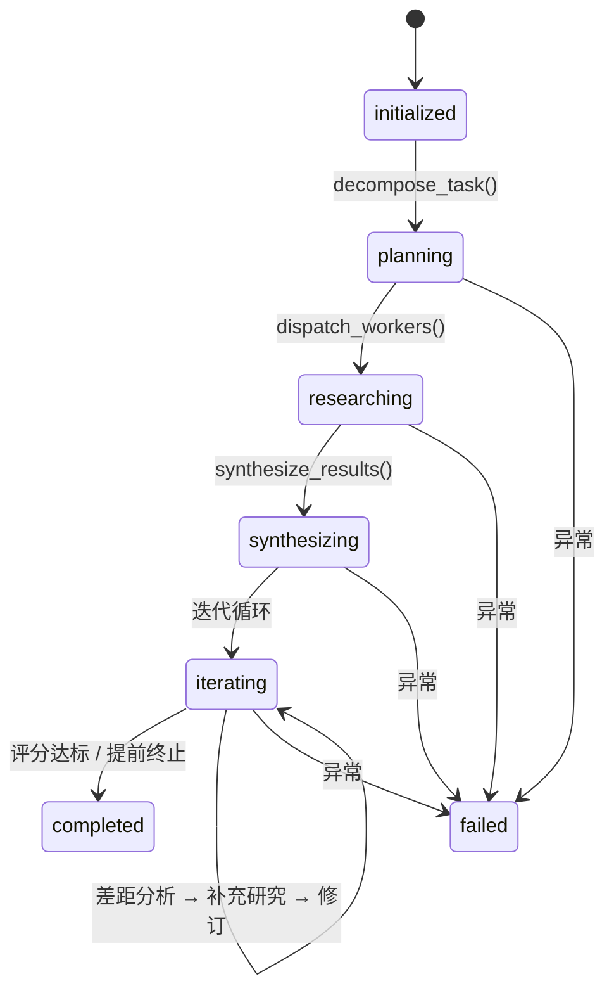
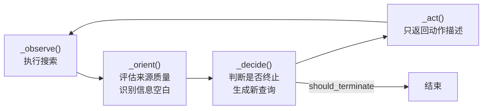
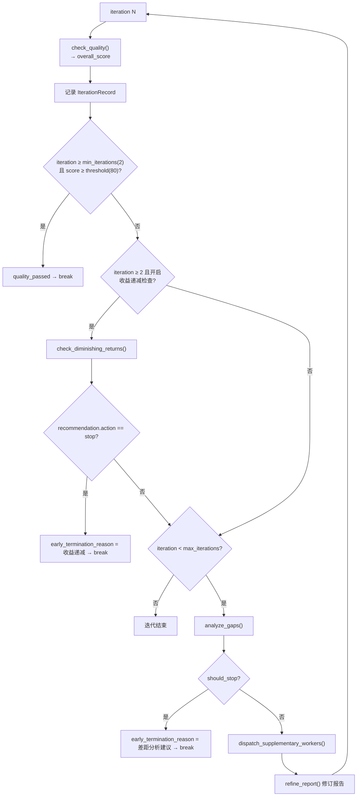

# Deep Research 链路

> - **依据代码**：`backend/app/services/research/{orchestrator.py,workers.py,research_manager.py,research_config.py,prompts.py,search_client.py,llm_client.py,service.py,utils.py}`、`backend/app/api/v1/research.py`
> - **资料来源**：2026-10-29 逐文件复核
> - **整理日期**：2026-10-29
> - **对应基线**：commit `7385dcd` + 工作区未提交改动
> - **相关篇目**：`01` 架构总览 ｜ `02` 能力链（§5 骨架）｜ `05` 接口 ｜ `08` 运行账本 ｜ `12` 风险台账

---

# 第一部分 现状事实

## 一、定位

Deep Research 是五条能力链中**唯一不走 `ToolRegistry` 的链路**：它不是「给主 Agent 提供一个工具」，而是一条**独立的后台任务链路**（提交任务 → 后台线程池执行 → SSE 进度 → 报告落盘）。它与主 Agent 的关系是**并列**，不是嵌套。

对外入口：`/api/v1/research` 族 **7** 个端点（见 `05_HTTP接口总览.md` §2.12）。

## 二、编排骨架（Orchestrator）

`Orchestrator.run(task)`（`backend/app/services/research/orchestrator.py:675-878`）驱动一个 **5 阶段状态机**：



| 阶段 | 方法 | 产出 |
| --- | --- | --- |
| `planning` | `decompose_task()`（`:156`） | `TaskPlan`：`understanding` / `query_type` / `subtasks[]` / `report_structure` / `research_plan` / `worker_count` |
| `researching` | `dispatch_workers()`（`:243`） | 每个 subtask 的检索结果 |
| `synthesizing` | `synthesize_results()`（`:322`） | 初始报告（Markdown） |
| `iterating` | 迭代循环（`:731`） | 多轮「评分 → 差距分析 → 补充研究 → 修订」 |
| `completed` / `failed` | — | 终态（`:855-858`） |

**查询类型**：`depth_first` / `breadth_first` / `simple`（`:63`），由 LLM 在拆解时判定（`prompts.py:38` 的 `TASK_DECOMPOSITION_PROMPT` 要求输出 `query_type` / `worker_count` / `research_plan`）。

**子任务截断**：`decompose_task` 产出的 subtask 数若超过 `recommended_worker_count`，按 priority（high > medium > low）排序后截断（`:218-223`）。

### 2.1 并发控制

`dispatch_workers()`（`:243-315`）：

```python
actual_workers = min(
    len(subtasks),
    self.max_workers,                                              # AGENT_CONFIG["max_workers"] = 6
    task_plan.query_type.recommended_worker_count if ... else self.max_workers
)
with ThreadPoolExecutor(max_workers=actual_workers) as executor:
    ...
```

三层上限取最小：子任务数 / 全局最大 **6** / 按查询类型推荐的并发数。迭代中的补充研究用 `dispatch_supplementary_workers()`（`:548`），同样开 `ThreadPoolExecutor`。

### 2.2 两层并发模型

| 层 | 线程池 | 并发度 |
| --- | --- | --- |
| 任务层 | `ResearchManager.executor = ThreadPoolExecutor(max_workers=settings.research_max_concurrent)` | **3**（`core/config.py:79`），API 层 `loop.run_in_executor(...)` |
| 任务内 | Orchestrator 内部 `ThreadPoolExecutor(max_workers=actual_workers)` | ≤ 6 |

> 最坏情况下同时有 `3 × 6 = 18` 个 Worker 线程在跑（每个 Worker 内还串行发起检索与 LLM 调用）。
> 单 Worker 超时 `AGENT_CONFIG["timeout_per_worker"]` = **120 秒**（`research_config.py:55`；`orchestrator.py:293,597`）。

## 三、OODA 子循环（Worker）

`SearchWorker.execute(subtask)`（`backend/app/services/research/workers.py:137-221`）是默认 Worker，内嵌 **OODA 循环**：



| 环节 | 职责 | 位置 |
| --- | --- | --- |
| 预算前置 | `_assess_task_complexity()`：关键词计数判 simple/medium/complex | `workers.py:223-244` |
| 预算调整 | `_adjust_budget()`：按复杂度分档 | `workers.py:246-256` |
| `_observe` | 执行 `search_client.search(query)`，每条 query 后 `sleep(0.3)`，结果累加 | `workers.py:272-296` |
| `_orient` | 来源质量分级（`_assess_source_quality:360`）+ 信息空白识别（`_identify_information_gaps:393`，最多返回 3 个空白） | `workers.py:298-324` |
| `_decide` | 无空白 **或** 剩余预算 < 2 → 终止；否则用「空白描述[:50]」当新查询词，**最多 2 个** | `workers.py:326-347` |
| `_act` | ⚠️ **只返回字符串描述，不执行任何动作**（真正的搜索发生在下一轮 Observe） | `workers.py:349` |
| 终止判定 | `_should_terminate()`：预算耗尽（`budget_exhausted`）**或** `len(ooda_cycles) >= max_analysis_cycles` | `workers.py:258-270` |

> ⚠️ **OODA 实际是「三步半」**：`_act` 阶段不执行动作，真正的检索由下一轮 `_observe` 完成。

**结果分析**：`_analyze_results()`（`:444`）→ `SEARCH_WORKER_TASK_PROMPT`（temp=0.3），喂入 `max_sources_per_topic = 10` 条上下文；LLM/解析失败时回落基础结果结构（`confidence_level="low"`，`:487-518`）。去重按 `url`（`_deduplicate_results:434`）。

### 3.1 预算分档

`ResearchBudget(max_queries, max_analysis_cycles, queries_used, cycles_used)`（`workers.py:56-71`）。`_adjust_budget()`（`:246-256`）按复杂度分档：

| 复杂度 | `max_queries` | `max_cycles` |
| --- | --- | --- |
| simple | **3** | **1** |
| medium | **5** | **2** |
| complex | **8** | **3** |

终止条件 `_should_terminate()`（`:258-270`）：预算耗尽或达到 `worker_max_ooda_cycles`（默认 3）。

### 3.2 已实现但未被调用的 Worker

| Worker | 职责 | 位置 | 状态 |
| --- | --- | --- | --- |
| `SearchWorker` | 默认检索 Worker | `workers.py:137` | **被 Orchestrator 使用** |
| `WriterWorker` | 写作 | `workers.py:523` | **未被调用** |
| `AnalysisWorker` | 分析 | `workers.py:577` | **未被调用** |
| `VisualizationWorker` | 可视化 | `workers.py:645` | **未被调用** |
| `WorkerFactory` | 工厂（默认返回 `SearchWorker`） | `workers.py:734` | 仅产出 SearchWorker |

Orchestrator 只用 `worker.execute(subtask)`，而 `worker_factory` 默认是 `search_worker_factory()`（`:764`）——**后三种 Worker 是死代码**。

## 四、评分与迭代

### 4.1 迭代循环（`orchestrator.py:731`）

每轮迭代：



### 4.2 终止条件汇总

| 终止路径 | 条件 | 结果 |
| --- | --- | --- |
| **质量达标** | `iteration >= min_iterations(2)` 且 `score >= quality_threshold(80)` | 正常结束（`quality_passed`） |
| **收益递减** | `iteration >= 2` 且 `check_diminishing_returns` 返回 `diminishing_returns_detected=True` 且 `recommendation.action="stop"` | 提前终止 |
| **差距分析建议停止** | `analyze_gaps` 返回 `stop_iteration_recommendation.should_stop=True` | 提前终止 |
| **达到最大迭代** | 循环跑完 `max_iterations`（默认 5） | 结束（无论质量） |

`IterationRecord` 记录每轮的 `iteration / quality_score / report_length / gap_count / supplementary_task_count`（落进 `meta_*.json` 的 `iteration_history`）。

### 4.3 质量评分的**六个维度**

评分 prompt 在 `backend/app/services/research/prompts.py:253-330`，要求 LLM 输出 6 个维度的分项 + 总分：

| # | 维度 | key | 检查要点（prompt 行号） |
|---|---|---|---|
| 1 | 完整性 | `completeness` | `:257-261` 覆盖度 / 信息空白 / 深度视角 / 广度子主题 |
| 2 | 准确性 | `accuracy` | `:263-267` 数据可靠 / 可疑信息 / 来源权威 / 事实 vs 推测 |
| 3 | 深度 | `depth` | `:269-273` 洞察 vs 罗列 / 因果推理 / 模式趋势 |
| 4 | 结构 | `structure` | `:275-279` 组织 / 逻辑 / 过渡 / 层次 |
| 5 | 可读性 | `readability` | `:281-284` 表达 / 术语 / 格式可视化 |
| 6 | 来源质量 | `source_quality` | `:286-289` 权威性 / 偏见 / 引用规范 |

输出 JSON 还含 `overall_score`、`critical_issues`、`missing_aspects`、`improvement_suggestions`、`factual_conflicts`、`needs_revision`、`revision_priority`。

> ⚠️ **解析失败兜底 `{"overall_score": 70}`**（`orchestrator.py:426`）——LLM 返回非法 JSON 时直接给 70 分。这可能**虚高通过**某些阈值判定。

### 4.4 迭代期的四个检查点

| 方法 | 用途 | 位置 |
| --- | --- | --- |
| `check_quality()` | 综合评分（`QUALITY_CHECK_PROMPT`，temp=0.2） | `orchestrator.py:390` |
| `check_diminishing_returns()` | 判断是否继续投入 | `orchestrator.py:436` |
| `analyze_gaps()` | 找信息缺口 + 是否建议停止 | `orchestrator.py:487` |
| `refine_report()` | 按缺口修订报告（temp=0.5，max_tokens=8192） | `orchestrator.py:621` |

### 4.5 阈值与上限（`research_config.py:74-82`）

| 参数 | 值 | 行号 | 代码使用情况 |
|---|---|---|---|
| `min_iterations` | **2** | `:75` | ✅ `orchestrator.py:692,768` |
| `max_iterations` | **5** | `:76` | ✅ `orchestrator.py:693,731` |
| `quality_threshold` | **80** | `:77` | ✅ `orchestrator.py:694,763,768` |
| `enable_diminishing_returns_check` | `True` | `:80` | ✅ `orchestrator.py:695,777` |
| `diminishing_returns_threshold` | `3` | `:81` | ❌ **未被引用（死配置）** |
| `early_termination_min_score` | `75` | `:82` | ❌ **未被引用（死配置）** |

API 侧覆盖范围：`max_workers` 1–10、`max_iterations` 1–10、`quality_threshold` 0–100（`backend/app/schemas/research.py:15-17`）。
可覆盖键白名单：`OVERRIDABLE_KEYS = ("max_iterations", "quality_threshold")`（`services/research/service.py:21`），**`max_workers` 走构造参数不走 overrides**（`service.py:50`）。

## 五、检索提供方与 LLM

### 5.1 检索 provider 三态

`SearchClient.provider`（`backend/app/services/research/search_client.py:35-42`）：

```python
if settings.bocha_api_key:      → "bocha"
elif settings.serper_api_key:   → "serper"
else:                           → "none"
```

- Bocha：POST `https://api.bocha.cn/v1/web-search`（`:70-118`），payload `{query, summary, count, freshness?}`，timeout 30s（`:87`）；响应 `data.webPages.value[]` → `SearchResult`（`:99-108`）；
- Serper：复用 `backend/app/services/web/serper_service.py`（`:123`）；
- none：**无检索能力**。

`multi_search` 顺序执行，每条间隔 **0.5s**（`:59-66`）。单例 `get_search_client()`（`:148`）。

`POST /api/v1/research` 在 `provider == "none"` 时**返回 HTTP 200 + `status="failed"` + 明确文案**（`backend/app/api/v1/research.py:112-123`），而非抛异常——快速失败但不当作系统错误。

### 5.2 LLM 客户端

`LLMClient`（`backend/app/services/research/llm_client.py`）独立于 `backend/app/core/llm.py`（DeepSeek），用 DashScope qwen 系列：

| 用途 | 配置键 | 模型 |
| --- | --- | --- |
| 默认 | `model` | `qwen-plus` |
| 复杂推理 | `model_smart` | `qwen-max` |
| 简单任务 | `model_fast` | `qwen-turbo` |

> ⚠️ **`model_smart` / `model_fast` 定义但从未使用**——代码不按复杂度切模型，实际全部走 `model`。

文件头注释明确说明与 `backend/app/core/llm.py` **刻意分离**。`chat_stream()` 支持 `include_usage`。

### 5.3 配置覆盖与并发安全

`service.py:run_research()`（`backend/app/services/research/service.py:24-54`）允许覆盖 `AGENT_CONFIG` 的两个键（`OVERRIDABLE_KEYS = ("max_iterations", "quality_threshold")`，`:21`）。

**覆盖按实例传递**：`overrides` 字典被传给 `Orchestrator(overrides=overrides)`（`service.py:48-53`），编排器在 `self.overrides`（`orchestrator.py:150`）中读取（`:692-695`），**不再「改全局 → finally 还原」**。

> 该实现已在代码注释中说明原因：「后者不是并发安全的（两个研究任务会互相覆盖同一份全局 dict）」（`service.py:46-47`）。这消除了旧版「并发串扰窗口」的问题。

## 六、落盘与持久化

### 6.1 目录结构

```
data/research/
├── tasks.json                              # 任务清单（重启恢复）
└── <task_id>/
    ├── report_YYYYmmdd_HHMMSS.md           # Markdown 报告
    └── meta_YYYYmmdd_HHMMSS.json           # 元数据
```

`_save_report()`（`research_manager.py:295-336`）写 `report_*.md` + `meta_*.json`。`meta` 结构：

`task_id` / `original_task` / `status` / `quality_score` / `duration` / `timestamp` / `task_plan{understanding, subtask_count, report_structure}` / `worker_results_count` / `iteration_count` / `iteration_history[{iteration, quality_score, report_length, gap_count, supplementary_task_count}]` / `search_provider`。

### 6.2 任务状态机

`TERMINAL_STATES = {"completed", "failed"}`（`research_manager.py:26`）。

| 方法 | 状态迁移 | 位置 |
| --- | --- | --- |
| `create_task()` | → `pending` | `research_manager.py:187` |
| `set_running()` | → `running` | `research_manager.py` |
| `set_completed()` | → `completed` + 写 result + 落盘报告 | `research_manager.py` |
| `set_failed()` | → `failed` | `research_manager.py` |
| `delete_task()` | 仅允许删终态，否则 `ValueError` → HTTP 400 | `research_manager.py:232-240`；`research.py:237` |

### 6.3 双写账本

研究任务**同时写穿 `runs` 表**（`trigger="research"`，`research_manager.py:93-144`），JSON 丢失时可从 `runs` 恢复（`_restore_from_db:146-182`）。`_save_tasks` 无条件写穿 DB（`persist` 只控制 JSON 文件）。

### 6.4 重启恢复

`_load_tasks()`（`research_manager.py:48-61`）：启动时读 `tasks.json`，**非终态任务标 `failed`**、错误置「服务重启，任务已中断」。`update_progress()` 追加 `{stage, data, timestamp}` 并更新 `progress_summary`。

### 6.5 进度事件（SSE）

`GET /research/{task_id}/stream` 发出 `{"type":"progress", stage, ...}` 与 `{"type":"final", ...}` 两类事件。轮询 `SSE_POLL_INTERVAL=0.5`、最长 `SSE_MAX_DURATION=1800`（`research.py:39-40`）。

### 6.6 24 个 stage

| 分组 | stage |
| --- | --- |
| 规划 | `decomposing` / `decomposed` |
| 分发 | `dispatching` / `workers_dispatched` |
| Worker | `worker_start` / `worker_search` / `worker_done` / `worker_failed` / `workers_completed` |
| 综合 | `synthesizing` / `synthesized` |
| 迭代 | `iteration_start` / `iteration_evaluated` / `quality_passed` / `diminishing_returns_stop` / `gap_analysis_stop` / `iteration_continue` / `no_supplementary_tasks` / `iteration_end` |
| 补充 | `gap_analyzed` / `supplementary_dispatched` / `supplementary_completed` / `report_refined` |
| 终态 | `completed` / `failed` |

前端 `STAGE_LABEL` 与之一一对应（`frontend/web/vue-element-plus/src/views/ResearchView.vue`）。

---

# 第二部分 原理剖析

## 七、为什么是 Orchestrator-Workers 而不是单 Agent 循环

Deep Research 面对的是「多主题、需要多路检索」的研究任务。三种主流的多智能体范式：

| 范式 | 结构 | 适用 |
| --- | --- | --- |
| 单 Agent + 多工具 | 一个 Agent 串行调工具 | 简单问答 |
| **Orchestrator-Workers**（本项目） | 一个编排器拆解任务、分发给多个 Worker 并行执行、汇总 | 多主题研究 |
| 多 Agent 对等协作 | 多个 Agent 互相通信 | 开放式复杂任务 |

选 Orchestrator-Workers 的理由：

1. **并行度可控**。研究任务的瓶颈是「N 个主题的检索」，可以并行；`ThreadPoolExecutor` + `min(len(subtasks), max_workers, recommended)` 三层上限把并行度交给数据决定，而不是写死。
2. **单点质量门禁**。报告质量由 Orchestrator 统一评分与迭代，Worker 只负责检索，职责单一。
3. **可追溯**。每个 Worker 的输入（subtask）、过程（OODA cycle）、输出（结果）都是结构化数据，可落盘可回放。

代价是**编排器成为单点**：Orchestrator 一旦在某阶段抛异常，整个任务失败，且没有任务级的 checkpoint 恢复——重启后整个任务标 `failed` 而非从中断点续跑。

## 八、为什么 Worker 内嵌 OODA 而不是一次性检索

一次性检索（「搜一次就写报告」）对研究任务质量不可控。OODA（Observe-Orient-Decide-Act）提供了一个**有预算的探索循环**：

- **Observe**：先按初始查询搜一轮；
- **Orient**：评估来源质量、识别「还缺什么信息」；
- **Decide**：决定是否值得再搜（有预算就继续，没预算或没缺口就停）；
- **Act**：执行补充搜索。

关键设计是**预算分档**（simple/medium/complex → 3/1、5/2、8/3）与**提前终止**（剩余预算 < 2 或无空白即停）。这让「简单问题不浪费调用，复杂问题不提前收工」。

> 本项目把 Act 拆成了「Decide 生成新查询 → 下一轮 Observe 执行」，因此实际只有三步半。这是**实现取舍**而非设计意图——`_act` 返回的是描述字符串，真正的检索语句由下一轮 `_observe` 使用。

## 九、为什么迭代要「评分 + 双提前终止」

固定 `max_iterations` 次的迭代有两个问题：质量早就达标时还继续浪费调用；质量提升停滞时还在做无效迭代。

本项目的迭代循环有三个出口：

1. **质量达标**（`score >= 80` 且至少 2 轮）——正常出口；
2. **收益递减**（第 2 轮起检测，若继续投入产出不值得则停）——经济性出口；
3. **差距分析建议停止**（分析认为没有可补的缺口）——收敛性出口。

三个出口分别对应「够了」「不值了」「没的可改了」。这是**把「什么时候停止研究」这个开放问题转化为三个可判定的条件**。

## 十、为什么任务持久化用 `tasks.json` 而不是只进 SQLite

Deep Research 的持久化是**文件 + DB 双写**：

- `tasks.json`：任务清单 + 进度事件（文件系统，供重启恢复）；
- `data/research/<task_id>/meta_*.json`：任务元数据；
- `data/research/<task_id>/report_*.md`：报告正文；
- `runs` 表（`trigger="research"`）：与业务运行账本打通。

选文件承载**报告正文**的原因：

1. 研究任务的写入是**低频、大对象**（一份报告几 MB Markdown），不适合关系表；
2. 报告本身就是交付物，用户要能直接打开文件；
3. 进度事件是**追加型日志**，文件 append 比 DB insert 简单。

代价是 `tasks.json` 全量读写（每次 `_save_tasks()` 重写整个文件），任务数增长后 IO 放大。

---

# 第三部分 已知边界与观察

| 编号 | 观察 | 证据 | 指向 |
| --- | --- | --- | --- |
| S-07-01 | `WriterWorker` / `AnalysisWorker` / `VisualizationWorker` / `WorkerFactory` 已实现但 Orchestrator 从不调用，能力虚高 | `backend/app/services/research/workers.py:523,577,645,734`；`orchestrator.py:268-275` | `12` §2.2 |
| S-07-02 | 检索 provider 三态自动选择，**无 Key 时 `POST /research` 返回 200 + `status="failed"`**，客户端无法用 HTTP 状态码判失败 | `backend/app/api/v1/research.py:112-123` | `12` §2 |
| S-07-03 | 任务无 checkpoint 恢复：重启后非终态任务整体标 `failed`，不从中断点续跑 | `backend/app/services/research/research_manager.py:48-61` | `12` §2 |
| S-07-04 | ~~任务与业务运行账本不互通~~ **已修**（S1 WP-1.8）：研究任务写穿 `runs`（`trigger=research`），并可从账本恢复 | `backend/app/services/research/research_manager.py:93-182` | 已关闭 |
| S-07-05 | 最坏并发 `3 × 6 = 18` Worker 线程，每个都可能起检索请求与 LLM 调用，无全局速率限制 | `backend/app/services/research/orchestrator.py:268-315` | `11` §2 |
| S-07-06 | ~~`AGENT_CONFIG` 是可变模块级 dict，try/finally 还原防并发串扰~~ **已修**：覆盖改为**按实例传递**（`Orchestrator(overrides=...)`），全局 dict 不再被改写 | `backend/app/services/research/service.py:46-53`；`orchestrator.py:150,692-695` | 已关闭 |
| S-07-06b | `OVERRIDABLE_KEYS` 只含 `max_iterations` / `quality_threshold`，但 `Orchestrator` 的 `self.overrides` **支持 `min_iterations`**（`orchestrator.py:692`）——该键在 service 层被过滤掉，API 无法覆盖 | `backend/app/services/research/service.py:21,44`；`orchestrator.py:692` | `12` §2.3 |
| S-07-07 | `tasks.json` 全量读写（每次 `_save_tasks()` 写整个文件），任务数增长后 IO 放大 | `backend/app/services/research/research_manager.py:79-80` | `11` §2 |
| S-07-08 | 研究任务的进度事件**不落 `run_events`**，断流恢复靠 `stage\|ts` 去重而非 `seq` 游标，与运行账本的回放机制不一致 | `backend/app/services/research/` | `12` §2 |
| S-07-09 | 报告无版本管理，同一任务多次运行会生成多份 `report_<ts>.md`，无「最新」指针 | `backend/app/services/research/research_manager.py:295-336` | `12` §2 |
| S-07-10 | **`FACT_CHECK_PROMPT` 全仓无引用** → 「事实核查」能力缺失（`speculative_vs_factual` 依赖 LLM 自填，不是独立核查） | `backend/app/services/research/prompts.py:585` | `12` §2.2 |
| S-07-11 | **OODA 的 `_act` 阶段空实现**——只返回动作描述，不执行动作，实际是「三步半」 | `backend/app/services/research/workers.py:349` | `12` §2.2 |
| S-07-12 | `_decide` 生成的新查询词是「信息空白描述的前 50 字符」，**不是真实检索式**，检索质量存疑 | `backend/app/services/research/workers.py:341` | `12` §2.2 |
| S-07-13 | `_observe` 里 `queries_to_use = search_queries[:queries_remaining]` → **第一轮就把全部 query 打满**，后续轮次无新查询可打（除非 `_decide` 换词） | `backend/app/services/research/workers.py:276` | `12` §2.2 |
| S-07-14 | **来源质量白/黑名单硬编码两份且不一致**：`workers.py:367-379` vs `research_config.py:93-108`（config 多 `idc`；config 的 `speculative_language` 从未被用） | `backend/app/services/research/workers.py:367-379`；`research_config.py:93-108` | `12` §2.3 |
| S-07-15 | `research_config.py` 有 **10 个死键**（`max_search_depth`/`worker_count_guidelines`/`min_sources_per_topic`/`report_language`/`include_sources`/`include_summary`/`diminishing_returns_threshold`/`early_termination_min_score`/`worker_max_ooda_cycles`/`research_budget`） | `backend/app/services/research/research_config.py:54-91` | `12` §2.3 |
| S-07-16 | `model_smart` / `model_fast` 定义但**从不按复杂度切模型** | `backend/app/services/research/research_config.py:29-30` | `12` §2.3 |
| S-07-17 | 质量 JSON 解析失败兜底 `overall_score=70` —— 可能虚高通过阈值判定 | `backend/app/services/research/orchestrator.py:426` | `12` §2.1 |
| S-07-18 | `research_manager.py` 的 `OUTPUT_CONFIG` / `LOG_CONFIG` 导入后从未使用；`orchestrator.py` 的 `PARALLEL_TASK_COORDINATION_PROMPT` 导入未用 | `research_manager.py:21`；`orchestrator.py:36` | `12` §2.3 |

---

# 第四部分 改进指向

| 优先级 | 事项 | 台账编号 |
| --- | --- | --- |
| **P0** | `POST /research` 无 Key 时的失败语义改为 503 或在契约中显式标注 | `12` §2 |
| **P1** | 接入或移除 `WriterWorker` / `AnalysisWorker` / `VisualizationWorker` / `FACT_CHECK_PROMPT` | `12` §2.2 |
| **P1** | 质量评分解析失败兜底改为**保守分数**（如 50）而非 70，避免虚高通过 | `12` §2.1 |
| **P1** | `_decide` 的新查询词改为「结构化检索式」而非空白描述的前 50 字符 | `12` §2.2 |
| **P1** | 统一来源质量白/黑名单到单一真相源 | `12` §2.3 |
| **P2** | 任务级 checkpoint（每阶段落盘，重启从中断点续跑） | `12` §2 |
| ~~**P2**~~ | ~~`AGENT_CONFIG` 改为不可变 + 任务级配置对象~~ **已完成**（改为按实例传递 overrides） | 已关闭 |
| **P2** | `OVERRIDABLE_KEYS` 补 `min_iterations`（编排器已支持） | `12` §2.3 |
| **P2** | `tasks.json` 改为追加型日志或 SQLite 表 | `11` §3 |
| **P2** | 报告加 `latest.md` 软链或版本指针 | `12` §2 |
| **P2** | 清理 `research_config.py` 的 10 个死键；启用 `model_smart`/`model_fast` 或删除 | `12` §2.3 |

---

# 第五部分 核对方式

```bash
cd backend

# 阶段方法
grep -n "def decompose_task\|def dispatch_workers\|def synthesize_results\|def check_quality\|def analyze_gaps\|def refine_report\|def check_diminishing" app/services/research/orchestrator.py

# 并发三层上限
grep -n "actual_workers = min" -A 5 app/services/research/orchestrator.py

# OODA 四环节（注意 _act 是否真的执行动作）
grep -n "def _observe\|def _orient\|def _decide\|def _act\|def _should_terminate" app/services/research/workers.py
sed -n '349,360p' app/services/research/workers.py

# 预算分档
grep -n "research_budget\|simple.*max_queries\|medium.*max_queries\|complex" app/services/research/research_config.py

# 迭代终止条件
grep -n "min_iterations\|quality_threshold\|diminishing_returns_detected\|should_stop" app/services/research/orchestrator.py

# 未被调用的 Worker（orchestrator 中应无输出）
grep -n "class WriterWorker\|class AnalysisWorker\|class VisualizationWorker" app/services/research/workers.py
grep -n "WriterWorker\|AnalysisWorker\|VisualizationWorker" app/services/research/orchestrator.py

# 死配置与未接线 prompt
grep -n "FACT_CHECK_PROMPT" app/services/research/*.py
grep -n "diminishing_returns_threshold\|early_termination_min_score\|model_smart\|model_fast" app/services/research/*.py

# 落盘结构
ls data/research/ 2>/dev/null
```
