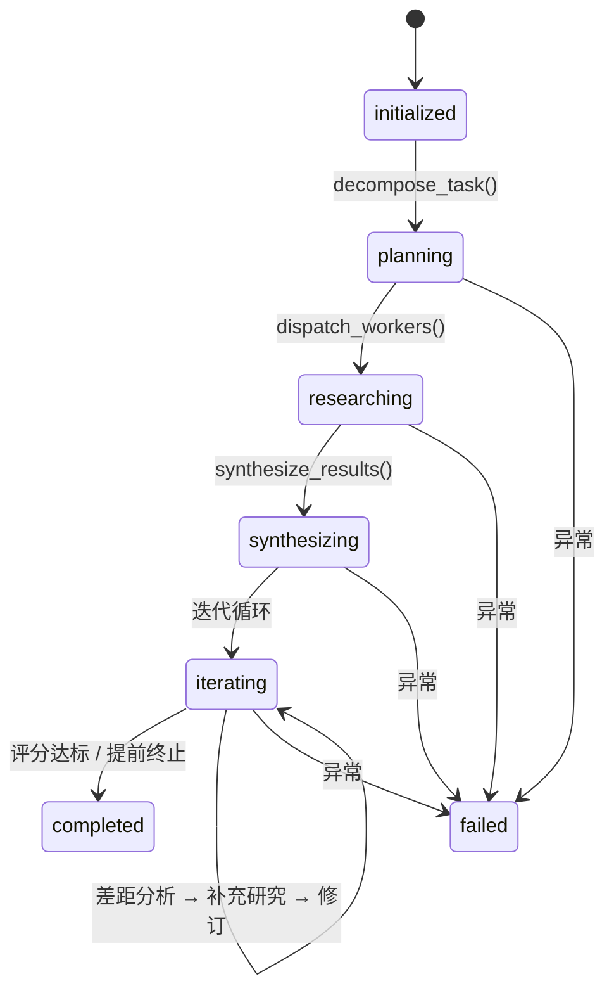
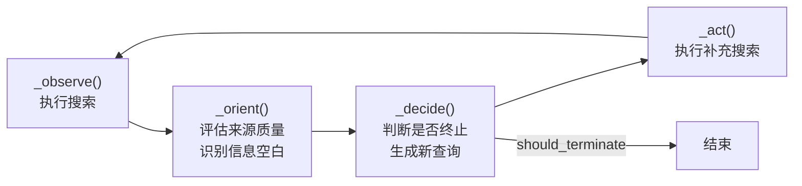
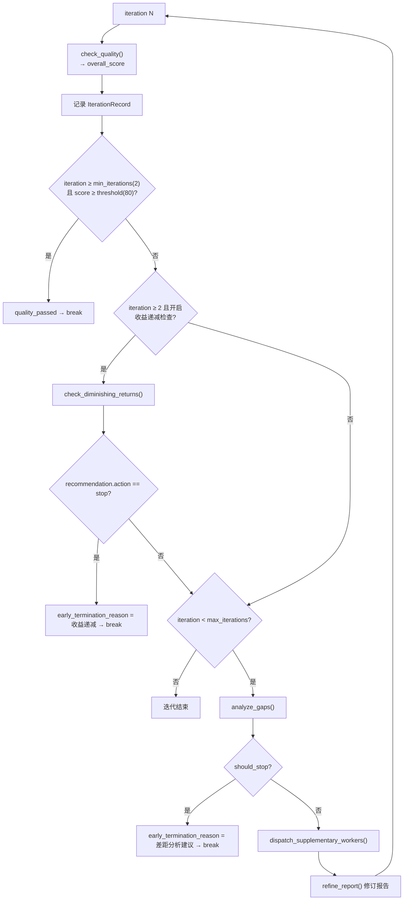

# Deep Research 链路

> - **依据代码**：`backend/app/services/research/{orchestrator.py,workers.py,research_manager.py,research_config.py,prompts.py,search_client.py,llm_client.py,service.py,utils.py}`、`backend/app/api/v1/research.py`
> - **资料来源**：2026-10-26 逐文件探查
> - **整理日期**：2026-10-26
> - **对应基线**：commit `c4dac22`
> - **相关篇目**：`01` 架构总览 ｜ `02` 能力链（§5 骨架）｜ `05` 接口 ｜ `08` 运行账本 ｜ `12` 风险台账

---

# 第一部分 现状事实

## 一、定位

Deep Research 是五条能力链中**唯一不走 `ToolRegistry` 的链路**：它不是「给主 Agent 提供一个工具」，而是一条**独立的后台任务链路**（提交任务 → 后台线程池执行 → SSE 进度 → 报告落盘）。它与主 Agent 的关系是**并列**，不是嵌套。

对外入口：`/api/v1/research` 族 7 个端点（见 `05_HTTP接口总览.md` §2.12）。

## 二、编排骨架（Orchestrator）

`Orchestrator.run(task)`（`backend/app/services/research/orchestrator.py:670-870`）驱动一个 **5 阶段状态机**：



| 阶段 | 方法 | 产出 |
| --- | --- | --- |
| `planning` | `decompose_task()`（`:151`） | `TaskPlan`：`task_understanding` / `query_type` / `subtasks[]` / `report_structure` / `research_plan` / `worker_count` |
| `researching` | `dispatch_workers()`（`:238`） | 每个 subtask 的检索结果 |
| `synthesizing` | `synthesize_results()`（`:317`） | 初始报告（Markdown） |
| `iterating` | 迭代循环（`:720-846`） | 多轮「评分 → 差距分析 → 补充研究 → 修订」 |
| `completed` / `failed` | — | 终态 |

**子任务截断**：`decompose_task` 产出的 subtask 数若超过 `recommended_worker_count`，按 priority 截断（`:212-218`）。

### 2.1 并发控制

`dispatch_workers()`（`:238-315`）：

```python
actual_workers = min(
    len(subtasks),
    self.max_workers,                                              # AGENT_CONFIG["max_workers"] = 6
    task_plan.query_type.recommended_worker_count if ... else self.max_workers
)
with ThreadPoolExecutor(max_workers=actual_workers) as executor:
    ...
```

三层上限取最小：子任务数 / 全局最大 6 / 按查询类型推荐的并发数。迭代中的补充研究用 `dispatch_supplementary_workers()`（`:543-614`），同样开 `ThreadPoolExecutor`。

### 2.2 两层并发模型

| 层 | 线程池 | 并发度 |
| --- | --- | --- |
| 任务层 | `ResearchManager.executor = ThreadPoolExecutor(max_workers=settings.research_max_concurrent)` | **3**（`core/config.py:70`），API 层 `loop.run_in_executor(...)` |
| 任务内 | Orchestrator 内部 `ThreadPoolExecutor(max_workers=actual_workers)` | ≤ 6（受 `worker_count_guidelines` 约束） |

> 这意味着最坏情况下同时有 `3 × 6 = 18` 个 Worker 线程在跑（再加每个 Worker 的检索/LLM 调用）。

## 三、OODA 子循环（Worker）

`SearchWorker.execute(subtask)`（`backend/app/services/research/workers.py:137-221`）是默认 Worker，内嵌 **OODA 循环**：



| 环节 | 职责 | 位置 |
| --- | --- | --- |
| `_observe` | 执行搜索，查询数受 `budget.queries_remaining` 限制，查询间 `time.sleep(0.3)` | `workers.py:272-296` |
| `_orient` | 来源质量评估 + 信息空白识别 | `workers.py:298-324` |
| `_decide` | 无空白或剩余预算 < 2 → 终止；否则用空白生成新 query（最多 2 个） | `workers.py:326-347` |
| `_act` | 执行 `_decide` 给出的新查询 | `workers.py:349-358` |

### 3.1 预算分档

`ResearchBudget(max_queries, max_analysis_cycles, queries_used, cycles_used)`（`workers.py:56-71`）。`_adjust_budget()`（`:246-256`）按复杂度分档：

| 复杂度 | `max_queries` | `max_cycles` |
| --- | --- | --- |
| simple | 3 | 1 |
| medium | 5 | 2 |
| complex | 8 | 3 |

终止条件 `_should_terminate()`（`:258-270`）：预算耗尽或达到 `worker_max_ooda_cycles`（`AGENT_CONFIG` 默认 3）。

### 3.2 已实现但未被调用的 Worker

| Worker | 职责 | 位置 | 状态 |
| --- | --- | --- | --- |
| `SearchWorker` | 默认检索 Worker | `workers.py:90-518` | **被 Orchestrator 使用** |
| `WriterWorker` | 写作 | `workers.py:523` | **未被调用** |
| `AnalysisWorker` | 分析 | `workers.py:577` | **未被调用** |
| `VisualizationWorker` | 可视化 | `workers.py:645` | **未被调用** |
| `WorkerFactory` | 工厂（默认返回 `SearchWorker`） | `workers.py:734` | 仅产出 SearchWorker |

Orchestrator 只用 `worker.execute(subtask)`，而 `worker_factory` 默认是 `search_worker_factory()`（`:764-766`）——**后三种 Worker 是死代码**。

## 四、评分与迭代

### 4.1 迭代循环（`orchestrator.py:720-846`）

每轮迭代：



### 4.2 终止条件汇总

| 终止路径 | 条件 | 结果 |
| --- | --- | --- |
| **质量达标** | `iteration >= min_iterations(2)` 且 `score >= quality_threshold(80)` | 正常结束（`quality_passed`） |
| **收益递减** | `iteration >= 2` 且 `check_diminishing_returns` 返回 `diminishing_returns_detected=True` 且 `recommendation.action="stop"` | 提前终止（`early_termination_reason="收益递减检测触发提前终止"`） |
| **差距分析建议停止** | `analyze_gaps` 返回 `stop_iteration_recommendation.should_stop=True` | 提前终止 |
| **达到最大迭代** | 循环跑完 `max_iterations`（默认 5） | 结束（无论质量） |

`IterationRecord`（`:82-92`）记录每轮的 `iteration / report / quality_score / quality_result / gap_analysis / supplementary_results / diminishing_returns_detected / score_improvement`。

### 4.3 质量评分的四个检查点

| 方法 | 用途 | 温度 |
| --- | --- | --- |
| `check_quality()`（`:385`） | 综合评分（`QUALITY_CHECK_PROMPT`） | 0.2 |
| `check_diminishing_returns()`（`:431`） | 判断是否继续投入 | `DIMINISHING_RETURNS_CHECK_PROMPT` |
| `analyze_gaps()`（`:482`） | 找信息缺口 + 是否建议停止 | `GAP_ANALYSIS_PROMPT` |
| `refine_report()`（`:616`） | 按缺口修订报告 | `REPORT_REFINEMENT_PROMPT` |

## 五、检索提供方与 LLM

### 5.1 检索 provider 三态

`SearchClient.provider`（`backend/app/services/research/search_client.py:34-41`）：

```python
if settings.bocha_api_key:      → "bocha"
elif settings.serper_api_key:   → "serper"
else:                           → "none"
```

- Bocha：POST `https://api.bocha.cn/v1/web-search`（`:69-117`）；
- Serper：复用 `backend/app/services/web/serper_service.py`（`:122-139`）；
- none：**无检索能力**。

`POST /api/v1/research` 在 `provider == "none"` 时**返回 HTTP 200 + `status="failed"` + 明确文案**（`backend/app/api/v1/research.py:113-123`），而非抛异常——快速失败但不当作系统错误。

### 5.2 LLM 客户端

`LLMClient`（`backend/app/services/research/llm_client.py`）独立于 `backend/app/core/llm.py`（DeepSeek），用 DashScope qwen 系列：

| 用途 | 模型 |
| --- | --- |
| 默认 | `qwen-plus` |
| 复杂推理 | `qwen-max` |
| 简单任务 | `qwen-turbo` |

文件头注释（`:5-9`）明确说明与 `backend/app/core/llm.py` **刻意分离**。`chat_stream()` 支持 `include_usage`。

### 5.3 配置覆盖与并发安全

`service.py:run_research()`（`backend/app/services/research/service.py:21-55`）允许覆盖 `AGENT_CONFIG` 的两个键（`OVERRIDABLE_KEYS = {"max_iterations", "quality_threshold"}`），执行后 `finally` 还原——**防止并发任务间的配置串扰**。

## 六、落盘与持久化

### 6.1 目录结构

```
data/research/
├── tasks.json                              # 任务清单（重启恢复）
└── <task_id>/
    ├── report_YYYYmmdd_HHMMSS.md           # Markdown 报告
    └── meta_YYYYmmdd_HHMMSS.json           # 元数据
```

`_save_report()`（`research_manager.py:186-227`）写 `report_*.md` + `meta_*.json`；`meta` 含 `task_id` / `original_task` / `status` / `quality_score` / `duration` / `task_plan` / `worker_results_count` / `iteration_count` / `iteration_history[]` / `search_provider`。

### 6.2 任务状态机

`TERMINAL_STATES = {"completed", "failed"}`（`research_manager.py:26`）。

| 方法 | 状态迁移 | 位置 |
| --- | --- | --- |
| `create_task()` | → `pending` | `:78-106` |
| `set_running()` | → `running` | `:152-157` |
| `set_completed()` | → `completed` + 写 result + 落盘报告 | `:159-172` |
| `set_failed()` | → `failed` | `:174-181` |
| `delete_task()` | 仅允许删终态，否则 `ValueError` → HTTP 400 | `:123-132` |

### 6.3 重启恢复

`_load_tasks()`（`research_manager.py:48-61`）：启动时读 `tasks.json`，**非终态任务标 `failed`**、错误置「服务重启，任务已中断」。`update_progress()`（`:140-150`）追加 `{stage, data, timestamp}` 并更新 `progress_summary`。

### 6.4 进度事件（SSE）

`GET /research/{task_id}/stream` 发出 `{"type":"progress", stage, ...}` 与 `{"type":"final", ...}` 两类事件。`stage` 共 **24 种**（前端 `STAGE_LABEL`，`frontend/web/vue-element-plus/src/views/ResearchView.vue:132-142`）。

### 6.5 24 个 stage

| 分组 | stage |
| --- | --- |
| 规划 | `decomposing` / `decomposed` |
| 分发 | `dispatching` / `workers_dispatched` |
| Worker | `worker_start` / `worker_search` / `worker_done` / `worker_failed` / `workers_completed` |
| 综合 | `synthesizing` / `synthesized` |
| 迭代 | `iteration_start` / `iteration_evaluated` / `quality_passed` / `diminishing_returns_stop` / `gap_analysis_stop` / `iteration_continue` / `no_supplementary_tasks` / `iteration_end` |
| 补充 | `gap_analyzed` / `supplementary_dispatched` / `supplementary_completed` / `report_refined` |
| 终态 | `completed` / `failed` |

---

# 第二部分 原理剖析

## 七、为什么是 Orchestrator-Workers 而不是单 Agent 循环

Deep Research 面对的是「多主题、需要多路检索」的研究任务。三种主流的多智能体范式：

| 范式 | 结构 | 适用 |
| --- | --- | --- |
| 单 Agent + 多工具 | 一个 Agent 串行调工具 | 简单问答 |
| **Orchestrator-Workers**（本项目） | 一个编排器拆解任务、分发给多个 Worker 并行执行、汇总 | 多主题研究 |
| 多 Agent 对等协作 | 多个 Agent 互相通信 | 开放式复杂任务 |

选 Orchestrator-Workers 的理由：

1. **并行度可控**。研究任务的瓶颈是「N 个主题的检索」，可以并行；`ThreadPoolExecutor` + `min(len(subtasks), max_workers, recommended)` 三层上限把并行度交给数据决定，而不是写死。
2. **单点质量门禁**。报告质量由 Orchestrator 统一评分与迭代，Worker 只负责检索，职责单一。
3. **可追溯**。每个 Worker 的输入（subtask）、过程（OODA cycle）、输出（结果）都是结构化数据，可落盘可回放。

代价是**编排器成为单点**：Orchestrator 一旦在某阶段抛异常，整个任务失败（`:862-866`），且没有任务级的 checkpoint 恢复——重启后整个任务标 `failed` 而非从中断点续跑。

## 八、为什么 Worker 内嵌 OODA 而不是一次性检索

一次性检索（「搜一次就写报告」）对研究任务质量不可控。OODA（Observe-Orient-Decide-Act）提供了一个**有预算的探索循环**：

- **Observe**：先按初始查询搜一轮；
- **Orient**：评估来源质量、识别「还缺什么信息」；
- **Decide**：决定是否值得再搜（有预算就继续，没预算或没缺口就停）；
- **Act**：执行补充搜索。

关键设计是**预算分档**（simple/medium/complex → 3/1、5/2、8/3）与**提前终止**（剩余预算 < 2 或无空白即停）。这让「简单问题不浪费调用，复杂问题不提前收工」。

## 九、为什么迭代要「评分 + 双提前终止」

固定 `max_iterations` 次的迭代有两个问题：质量早就达标时还继续浪费调用；质量提升停滞时还在做无效迭代。

本项目的迭代循环有三个出口：

1. **质量达标**（`score >= 80` 且至少 2 轮）——正常出口；
2. **收益递减**（第 2 轮起检测，若继续投入产出不值得则停）——经济性出口；
3. **差距分析建议停止**（分析认为没有可补的缺口）——收敛性出口。

三个出口分别对应「够了」「不值了」「没的可改了」。这是**把「什么时候停止研究」这个开放问题转化为三个可判定的条件**。

## 十、为什么任务持久化用 `tasks.json` 而不是进 SQLite

Deep Research 的 `tasks.json` 与业务 SQLite 是**两套独立存储**：

- `tasks.json`：任务清单 + 进度事件（文件系统，供重启恢复）；
- `data/research/<task_id>/meta_*.json`：任务元数据；
- `data/research/<task_id>/report_*.md`：报告正文。

选择文件而非 SQLite 的原因（与 `04` 的「研究任务持久化升级 SQLite」历史提案相反，该提案**未实施**）：

1. 研究任务的写入是**低频、大对象**（一份报告几 MB Markdown），不适合关系表；
2. 进度事件是**追加型日志**，文件 append 比 DB insert 简单；
3. 报告本身就是交付物，用户要能直接打开文件。

代价是与业务 SQLite 的「运行账本」**不互通**——Deep Research 任务不会出现在 `runs` 表里，`/api/v1/runs` 查不到它们。

---

# 第三部分 已知边界与观察

| 编号 | 观察 | 证据 | 指向 |
| --- | --- | --- | --- |
| S-07-01 | `WriterWorker` / `AnalysisWorker` / `VisualizationWorker` 已实现但 Orchestrator 从不调用，能力虚高 | `backend/app/services/research/workers.py:523,577,645`；`orchestrator.py:273-275` | `12` D-28 |
| S-07-02 | 检索 provider 三态自动选择，**无 Key 时 `POST /research` 返回 200 + `status="failed"`**，客户端无法用 HTTP 状态码判失败 | `backend/app/api/v1/research.py:113-123` | `12` D-35 |
| S-07-03 | 任务无 checkpoint 恢复：重启后非终态任务整体标 `failed`，不从中断点续跑 | `backend/app/services/research/research_manager.py:48-61` | `12` §2 |
| S-07-04 | ~~任务与业务运行账本不互通：Deep Research 任务不进 `runs` 表~~ **已修**（S1 WP-1.8）：研究任务写穿 `runs`（`trigger=research`），并可从账本恢复 | `backend/app/services/research/research_manager.py` | 已关闭 |
| S-07-05 | 最坏并发 `3 × 6 = 18` Worker 线程，每个都可能起检索请求与 LLM 调用，无全局速率限制 | `backend/app/services/research/orchestrator.py:263-315` | `11` §2 |
| S-07-06 | `AGENT_CONFIG` 是**可变模块级 dict**，`service.py` 用 try/finally 还原防并发串扰，但两个并发任务的临时覆盖仍可能在窗口期互相影响 | `backend/app/services/research/research_config.py:5-9`；`service.py:43-55` | `12` §2 |
| S-07-07 | `tasks.json` 全量读写（每次 `_save_tasks()` 写整个文件），任务数增长后 IO 放大 | `backend/app/services/research/research_manager.py:63` | `11` §2 |
| S-07-08 | 研究任务的进度事件**不落 `run_events`**，断流恢复靠 `stage\|ts` 去重而非 `seq` 游标，与运行账本的回放机制不一致 | `backend/app/services/research/` | `12` §2 |
| S-07-09 | 报告无版本管理，同一任务多次运行会生成多份 `report_<ts>.md`，无「最新」指针 | `backend/app/services/research/research_manager.py:186-227` | `12` §2 |

---

# 第四部分 改进指向

| 优先级 | 事项 | 台账编号 |
| --- | --- | --- |
| **P0** | `POST /research` 无 Key 时的失败语义改为 503 或在契约中显式标注 | D-35 |
| **P1** | 接入或移除 `WriterWorker` / `AnalysisWorker` / `VisualizationWorker` | D-28 |
| **P1** | Deep Research 任务接入 `runs` 账本（共享 `run_events` 回放） | `12` §2 |
| **P1** | 任务级 checkpoint（每阶段落盘，重启从中断点续跑） | `12` §2 |
| **P2** | `AGENT_CONFIG` 改为不可变 + 任务级配置对象，消除并发串扰窗口 | `12` §2 |
| **P2** | `tasks.json` 改为 SQLite 表或追加型日志 | `11` §3 |
| **P2** | 报告加 `latest.md` 软链或版本指针 | `12` §2 |

---

# 第五部分 核对方式

```bash
cd backend

# 阶段方法
grep -n "def decompose_task\|def dispatch_workers\|def synthesize_results\|def check_quality\|def analyze_gaps\|def refine_report\|def check_diminishing" backend/app/services/research/orchestrator.py

# 并发三层上限
grep -n "actual_workers = min" -A 5 backend/app/services/research/orchestrator.py

# OODA 四环节
grep -n "def _observe\|def _orient\|def _decide\|def _act\|def _should_terminate" backend/app/services/research/workers.py

# 预算分档
grep -n "research_budget\|simple.*max_queries\|medium.*max_queries\|complex" backend/app/services/research/research_config.py

# 迭代终止条件
grep -n "min_iterations\|quality_threshold\|diminishing_returns_detected\|should_stop" backend/app/services/research/orchestrator.py

# 未被调用的 Worker
grep -n "class WriterWorker\|class AnalysisWorker\|class VisualizationWorker" backend/app/services/research/workers.py
grep -n "WriterWorker\|AnalysisWorker\|VisualizationWorker" backend/app/services/research/orchestrator.py   # 应无输出

# 落盘结构
ls data/research/ 2>/dev/null
```
