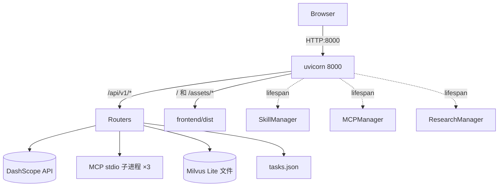

# agent 部署（扩充版）

> - **依据项目**：`apps/agent/backend/app/main.py` + `frontend/` + `pyproject.toml`
> - **资料来源**：本项目代码（2026-09-15 探查）+ FastAPI 部署文档 + Vite 部署文档 + Docker 官方 + uv 官方
> - **整理日期**：2026-09-15（首发 2026-09-15 扩充）
> - **范围**：单端口部署（核心亮点）+ Docker + K8s

---

# 第一部分 当前部署拓扑

## 一、单端口部署（项目亮点）



**核心**：`main.py:84-101` 让 FastAPI 同时托管 `frontend/dist/`，单端口（8000）即可运行整套系统。

### 1.1 实现代码

```python
# main.py:29
FRONTEND_DIST = PROJECT_ROOT.parent / "frontend" / "dist"

# main.py:46-47  lifespan 检测
if FRONTEND_DIST.exists():
    logger.info("检测到前端构建产物，托管于 / : %s", FRONTEND_DIST)

# main.py:81-92  挂载（实测）
app.mount("/assets", StaticFiles(directory=str(FRONTEND_DIST / "assets")), name="assets")

@app.get("/", include_in_schema=False)
async def serve_index():
    return FileResponse(FRONTEND_DIST / "index.html")
```

## 二、与传统多服务对比

| 维度 | 本项目（单端口） | 传统（nginx + 多服务） |
|------|-----------------|----------------------|
| **架构** | FastAPI 静态托管 | nginx 反代 → FastAPI + Vue dev |
| **生产** | `npm run build` 后重启 | `npm run build` + nginx reload |
| **开发** | `npm run dev` (Vite) + uvicorn reload | 同 |
| **HTTPS** | 自挂证书（前置 caddy） | nginx 配置 |
| **优势** | 极简；零反代 | 分层；成熟 |
| **劣势** | 长连接与静态服务共用进程 | 需多服务编排 |

## 三、开发模式 vs 生产模式

### 3.1 开发模式

```bash
# 终端 1：后端（端口 8000）
cd backend
uv venv .venv --python 3.11
uv pip install --python .venv/bin/python -r requirements.txt
cp .env.example .env   # 填入 DASHSCOPE_API_KEY + LLM_API_KEY + 可选 BOCHA/SERPER
.venv/bin/python -m scripts.ingest_data   # RAG 入库
.venv/bin/uvicorn app.main:app --host 0.0.0.0 --port 8000 --reload

# 终端 2：前端开发（端口 5173）
cd frontend
npm install
npm run dev              # Vite 代理 /api → 8000
```

### 3.2 生产模式（单端口）

```bash
# 后端
cd backend
.venv/bin/uvicorn app.main:app --host 0.0.0.0 --port 8000 --workers 4 --loop uvloop

# 前端 build（自动被 FastAPI 托管）
cd frontend
npm install
npm run build    # 产出 dist/

# 验证
curl http://localhost:8000/
curl http://localhost:8000/api/v1/health
```

---

# 第二部分 Docker 化

## 四、Docker Compose（推荐生产）

### 4.1 后端 Dockerfile

```dockerfile
# backend/Dockerfile
FROM python:3.11-slim

WORKDIR /app

RUN apt-get update && apt-get install -y --no-install-recommends \
    build-essential \
    && rm -rf /var/lib/apt/lists/*

# 用 uv 加速依赖安装
COPY --from=ghcr.io/astral-sh/uv:latest /uv /bin/uv

COPY pyproject.toml requirements.txt ./
RUN uv pip install --system -r requirements.txt

COPY . .

# 数据/日志挂载
RUN mkdir -p /app/data/research /app/data/outputs /app/data/logs

ENV PYTHONUNBUFFERED=1

EXPOSE 8000

# 多 worker + uvloop
CMD ["uvicorn", "app.main:app", \
     "--host", "0.0.0.0", \
     "--port", "8000", \
     "--workers", "4", \
     "--loop", "uvloop", \
     "--http", "httptools"]
```

### 4.2 前端 Dockerfile

```dockerfile
# frontend/Dockerfile
FROM node:20-alpine AS builder

WORKDIR /app
COPY package*.json ./
RUN npm ci

COPY . .
RUN npm run build    # 产出 dist/

# 用 python 镜像托管 dist（避免 nginx）
FROM python:3.11-slim

# 这里 dist/ 会被 backend/Dockerfile 的 COPY 覆盖
```

### 4.3 docker-compose.yml

```yaml
version: '3.8'

services:
  backend:
    build: ./backend
    container_name: agent-backend
    ports:
      - "8000:8000"
    environment:
      - DASHSCOPE_API_KEY=${DASHSCOPE_API_KEY}
      - LLM_API_KEY=${LLM_API_KEY}
      - BOCHA_API_KEY=${BOCHA_API_KEY:-}
      - SERPER_API_KEY=${SERPER_API_KEY:-}
      - RESEARCH_MAX_CONCURRENT=4
      - LOG_LEVEL=INFO
    volumes:
      - ./backend/data:/app/data
      - ./backend/skills:/app/skills
    restart: unless-stopped
    healthcheck:
      test: ["CMD", "curl", "-f", "http://localhost:8000/api/v1/health"]
      interval: 30s
      timeout: 5s
      retries: 3
      start_period: 30s   # ★ MCP subprocess 启动需要时间
```

**注意**：单端口模式下，前端 dist 由 backend 容器托管。无需额外 nginx。

---

# 第三部分 K8s + Helm（可选）

## 五、K8s 部署

```yaml
# k8s/deployment.yaml
apiVersion: apps/v1
kind: Deployment
metadata:
  name: agent
spec:
  replicas: 4
  selector:
    matchLabels:
      app: agent
  template:
    metadata:
      labels:
        app: agent
    spec:
      containers:
      - name: app
        image: agent:latest
        ports:
        - containerPort: 8000
        env:
        - name: DASHSCOPE_API_KEY
          valueFrom:
            secretKeyRef:
              name: agent-secrets
              key: dashscope-key
        - name: LLM_API_KEY
          valueFrom:
            secretKeyRef:
              name: agent-secrets
              key: llm-key
        resources:
          requests:
            cpu: "2"
            memory: "4Gi"
          limits:
            cpu: "4"
            memory: "8Gi"
        livenessProbe:
          httpGet:
            path: /api/v1/health
            port: 8000
          initialDelaySeconds: 30
          periodSeconds: 30
        readinessProbe:
          httpGet:
            path: /api/v1/health
            port: 8000
          initialDelaySeconds: 5
          periodSeconds: 10
        volumeMounts:
        - name: data
          mountPath: /app/data
      volumes:
      - name: data
        persistentVolumeClaim:
          claimName: agent-data
```

## 六、Caddy 反代（前置 HTTPS）

```caddyfile
# /etc/caddy/Caddyfile
api.example.com {
    reverse_proxy 127.0.0.1:8000
    encode gzip zstd
}
```

---

# 第四部分 关键观察与改造

## 七、关键观察表

| 编号 | 观察 | 影响 | 优先级 |
|------|------|------|--------|
| AP-7-1 | **单端口部署** | 创新亮点 | OK |
| AP-7-2 | FastAPI 静态文件托管 | 节省 nginx | OK |
| AP-7-3 | 无 nginx（生产需补） | HTTPS 处理 | P1 |
| AP-7-4 | data/ 需挂 volume | 容器化要点 | P0 |
| AP-7-5 | skills/ 需挂 volume | 自定义 Skill 保留 | P1 |
| AP-7-6 | MCP subprocess 启动慢（~2s） | healthcheck 需 start_period | P0 |
| AP-7-7 | 无 K8s Helm Chart | 大型部署不便 | P2 |
| AP-7-8 | 无 CI/CD | 手动部署 | P1 |

## 八、改造路线图

| 周 | 任务 | 工作量 |
|----|------|--------|
| **W1** | Docker Compose | 1d |
| **W1** | Volume 挂载（data + skills） | 0.5d |
| **W1** | Caddy 反代（自动 HTTPS） | 0.5d |
| **W2** | GitHub Actions CI/CD | 1d |
| **W3** | K8s Helm Chart | 3d |
| **W3** | 健康检查增强（livenessProbe + readinessProbe） | 0.5d |

## 九、推荐的部署拓扑（生产）

```
                  ┌─→ Backend Pod 1 (uvicorn workers=4 + uvloop) :8000
Internet → LB ────┼─→ Backend Pod 2
                  ├─→ Backend Pod 3
                  └─→ Backend Pod 4

共享存储：
  PVC (data/) → tasks.json + chat_log + milvus.db
  ConfigMap (skills/) → 6 个 Skill

监控：
  Prometheus ← /metrics
  Grafana
  Loki ← JSON logs
  Langfuse ← LLM 追踪
```

---

## 附录 A：参考文献

| # | 类型 | 标题 | 来源 | 访问日期 |
|---|------|------|------|----------|
| [1] | 官方文档 | FastAPI StaticFiles | https://fastapi.tiangolo.com/tutorial/static-files/ | 2026-09-15 |
| [2] | 官方文档 | FastAPI Deployment | https://fastapi.tiangolo.com/deployment/ | 2026-09-15 |
| [3] | 官方文档 | Uvicorn Deployment | https://www.uvicorn.org/deployment/ | 2026-09-15 |
| [4] | 官方文档 | Vite Build | https://vitejs.dev/guide/build.html | 2026-09-15 |
| [5] | 官方文档 | Docker Compose | https://docs.docker.com/compose/ | 2026-09-15 |
| [6] | OSS 项目 | uv (Python 包管理) | https://github.com/astral-sh/uv | 2026-09-15 |
| [7] | 官方文档 | Caddy | https://caddyserver.com/docs/ | 2026-09-15 |
| [8] | 官方文档 | Kubernetes | https://kubernetes.io/docs/home/ | 2026-09-15 |
| [9] | OSS 项目 | Helm | https://helm.sh | 2026-09-15 |
| [10] | 官方文档 | GitHub Actions | https://docs.github.com/en/actions | 2026-09-15 |
| [11] | 同源文档 | `apps/finance-report/doc/analysis/07_部署.md` | 参考 | 2026-09-15 |
| [12] | 同源文档 | `apps/industry-research/doc/analysis/07_部署.md` | 8 服务 | 2026-09-15 |

---

> **本文档结构遵循「五段式」**：当前实现 → 原理剖析 → 业界做法调研 → 操作步骤 → 参考文献附录。
