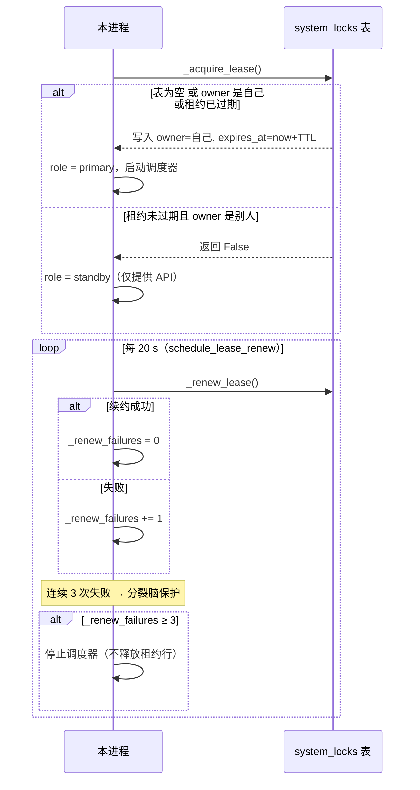
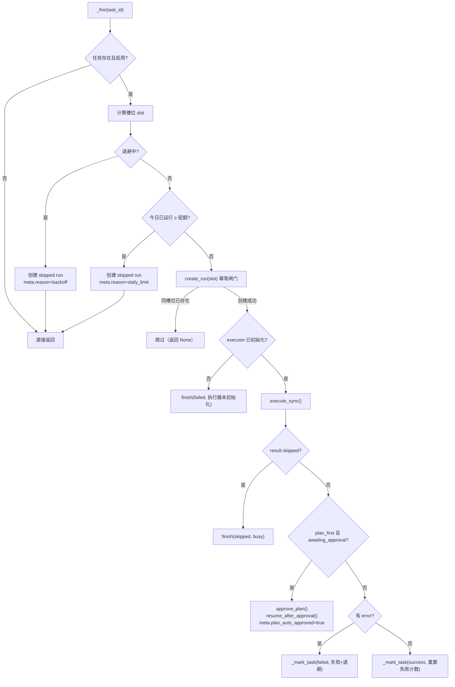
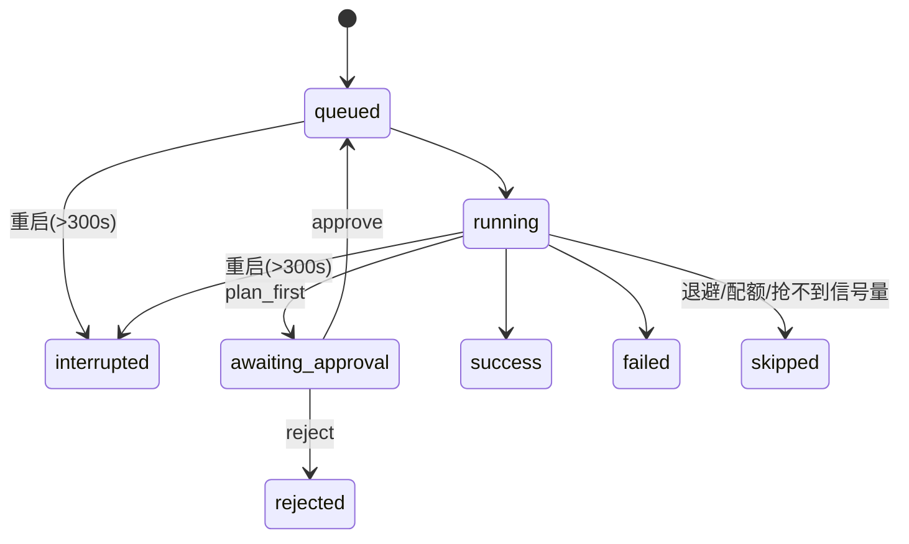

# 调度与运行账本

> - **依据代码**：`backend/app/services/scheduler_service.py`、`backend/app/services/run_service.py`、`backend/app/services/run_executor.py`、`backend/app/schemas/schedule.py`、`backend/app/api/v1/schedules.py`、`backend/app/db/models.py`
> - **资料来源**：2026-10-26 逐文件探查
> - **整理日期**：2026-10-26
> - **对应基线**：commit `c4dac22`
> - **相关篇目**：`01` 架构总览 ｜ `03` 执行引擎 ｜ `04` 数据层 ｜ `05` 接口 ｜ `12` 风险台账

---

# 第一部分 现状事实

## 一、定位

本域负责**无人值守执行**：把「到点触发一个 Agent 任务」拆成两个可独立推理的部分——

| 部分 | 职责 | 实现 |
|---|---|---|
| **调度**（什么时候触发） | cron / interval 定时、多副本防重、失败退避、每日配额 | `backend/app/services/scheduler_service.py` |
| **运行账本**（触发后留痕） | run 记录、事件流落库、断点续传、事件回放、过期清理 | `backend/app/services/run_service.py` + `run_executor.py` |

两条链路共用同一份执行引擎（`RunExecutor`），因此「手动对话」与「定时任务」产生的事件结构与回放方式是同构的。

## 二、定时任务模型

`scheduled_tasks` 表（`backend/app/db/models.py:121-153`）存任务定义。**表是唯一真相源**：启动时从表重建 APScheduler job，**不使用 APScheduler 的 jobstore 持久化**（避免双写）。

### 2.1 入参校验（`backend/app/schemas/schedule.py:13-64`）

| 校验 | 规则 |
|---|---|
| `mode` | `Literal["chat","work"]`，默认 `work` |
| `schedule_kind` | `Literal["cron","interval"]` |
| `cron_expr` / `interval_seconds` | **必须二选一**（`model_validator`） |
| `interval_seconds` | ≥ 60 秒 |
| `cron_expr` | 用 `CronTrigger.from_crontab()` 试解析，非法即 `ValueError` |
| `timezone` | `ZoneInfo` 可识别，默认 `Asia/Shanghai` |
| `mode=chat` + `plan_first` | 拒绝（「对话模式不支持 plan_first」） |
| `mode=work` + `enabled` | 必须显式 `allow_unattended_tools=true` |
| `team_id` 与 `skills` | **互斥**（只能二选一） |
| 任务总数 | 上限 200 |

### 2.2 任务 → 执行的参数组装

`_build_exec_meta()`（`scheduler_service.py:403-418`）把任务定义翻译成 `RunExecutor.execute_sync()` 的入参：

```python
{
    "mode": row.mode,
    "team_id": row.team_id,
    "skills": json.loads(row.skills_json or "[]") or None,
    "enable_mcp": bool(enable.get("mcp")),
    "enable_rag": bool(enable.get("rag")),
    "enable_web_research": bool(enable.get("web")),
    "enable_reflection": bool(enable.get("reflection")) and row.mode == "work",
    "plan_first": bool(row.plan_first),
}
```

注意 `enable_reflection` 被强制叠加 `and mode=="work"`——与交互式路径的 chat 反思禁用保持一致。

## 三、调度与租约

### 3.1 调度器本体

`BackgroundScheduler(timezone=ZoneInfo(settings.tz))`，job 参数（`scheduler_service.py:228-233`）：

| 参数 | 值 | 含义 |
|---|---|---|
| `max_instances` | 1 | 同一 job 不并发 |
| `coalesce` | True | 错过的多次触发合并为一次 |
| `misfire_grace_time` | 300 s | 错过 5 分钟内仍补跑 |

### 3.2 DB 租约（多副本防重）

`system_locks` 表存一行 `name="scheduler"` 的租约。owner = `hostname:pid:uuid8`（`scheduler_service.py:118`）。



| 参数 | 值 | 位置 |
|---|---|---|
| 租约 TTL | `schedule_lease_ttl = 60` s | `backend/app/core/config.py:92` |
| 续约间隔 | `schedule_lease_renew = 20` s | `backend/app/core/config.py:93` |
| 分裂脑保护 | 连续 **3 次**续约失败 → 停止调度 | `backend/app/services/scheduler_service.py:173-178` |

**关键**：续约失败 3 次时**只停止调度器，不删除租约行**（`_stop_scheduler_only()` 不调 `_release_lease()`，`:202-209`）。这避免了一个网络分区进程释放租约、让另一个分区以为自己拿到了锁的脑裂场景。

### 3.3 角色

| 角色 | 条件 | 行为 |
|---|---|---|
| `primary` | 抢到租约 | 注册并触发 job |
| `standby` | 未抢到租约 | 只提供 API，不触发任务 |

`GET /api/v1/schedules/health` 返回 `{role, owner, jobs, enabled}`，供前端/运维判断当前实例角色。

## 四、幂等与配额

### 4.1 确定性槽位

`_compute_slot()`（`scheduler_service.py:393-401`）生成**重启/补跑/并发计算结果一致**的槽位字符串：

| 触发方式 | 槽位算法 |
|---|---|
| `cron` | `now` 按分钟截断（`replace(second=0, microsecond=0)`） |
| `interval` | 以 `created_at` 为锚，`idx = (now - created) // interval`，槽位 = `created + idx * interval` |

槽位是 `runs.scheduled_for` 的值，靠 `uq_runs_task_slot` 唯一约束防重复。

### 4.2 失败退避

| 常量 | 值 | 位置 |
|---|---|---|
| `BACKOFF_THRESHOLD` | 3 | `scheduler_service.py:43` |
| `BACKOFF_BASE_SECONDS` | 30 | 同上 |
| `BACKOFF_MAX_SECONDS` | 3600 | 同上 |

规则（`_mark_task`，`scheduler_service.py:508-535`）：
- 每次失败 `consecutive_failures += 1`；
- 连续失败 ≥ 3 次时进入退避：`delay = min(30 * 2^(failures-3), 3600)` 秒；
- 退避期内触发 → 创建一个 `status="skipped"`、`meta.reason="backoff"` 的 run 记录并立即 `finish`（留痕但不执行）；
- 成功一次 → `consecutive_failures = 0`、`backoff_until = None`。

### 4.3 每日配额（按任务时区）

`count_today_runs(task_id, tz)`（`run_service.py`）统计**该任务本地自然日**内 `status in (running, success, failed, awaiting_approval)` 的 run 数；`>= daily_run_limit`（默认 100）时创建 `skipped` 记录（`meta.reason="daily_limit"`）。

**口径（2026-10-28 批次 03 修正）**：旧实现用 `datetime.now(timezone.utc).date()`，与 `scheduled_tasks.timezone` 无关 → 北京时区的任务在 UTC 日界（早 8 点前后）会误判配额。现按任务时区切本地零点再折算 UTC 边界做区间过滤；非法时区回落 UTC 且不抛。

注意：**`skipped` 状态不计入配额**（不在 `count_today_runs` 的 in 列表里），避免「因配额被跳过」本身占用配额。

### 4.4 触发决策树



## 五、运行账本与事件

### 5.1 `runs` 的 8 种状态



`TERMINAL_STATUSES = {"success", "failed", "skipped", "interrupted", "rejected"}`（`run_service.py:23`）。`queued` / `running` / `awaiting_approval` 是非终态。

### 5.2 事件追加（批量）

`RunExecutor` 的流式执行把事件先攒进内存 buffer，满足条件才批量落库（`run_executor.py:26-27,232-233`）：

| 条件 | 阈值 |
|---|---|
| buffer 满 | `EVENT_FLUSH_COUNT = 20` 条 |
| 距上次落库超 | `EVENT_FLUSH_INTERVAL = 2.0` s |

`append_events()` 用 `max(seq)+1` 分配 `seq` 并走 `retry_on_locked()`（`run_service.py:178-198`）。事件负载截断到 60000 字符。

### 5.3 事件负载形态

`append_events` 把 `type` 拆出为列，其余字段打包进 `payload_json`（`run_service.py` 内 `{k: v for k, v in ev.items() if k != "type"}`）。因此回放端点返回的每条事件是 `{seq, type, payload, created_at}`，`payload` 不含 `type`。

## 六、并发闸门

`RunExecutor` 持有全局 `BoundedSemaphore(settings.schedule_max_concurrent)`（默认 2，`run_executor.py:43`）：

```python
acquired = self._semaphore.acquire(blocking=False)
if not acquired:
    return {"skipped": True, "error": "busy"}   # execute_sync 被跳过
```

**关键约束（S4 已变更）**：这个信号量**现在交互路径也占**——`execute_stream` 默认 `acquire_slot=True`（`execute_sync` 自行持槽并传 `acquire_slot=False`，避免重复占用导致预算折半）。超限时返回 **`busy` 事件**并如实提示，不静默丢弃。

## 七、回放与清理

| 端点 | 行为 |
|---|---|
| `GET /api/v1/runs/{run_id}/events` | 返回 `{items, last_seq, status, has_more}`，`after_seq` 游标 + `limit 1..2000` |
| `GET /api/v1/runs/{run_id}/stream` | **SSE**：DB tail 轮询（`STREAM_POLL_INTERVAL=0.3` s），上限 `STREAM_MAX_SECONDS=1800` s，终态时补发 `{"type":"done","status":...}` |

**清理**：每日 03:30（`CronTrigger(hour=3, minute=30)`）调 `cleanup_runs()`，删 90 天前的终态 run（级联删事件）（`scheduler_service.py:194-198,615-618`；`run_service.py:283-299`）。

**周期巡检（2026-10-28 批次 03 新增）**：`__stale_sweep__` job 每 `schedule_stale_sweep_minutes`（默认 5 分钟）调 `sweep_stale_runs()` → `recover_interrupted(grace_seconds=max(schedule_stale_sweep_grace, schedule_run_timeout+60))`，把超期未完成的 `running`/`queued` 标为 `interrupted`（`error` 记「超过时限未完成，周期巡检标记为中断」）。宽限期必须大于单次运行上限，否则会把**仍在跑**的长任务误判为中断。

## 八、plan_first 定时任务

无人值守的 plan_first 任务在 `_fire()` 里**自动批准**（`scheduler_service.py:489-498`）：

1. `execute_sync` 跑到 `awaiting_approval` 后返回；
2. `_fire` 检测到 `status="awaiting_approval"` 且 `task.plan_first` → `approve_plan()` + `resume_after_approval()`；
3. `meta.plan_auto_approved=true` 写入账本。

这保证 plan_first 的定时任务不会因「无人点确认」而永久停在待审批。

---

# 第二部分 原理剖析

## 九、为什么「表为真相、job 为投影」而不是 APScheduler jobstore

APScheduler 的 jobstore 会把 job 状态持久化到外部存储，但那是**应用框架的持久化格式**，与业务表结构不一致。如果用 jobstore，同一个任务会有两份真相：业务表（`scheduled_tasks`）与 jobstore 表（`apscheduler_jobs`），两者需要双向同步，任何一处变更都要双写。

本项目选择**只有业务表**：job 在启动时从表重建（`sync_all_jobs()`），运行时对表的写操作（create/update/toggle/delete）同步触发 `sync_task()` 重建对应 job。代价是：

- 重启后 job 的「下次触发时间」依赖 `next_run_at` 字段的正确维护；
- 多副本时**只有拿到租约的副本**注册 job（其它副本的 APScheduler 是 standby），避免双触发。

这个模式叫 **「持久化到业务表，运行态重建」**，是 APScheduler 与业务数据共存的推荐做法。

## 十、为什么幂等用「槽位唯一约束」而不是「锁」

调度的典型竞态是：同一分钟，两个副本（或同一副本的补跑与正常触发）都想创建 run。

如果用锁（`SELECT ... FOR UPDATE`），SQLite 的表级写锁会让「检查是否存在」这个读操作也被阻塞，而且锁的持有时间不好控制。

本项目用的是**乐观方案**：先算一个确定性的槽位字符串，直接 `INSERT`，让 `uq_runs_task_slot` 唯一约束在事务提交时判定冲突，冲突则 `IntegrityError` → 返回 `None` → 跳过。这把判重从「读-判断-写」三步合并为「写-由存储层判定」一步，且**天然原子**。

代价是槽位字符串必须是确定性的（`scheduler_service.py:393-401` 的注释强调「重启/补跑/并发计算结果一致」），否则同一逻辑槽位会算出不同字符串而失去防重作用。

## 十一、为什么退避要写一条 skipped 记录而不是直接跳过

直接跳过（什么都不写）会让用户在运行历史里看到「这一小时没有记录」，无法区分「没触发」和「触发了但被退避」。

写一条 `status="skipped"`、`meta.reason="backoff"` 的记录，把**「决定不执行」本身留痕**。这也是运行账本的设计哲学：**所有有业务含义的决策都应该产生记录**，哪怕结果是「不做」。

## 十二、为什么续约失败只停调度器、不删租约行

考虑两个副本 A、B 因网络分区互相不可见：
- A 续约失败（看不到 DB）→ 若 A 删除租约行，B 稍后恢复网络会看到空租约 → B 抢到租约 → 两个副本都在调度 → **重复执行**；
- A 只停调度器不删租约 → 租约行在 DB 里保留 A 的 owner 与过期时间 → B 恢复网络后看到「A 的租约，60 s 后过期」→ 60 s 内 B 不会抢 → A 的网络恢复后要么续约成功（重新调度），要么租约过期被 B 接管。

这就是**分裂脑保护**（split-brain protection）：宁可暂时无人调度，也不能两个副本同时调度。

---

# 第三部分 已知边界与观察

| 编号 | 观察 | 证据 | 指向 |
|---|---|---|---|
| S-08-01 | `allow_dangerous_tools` 字段可写可存，但**无任何生效分支**（仅 `allow_unattended_tools` 被校验） | `backend/app/db/models.py:140`；`scheduler_service.py:98,299,341-342` | `12` D-29 |
| S-08-02 | `delivery_json` 字段存在但**无投递实现**（无邮件/Webhook 发送代码） | `backend/app/db/models.py:149` | `12` §2 |
| S-08-03 | `run-now` 的 `wait_seconds` 参数（0..300）实际语义是「等待执行完成的秒数」，但超时后返回的 run 状态依赖后台执行，调用方无法确定是否真正完成 | `backend/app/api/v1/schedules.py:101-111` | `12` §2 |
| S-08-04 | ~~交互式 SSE 不占并发信号量~~ **已修**（S4 WP-4.4）：交互路径与调度共用预算，超限返回 `busy` 事件 | `backend/app/services/run_executor.py` | 已关闭 |
| S-08-05 | 调度任务执行在 `BackgroundScheduler` 的线程里，而 `execute_sync` 内部又调 `LocalCodeExecutor` 的 `subprocess.run`——**长时间阻塞的子进程会占用调度线程** | `backend/app/services/run_executor.py:275-319` | `11` §2 |
| S-08-06 | ~~`count_today_runs` 的「今天」用 UTC 日期~~ **已修**（2026-10-28 批次 03）：改为按任务 `timezone` 切本地自然日 | `backend/app/services/run_service.py` | 已关闭 |
| S-08-07 | `resume_after_approval` 用 daemon 线程恢复执行，**进程退出即丢失**；定时任务的 plan_first 依赖此机制 | `backend/app/services/run_executor.py:324-406` | `12` §2 |
| S-08-08 | ~~`recover_interrupted` 只在启动时跑一次~~ **已修**（2026-10-28 批次 03）：调度器新增 `__stale_sweep__` 周期 job（默认每 5 分钟），超期 `running` 标记为 `interrupted` 并记原因 | `backend/app/services/scheduler_service.py` | 已关闭 |
| S-08-09 | 事件负载 `payload_json` 截断到 60000 字符，超大工具结果在账本中被截断，回放时丢失尾部 | `backend/app/services/run_service.py:178-198` | `12` §2 |
| S-08-10 | 任务总数上限 200 在 schema 校验，但**无分页/软删除**，删除即永久删除（运行历史保留但任务定义不可恢复） | `backend/app/api/v1/schedules.py` | `12` §2 |

---

# 第四部分 改进指向

| 优先级 | 事项 | 台账编号 |
|---|---|---|
| ~~**P0**~~ | ~~`allow_dangerous_tools` 生效~~ **已完成**（2026-10-28 批次 03：权限引擎按 `dangerous_tools_context` 裁剪） | 已关闭（D-29） |
| **P1** | 交互式 SSE 也纳入并发护栏（或单独设交互式并发上限） | `11` §3 |
| **P1** | `resume_after_approval` 改为可持久化任务（防进程退出丢失） | `12` §2 |
| ~~**P1**~~ | ~~`recover_interrupted` 加周期性巡检~~ **已完成**（批次 03） | 已关闭（S-08-08） |
| ~~**P2**~~ | ~~`count_today_runs` 改用任务 `timezone`~~ **已完成**（批次 03） | 已关闭（S-08-06） |
| **P2** | `delivery_json` 实现投递（Webhook / 邮件）或移除字段 | `12` §2 |
| **P2** | 事件负载超限改为「截断 + 标记 truncated」而非静默截断 | `12` §2 |
| **P2** | 任务删除加软删除或确认提示 | `12` §2 |

---

# 第五部分 核对方式

```bash
cd backend

# 租约与退避常量
grep -n "LEASE_NAME\|BACKOFF_\|MISFIRE" backend/app/services/scheduler_service.py

# 分裂脑保护
grep -n "_renew_failures >= 3" backend/app/services/scheduler_service.py

# 槽位算法
grep -n "def _compute_slot" -A 10 backend/app/services/scheduler_service.py

# 幂等闸门
grep -n "uq_runs_task_slot" backend/app/db/models.py

# 事件批量参数
grep -n "EVENT_FLUSH_COUNT\|EVENT_FLUSH_INTERVAL" backend/app/services/run_executor.py

# 并发信号量
grep -n "BoundedSemaphore\|schedule_max_concurrent" backend/app/services/run_executor.py backend/app/core/config.py

# 每日配额
grep -n "def count_today_runs\|daily_run_limit" backend/app/services/run_service.py

# 清理任务
grep -n "CronTrigger(hour=3" backend/app/services/scheduler_service.py
```
