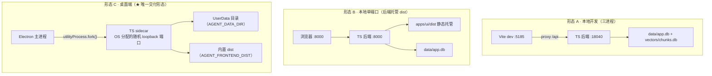

# 部署形态与端口矩阵

> - **依据代码**：`apps/desktop/src/main/backend.ts`、`apps/desktop/src/main/paths.ts`、`apps/server/src/main.ts`、`apps/server/src/shared/config.ts`、`apps/server/src/http/bootstrap.ts`、`apps/server/src/http/static.ts`、`scripts/build-desktop.mjs`、`apps/desktop/electron-builder.yml`、`deploy/README.md`
> - **整理日期**：2026-11-01（**单运行时改造后重写**）
> - **对应基线**：commit `0c12024` + 工作区未提交改动
> - **相关篇目**：`01` 架构总览 ｜ `03` 编排设计 ｜ `05` 接口总览 ｜ `10` 可观测 ｜ `15` 目标形态与实现状态

---

# 第一部分 现状事实

## 一、三种运行形态（Web / Docker 形态**已退场**）



| 形态 | 入口 | 后端 | 前端 | 数据 | 状态 |
|---|---|---|---|---|---|
| **A 本地开发** | `http://127.0.0.1:5185` | `node dist/main.js`（`AGENT_PORT=18040`） | Vite dev server | 仓库根 `data/` | ✅ 保留 |
| **B 本地单端口** | `http://127.0.0.1:8000/` | `node dist/main.js`（`:8000`） | 后端托管 `apps/ui/dist` | 仓库根 `data/` | ✅ 保留 |
| **C 桌面端** | Electron 窗口 | **sidecar 子进程**（`utilityProcess.fork`） | 内嵌 `apps/ui/dist` | `AGENT_DATA_DIR`（UserData） | ✅ **唯一交付形态** |
| ~~Web 形态~~ | 浏览器直连 `:8000` + CORS + API Key | 同 B | 同 B | 同 B | ❌ **已退场**（design/16 §9.1） |
| ~~Docker Compose~~ | `http://<host>:8080/` | `backend:8000` 容器 | `web` 容器（nginx） | named volume | ❌ **已退场** |

### 已退场形态的删除清单

| 删除项 | 原因 |
| --- | --- |
| `docker-compose.yml` · `deploy/docker-compose.milvus.yml` | Docker 形态退场（design/16 §9.1） |
| `deploy/{frontend,backend,nginx}/` | 同上 |
| `backend/Dockerfile` | 同上（**已删除**） |
| `deploy/部署文件分析与操作手册.md` | 由 `deploy/README.md`（**发布手册**）取代 |
| `api_key_guard`（API Key 鉴权） | Web 形态退场 → 桌面端用「Host 白名单 + 会话令牌」 |
| CORS 中间件 | 桌面端**同源**（渲染进程走本地 HTTP），无需跨域 |
| `milvus-lite` 容器 | 向量层改为本地 SQLite + BM25 混合检索 |

> **收益**：安装包不再携带 portable Python（**-987MB**）；后端产物 **104.7MB**。

## 二、形态 B 的启用条件

后端只有在 `apps/ui/dist` **存在**时才注册静态托管路由（`apps/server/src/http/static.ts`）：

```ts
// apps/server/src/http/static.ts
if (!fs.existsSync(distRoot)) return;      // 目录不存在 → 不注册
app.get("/assets/*", ...)                   // 带长缓存（immutable）
app.get("/", ...)                           // → index.html
app.get("/*", ...)                          // → SPA 回退（带**路径穿越防护**）
```

`apps/ui/dist` 未生成时（需先 `node scripts/ui/build-frontend.mjs`），`GET /` 返回引导 JSON。

> ⚠️ **路径穿越防护**：`resolveStaticTarget()` 用 `path.resolve` + **前缀判定**
> 确认目标仍落在 dist 根内，否则一律回退 `index.html`（防 `../../etc/passwd`）。

## 三、形态 C（桌面端）的关键差异

桌面端不是「形态 B 换个壳」，而是**一套独立的环境变量契约**（由壳注入 sidecar）：

| 环境变量 | 值 | 作用 |
|---|---|---|
| `AGENT_DESKTOP` | `1` | 开启桌面守卫（Host 白名单 + 会话令牌） |
| `AGENT_DESKTOP_TOKEN` | 32 字节随机 | 常驻会话令牌（**永不出现在 URL**） |
| `AGENT_DESKTOP_BOOTSTRAP_NONCE` | 32 字节随机 | 一次性引导 nonce（用后即作废） |
| `AGENT_DATA_DIR` | `<userData>/data` | 可写数据根（数据库 / 日志 / 产物 / 向量） |
| `AGENT_FRONTEND_DIST` | `<resources>/frontend` | 内置前端产物 |
| `AGENT_SKILLS_DIR` | `<resources>/skills` | 内置 Skill（只读） |

### 端口与握手

| 项 | 值 | 来源 |
|---|---| --- | --- |
| 端口 | **OS 分配的随机 loopback 端口** | `app.listen({host:"127.0.0.1", port:0})` |
| 握手行 | `AGENT_DESKTOP_READY {json}` | sidecar **stdout 的唯一一行** |
| 握手载荷 | `{protocol, port, pid, data_dir, workspace_dir, app_version, backend_version, started_at}` | 不含令牌 |
| 端口回写 | `settings.port` 被覆写为真实端口 | 供 Host 白名单校验 |

> **无 TOCTOU 竞态**：端口由 OS 分配（`port: 0`），不「先探端口再绑定」。

### 会话与守卫

| 机制 | 生效条件 | 说明 |
|---|---|---|
| **Host 白名单** | 恒定 | 只接受 `127.0.0.1` / `localhost` 且**端口等于本进程端口** → 否则 `421` |
| **一次性 nonce** | `GET /__desktop/bootstrap?t=<nonce>` | 校验通过即作废 → 下发 `HttpOnly` + `SameSite=Strict` Cookie → `302` 回 `/` |
| **常驻令牌** | `X-Agent-Desktop-Token` header | 供壳自身的 Node 侧请求使用；**永不出现在 URL** |
| **会话 Cookie** | `agent_desktop_session` | 8 小时 TTL；fail-closed（签发时间缺失即视为过期） |

## 四、端口矩阵

| 端口 | 进程 | 形态 | 绑定 | 用途 |
|---|---|---|---|---|
| `5185` | Vite dev | A | `127.0.0.1` | 前端 dev server（proxy `/api` → 18040） |
| `18040` | TS 后端 | A | `127.0.0.1` | 开发态固定端口（`AGENT_PORT`） |
| `8000` | TS 后端 | B | `127.0.0.1` | 单端口演示（后端托管前端产物） |
| **随机** | TS sidecar | C | `127.0.0.1` | 桌面端（OS 分配，握手告知壳） |
| ~~8000（对外）~~ | ~~nginx~~ | ~~C~~ | ~~`0.0.0.0`~~ | ❌ Web/Docker 形态已退场 |

> **绑定策略**：全部形态**只绑 `127.0.0.1`**。Web 形态退场后**不再有对外暴露面**，
> 也不再需要 API Key 鉴权与 CORS。

---

# 第二部分 实测证据（2026-11-01）

| # | 检查 | 结果 |
| --- | --- | --- |
| 1 | 开发态三进程（Vite 5185 / 后端 18040 / Electron） | ✅ 正常 |
| 2 | 形态 B：后端托管 `apps/ui/dist`，`GET /` → 200 `text/html` | ✅ |
| 3 | 形态 C：Electron → `utilityProcess.fork` → 握手成功 | ✅ `run-state.json` 写入 `pid`/`port`/`exe` |
| 4 | 形态 C：首次启动建库 | ✅ 23 表（22 业务表 + `__migrations`） |
| 5 | 形态 C：无会话访问 `/api/v1/health` | ✅ `401 E_AUTH` |
| 6 | 形态 C：非法 `Host` 头 | ✅ `421` |
| 7 | 形态 C：错误引导 nonce | ✅ `401`（一次性 nonce 生效） |
| 8 | 安装包（macOS arm64）实机启动 → 建库 → 冒烟 | ✅ 38/38 |
| 9 | 安装包体积 | ✅ dmg 125.4MB / 后端产物 104.7MB（预算 120MB） |

> 证据归档：`doc/test-runs/P9-final/raw/package-artifacts.log`、`raw/packaged-acceptance.log`。

---

# 第三部分 结论与待办

| # | 结论 |
| --- | --- |
| 1 | **软件现在只有一个形态**：一个桌面软件（Electron 壳 + 内嵌 TS sidecar）。 |
| 2 | Web / Docker 形态退场后，**不再有对外暴露面**，鉴权简化为「Host 白名单 + 会话令牌」。 |
| 3 | 单一运行时（Node）→ 安装包**不携带** Python 运行时（-987MB）。 |
| 4 | 端口全部 `127.0.0.1`；桌面端端口由 OS 分配，无 TOCTOU 竞态。 |

## 待办

| # | 项 | 状态 |
| --- | --- | --- |
| 1 | Windows / Linux 安装包产出与实机验收 | ⏳ 本轮只产出 macOS（x64 + arm64） |
| 2 | 代码签名与公证（macOS `notarize`） | ⏳ 需开发者证书 |
| 3 | 自动更新通道（`publish` 段） | ⏳ 未配置（启动日志会提示） |
