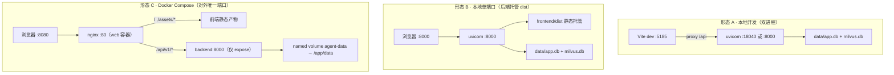

# 部署形态与端口矩阵

> - **依据代码**：`docker-compose.yml`、`deploy/backend/Dockerfile`、`deploy/backend/entrypoint.sh`、`deploy/frontend/Dockerfile`、`deploy/nginx/nginx.conf`、`deploy/nginx/conf.d/agent.conf`、`deploy/docker-compose.milvus.yml`、`backend/app/main.py`、`frontend/scripts/build-frontend.mjs`、`frontend/web/vue-element-plus/vite.config.ts`
> - **资料来源**：2026-10-26 逐文件探查
> - **整理日期**：2026-10-26
> - **对应基线**：commit `c4dac22`
> - **相关篇目**：`01` 架构总览 ｜ `04` 数据层 ｜ `05` 接口 ｜ `10` 可观测 ｜ `deploy/部署文件分析与操作手册.md`

---

# 第一部分 现状事实

## 一、三种部署形态



| 形态 | 入口 | 后端 | 前端 | 数据 | 适用 |
|---|---|---|---|---|---|
| **A 本地开发** | `http://127.0.0.1:5185` | 进程直跑（`uvicorn`） | Vite dev server | 本地 `backend/data/` | 日常开发调试 |
| **B 本地单端口** | `http://127.0.0.1:8000/` | 进程直跑（`:8000`） | 后端托管 `frontend/dist` | 本地 `backend/data/` | 无 Node 环境的演示 |
| **C Docker Compose** | `http://<host>:8080/` | `backend:8000`（容器内，仅 expose） | `web` 容器（nginx:80） | named volume `agent-data` → `/app/data` | **对外提供服务** |

### 形态 B 的启用条件

后端只有在 `frontend/dist` **存在**时才注册静态托管路由（`backend/app/main.py:102-119`）：

```python
if FRONTEND_DIST.exists():
    app.mount("/assets", StaticFiles(directory=str(FRONTEND_DIST / "assets")), name="assets")
    # ... GET / 返回 index.html；GET /{full_path:path} SPA 回退
```

`frontend/dist` 当前**未生成**（需要先 `node frontend/scripts/build-frontend.mjs`），因此此时 `GET /` 返回的是引导 JSON（`main.py:120-129`），形态 B 不可用。

## 二、端口矩阵

| 端口 | 角色 | 协议 | 说明 |
|---|---|---|---|
| **5185** | Vite dev server（形态 A 前端） | HTTP | `vite.config.ts:18` |
| **18040** | Vite proxy 的 `/api` 目标（形态 A 后端应跑在这） | HTTP | `vite.config.ts:22` |
| **8000** | 后端本地默认端口 / 容器内后端端口 | HTTP + SSE | 形态 B 对外 / 形态 C 容器内 |
| **8001** | 后端本地备选端口 | HTTP + SSE | 本机 `8000` 被占用时用（如与 `kaisupport` 容器共存） |
| **8080** | **Docker Compose 对外唯一端口**（`HOST_HTTP_PORT` 可覆盖） | HTTP + SSE | 形态 C |
| **19530** | 独立 Milvus（可选叠加） | gRPC | `deploy/docker-compose.milvus.yml` |
| 5173 | 文档遗留端口 | — | **当前代码不使用**，仅出现在 `frontend/README.md` 与 `smoke.mjs` 的 CORS Origin 里 |

**形态 A 的代理断链风险**：`vite.config.ts:22` 的 proxy 目标是 `http://127.0.0.1:18040`，而 `frontend/README.md` 与 `smoke.mjs` 仍写 `8000`——**开发时必须保证后端跑在 18040**，或修改 `vite.config.ts` 的 target。

## 三、Docker Compose 拓扑

`docker-compose.yml` 定义两个服务（`name: agent`）：

| 服务 | 镜像 | 容器名 | 端口 | 依赖 |
|---|---|---|---|---|
| `backend` | `agent-backend:1.1.0` | `agent-backend` | `expose: 8000`（不对外发布） | — |
| `web` | `agent-web:1.1.0` | `agent-web` | `${HOST_HTTP_PORT:-8080}:80` | `depends_on: backend: service_healthy` |

**关键配置**：

| 项 | 值 |
|---|---|
| `backend.env_file` | `./backend/.env`（密钥由此注入） |
| `backend.environment` | `HOST=0.0.0.0`、`PORT=8000`、`MILVUS_DB_PATH=data/milvus.db`、`MILVUS_COLLECTION=hybrid_demo`、`RESEARCH_OUTPUT_DIR=data/research`、`RUN_INGEST=false`、`TZ=Asia/Shanghai` |
| `backend.volumes` | `backend-data:/app/data`（named volume，名 `agent-data`） |
| `backend.healthcheck` | `python -c "urllib... http://127.0.0.1:8000/api/v1/health"`，interval 30s / start_period 90s / retries 5 |
| `backend.init` | `true`（PID 1 为 tini，回收僵尸子进程——MCP stdio 子进程必需） |
| `web.healthcheck` | `wget -q http://127.0.0.1/nginx-healthz` |
| 日志 | 统一 `json-file`，`max-size: 20m`、`max-file: 5` |

**启动序列**：`web` 等 `backend` 的 healthcheck 通过（`service_healthy`）才启动，因此首启时 `backend` 的迁移 + 服务初始化会先跑完。

### 3.1 可选：独立 Milvus

```bash
docker compose -f docker-compose.yml -f deploy/docker-compose.milvus.yml up -d
docker compose exec backend python -m scripts.ingest_data   # 重新入库
```

`deploy/docker-compose.milvus.yml` 叠加 etcd + minio + milvus（standalone），后端 `MILVUS_DB_PATH` 需改为指向服务地址。

## 四、镜像构建

### 4.1 后端镜像（`deploy/backend/Dockerfile`，python:3.12-slim）

| 层 | 内容 |
|---|---|
| 系统依赖 | Chromium 运行依赖（小红书 MCP Server 用）+ `cmake g++`（编译 chromadb 等 C 扩展）+ `tzdata curl` |
| Python 依赖 | `backend/requirements.txt`（分层：requirements 变更才重建） |
| Playwright | `playwright install chromium` + `install-deps`；可用 `--build-arg INSTALL_PLAYWRIGHT=false` 关闭（小红书 Server 将不可用） |
| 应用代码 | `backend/app/`、`backend/skills/`、`backend/scripts/`、`conftest.py` |
| 数据目录 | 预建 `data/{outputs,uploads,browser_data,pdf,logs,research}` |
| 入口 | `entrypoint.sh`：兜底 mkdir → 可选 `RUN_INGEST=true` 自动入库 → `exec "$@"` |
| CMD | `uvicorn app.main:app --host 0.0.0.0 --port 8000` |
| 健康检查 | Dockerfile 内 `HEALTHCHECK` + Compose 的 healthcheck 同一路径 |

**构建参数**：`PIP_INDEX_URL`（国内可改清华源）、`APT_MIRROR`（国内可改 USTC 源）、`INSTALL_PLAYWRIGHT`、`TARGETARCH`。

### 4.2 前端镜像（`deploy/frontend/Dockerfile`，两段式）

| 阶段 | 基础镜像 | 内容 |
|---|---|---|
| builder | `node:22-alpine` | `npm ci`（先拷 package.json 利用层缓存）→ `npm run build` → `/build/dist` |
| runtime | `nginx:1.27-alpine` | 仅含构建产物 + nginx 配置；非 root 运行；`EXPOSE 80` |

构建对象固定为 `frontend/web/vue-element-plus`（仓库唯一前端实现）。

## 五、Nginx 关键参数（`deploy/nginx/conf.d/agent.conf`）

| 配置 | 值 | 作用 |
|---|---|---|
| `proxy_buffering` | `off` | **SSE 必须**，否则流式输出被缓冲成一次性吐出 |
| `proxy_cache` | `off` | 不缓存 API 响应 |
| `proxy_request_buffering` | `off` | 不缓冲请求体 |
| `chunked_transfer_encoding` | `on` | 分块传输 |
| `gzip` | `off`（`location /api/`） | SSE 不二次压缩 |
| `add_header X-Accel-Buffering "no"` | always | 告诉下游不缓冲 |
| `add_header Cache-Control "no-cache"` | always | — |
| `proxy_connect_timeout` | `10s` | 连接超时 |
| `proxy_send_timeout` / `proxy_read_timeout` | `3600s` | **SSE / 深度研究任务可能长时间无数据** |
| `resolver` | `127.0.0.11 valid=30s ipv6=off` | Docker 内嵌 DNS，backend 容器重建后 IP 变化自动重解析 |
| `location /api/` | `proxy_pass http://$ap_backend$request_uri`，`$ap_backend = backend:8000` | 变量形式 proxy_pass + resolver，容器 IP 变化也能解析 |
| `location ^~ /assets/` | `expires 7d` + `immutable` + `access_log off` | 带 hash 的构建产物长缓存 |
| `location = /index.html` | `no-cache, must-revalidate` | 入口不缓存 |
| `location /` | `try_files $uri $uri/ /index.html` | SPA 路由回退 |
| `location = /nginx-healthz` | `return 200 "ok"` | Nginx 自身健康检查 |
| 额外 | `/docs` `/redoc` `/openapi.json` `/docs-info` 也反代到后端 | 生产可关闭 |

## 六、配置项清单（`backend/.env`）

| 分组 | 变量 | 必填 | 缺失影响 |
|---|---|---|---|
| 主 LLM | `DASHSCOPE_API_KEY` | **是** | `/agent/run` 返回错误事件；`/rag/query` 503；`/agent/chat` 503 |
| 备选 LLM | `LLM_API_KEY`（备选 provider） | 建议 | 主链路默认千问；备选仅供特定分支 |
| Web 回答 | `OPENAI_API_KEY` | Web 链必填 | `/web_research/research` 503 |
| Web 检索 | `SERPER_API_KEY` | Web 链必填 | 同上 |
| Research 检索 | `BOCHA_API_KEY` 或 `SERPER_API_KEY` | Research 链必填 | `POST /research` 返回 200 + `status="failed"` |
| Milvus | `MILVUS_DB_PATH` | 否（默认 `data/milvus.db`） | — |
| 调度 | `SCHEDULER_ENABLED`（默认 true）、`SCHEDULE_LEASE_TTL`（60）、`SCHEDULE_LEASE_RENEW`（20） | 否 | 禁用时调度器只读 |
| 会话 | `SESSION_HISTORY_LIMIT`（10）、`SESSION_HISTORY_MAX_CHARS`（8000） | 否 | — |
| 执行 | `EXEC_TIMEOUT`（180 s）、`MAX_TOKENS`（8192） | 否 | — |
| 模型 | `DEFAULT_MODEL`（qwen-plus）、`PLAN_MODEL`（deepseek-chat）、`RAG_MODEL`（deepseek-chat）、`ANSWER_MODEL`（deepseek-reasoner） | 否 | — |

> `backend/.env.example` 是模板；`docker-compose.yml` 通过 `env_file: ./backend/.env` 注入。

## 七、数据与迁移

| 项 | 位置 | 备份/迁移方式 |
|---|---|---|
| SQLite | 容器内 `/app/data/app.db`（named volume `agent-data`） | `sqlite3 data/app.db "VACUUM INTO 'backup.db'"` 或整卷备份 |
| Milvus Lite | `/app/data/milvus.db`（同卷） | 文件拷贝 |
| 研究报告 | `/app/data/research/` | 文件拷贝 |
| Skill / 产出 / 上传 | `/app/data/{skills_custom,outputs,uploads,pdf}/` | 文件拷贝 |
| Schema 迁移 | Alembic，启动时自动 `upgrade head` | **失败即中止启动**（`main.py:39-43`） |

**SQLite 备份注意**：WAL 模式下需先 `PRAGMA wal_checkpoint(TRUNCATE)` 或用 `VACUUM INTO`（在线安全拷贝），直接 `cp app.db` 可能拷到不完整的 WAL 状态。

## 八、实测口径

| 环境 | 启动命令 | 备注 |
|---|---|---|
| Windows 本地后端 | `cd backend && .venv/Scripts/python.exe -m uvicorn app.main:app --host 127.0.0.1 --port 8001` | **不用 `--reload`**（改代码需手动重启）；8001 避开本机 8000 占用 |
| Windows 本地前端 | `cd frontend/web/vue-element-plus && npm run dev` | dev 端口 5185，proxy 需指向实际后端端口 |
| 容器 | `docker compose build && docker compose up -d` | 访问 `http://<host>:8080/` |
| RAG 入库（容器） | `docker compose exec backend python -m scripts.ingest_data` | 需 PDF + `DASHSCOPE_API_KEY` |
| 全量接口测试 | `cd backend && .venv/Scripts/python.exe -m scripts.api_full_test http://127.0.0.1:8001` | 132 用例（若该脚本存在） |

---

# 第二部分 原理剖析

## 九、为什么对外只暴露一个端口

三种形态的取舍：

| 形态 | 端口数 | 优点 | 代价 |
|---|---|---|---|
| 前后端分离（Vite + uvicorn 各自对外） | 2 | 开发热更新快 | 部署需配反代/CORS；对外暴露面大 |
| **单端口**（后端托管 dist / Nginx 统一入口） | **1** | 对外只有一个入口；无 CORS 问题；部署简单 | 开发时改前端需重新 build |
| 网关 + 多服务 | N | 可水平扩展 | 需要 API 网关与发现机制 |

本项目是**单机部署的整合平台**，不是微服务，因此选单端口：

- 开发态用形态 A（双进程，热更新）；
- 生产态用形态 B（纯 Python 环境）或形态 C（容器）。

单端口模式的关键是 **SPA 路由回退**：前端 `createWebHistory` 产生的 `/admin/schedules` 这类路径，刷新时后端/Nginx 必须回 `index.html` 而不是 404。两套实现分别在 `main.py:109-119`（后端）与 `agent.conf` 的 `location /`（Nginx）。

## 十、为什么 SSE 需要 `proxy_buffering off`

SSE 的流式体验依赖**事件到达即送达**。Nginx 默认会缓冲上游响应，攒够一定量（或上游关闭）才发给客户端——这会把「持续 30 秒逐条推送的事件流」变成「30 秒后一次性收到 30 条」。

`proxy_buffering off` 让 Nginx 收到上游的每个 chunk 就立即转发。配套的 `X-Accel-Buffering: no` 是给更下游（如 CDN）的同样指令。`proxy_read_timeout 3600s` 是为了 SSE / Deep Research 这种**长时间无数据但连接不能断**的场景——默认 60s 会在静默 1 分钟后切断连接。

## 十一、为什么用变量形式的 `proxy_pass` + resolver

`proxy_pass http://backend:8000` 是**静态解析**——Nginx 启动时解析一次 `backend` 的 IP 并缓存。backend 容器重建后 IP 变化，Nginx 仍指向旧 IP，导致 502。

`set $ap_backend backend:8000; proxy_pass http://$ap_backend$request_uri;` 配合 `resolver 127.0.0.11 valid=30s`，把域名解析从「启动时一次」改为「每次请求时按 30s TTL 重新解析」，backend 容器重建后自动跟随新 IP。这是 Docker Compose 环境下 Nginx 反代的推荐写法。

## 十二、为什么后端容器要 `init: true`

MCP 工具调用通过 `subprocess` 拉起 Python 子进程（`mcp_manager.py:145-168`）。这些子进程是**容器 PID 1（uvicorn）的子进程**。若 PID 1 是 uvicorn 本身，子进程退出后成为僵尸进程，需 PID 1 调 `wait()` 回收——uvicorn 不主动做这个。

`init: true` 让容器 PID 1 变成 `tini`（一个微型 init），负责回收所有子进程、转发信号。没有它，高频 MCP 调用会累积僵尸进程直到耗尽 PID 空间。

---

# 第三部分 已知边界与观察

| 编号 | 观察 | 证据 | 指向 |
|---|---|---|---|
| S-09-01 | 形态 A 的 Vite proxy 目标 `18040` 与文档/README 写的 `8000` 不一致，开发时易连不上 | `frontend/web/vue-element-plus/vite.config.ts:22`；`frontend/README.md:28,33` | `12` D-1 |
| S-09-02 | 无 HTTPS/TLS 终结，全部走 HTTP；`/docs` `/redoc` `/openapi.json` 默认对公网开放 | `deploy/nginx/conf.d/agent.conf` | `12` §3 |
| S-09-03 | 健康检查只查 `/api/v1/health`（含 Milvus/MCP 等非关键依赖），Milvus 不可用时可能误判容器不健康 | `docker-compose.yml`；`backend/app/api/v1/system.py` | `12` §2 |
| S-09-04 | `backend/.env` 明文存密钥，compose 通过 `env_file` 注入；无密钥管理（Vault/KMS） | `docker-compose.yml` | `12` §3 |
| S-09-05 | 单副本设计：`backend` 与 `web` 都是单容器，无副本数配置；调度租约支持多副本但部署未启用 | `docker-compose.yml` | `11` §3 |
| S-09-06 | `agent-data` 卷包含 Milvus Lite 文件库，多副本挂载同一卷会因 SQLite/Milvus 文件锁冲突 | `docker-compose.yml` | `11` §2 |
| S-09-07 | `RUN_INGEST=true` 的自动入库在每次启动都会执行（无「已入库」标记），重复启动会重复入库（叠加 Milvus 不去重） | `deploy/backend/entrypoint.sh` | `12` D-34 |
| S-09-08 | 无 K8s / Helm 资产（已于 2026-10-18 移除 CI/CD 与 K8s 工程）；`doc/README.md` 历史曾提及 `deployment/` 目录，现部署文档在 `deploy/` | `deploy/` 实测 | — |

---

# 第四部分 改进指向

| 优先级 | 事项 | 台账编号 |
|---|---|---|
| **P0** | 修 `vite.config.ts` proxy 目标或修 README，消除 18040/8000 不一致 | D-1 |
| **P0** | 生产部署加 HTTPS（前置 Caddy/Traefik 或云 LB）并关闭 `/docs` 公网暴露 | `12` §3 |
| **P1** | 健康检查拆 `liveness`（仅进程活）与 `readiness`（依赖就绪）两个探针 | `12` §2 |
| **P1** | 密钥改用环境注入或密钥管理（不落地 `backend/.env` 明文） | `12` §3 |
| **P2** | `RUN_INGEST` 加「已入库」标记（如写 `data/.ingest_done`），避免重复启动重复入库 | D-34 |
| **P2** | 提供多副本部署的覆盖文件（前提：调度租约 + Milvus Standalone + 鉴权） | `11` §3 |

---

# 第五部分 核对方式

```bash
cd /c/workspace/project/agent-platform

# 1. 端口矩阵
grep -n "port\|target" frontend/web/vue-element-plus/vite.config.ts
grep -n "HOST_HTTP_PORT\|8080\|8000" docker-compose.yml

# 2. Compose 服务与依赖
grep -n "depends_on\|service_healthy\|expose\|ports:" docker-compose.yml

# 3. Nginx SSE 参数
grep -n "proxy_buffering\|proxy_read_timeout\|X-Accel-Buffering\|resolver" deploy/nginx/conf.d/agent.conf

# 4. 后端单端口托管条件
grep -n "FRONTEND_DIST.exists\|StaticFiles\|spa_fallback" backend/app/main.py

# 5. 镜像构建参数
grep -n "ARG " deploy/backend/Dockerfile deploy/frontend/Dockerfile

# 6. init / tini
grep -n "init:" docker-compose.yml
```

---

## 附录 A：可选前置反代（形态参考）

如需 HTTPS 或域名接入，可在 Nginx 前再套一层 TLS 终结（Caddy / Traefik / 云负载均衡均可）。**本仓库无此类资产**——`deploy/` 只含 Dockerfile、nginx、compose；如需，自行添加一层反向代理，把 443 → `web:80` 即可。历史文档曾给过 Caddy 示例，仅作形态参考，非现役方案。
