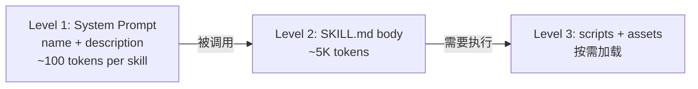

# Skill 注册表与四级 Skill 设计（扩充版）

> - **整理日期**：2026-09-15（首发 2026-09-15 扩充）
> - **依据项目**：`apps/agent/skills/`（6 Skill：pdf/data-analysis/frontend-design/marketing-materials/ralph-loop/skill-creator）+ `services/skill_manager.py`
> - **资料来源**：Anthropic Claude Skills 官方文档 + Claude Code Skills 设计 + AutoGen Skills + LangChain Tools + CrewAI Tools

---

# 第一章 原理

## 1.1 Skill 是什么

在 Agent 系统中，**Skill = 一个有特定用途的可调用单元**，含：

- 元数据（name、description、触发条件）
- 可选资源（scripts / assets / references）
- 指令文件（SKILL.md）

| 维度 | Function Call | Tool | Skill |
|------|---------------|------|-------|
| **粒度** | 单个函数 | 工具调用封装 | 完整工作流（含多步、含资源） |
| **资源** | 无 | 无 | scripts / assets / references |
| **面向** | 程序员 | 程序员/LLM | LLM（系统提示驱动） |
| **参考** | OpenAI | LangChain | Anthropic Skills |

## 1.2 四级 Skill 复杂度（业界参考）

| 级别 | 描述 | 适用 | 示例 |
|------|------|------|------|
| **L1 纯函数** | 一个 Python 函数 | 简单工具 | `get_weather()` |
| **L2 有状态** | 持有上下文/历史 | 多轮对话辅助 | 当前会话计数器 |
| **L3 异步** | 异步 I/O | 远程 API 调用 | DashScope Embedding |
| **L4 沙箱** | 受限执行环境 | 代码执行 | E2B sandbox / Docker |

## 1.3 渐进式披露（Progressive Disclosure）

Anthropic Skills 的核心设计：



**优势**：6 Skill 同时启用时 system prompt 仅 ~600 tokens，而不是全文加载。

---

# 第二章 工程实现（agent）

## 2.1 Skill 目录结构（实测）

```
skills/
├── pdf/                    # Skill 1
│   ├── SKILL.md            # 系统提示 + 工作流说明
│   ├── forms.md            # PDF forms 专题
│   ├── reference.md
│   ├── scripts/            # 8 个 Python 脚本
│   └── LICENSE.txt
├── data-analysis/          # Skill 2
├── frontend-design/        # Skill 3
├── marketing-materials/    # Skill 4
├── ralph-loop/             # Skill 5
└── skill-creator/          # Skill 6（meta skill）
    ├── SKILL.md
    ├── scripts/            # 10 个评估与打包脚本
    ├── agents/
    ├── references/
    ├── assets/
    ├── eval-viewer/
    └── LICENSE.txt
```

### 2.1.1 6 Skill 详解

| Skill | 功能 | 关键文件 |
|-------|------|---------|
| **skill-creator** | 元 Skill：创建/迭代/优化其他 Skill | `SKILL.md` + `scripts/` (10 .py) + `agents/` + `eval-viewer/` |
| **pdf** | PDF 处理工具集（读/合并/拆分/旋转/水印/加密/OCR） | `SKILL.md` + `scripts/` (8 .py) + `forms.md` + `reference.md` |
| **frontend-design** | 高质量前端界面（避免「AI slop」美学） | `SKILL.md` |
| **ralph-loop** | Ralph Wiggum 风格 AI 编程循环（PLANNING/BUILDING） | `SKILL.md` |
| **data-analysis** | 数据分析 Skill | `SKILL.md` |
| **marketing-materials** | 营销物料 Skill | `SKILL.md` |

## 2.2 SKILL.md 标准结构

```markdown
---
name: pdf
description: PDF 处理工具集（合并、拆分、旋转、水印、加密、OCR）。当用户需要处理 PDF 文件时使用。
---

# PDF Skill

## 工作流程
1. 检测 PDF 类型（普通 / 扫描 / 加密）
2. 选择工具
3. 执行并返回结果

## 工具列表
- extract_text: 从 PDF 提取文本
- merge_pdfs: 合并多个 PDF
- split_pdf: 按页拆分
...

## 注意事项
- 大文件需用流式处理
- 加密 PDF 需先解密
```

## 2.3 SkillManager 实现

```python
# services/skill_manager.py
class SkillManager:
    """6 Skill 注册表"""
    
    def __init__(self, skills_dir: Path):
        self.skills_dir = skills_dir
        self.skills: dict[str, Skill] = {}
        self.load_all()
    
    def load_all(self):
        """扫描 skills_dir 下每个子目录的 SKILL.md"""
        for path in self.skills_dir.iterdir():
            if path.is_dir() and (path / "SKILL.md").exists():
                self.skills[path.name] = self._parse_skill(path)
    
    def list_skills(self) -> list[dict]:
        """返回 metadata 列表（轻量）"""
        return [
            {"name": s.name, "description": s.description}
            for s in self.skills.values()
        ]
    
    def get_skill(self, name: str) -> Skill | None:
        return self.skills.get(name)
    
    def build_system_prompt(self, selected_skills: list[str]) -> str:
        """构造 system prompt 第一级披露"""
        parts = [BASE_SYSTEM_PROMPT]
        for name in selected_skills:
            skill = self.skills.get(name)
            if skill:
                parts.append(f"## Skill: {skill.name}\n{skill.frontmatter}")
        return "\n\n".join(parts)
    
    def invoke_skill(self, name: str, tool: str, args: dict) -> dict:
        """调用 skill 内具体工具"""
        skill = self.skills[name]
        return skill.execute_tool(tool, args)
    
    def get_skill_files(self, name: str, path: str) -> Path | None:
        """安全获取 skill 内文件（防止路径穿越）"""
        skill = self.skills[name]
        target = (skill.path / path).resolve()
        # ★ 防止 ../../core/config.py 类攻击
        if not str(target).startswith(str(skill.path.resolve())):
            raise ValueError("路径穿越检测")
        return target if target.exists() else None
```

## 2.4 渐进式披露实现

```python
# services/skill_manager.py
def build_system_prompt(self, selected_skills: list[str]) -> str:
    """★ 第一级披露：仅 metadata"""
    parts = []
    for name in selected_skills:
        skill = self.skills.get(name)
        if skill:
            # 仅加载 SKILL.md 的 YAML frontmatter（~100 tokens）
            parts.append(f"## Skill: {skill.name}\n{skill.frontmatter}")
    
    return "\n\n".join(parts)

def load_skill_body(self, name: str) -> str:
    """★ 第二级披露：完整 SKILL.md body（被调用时按需加载）"""
    skill = self.skills[name]
    return skill.full_md

def load_skill_resource(self, name: str, resource_path: str) -> bytes:
    """★ 第三级披露：scripts / assets（执行时按需加载）"""
    return self.get_skill_files(name, resource_path).read_bytes()
```

**token 对比**：

| 模式 | token |
|------|-------|
| 全部 6 Skill 全文加载 | ~30,000 |
| 仅 metadata（默认） | ~600 |
| + 1 Skill 全文 | ~5,600 |
| + scripts 按需 | 视具体 |

## 2.5 API 端点

```python
# api/v1/skills.py
@router.get("/", response_model=list[SkillInfo])
async def list_skills():
    """列出所有 Skill（轻量 metadata）"""
    return skill_manager.list_skills()

@router.get("/{name}", response_model=SkillDetail)
async def get_skill(name: str):
    """获取 Skill 详情（含 frontmatter）"""
    skill = skill_manager.get_skill(name)
    return skill

@router.post("/reload")
async def reload_skills():
    """★ 热加载（无需重启）"""
    skill_manager.load_all()
    return {"success": True, "count": len(skill_manager.skills)}

@router.post("/{name}/validate")
async def validate_skill(name: str):
    """校验 Skill 完整性"""
    skill = skill_manager.get_skill(name)
    return skill.validate()

@router.get("/{name}/files/{path:path}")
async def get_skill_file(name: str, path: str):
    """★ 安全获取 Skill 内文件（路径穿越防护）"""
    return FileResponse(skill_manager.get_skill_files(name, path))
```

---

# 第三章 业界做法调研

## 3.1 Skill 框架横向对比

| 方案 | 来源 | 范式 | 资源加载 |
|------|------|------|---------|
| **Anthropic Claude Skills** | https://docs.anthropic.com/en/docs/build-with-claude/skills | 渐进式披露；frontmatter YAML | 按需 |
| **Claude Code Skills** | https://docs.claude.com/en/docs/claude-code/skills | Slash 命令触发；本地 SKILL.md | 按需 |
| **AutoGen Skills** | https://microsoft.github.io/autogen/ | 编程式注册 | 一次性 |
| **LangChain Tools** | https://python.langchain.com/docs/concepts/tools/ | `@tool` 装饰器；简单 | 无 |
| **CrewAI Tools** | https://docs.crewai.com/concepts/tools | BaseTool 子类；中等 | 无 |
| **OpenAI Agents SDK** | https://platform.openai.com/docs/agents | function calling | 无 |
| **本项目 Skill** | 自研 | SKILL.md + 渐进式披露 | 按需 |

### 3.1.1 Anthropic Skills vs Claude Code Skills

| 维度 | Anthropic Skills（API） | Claude Code Skills（CLI） |
|------|----------------------|----------------------|
| **触发** | LLM 自动判断 | 用户 slash 命令 + LLM |
| **格式** | YAML + Markdown | SKILL.md 文件 |
| **部署** | API 内嵌 | 本地文件 |
| **作用域** | 单次对话 | 整个会话 |
| **资源** | 内联 | 文件系统 |

## 3.2 渐进式披露的最佳实践

```yaml
# 好的 frontmatter（~100 tokens）
---
name: pdf
description: 处理 PDF 文件（合并、拆分、OCR、加密）。当用户需要 PDF 操作时调用。
---

# 详细指令（按需加载，~5K tokens）
- 工具列表 + 用法
- 工作流示例
- 边界情况
- 错误处理
```

---

# 第四章 操作步骤

## 4.1 P1-1：Skill 热加载

```python
# api/v1/skills.py
@router.post("/reload")
async def reload_skills():
    """★ 无需重启即可加载新 Skill"""
    skill_manager.load_all()
    return {"success": True, "count": len(skill_manager.skills)}
```

## 4.2 P1-2：路径穿越防护

```python
# services/skill_manager.py
def get_skill_files(self, name: str, path: str) -> Path | None:
    target = (self.skills[name].path / path).resolve()
    # ★ 防止 ../../core/config.py 类攻击
    if not str(target).startswith(str(self.skills[name].path.resolve())):
        raise ValueError("路径穿越检测")
    return target if target.exists() else None
```

## 4.3 P1-3：Skill 版本控制

```python
class Skill:
    def __init__(self, path: Path):
        self.path = path
        self.name = path.name
        self.frontmatter = self._parse_frontmatter(path / "SKILL.md")
        self.version = self.frontmatter.get("version", "1.0.0")
        self.description = self.frontmatter.get("description", "")
```

## 4.4 P2-1：Skill 远程仓库

```python
# 类似 git submodule：每个 Skill 一个 git 仓库
class SkillMarketplace:
    """远程 Skill 注册表"""
    
    async def install(self, skill_name: str, repo_url: str):
        """从 git 仓库安装 Skill"""
        subprocess.run(["git", "clone", repo_url, f"skills/{skill_name}"])
        skill_manager.load_all()
    
    async def search(self, query: str) -> list[dict]:
        """搜索远程 Skill"""
        return await remote_api.get(f"/skills/search?q={query}")
```

## 4.5 P2-2：Skill 自动评估

```python
# skill-creator Skill 自带评估（eval-viewer/）
class SkillEvaluator:
    """Skill 评估"""
    
    async def evaluate(self, skill_name: str, test_cases: list[dict]):
        results = []
        for case in test_cases:
            result = await skill_manager.invoke_skill(
                skill_name, case["tool"], case["args"]
            )
            passed = self._verify(result, case["expected"])
            results.append({"case": case, "passed": passed, "result": result})
        
        return {
            "skill": skill_name,
            "total": len(test_cases),
            "passed": sum(r["passed"] for r in results),
            "pass_rate": sum(r["passed"] for r in results) / len(test_cases),
        }
```

---

## 附录 A：参考文献

| # | 类型 | 标题 | 来源 | 访问日期 |
|---|------|------|------|----------|
| [1] | 官方文档 | Anthropic Skills | https://docs.anthropic.com/en/docs/build-with-claude/skills | 2026-09-15 |
| [2] | 官方文档 | Claude Code Skills | https://docs.claude.com/en/docs/claude-code/skills | 2026-09-15 |
| [3] | 官方文档 | Anthropic Skills 渐进式披露 | https://docs.anthropic.com/en/docs/build-with-claude/skills#how-skills-work | 2026-09-15 |
| [4] | OSS 项目 | AutoGen | https://github.com/microsoft/autogen | 2026-09-15 |
| [5] | 官方文档 | LangChain Tools | https://python.langchain.com/docs/concepts/tools/ | 2026-09-15 |
| [6] | 官方文档 | CrewAI Tools | https://docs.crewai.com/concepts/tools | 2026-09-15 |
| [7] | 官方文档 | OpenAI Agents SDK | https://platform.openai.com/docs/agents | 2026-09-15 |
| [8] | 同源文档 | `apps/agent/skills/skill-creator/` | 元 Skill | 2026-09-15 |
| [9] | 同源文档 | `apps/industry-research/doc/knowledge/01_企业级JWT认证与多租户隔离.md` | 跨项目参考 | 2026-09-15 |

---

> **本文档结构遵循「五段式」**：当前实现 → 原理剖析 → 业界做法调研 → 操作步骤 → 参考文献附录。
