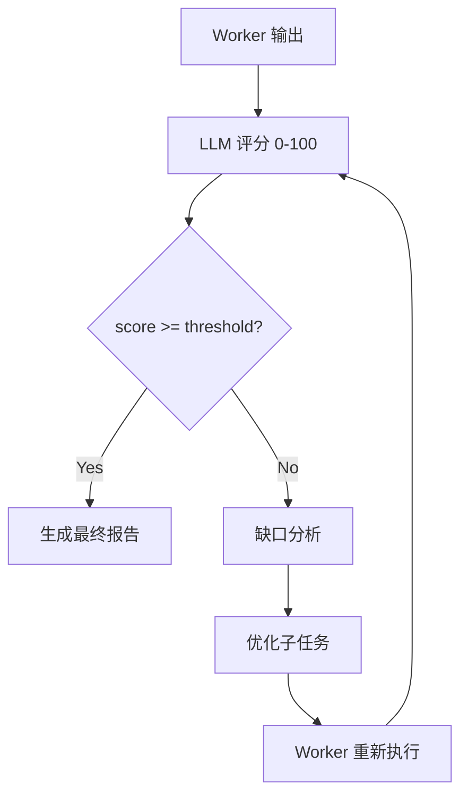

# 质量评分迭代与任务持久化（扩充版）

> - **整理日期**：2026-09-15（首发 2026-09-15 扩充）
> - **依据项目**：`apps/agent-platform/backend/app/services/research/` + `config.py`
> - **资料来源**：Anthropic Agent 评估博客 + Self-Refine 论文 + Reflexion 论文 + CrewAI/AutoGen 状态管理 + asyncio + aiosqlite

---

# 第一章 质量评分迭代

## 1.1 为什么要评分

普通多 Agent 系统的常见问题：

- ❌ Worker 输出质量参差
- ❌ 最终报告只是简单拼接
- ❌ 无法判断「是否够好」

**评分机制**：让另一个 LLM（Orchestrator）评估 Worker 输出，给出 0-100 分；未达标则触发补充检索。

## 1.2 评分流程



## 1.3 评分 Prompt 设计

```python
SCORE_PROMPT = """你是研究质量评估专家。

## 评估维度（权重）
1. 完整性 (40%)：覆盖任务的所有方面
2. 准确性 (30%)：数据/事实可信，引用完整
3. 时效性 (15%)：信息是否最新
4. 深度 (15%)：是否有洞察而非简单拼接

## 输入
任务: {task}
研究发现: {findings}

## 输出格式（JSON）
{{
  "score": 0-100,
  "completeness": 0-100,
  "accuracy": 0-100,
  "freshness": 0-100,
  "depth": 0-100,
  "gaps": ["具体缺失的方面1", "方面2"],
  "suggestion": "改进建议"
}}
"""
```

## 1.4 实现要点

```python
async def score(task: str, findings: List[str]) -> Dict:
    """评估 Worker 输出"""
    prompt = SCORE_PROMPT.format(task=task, findings="\n".join(findings))
    result = await llm_call(prompt, response_format={"type": "json_object"})
    return json.loads(result)
```

## 1.5 收益递减检测

```python
async def should_iterate(score_history: list[float]) -> bool:
    """避免无限迭代"""
    if len(score_history) < 2:
        return True
    delta = score_history[-1] - score_history[-2]
    return delta > 2  # 至少提升 2 分才继续
```

**避免「无限迭代」的关键设计**：
- 最大迭代次数（`max_iterations=3`）
- 收益递减检测（delta < 2 停止）
- 阈值达标（score >= threshold 停止）

---

# 第二章 任务持久化

## 2.1 当前方案：JSON 文件

```python
# config.py
research_output_dir: str = "data/research"
research_persist: bool = True
```

**结构**：

```json
// data/research/tasks.json
{
  "tasks": {
    "abc12345": {
      "task_id": "abc12345",
      "original_task": "2026 新能源汽车市场竞争格局",
      "status": "completed",
      "config": {
        "max_workers": 4,
        "max_iterations": 3,
        "quality_threshold": 80
      },
      "progress": [...],
      "progress_summary": {},
      "created_at": "2026-09-15T10:00:00",
      "started_at": "2026-09-15T10:00:01",
      "completed_at": "2026-09-15T10:05:23",
      "report_path": "data/research/abc12345/report_20260915_100523.md",
      "score": 87
    }
  },
  "updated_at": "2026-09-15T10:05:23"
}
```

**目录结构**：

```
data/research/
├── tasks.json                  # 任务记录（重启恢复）
└── <task_id>/
    ├── report_YYYYmmdd_HHMMSS.md
    └── meta_YYYYmmdd_HHMMSS.json
```

## 2.2 优缺点

| 维度 | 评估 |
|------|------|
| **优点** | 简单；人类可读；零依赖；调试方便 |
| **缺点** | 无事务；并发写有竞态；查询能力弱 |

## 2.3 并发保护

```python
import asyncio
import threading

class TaskStore:
    def __init__(self, path):
        self.path = path
        self._lock = threading.Lock()  # ★ 写锁
    
    def update(self, task_id: str, **kwargs):
        with self._lock:
            data = self._load()
            data["tasks"][task_id].update(kwargs)
            self._save(data)
    
    def _load(self):
        return json.loads(self.path.read_text())
    
    def _save(self, data):
        # ★ 原子写：先写临时文件再 rename
        tmp = self.path.with_suffix(".tmp")
        tmp.write_text(json.dumps(data, ensure_ascii=False, indent=2))
        tmp.rename(self.path)
```

## 2.4 重启恢复（核心特性）

```python
# services/research/research_manager.py
TERMINAL_STATES = {"completed", "failed"}

def _load_tasks(self):
    """启动时恢复历史任务（运行中的标记为中断）"""
    if not self.persist or not self._tasks_file.exists():
        return
    try:
        data = json.loads(self._tasks_file.read_text())
        for task in data.get("tasks", []):
            if task.get("status") not in TERMINAL_STATES:
                task["status"] = "failed"
                task["error"] = task.get("error") or "服务重启，任务已中断"
            self.tasks[task["task_id"]] = task
        logger.info("已恢复 %d 个研究任务记录", len(self.tasks))
    except Exception as exc:
        logger.warning("研究任务记录恢复失败: %s", exc)


def shutdown(self):
    """优雅关闭（lifespan 调用）"""
    self.executor.shutdown(wait=True)
```

**恢复语义**：
- ✅ `completed` / `failed`：保留
- ⚠️ `running` → `failed`：标记中断
- ✅ 新任务正常执行

---

# 第三章 业界做法调研

## 3.1 持久化方案对比

| 方案 | 来源 | 特点 | 适用 |
|------|------|------|------|
| **JSON 文件**（本项目） | — | 简单；零依赖 | POC/小型 |
| **SQLite + aiosqlite** | https://github.com/omnilib/aiosqlite | 强类型；事务 | 单机生产 |
| **PostgreSQL + asyncpg** | 通用 | 生产级；多副本 | 大型 |
| **Redis + AOF** | https://redis.io/ | 高性能；过期清理 | 高频 |
| **DuckDB** | https://duckdb.org/ | 列式；分析查询 | 离线分析 |
| **SQLite + WAL** | https://www.sqlite.org/wal.html | 事务；并发写 | 单机生产 |

## 3.2 SQLite 推荐升级

```python
import aiosqlite

class TaskStore:
    def __init__(self, db_path: str):
        self.db_path = db_path
    
    async def init(self):
        async with aiosqlite.connect(self.db_path) as conn:
            await conn.execute("""
                CREATE TABLE IF NOT EXISTS tasks (
                    task_id TEXT PRIMARY KEY,
                    task TEXT NOT NULL,
                    status TEXT NOT NULL,
                    score INTEGER,
                    report TEXT,
                    iterations INTEGER,
                    progress_json TEXT,
                    config_json TEXT,
                    created_at REAL,
                    updated_at REAL
                )
            """)
            # ★ 索引
            await conn.execute("CREATE INDEX IF NOT EXISTS idx_status ON tasks(status)")
            await conn.execute("CREATE INDEX IF NOT EXISTS idx_created_at ON tasks(created_at)")
            await conn.commit()
    
    async def upsert(self, task_id: str, **kwargs):
        async with aiosqlite.connect(self.db_path) as conn:
            cols = ", ".join(f"{k}=?" for k in kwargs)
            await conn.execute(
                f"UPDATE tasks SET {cols}, updated_at=? WHERE task_id=?",
                list(kwargs.values()) + [time.time(), task_id]
            )
            await conn.commit()
```

## 3.3 自我演化 / 反思论文

| 论文 | 关键机制 |
|------|---------|
| **Self-Refine** (Madaan 2023) | 多轮迭代自我精化（无外部反馈） |
| **Reflexion** (Shinn 2023) | 加入自我反思 + 长期记忆 |
| **CRITIC** (Gou 2024) | 用外部工具验证（搜索/代码） |

---

# 第四章 操作步骤

## 4.1 P1-1：升级到 SQLite

**步骤**：
1. 安装：`pip install aiosqlite`
2. 新增 `services/research/store_sqlite.py`
3. `config.py` 加 `research_store_backend: str = "sqlite"`
4. 迁移 `tasks.json` 数据到 SQLite

**迁移脚本**：

```python
# scripts/migrate_tasks_json_to_sqlite.py
import json
import aiosqlite
from pathlib import Path

async def migrate():
    # 读 JSON
    json_path = Path("data/research/tasks.json")
    if not json_path.exists():
        print("No tasks.json to migrate")
        return
    data = json.loads(json_path.read_text())
    
    # 写 SQLite
    async with aiosqlite.connect("data/research/tasks.db") as db:
        await db.execute("""
            CREATE TABLE tasks (
                task_id TEXT PRIMARY KEY,
                task TEXT NOT NULL,
                status TEXT NOT NULL,
                score INTEGER,
                report TEXT,
                iterations INTEGER,
                progress_json TEXT,
                config_json TEXT,
                created_at TEXT,
                updated_at TEXT
            )
        """)
        for task in data.get("tasks", []):
            await db.execute(
                "INSERT INTO tasks VALUES (?, ?, ?, ?, ?, ?, ?, ?, ?, ?)",
                (task["task_id"], task["original_task"], task["status"],
                 task.get("score"), task.get("report"), task.get("iterations"),
                 json.dumps(task.get("progress", [])),
                 json.dumps(task.get("config", {})),
                 task.get("created_at"), task.get("updated_at"))
            )
        await db.commit()
    print(f"Migrated {len(data['tasks'])} tasks")

asyncio.run(migrate())
```

## 4.2 P1-2：质量评分增强

```python
# services/research/scoring.py
async def score_with_breakdown(task: str, findings: List[str]) -> Dict:
    """多维度评分"""
    prompt = SCORE_PROMPT.format(task=task, findings="\n".join(findings))
    result = await llm_call(prompt, response_format={"type": "json_object"})
    score_data = json.loads(result)
    
    # 加权总分
    weights = {"completeness": 0.4, "accuracy": 0.3, "freshness": 0.15, "depth": 0.15}
    score_data["score"] = sum(
        score_data[k] * w for k, w in weights.items()
    )
    
    return score_data
```

## 4.3 P1-3：评分历史追踪

```python
class ScoringHistory:
    """评分历史（用于收益递减检测 + Langfuse 追踪）"""
    
    def __init__(self):
        self.history: list[Dict] = []
    
    def record(self, score_data: Dict):
        self.history.append({
            "iteration": len(self.history) + 1,
            "score": score_data["score"],
            "gaps": score_data["gaps"],
            "timestamp": datetime.now().isoformat(),
        })
    
    def should_stop(self, threshold: int = 80, min_delta: int = 2) -> bool:
        if not self.history:
            return False
        latest = self.history[-1]["score"]
        if latest >= threshold:
            return True
        if len(self.history) >= 2:
            delta = latest - self.history[-2]["score"]
            if delta < min_delta:
                return True  # ★ 收益递减
        return False
```

## 4.4 P2-1：质量评分接入 Claude

```python
import anthropic

async def score_with_claude(task: str, findings: List[str]) -> Dict:
    """用 Claude 作为评分器（更稳定）"""
    client = anthropic.Anthropic(api_key=settings.anthropic_api_key)
    msg = client.messages.create(
        model="claude-sonnet-4.5",
        max_tokens=1024,
        messages=[{"role": "user", "content": SCORE_PROMPT.format(task=task, findings=findings)}]
    )
    return json.loads(msg.content[0].text)
```

**优势**：
- ✅ Claude 评分更稳定
- ✅ 跨模型评估（防止 self-evaluation bias）
- ❌ 成本（额外 API 调用）

## 4.5 P2-2：评分历史可视化

```python
# 前端展示评分历史
class ResearchView:
    def render_scoring_history(self, history):
        return f"""
        <div class="scoring-chart">
          <canvas ref="chart" />
          <script>
            new Chart(this.$refs.chart, {{
              type: 'line',
              data: {{
                labels: {history.iterations},
                datasets: [{{
                  label: 'Quality Score',
                  data: {history.scores},
                  borderColor: '#4CAF50'
                }}]
              }}
            }})
          </script>
        </div>
        """
```

---

## 附录 A：参考文献

| # | 类型 | 标题 | 来源 | 访问日期 |
|---|------|------|------|----------|
| [1] | 博客 | Anthropic: Building Effective Agents | https://www.anthropic.com/research/building-effective-agents | 2026-09-15 |
| [2] | OSS 项目 | aiosqlite | https://github.com/omnilib/aiosqlite | 2026-09-15 |
| [3] | 官方文档 | SQLite | https://www.sqlite.org/docs.html | 2026-09-15 |
| [4] | 官方文档 | SQLite WAL | https://www.sqlite.org/wal.html | 2026-09-15 |
| [5] | 官方文档 | asyncio Lock | https://docs.python.org/3/library/asyncio-sync.html | 2026-09-15 |
| [6] | 官方文档 | threading Lock | https://docs.python.org/3/library/threading.html | 2026-09-15 |
| [7] | 官方文档 | Anthropic Messages API | https://docs.anthropic.com/claude/reference/messages | 2026-09-15 |
| [8] | 官方文档 | LangGraph Checkpointing | https://langchain-ai.github.io/langgraph/concepts/persistence/ | 2026-09-15 |
| [9] | 论文 | Self-Refine (Madaan et al. 2023) | https://arxiv.org/abs/2303.08181 | 2026-09-15 |
| [10] | 论文 | Reflexion (Shinn et al. 2023) | https://arxiv.org/abs/2303.11366 | 2026-09-15 |
| [11] | 论文 | CRITIC (Gou et al. 2024) | https://arxiv.org/abs/2305.11738 | 2026-09-15 |
| [12] | 同源文档 | `apps/agent-platform/backend/docs/research/` | 项目内能力链文档 | 2026-09-15 |
| [13] | 同源文档 | `apps/industry-research-assistant/doc/knowledge/08_研究历史持久化与恢复.md` | PostgresSaver | 2026-09-15 |

---

> **本文档结构遵循「五段式」**：当前实现 → 原理剖析 → 业界做法调研 → 操作步骤 → 参考文献附录。
